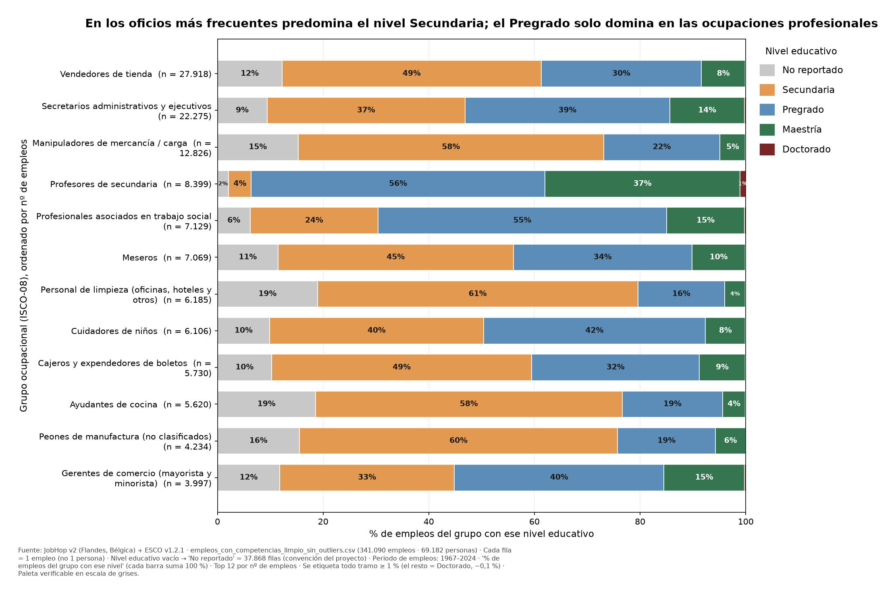
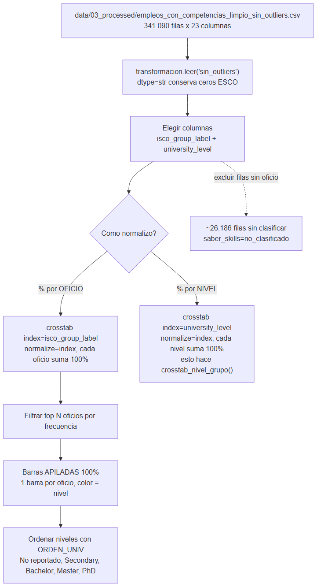
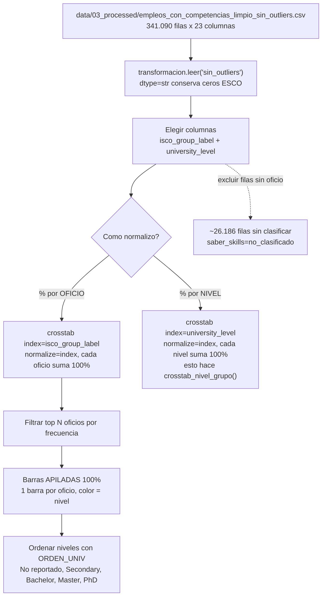
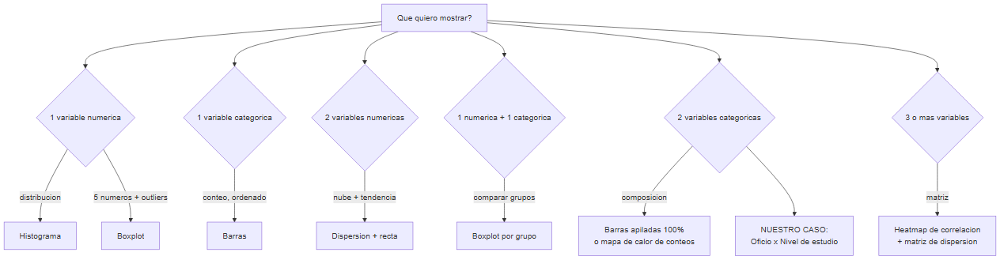
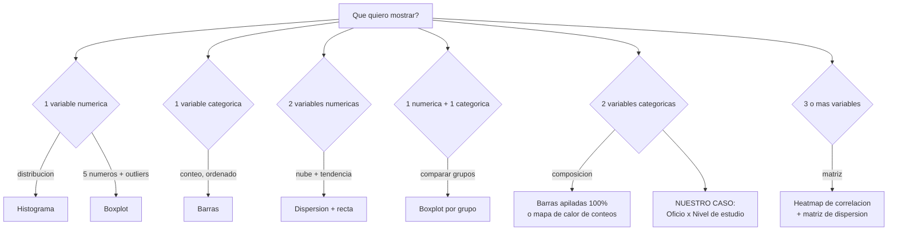

# EDA — Guía para graficar **Grupo ocupacional × Nivel educativo**

> **Para qué sirve este documento.** Contiene el contexto verificado del proyecto
> para construir **una** gráfica concreta —el cruce *qué trabajo hacen las personas
> según su nivel de estudio*— **sin inventar nombres de columnas, cifras ni reglas**.
> Todo lo que dice aquí sale del propio repositorio (código y documentación) o se
> midió sobre el CSV procesado. Si algo no está confirmado, se marca con ⚠️.
>
> **Correcciones de la revisión integradas** en: §3 (contexto del dato), §5 (idioma
> unificado), §6 (código que genera la figura final), §8 (reglas de honestidad),
> §10.1 (figura final + tabla de respaldo y paleta) y §13 (checklist + evidencia de
> "buenas prácticas de visualización").
>
> **Figura final:** `docs/img/eda_nivel_por_oficio.png` (2223×1481 px). Título-hallazgo,
> paleta verificable en escala de grises y todo tramo ≥ 1 % etiquetado.

Fecha de redacción: 2026-10 (actualizado 2026-10-18) · Rama: `Skill-Proccess`.

---

## 1. El proyecto en un párrafo (para no confundir el contexto)

**JobPath** (repositorio `MineriaProtect`) es un proyecto académico de **Minería de
Datos** (UNIMINUTO Ibagué, 2026-2) sobre un **observatorio laboral de formaciones
educativas**: conectar lo que una persona estudia con lo que llega a trabajar.

- Estudia **trayectorias laborales** reconstruidas por **JobHop v2** (Flandes,
  Bélgica) y enriquecidas con la taxonomía **ESCO v1.2.1**.
- Metodología **KDD / CRISP-DM**. Es una tarea **no supervisada**: **no hay columna
  objetivo que predecir** (no se clasifica ni se predice).
- ⚠️ **Fuera de alcance explícito** (acta `notebooks/1.0_comprension_negocio.md`):
  *"cualquier uso de la información para decisiones individuales sobre personas."*
  Por eso **esta gráfica describe patrones, NO decide contrataciones**.

---

## 2. La gráfica objetivo

**Una barra por grupo ocupacional; dentro de cada barra, el % por nivel educativo
apilado hasta 100 %.**

Idea (ejemplo inventado, solo para ilustrar el formato):

| Oficio | Secundaria | Pregrado | Maestría |
|---|---|---|---|
| Panadero | 20 % | 70 % | 10 % |
| Barrendero | 30 % | 20 % | 50 % |
| Ingeniero | 20 % | 10 % | 70 % |

De las gráficas de la **Sesión 5 (EDA)**, la que refleja esto es **Barras**, en su
versión **apiladas** (o agrupadas). Ver §9.

La **figura final** de este documento se titula con el **hallazgo** (*"En los oficios más
frecuentes predomina el nivel Secundaria; el Pregrado solo domina en las ocupaciones
profesionales"*) y usa la **paleta verificable en escala de grises** de §10.1.

---

## 3. Fuente de datos exacta (no buscar otra)

| Dato | Valor verificado |
|---|---|
| Archivo | `data/03_processed/empleos_con_competencias_limpio_sin_outliers.csv` |
| Filas (experiencias/empleos) | **341.090** |
| Columnas | **23** |
| Personas (`resume_id` distintas) | **69.182** |
| País / mercado | **Flandes, Bélgica** (fuente JobHop v2) |
| Periodo de los empleos | inicio **1967–2021**, fin **1970–2024** (fechas trimestrales; los vigentes se censuran en Q1 2026) |
| Grano (qué es una fila) | **1 fila = 1 empleo** (experiencia laboral), **no** 1 persona |
| Definición del % de la gráfica | **% de empleos del grupo ocupacional** con ese nivel educativo (cada barra suma 100 %) |
| Cómo se carga en el proyecto | `transformacion.leer("sin_outliers")` |

> **Ojo con el nombre del archivo.** La documentación menciona también
> `empleos_con_competencias_limpio.csv` (376.567 filas), pero **en la carpeta
> `data/03_processed/` el único CSV presente es el `..._sin_outliers.csv`**.
> Usa el que existe; si no, el código falla buscando un archivo que no está.

**Cómo se lee (regla del proyecto):** `transformacion.leer()` usa `dtype=str` para
**conservar los ceros a la izquierda** de los códigos ESCO (`"0110"` no puede
colisionar con `"110"`). Por eso `university_level` y demás llegan como **texto**.

```python
from src.transformacion import transformacion as t
df = t.leer("sin_outliers")   # dtype=str; codigos ESCO intactos
```

---

## 4. Columnas que SÍ se usan (semántica verificada)

| Columna | Qué es | Notas |
|---|---|---|
| `resume_id` | Identificador de la persona | Agrupa varias filas (1 fila = 1 empleo) |
| `isco_group_label` | **Grupo ocupacional** (etiqueta ISCO-08) | Es la variable del eje Y. **424 grupos** distintos |
| `isco_group` | Código del grupo ISCO (p. ej. `0110`) | Versión código de la anterior |
| `occupation_label` | **Ocupación** concreta (más fina) | **2.826** etiquetas; úsala solo si quieres más detalle que el grupo |
| `occupation_code` | Código ESCO de la ocupación | Texto con ceros a la izquierda |
| `university_level` | **Nivel educativo** de la persona | **Variable del apilado**. Valores canónicos en §5 |
| `isco_level` | Nivel jerárquico ISCO | ⚠️ **Es constante = "4"** → **NO sirve** para nada (el código `revisar_isco()` lo descarta) |
| `saber_skills` | `ok` / `no_clasificado` | Marca si la fila tiene oficio al que atribuir competencias |
| `es_vigente` | Empleo aún vigente | `True` en 18.956 filas |
| `start_date` / `end_date` | Periodo `"Qn AAAA"` (o `"Present"`) | Para duración, no para esta gráfica |

Columnas de competencias (para otros análisis, **no** para esta gráfica):
`n_skills_essential`, `n_skills_competence`, `n_skills_knowledge`,
`n_skills_sin_tipo`, `veces_ese_oficio`, `skills`, `knowledge`, `sin_tipo`.
Banderas: `es_unknown_ocupacion`, `es_rescatado`.

---

## 5. Niveles educativos: valores canónicos y orden

Definidos en `src/filtro/filtros.py` y `src/transformacion/transformacion.py`.

- **Valores válidos** (`NIVELES_EDUCATIVOS`):
  `{"Secondary school", "Bachelor", "Master", "PhD", "No reportado"}`
- **Orden canónico** (`ORDEN_UNIV`) — úsalo para el orden de los colores:

| Nivel | Orden |
|---|---|
| `No reportado` | 0 |
| `Secondary school` | 1 |
| `Bachelor` | 2 |
| `Master` | 3 |
| `PhD` | 4 |

**Nombres que se muestran en la figura final (un solo idioma).** Las etiquetas del
eje y la leyenda van en **español**; es un cambio **solo de presentación** (los valores
del archivo siguen siendo los canónicos en inglés):

| Valor canónico (archivo) | Etiqueta en la figura |
|---|---|
| `No reportado` | No reportado |
| `Secondary school` | Secundaria |
| `Bachelor` | Pregrado |
| `Master` | Maestría |
| `PhD` | Doctorado |

**Conteos reales observados** en el archivo `sin_outliers`:

| Nivel | Empleos |
|---|---|
| Secondary school | 132.489 |
| Bachelor | 118.999 |
| Master | 50.273 |
| PhD | 1.461 |

⚠️ **Esos 4 suman 303.222, no 341.090.** Faltan **37.868** filas cuyo `university_level`
llega **vacío**. Auditado (§10.2): son **`NaN`** (el CSV trae cadena vacía y `leer()` la
convierte con `na_values=[""]`); **no hay ningún `"No reportado"` literal** en el archivo,
ni cadenas con espacios, ni etiquetas inesperadas. Para que las barras sumen 100 % sin
esconder el dato, esos `NaN` se muestran como **`No reportado`** (convención del propio
proyecto: `transformacion.py` hace `nivel.fillna(ORDEN_UNIV["No reportado"])`).

---

## 6. Cómo se calcula (código que genera la figura final)

Este es el código **exacto** que produce `docs/img/eda_nivel_por_oficio.png`. Incluye
la **auditoría de `university_level`**, el **tratamiento explícito de los ausentes**
(`NaN`/vacío → `No reportado`, que es la convención del propio proyecto en
`transformacion.py`), **validaciones automáticas** que detienen la generación si algo
no cuadra, y las correcciones de presentación (n por grupo, % legibles, idioma único,
nota de contexto y **paleta con contraste verificable en escala de grises**).

```python
import textwrap
import pandas as pd
import matplotlib
matplotlib.use("Agg")                      # guardar a PNG sin abrir ventana
import matplotlib.pyplot as plt
from matplotlib import colors as mcolors
from src.transformacion import transformacion as t

mil = lambda n: f"{n:,}".replace(",", ".")  # 27918 -> "27.918"
CANON = ["No reportado", "Secondary school", "Bachelor", "Master", "PhD"]

df = t.leer("sin_outliers")   # dtype=str, na_values=[""] -> los vacios llegan como NaN

# ---------------- 1) AUDITORIA de university_level ----------------
raw = df["university_level"]
print(raw.value_counts(dropna=False), "\n")
n_na    = int(raw.isna().sum())                                # 37.868
s       = raw.fillna("\x00").str.strip()
n_empty = int((s == "").sum())                                 # 0 (ya son NaN)
n_ws    = int(((s == "") & raw.notna()).sum())                 # 0
n_unexp = int((~raw.isin(CANON) & raw.notna()).sum())          # 0
assert n_unexp == 0, f"etiquetas inesperadas: {raw[~raw.isin(CANON) & raw.notna()].unique()}"

# ---------------- 2) TRATAMIENTO de ausentes (copia de trabajo; NO toca el CSV) ----
# Convencion del proyecto: transformacion.py -> nivel.fillna(ORDEN_UNIV['No reportado'])
df["university_level"] = df["university_level"].fillna("No reportado")
assert df["university_level"].isin(CANON).all()

# ---------------- 3) TOP 12 + tabla de contingencia ----------------
top = df.loc[df["isco_group_label"].notna(), "isco_group_label"].value_counts().head(12)
n_por_grupo = top
sub = df[df["isco_group_label"].isin(top.index)]
ct  = pd.crosstab(sub["isco_group_label"], sub["university_level"]) \
        .reindex(columns=CANON, fill_value=0)
pct = ct.div(ct.sum(axis=1), axis=0) * 100        # normalizado POR OFICIO (cada barra = 100%)

# ---------------- 5) VALIDACIONES (si alguna falla, STOP: no se genera la figura) ----
assert len(top) == 12, "no hay 12 grupos"
assert list(top.index) == list(df["isco_group_label"].value_counts().head(12).index), \
    "el top 12 no coincide con los 12 mas frecuentes"
assert list(pct.columns) == CANON, "faltan niveles en la tabla"
assert (ct.sum(axis=1) == n_por_grupo.reindex(ct.index)).all(), "n etiquetado != denominador"
assert ((pct.sum(axis=1) - 100).abs() < 1e-9).all(), "las barras no suman 100%"
assert int(ct.values.sum()) == len(sub), "se excluyeron registros del denominador"
assert int(df.loc[df["isco_group_label"].isin(top.index), "university_level"].isna().sum()) == 0
print("VALIDACIONES OK (12 grupos, 5 niveles, cada barra suma 100%, n == denominador)\n")

# ---------------- 6) figura ----------------
NIVEL_ES = {"No reportado": "No reportado", "Secondary school": "Secundaria",
            "Bachelor": "Pregrado", "Master": "Maestría", "PhD": "Doctorado"}
OFICIO_ES = {
    "Shop sales assistants": "Vendedores de tienda",
    "Administrative and executive secretaries": "Secretarios administrativos y ejecutivos",
    "Freight handlers": "Manipuladores de mercancía / carga",
    "Secondary education teachers": "Profesores de secundaria",
    "Social work associate professionals": "Profesionales asociados en trabajo social",
    "Waiters": "Meseros",
    "Cleaners and helpers in offices, hotels and other establishments":
        "Personal de limpieza (oficinas, hoteles y otros)",
    "Child care workers": "Cuidadores de niños",
    "Cashiers and ticket clerks": "Cajeros y expendedores de boletos",
    "Kitchen helpers": "Ayudantes de cocina",
    "Manufacturing labourers not elsewhere classified":
        "Peones de manufactura (no clasificados)",
    "Retail and wholesale trade managers": "Gerentes de comercio (mayorista y minorista)",
}

pct_es = pct.rename(columns=NIVEL_ES).loc[top.index[::-1]]   # el mayor arriba
etiquetas = [textwrap.fill(f"{OFICIO_ES.get(i, i)}  (n = {mil(n_por_grupo[i])})", 42)
             for i in pct_es.index]

# paleta verificable en ESCALA DE GRISES (escalones de luminosidad >= 25) y con
# contraste texto/tramo >= 4.5 en todos los niveles.  Gris = 200/167/131/94/63
color_map = {"No reportado": "#C8C8C8", "Secundaria": "#E39A50",
             "Pregrado": "#5B8DB8", "Maestría": "#35754F", "Doctorado": "#7A2626"}
colores = [color_map[c] for c in pct_es.columns]

def txt_color(h):                          # texto claro sobre tramo oscuro y viceversa
    r, g, b = mcolors.to_rgb(h)
    return "white" if (0.299 * r + 0.587 * g + 0.114 * b) < 0.47 else "#1A1A1A"

# contexto: pais y periodo REAL de los empleos (para la nota al pie)
anio_ini = pd.to_numeric(df["start_date"].str.extract(r"(\d{4})")[0], errors="coerce")
anio_fin = pd.to_numeric(
    df.loc[df["end_date"] != "Present", "end_date"].str.extract(r"(\d{4})")[0], errors="coerce")

fig, ax = plt.subplots(figsize=(14, 9.5))
ys = list(range(len(pct_es)))
left = [0.0] * len(pct_es)
for col, color in zip(pct_es.columns, colores):
    vals = pct_es[col].values
    ax.barh(ys, vals, left=left, color=color, height=0.72, label=col,
            edgecolor="white", linewidth=0.8)
    for i, (l, v) in enumerate(zip(left, vals)):
        if v >= 1:                         # etiqueta % en TODO tramo >= 1 %  [critica 2]
            fs = 9.0 if v >= 4 else 6.8     # letra menor en los tramos finos
            ax.text(l + v / 2, i, f"{v:.0f}%", ha="center", va="center",
                    fontsize=fs, color=txt_color(color), fontweight="bold")
    left = [l + v for l, v in zip(left, vals)]

ax.set_yticks(ys)
ax.set_yticklabels(etiquetas, fontsize=10)
ax.set_xlim(0, 100)
ax.set_xlabel("% de empleos del grupo con ese nivel educativo", fontsize=11)
ax.set_ylabel("Grupo ocupacional (ISCO-08), ordenado por nº de empleos", fontsize=11)
ax.set_title("En los oficios más frecuentes predomina el nivel Secundaria; "
             "el Pregrado solo domina en las ocupaciones profesionales",
             fontsize=14, fontweight="bold", pad=14)
ax.grid(axis="x", linestyle=":", alpha=0.5)
ax.set_axisbelow(True)
ax.legend(title="Nivel educativo", bbox_to_anchor=(1.01, 1), loc="upper left",
          frameon=False, fontsize=11, title_fontsize=11,
          handlelength=1.7, handleheight=1.7, labelspacing=0.8)

# 9) Nota al pie: fuente, pais, periodo, total, grano y definicion del %  [critica 4]
nota = (f"Fuente: JobHop v2 (Flandes, Bélgica) + ESCO v1.2.1 · "
        f"empleos_con_competencias_limpio_sin_outliers.csv "
        f"({mil(len(df))} empleos · {mil(df['resume_id'].nunique())} personas) · "
        f"Cada fila = 1 empleo (no 1 persona) · "
        f"Nivel educativo vacío → 'No reportado' = {mil(n_na)} filas (convención del proyecto) · "
        f"Periodo de empleos: {int(anio_ini.min())}–{int(anio_fin.max())} · "
        f"'% de empleos del grupo con ese nivel' (cada barra suma 100 %) · "
        f"Top 12 por nº de empleos · Se etiqueta todo tramo ≥ 1 % (el resto = Doctorado, ~0,1 %) · "
        f"Paleta verificable en escala de grises.")
fig.text(0.01, 0.012, "\n".join(textwrap.wrap(nota, 150)), fontsize=7.5, color="#444444")

plt.tight_layout(rect=(0, 0.06, 1, 1))
# bbox_inches='tight' garantiza que NINGUNA etiqueta quede recortada
plt.savefig("docs/img/eda_nivel_por_oficio.png", dpi=150, bbox_inches="tight", pad_inches=0.3)
```

> **Traducción de las ocupaciones.** Para unificar el idioma, las etiquetas del eje
> ocupacional también se traducen al español (`OFICIO_ES`), pero el nombre **ISCO-08
> en inglés** se conserva en la tabla de respaldo (§10.1) para trazabilidad. Si la
> audiencia es internacional, se puede revertir y dejar la figura íntegra en inglés.

---

## 7. Ya existe una función parecida (¡ojo con su orientación!)

En `src/filtro/indicadores.py`:

```python
def crosstab_nivel_grupo(df, top=30):
    """% de filas por fila-nivel: frecuencia relativa de grupos ISCO por nivel."""
    top_grupos = df.loc[~_ausente(df["isco_group_label"]),
                        "isco_group_label"].value_counts().head(top).index
    sub = df[df["isco_group_label"].isin(top_grupos)]
    cruce = pd.crosstab(sub["university_level"], sub["isco_group_label"])
    return (cruce.div(cruce.sum(axis=1), axis=0) * 100).round(2)
```

⚠️ **Diferencia clave de orientación:**
- `crosstab_nivel_grupo()` normaliza **por NIVEL** (cada fila-nivel suma 100 %):
  responde *"de todos los Master, ¿en qué grupos trabajan?"*.
- La gráfica que queremos normaliza **por OFICIO** (cada barra-oficio suma 100 %):
  responde *"de los que trabajan en este oficio, ¿qué nivel tienen?"*.

Son **transpuestas**. Para nuestra gráfica usamos **oficio en filas** (como el §6),
no la función tal cual. La función sigue siendo útil para otros cortes.

Otras funciones del proyecto que puedes reutilizar sin reinventar:
`indicadores.top_valores(serie, n)` · `indicadores.duracion_mediana_por_grupo(df, top)`
· `indicadores.duracion_mediana_por_nivel(df)` · `filtros.filtrar_por_grupo_isco(df, grupo)`
· `filtros.filtrar_por_nivel_educativo(df, nivel)` (valida el nivel contra la lista canónica)
· `filtros.filtrar_vigentes(df)`.

---

## 8. Reglas de honestidad visual (de la Sesión 5 + revisión)

1. **Eje desde 0** (aquí no aplica: al ser % apilado va de 0 a 100, se cumple solo).
2. **Ordenar por frecuencia**, nunca alfabético "porque sí": el orden ya informa.
3. **% que suman 100** por barra. Si falta un nivel, **muéstralo** (`No reportado`), no lo escondas.
4. **Nada de pastel / pastel 3D** para muchas categorías (lo prohíbe la presentación).
5. Cada color = un nivel, **mismo color en todas las barras** (leyenda única).
6. Etiquetas con **unidad y título del hallazgo** ("% de empleos", no "valor").
7. **Muestra el tamaño de cada grupo (`n`)** en la etiqueta del eje (p. ej. `(n = 27.918)`).
   Sin ese dato, dos barras idénticas pueden esconder grupos de 100 vs 100.000 empleos.
8. **Etiqueta los tramos pequeños**: pon el **% dentro** de los tramos legibles (≥ 1 %) y
   deja una **tabla de respaldo** (§10.1) para la precisión de los tramos finos (p. ej. `PhD`).
9. **Da contexto en una nota al pie**: fuente, país, **periodo**, total analizado y
   **definición exacta del %** (qué es lo que suma 100 %).
10. **Explicita el criterio de orden**: di en el título/eje si el "top N" es por **nº de
    empleos** y en qué orden se pintaron las barras.
11. **Un solo idioma** en todo el gráfico (título, ejes, leyenda y categorías); si la
    fuente viene en inglés, **traduce solo para mostrar** y conserva el original donde sea trazable.
12. **Contraste real en cada tramo**: no uses gris casi blanco (se confunde con el fondo y
    parece que la barra *se corta*) ni texto blanco sobre colores claros. Elige el color del
    número (**claro u oscuro**) según la luminancia del tramo, y guarda con `bbox_inches='tight'`
    para que ninguna etiqueta quede recortada.
13. **Verificable en escala de grises**: los 5 colores deben llevar **escalones de luminosidad ≥ 25**
    (aquí: 200 / 167 / 131 / 94 / 63). Así la figura se sigue leyendo en una impresora o
    fotocopia en blanco y negro, sin depender del color.

---

## 9. Conexión con la Sesión 5: ¿qué gráfica es?

| Gráfica Sesión 5 | ¿Sirve para este cruce? |
|---|---|
| **Barras** | ✅ **Sí** — en versión **apiladas/agrupadas** (categorías = oficio, apilado = nivel) |
| Heatmap | ⚠️ Solo un mapa de calor de **conteos**; el de la Sesión 5 es de **correlación** (numérico), no es lo mismo |
| Histograma | ❌ Es para **una** variable numérica |
| Boxplot | ❌ Numérica vs grupos (aquí son dos categóricas) |
| Dispersión | ❌ Dos variables **numéricas** |

**Respuesta corta: Barras (apiladas).**

---

## 10. Ejemplo real parcial (para que la gráfica no sorprenda)

Top 10 grupos ocupacionales por nº de empleos en el archivo:

| `isco_group_label` | Empleos |
|---|---|
| Shop sales assistants | 27.918 |
| Administrative and executive secretaries | 22.275 |
| Freight handlers | 12.826 |
| Secondary education teachers | 8.399 |
| Social work associate professionals | 7.129 |
| Waiters | 7.069 |
| Cleaners and helpers in offices, hotels and other establishments | 6.185 |
| Child care workers | 6.106 |
| Cashiers and ticket clerks | 5.730 |
| Kitchen helpers | 5.620 |

(Estos son los candidatos naturales al eje Y; la figura final usa el **top 12**.)

---

## 10.1 Figura final (versión mejorada) y tabla de respaldo

**Figura:**



*Archivo: `docs/img/eda_nivel_por_oficio.png` (2223×1481 px).*

**Criterio de la figura:** los **12 grupos ocupacionales con más empleos** (por nº de registros),
**ordenados por nº de empleos** (el mayor arriba). Cada barra suma 100 %.
El **título declara el hallazgo** (no el tipo de gráfico) y el eje X lleva la **unidad (%)**.
**Periodo real de los empleos:** inicio **1967–2021**, fin **1970–2024** (fechas trimestrales;
los vigentes se censuran en Q1 2026).

**Tabla de respaldo (precisión exacta; permite comparar los tramos pequeños):**

| Grupo ocupacional (ISCO-08) | Original (inglés) | n empleos | No reportado | Secundaria | Pregrado | Maestría | Doctorado |
|---|---|---:|---:|---:|---:|---:|---:|
| Vendedores de tienda | Shop sales assistants | 27.918 | 12,21 | 49,11 | 30,27 | 8,35 | 0,06 |
| Secretarios administrativos y ejecutivos | Administrative and executive secretaries | 22.275 | 9,39 | 37,49 | 38,74 | 14,17 | 0,21 |
| Manipuladores de mercancía / carga | Freight handlers | 12.826 | 15,30 | 57,80 | 22,03 | 4,81 | 0,05 |
| Profesores de secundaria | Secondary education teachers | 8.399 | 2,11 | 4,30 | 55,57 | 36,97 | 1,06 |
| Profesionales asociados en trabajo social | Social work associate professionals | 7.129 | 6,21 | 24,17 | 54,65 | 14,74 | 0,22 |
| Meseros | Waiters | 7.069 | 11,49 | 44,52 | 33,84 | 10,07 | 0,08 |
| Personal de limpieza (oficinas, hoteles y otros) | Cleaners and helpers in offices, hotels and other establishments | 6.185 | 18,95 | 60,63 | 16,46 | 3,91 | 0,05 |
| Cuidadores de niños | Child care workers | 6.106 | 9,89 | 40,47 | 42,02 | 7,55 | 0,07 |
| Cajeros y expendedores de boletos | Cashiers and ticket clerks | 5.730 | 10,26 | 49,23 | 31,73 | 8,67 | 0,10 |
| Ayudantes de cocina | Kitchen helpers | 5.620 | 18,56 | 58,06 | 19,04 | 4,25 | 0,09 |
| Peones de manufactura (no clasificados) | Manufacturing labourers not elsewhere classified | 4.234 | 15,52 | 60,23 | 18,54 | 5,69 | 0,02 |
| Gerentes de comercio (mayorista y minorista) | Retail and wholesale trade managers | 3.997 | 11,81 | 33,02 | 39,70 | 15,21 | 0,25 |

*(Valores en %. Cada fila suma 100 %.)*

**Paleta (consistente, con contraste y verificable en escala de grises):**

| Nivel | HEX | Gris (0–255) | Color del `%` | Contraste |
|---|---|---:|---|---:|
| No reportado | `#C8C8C8` | 200 | oscuro | 10,4 |
| Secundaria | `#E39A50` | 167 | oscuro | 7,5 |
| Pregrado | `#5B8DB8` | 131 | oscuro | 4,9 |
| Maestría | `#35754F` | 94 | claro | 5,5 |
| Doctorado | `#7A2626` | 63 | claro | 9,9 |

Los escalones de luminosidad (200 → 167 → 131 → 94 → 63, pasos **≥ 25**) permiten distinguir los
cinco niveles **en blanco y negro**; y el contraste texto/tramo **supera 4,5 (WCAG AA)** en todos.

**Qué mejora resuelve cada punto de la revisión:**

| Crítica recibida | Mejora aplicada |
|---|---|
| 1. No muestra el tamaño real de cada grupo | **`(n = ...)`** en cada barra + columna **n empleos** en la tabla (§8.7) |
| 2. Categorías pequeñas difíciles de comparar | **Etiquetas %** en todo tramo ≥ 1 % (letra menor en los finos) + **tabla de respaldo** con precisión exacta (§8.8) |
| 3. Idioma inconsistente | Todo el gráfico en **español** (Secundaria/Pregrado/Maestría/Doctorado); original ISCO en inglés en la tabla (§5, §8.11) |
| 4. Falta contexto de los datos | **Nota al pie** con fuente, país, **periodo 1967–2024**, total y definición del % (§3, §8.9) |
| 5. Criterio de ordenamiento no evidente | Eje **"ordenado por nº de empleos"** + nota al pie **"Top 12 por nº de empleos"** (§8.10) |
| 6. *Algunas barras se veían "cortadas" y sus números ilegibles* | **Paleta verificable en escala de grises** (escalones de luminosidad ≥ 25), texto **claro/oscuro según la luminancia** del tramo, etiquetas de eje **envueltas** y guardado con **`bbox_inches="tight"`** (§8.12) |

> **Nota de traducción.** Las etiquetas ocupacionales se tradujeron al español **para unificar el idioma**;
> el nombre canónico **ISCO-08 en inglés** se conserva en la tabla por trazabilidad. Si se prefiere el
> gráfico íntegro en inglés (audiencia internacional), basta revertir el mapa `OFICIO_ES` (§6).

---

## 10.2 Auditoría de datos y validaciones (ejecutadas)

**Auditoría de `university_level`** (sobre `sin_outliers`, 341.090 filas):

| Categoría | Filas |
|---|---:|
| `Secondary school` | 132.489 |
| `Bachelor` | 118.999 |
| `Master` | 50.273 |
| `PhD` | 1.461 |
| **`NaN`** (vacío en el CSV) | **37.868** |
| Cadenas vacías sin convertir | 0 |
| Solo espacios | 0 |
| **Etiquetas inesperadas** | **0** |
| Valores distintos no nulos | `Master, Bachelor, Secondary school, PhD` |

→ **No existe** un `"No reportado"` literal en los datos: los 37.868 ausentes son `NaN`.
Se muestran como `No reportado` **solo en la copia de trabajo** (el CSV no se modifica).

**Error corregido.** La versión anterior del código (§6) usaba `pd.crosstab` **sin tratar
los `NaN`**: se habrían excluido del denominador mientras la etiqueta `n` sí los contaba
→ las barras **no** sumarían 100 % y faltaría el tramo `No reportado`. Ahora el código hace
`fillna("No reportado")` **antes** del `crosstab`.

**Validaciones automáticas** (el código se detiene con `assert` si alguna falla):

| Validación | Resultado |
|---|---|
| Los 12 grupos son los 12 de mayor frecuencia | ✅ |
| Los 5 niveles están en la tabla de contingencia | ✅ |
| `n` etiquetado == denominador (`ct.sum(axis=1)`) | ✅ |
| Cada barra suma 100 % (tolerancia 1e-9) | ✅ |
| Suma de conteos == filas de los 12 grupos (nada excluido) | ✅ |
| No quedan `NaN` en los grupos graficados | ✅ |

## 11. Qué NO se puede afirmar con esta gráfica (anti-alucinación)

- ❌ **No dice la carrera/campo estudiado.** `university_level` es **NIVEL**
  (Secundaria / Pregrado / Maestría / Doctorado), **no** la profesión estudiada. Sirve para
  *"qué nivel suele hacer este trabajo"*, **no** para *"si estudió algo afín"*.
- ❌ **No prueba causalidad.** Muestra **asociación/composición**, no causa.
  Un oficio con muchos master **no** significa que "exija" título.
- ❌ **No es "por persona".** Cada fila = **un empleo**. Quien tuvo 5 empleos en el
  mismo oficio pesa 5 veces. Si quieres conteo **por persona**, **deduplica** antes
  por `(resume_id, isco_group_label, university_level)`.
- ❌ **No sirve para decidir contrataciones.** Fuera de alcance del proyecto (§1).
- ⚠️ **Filas sin oficio.** ~**26.186 filas** tienen `saber_skills = "no_clasificado"`
  (sin `isco_group_label`); se excluyen de la gráfica y **hay que declararlo**.

---

## 12. Diagramas (generados con MCP Mermaid)

**Flujo de datos hasta la gráfica**





**Cómo elegir la gráfica según el tipo de variables**





---

## 13. Checklist antes de publicar la gráfica

**Estado de la figura final: TODO ✅** (verificado por medición sobre `docs/img/eda_nivel_por_oficio.png`).

- [x] Usé `data/03_processed/empleos_con_competencias_limpio_sin_outliers.csv`.
- [x] Cargué con `t.leer("sin_outliers")` (o `dtype=str`, `na_values=[""]`).
- [x] **Audité** `university_level.value_counts(dropna=False)`: 37.868 `NaN`, 0 vacías sin
      convertir, 0 con espacios, 0 etiquetas inesperadas (§10.2).
- [x] Traté esos `NaN` como **`No reportado`** en una **copia de trabajo** (sin tocar el CSV)
      y **verifiqué** que el `n` etiquetado == denominador de cada barra.
- [x] Excluí (y declaré) las ~26.186 filas sin `isco_group_label`.
- [x] Normalicé **por oficio** (cada barra suma 100 %) y las **validaciones pasan** (§10.2).
- [x] Ordené niveles con `ORDEN_UNIV` y oficios por frecuencia.
- [x] Puse **`(n = ...)`** en cada barra (tamaño real del grupo).
- [x] Etiqueté los tramos ≥ 1 % y dejé la **tabla de respaldo** para los pequeños.
- [x] Añadí la **nota al pie**: fuente, país, periodo, total, **grano (1 fila = 1 empleo)**,
      **tratamiento de los vacíos** (`→ No reportado`) y definición del %.
- [x] Dejé explícito el criterio del **"top N"** y el orden de las barras.
- [x] Usé **un solo idioma** en título, ejes, leyenda y categorías.
- [x] Titulé con el hallazgo y puse unidades (%). 0 % de pastel.
- [x] Paleta **verificable en escala de grises** (saltos de luminosidad **≥ 25**) y contraste
      texto/tramo **≥ 4,5** en los 5 niveles (§10.1).
- [x] No afirmé causalidad, ni "por persona", ni "carrera estudiada".

**Evidencia de la verificación (medida sobre la imagen final):**

| Regla "Buenas prácticas de visualización" | Resultado |
|---|---|
| Ejes etiquetados **con unidades** | ✅ eje X en **%** |
| **Título que declara el hallazgo** | ✅ (no dice "gráfico de barras") |
| Barras **desde cero** + anotaciones directas | ✅ `xlim(0,100)`; el `%` va dentro del tramo |
| Paleta **consistente y en escala de grises** | ✅ mismo color por nivel; saltos **33/36/37** (y 31) |
| Nunca: pastel 3D / truncar eje / doble eje Y / arcoíris | ✅ ninguno presente |

> Límites honestos del dato (declarados en la figura, no son incumplimientos): el `%` se
> **redondea** (la suma visual puede dar 99/100/101) y el tramo **Doctorado** (~0,1 %) no cabe
> como número, por eso queda solo en la **tabla de respaldo**.

---

## 14. Referencias internas

- `README.md` — contexto, fuentes y calidad del dataset.
- `docs/SKILLS.md` — las columnas de competencias (qué significan y qué no).
- `docs/METODOLOGIA_KDD_CRISPDM.md` — metodología y tratamiento de nulos.
- `notebooks/1.0_comprension_negocio.md` — acta de constitución (alcance).
- `notebooks/2.0_EDA_y_seleccion.ipynb` — único EDA del repo (previo a las competencias).
- `docs/explicacion/contexto_sesion1..4.md` y `presentacion.md` — material de clase.
- Código: `src/transformacion/transformacion.py` (`leer`, `fechas_ordinales`),
  `src/filtro/indicadores.py` (`crosstab_nivel_grupo`, `top_valores`),
  `src/filtro/filtros.py` (`NIVELES_EDUCATIVOS`, `filtrar_*`).
