# Informe de laboratorio — Proyecto JobPath

**Patrones de transición ocupacional en trayectorias laborales posteriores a la formación**

**Minería de Datos · UNIMINUTO Ibagué · 2026-2 · Docente: Esteban Ernesto Morales Castro**

| | |
|---|---|
| **Integrantes** | [PENDIENTE: completar nombres de los integrantes] |
| **Curso / unidad** | Minería de Datos — Unidad 1 |
| **Dataset analizado** | `data/02_interim/empleos_con_competencias_limpio_sin_outliers.csv` (341.090 × 23) |
| **Fuentes** | JobHop v2 (Hugging Face) + Taxonomía ESCO v1.2.1 (Comisión Europea) |
| **Notebook reproducible** | `notebooks/2.1_EDA_informe.ipynb` |
| **Framework** | KDD + CRISP-DM |

---

## 1. Portada y contexto

### 1.1 El problema de negocio

Este trabajo es el análisis exploratorio del proyecto **JobPath**, un observatorio laboral que busca **conectar lo que una persona estudia con lo que efectivamente llega a trabajar**.

- **A quién le importa:** instituciones educativas (pertinencia de las carreras), egresados (decisión vocacional) y tomadores de decisión públicos (política de formación).
- **Pregunta de negocio:** *¿hay patrones (transiciones frecuentes, permanencias, retornos al mismo oficio) que permitan entender cómo evoluciona la ocupación de una persona en el tiempo y qué relación tiene con lo que estudió?*
- **Pregunta técnica:** *dado un historial de empleos `(desde, hasta, ocupación)` por persona, ¿qué secuencias y transiciones ocupacionales son frecuentes y estables?*

> **Importante sobre la "variable objetivo".** El proyecto es de **descubrimiento no supervisado**: no existe una columna que se quiera predecir. Por eso donde la rúbrica dice "variable objetivo" aquí se trabaja con la **variable de interés conductual `veces_ese_oficio` (reincidencia)** y con la **cobertura de competencias `saber_skills`** como cruces centrales.

### 1.2 Objetivos del análisis

1. Describir la calidad y la estructura del dataset enriquecido (una fila = una experiencia laboral).
2. Caracterizar cada variable (univariado) y sus relaciones (bivariado/multivariado).
3. Descubrir asociaciones entre la **duración**, la **demanda de competencias del oficio** y la **reincidencia**.
4. Producir hallazgos **accionables para no técnicos** que alimenten la fase de minería de secuencias.

### 1.3 Ficha técnica del dataset

| Métrica | Valor |
|---|---:|
| Experiencias (filas) | 341.090 |
| Columnas | 23 |
| Personas (`resume_id` únicos) | 69.182 |
| Grano | 1 fila = 1 experiencia laboral |
| Periodos distintos (persona, inicio, fin) | 323.742 |
| Cargos distintos (`occupation_code`) | 2.826 |
| Primer periodo registrado | Q1 1967 |
| Experiencias con oficio clasificado | 314.904 (92,3 %) |

**Origen de los datos.** El dataset se construye en tres pasos documentados por el proyecto:

1. **JobHop v2** reconstruye trayectorias laborales a partir de hojas de vida no estructuradas (Flandes, Bélgica). Se usa la unión de las particiones **test + val**.
2. **ESCO v1.2.1** convierte cada código de ocupación (`matched_code`) en una **ocupación con nombre y área ISCO**, y aporta las **competencias esenciales** que exige cada oficio.
3. Se limpia y se enriquece hasta obtener el CSV analizado aquí.

**Advertencia metodológica permanente.** Las seis columnas de competencias describen el **puesto** —«este cargo exige N competencias»— y **nunca** lo que sabe la persona. La única columna conductual (sobre la persona) es `veces_ese_oficio`.

### 1.4 Diccionario resumido

| Columna | Tipo | Significado |
|---|---|---|
| `resume_id` | texto | Identificador de persona; agrupa su trayectoria |
| `start_date`, `end_date` | texto | Trimestre de inicio/fin (`Qn AAAA`); `end_date = 'Present'` si el empleo seguía vigente (censura) |
| `university_level` | categórica | Máximo nivel educativo registrado |
| `matched_code` | texto | Código de ocupación crudo de JobHop v2 |
| `emparejado` | categórica | `ok` / `unknown` / `rescatado` (cobertura ESCO) |
| `occupation_code` | texto | Código ESCO/ISCO tras el cruce |
| `occupation_label` | texto | Nombre de la ocupación (ESCO) |
| `isco_group`, `isco_group_label`, `isco_level` | categórica | Área ocupacional jerárquica ISCO-08 |
| `n_skills_essential` | número | N.º de competencias esenciales que **exige** el oficio |
| `n_skills_competence` | número | Cuántas son *saber hacer* |
| `n_skills_knowledge` | número | Cuántas son *saber* |
| `n_skills_sin_tipo` | número | Relaciones sin `skillType` (bucket aritmético) |
| `veces_ese_oficio` | número | Cuántas veces esta persona ejerció **este** oficio (**reincidencia**) |
| `saber_skills` | categórica | `ok` / `no_clasificado` (¿hay oficio al que atribuir competencias?) |
| `skills`, `knowledge`, `sin_tipo` | texto | Listas de competencias del oficio separadas por `|` |
| `es_unknown_ocupacion`, `es_rescatado`, `es_vigente` | booleana | Banderas de calidad y de censura |

---

## 2. Calidad de datos

Aquí se documentan los problemas encontrados y —lo más importante— **la decisión tomada** en cada caso (herencia de las sesiones 3–4).

### 2.1 Nulos y vacíos

El dataset **no tiene nulos "sucios"**. Los vacíos son **estructurales** y están gobernados por banderas:

| Situación | Filas | Decisión |
|---|---:|---|
| Sin oficio clasificado (`saber_skills = no_clasificado`) | 26.186 (7,68 %) | **No imputar.** Conservar con bandera; quedan fuera de la matriz numérica |
| Empleo vigente al capturar el CV (censura `Present`) | 18.956 | **No inventar fecha de fin.** Marcar con `es_vigente = True` |
| Nivel educativo no reportado | 37.868 (11,1 %) | Conservar como categoría propia (información, no error) |

**Regla de oro respetada:** *vacío ≠ 0*. Se comprobó que los contadores de competencias están vacíos **exactamente** en las 26.186 filas sin oficio y **nunca** valen 0. Un 0 afirmaría "el cargo no exige ninguna competencia", lo cual es falso.

### 2.2 Duplicados y pluriempleo

| Control | Resultado | Decisión |
|---|---|---|
| Filas duplicadas exactas | **0** | Nada que eliminar |
| Cobertura de ocupación | 314.904 `ok` · 2.499 `rescatado` · 25.805 `unknown` | Conservar banderas (no se imputa) |
| Experiencias simultáneas / mismo trimestre | **17.348 filas de "más"** (341.090 filas vs 323.742 periodos) | **Conservar.** No son duplicados: son cargos simultáneos o transiciones reales dentro del mismo trimestre |

### 2.3 Outliers

Se usó el criterio de **Tukey (IQR)** sobre la duración `dur_q` (trimestres):

- Q1 = 2 · Q3 = 9 · IQR = 7 → **cerco superior = 19,5 trimestres**.
- **12.086 experiencias (3,75 %)** quedan por encima del cerco.

**Decisión:** en esta variante (la "sin cola larga") las experiencias con duración ≥ 25 trimestres ya fueron **recortadas por diseño**; la cola larga se estudia aparte porque **una carrera larga es señal, no contaminación**. Se decidió **no eliminar los 12.086 casos por encima de 19,5**, porque son carreras extensas reales dentro del rango preservado (duración máxima observada = 24 trimestres).

> **Decisiones de calidad en una frase, para no técnicos:** los datos faltantes no se "rellenan" con valores inventados; se marcan con etiquetas para poder analizarlos aparte. Los periodos repetidos se conservan porque representan trabajos reales simultáneos.

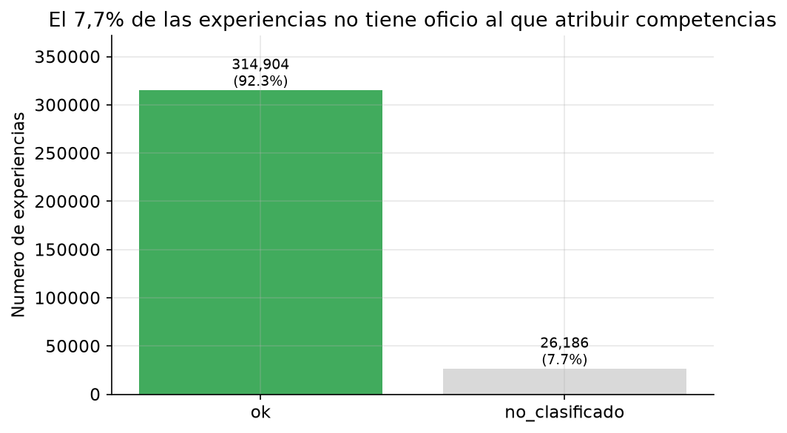

**Figura 1.** Distribución de la cobertura de competencias. 314.904 experiencias (92,3 %) tienen un oficio al que atribuir competencias; 26.186 (7,7 %) no. *Lectura:* cualquier análisis sobre competencias describe al 92,3 % del universo; el 7,7 % restante debe decidirse explícitamente en la fase de minería (deuda **D1**).

---

## 3. Análisis univariado

| Variable | n | Media | Mediana | Q1 | Q3 | IQR | Máx | Asimetría |
|---|---:|---:|---:|---:|---:|---:|---:|---:|
| `dur_q` (trimestres) | 322.134 | 6,27 | 5 | 2 | 9 | 7 | 24 | 1,41 |
| `n_skills_essential` | 314.904 | 23,31 | 20 | 15 | 28 | 13 | 99 | 2,24 |
| `n_skills_competence` | 314.904 | 19,32 | 18 | 12 | 23 | 11 | 69 | 1,92 |
| `n_skills_knowledge` | 314.904 | 3,98 | 3 | 1 | 6 | 5 | 45 | 3,84 |
| `n_skills_sin_tipo` | 314.904 | 0,01 | 0 | 0 | 0 | 0 | 2 | 11,53 |
| `veces_ese_oficio` | 314.904 | 1,59 | 1 | 1 | 2 | 1 | 19 | 3,33 |

**Lectura de conjunto.** Todas las variables numéricas son **asimétricas positivas** (media > mediana): una minoría de casos extremos estira la cola derecha. Por eso se reporta siempre la **mediana** como medida de centro.

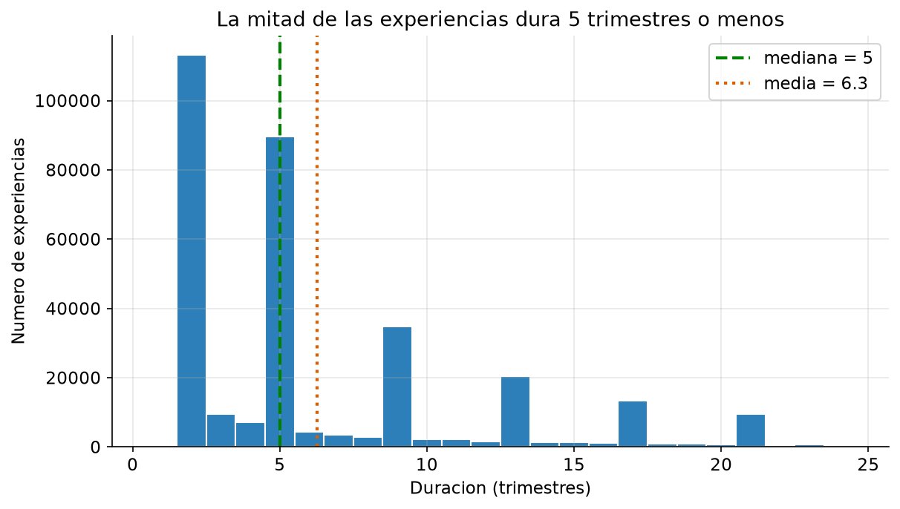

**Figura 2.** Distribución de `dur_q`. La mediana es **5 trimestres** y la media 6,27. *Lectura:* la mitad de las experiencias laborales dura un año o menos; el patrón típico es de **empleos cortos**, no de carreras largas.

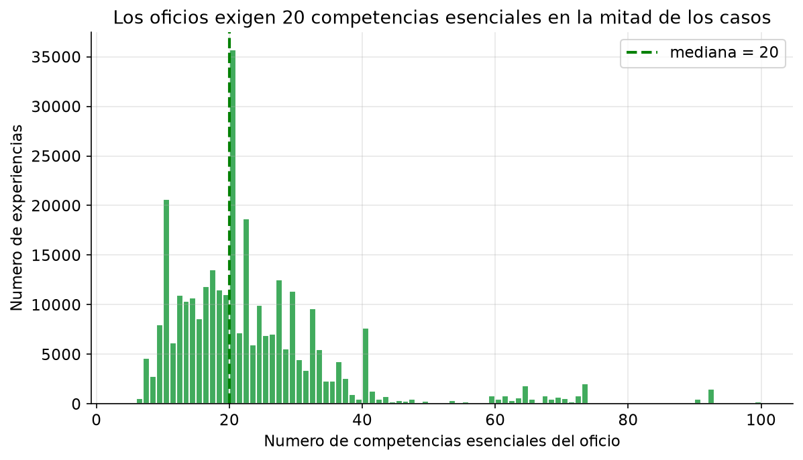

**Figura 3.** Distribución de `n_skills_essential`. La mediana es **20 competencias** por oficio. *Lectura:* existe una cola de oficios muy exigentes (hasta 99 competencias) que eleva la media por encima de la mediana; "cuánto exige un cargo" es una dimensión con fuerte dispersión.

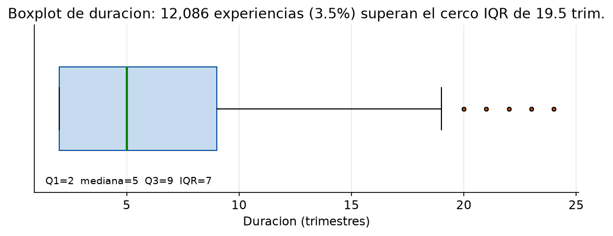

**Figura 4.** Boxplot de `dur_q` con el cerco IQR = 19,5. *Lectura:* la caja concentra el 50 % central entre 2 y 9 trimestres; **12.086 casos (3,75 %)** superan el cerco. No son errores: son carreras largas conservadas a propósito.

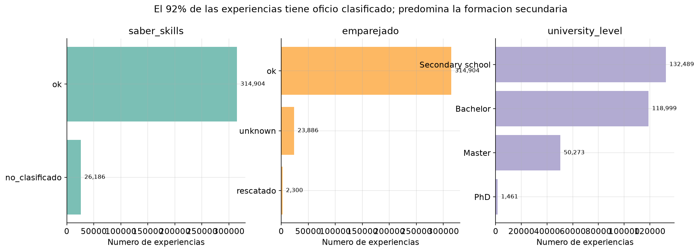

**Figura 5.** Frecuencias de `saber_skills`, `emparejado` y `university_level`. *Lectura:* el oficio está clasificado en el **92 %** de las experiencias; el nivel educativo dominante es **secundaria (38,8 %)**, seguido de **grado/Bachelor (34,9 %)**, máster (14,7 %), doctorado (0,4 %) y sin dato (11,1 %). Es decir, el dataset refleja sobre todo **trabajo de nivel técnico-medio**, no élites académicas.

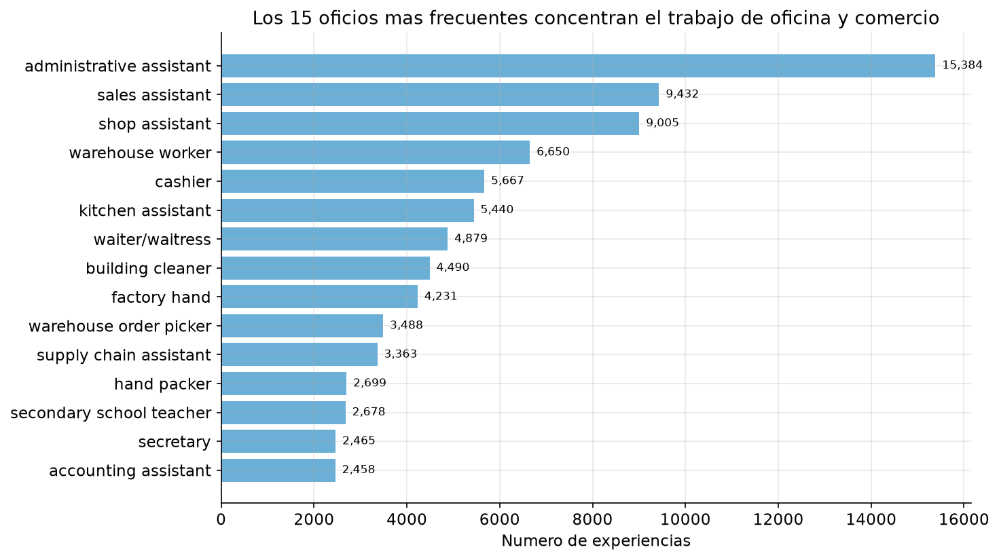

**Figura 6.** Los 15 oficios más frecuentes. *Lectura:* dominan ocupaciones de **oficina y comercio** (vendedores, cajeros, auxiliares administrativos). Esto explica por qué la mediana de competencias por oficio no es alta: los oficios más poblados son también los menos intensivos en competencias.

---

## 4. Análisis bivariado y multivariado

### 4.1 Duración por área ocupacional

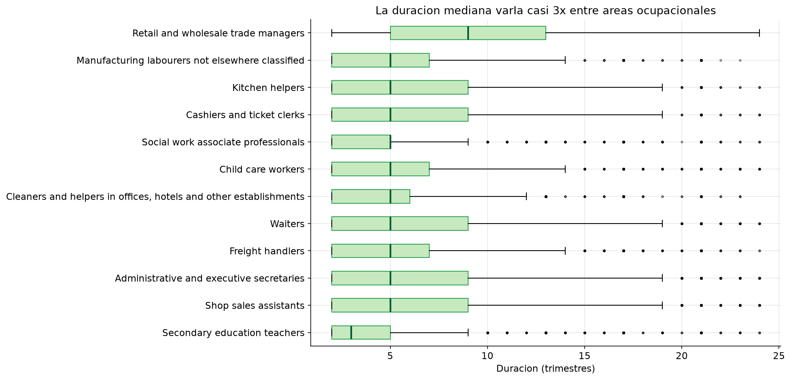

**Figura 7.** Duración mediana por área ocupacional (top 12). *Lectura:* la mediana varía **casi 3×** entre áreas: docencia de secundaria es la más corta (3 trimestres) y gerencia de comercio la más larga (9). El **área ocupacional sí discrimina** la permanencia, aunque la duración individual sea corta en promedio.

### 4.2 Duración vs. demanda de competencias

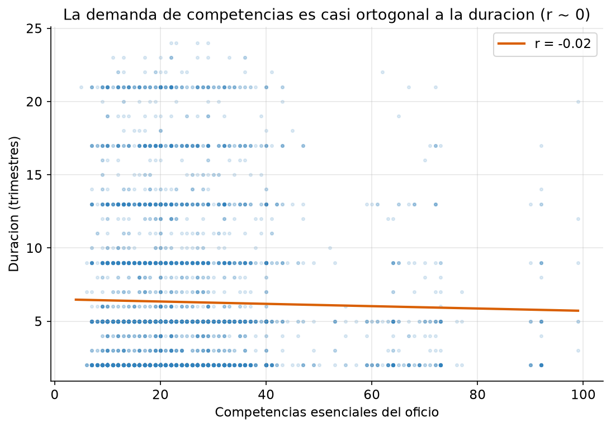

**Figura 8.** Relación entre competencias esenciales del oficio y duración del empleo. La correlación de Pearson es **r ≈ −0,02**. *Lectura:* ambas dimensiones son **casi ortogonales** — la duración de un empleo **no** anticipa cuántas competencias exige el cargo. Para describir trayectorias hacen falta **las dos**, ninguna resume a la otra.

### 4.3 Reincidencia por área (cruce con la variable de interés)

La tasa **global de reincidencia** (personas que repiten un oficio, `veces_ese_oficio > 1`) es **31,5 %**.

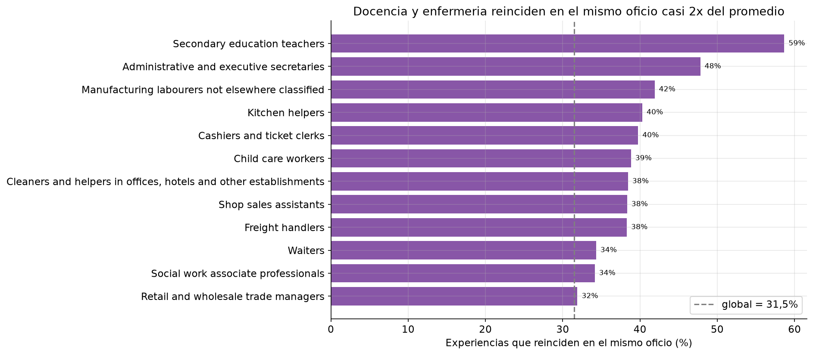

**Figura 9.** Tasa de reincidencia por área. *Lectura:* docencia de primaria (**60,9 %**), enfermería (**60,6 %**) y docencia de secundaria (**58,7 %**) **casi duplican** el promedio; en el extremo opuesto aparecen áreas de oficina y logística con tasas cercanas al 11–15 %. La reincidencia está **fuertemente concentrada por oficio**.

### 4.4 Matriz de correlaciones (heatmap)

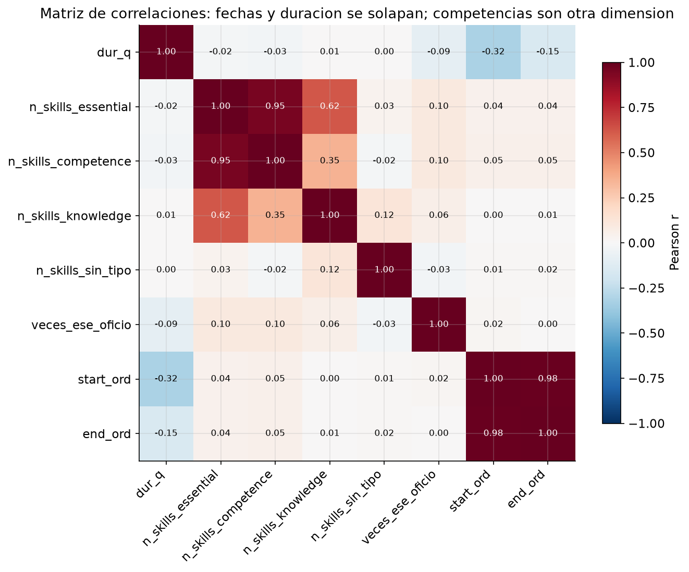

**Figura 10.** Matriz de correlaciones. Lecturas clave:

| Par de variables | r | Interpretación |
|---|---:|---|
| `start_ord` ↔ `end_ord` | **0,99** | Son la misma línea de tiempo (redundancia) |
| `dur_q` ↔ `start_ord` | **−0,32** | Las experiencias más recientes duran menos (censura por la derecha) |
| `n_skills_essential` ↔ `n_skills_competence` | **0,95** | Fuerte: el "saber hacer" es casi todo el total |
| `n_skills_essential` ↔ `n_skills_knowledge` | **0,62** | Relación moderada |
| `dur_q` ↔ `n_skills_essential` | **−0,02** | Dimensiones independientes |

### 4.5 Matriz de dispersión y auditoría de redundancia

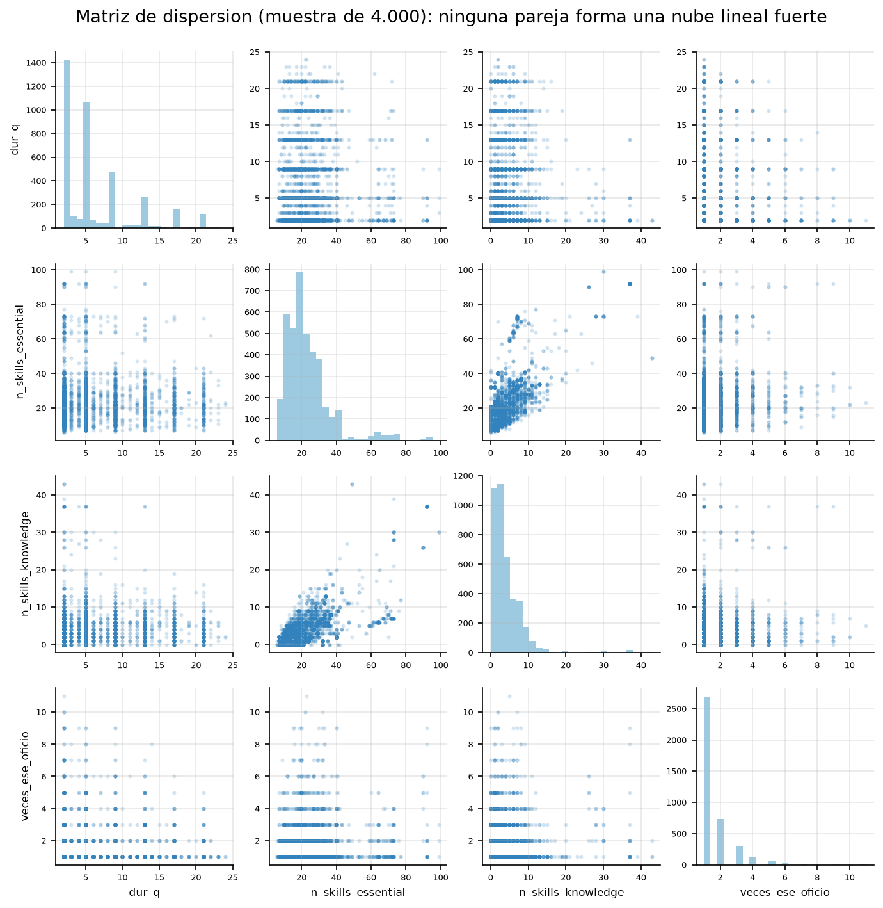

**Figura 11.** Matriz de dispersión (muestra de 4.000 casos). *Lectura:* ningún par muestra nubes lineales claras, lo que confirma la ausencia de relaciones simples fuertes entre duración, competencias y reincidencia.

**Auditoría de redundancia (resultados verificados):**

- `n_skills_essential` es **determinista de `occupation_code`** (1 solo valor por oficio en los 2.826 oficios).
- **η² = 0,73** del grupo ISCO sobre `n_skills_essential`: el área ocupacional explica ~73 % de su varianza.
- `n_skills_competence` + `n_skills_knowledge` + `n_skills_sin_tipo` **reparten** `n_skills_essential` (no son variables nuevas).
- Tras el recorte de las filas sin oficio, `es_unknown_ocupacion`, `es_rescatado` y `emparejado` quedan **constantes**: no aportan señal y deben excluirse de la matriz numérica.

### 4.6 Las competencias ESCO: saber vs. saber hacer

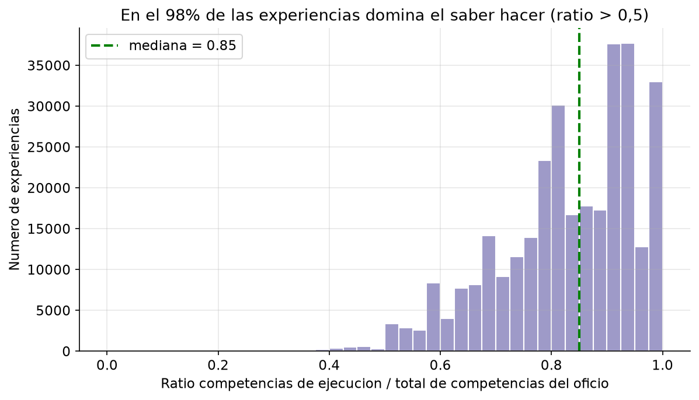

**Figura 12.** Ratio `competence / essential`. La mediana es **0,85** y en **309.709 de 314.904** registros (98,4 %) el ratio supera 0,5. *Lectura:* el **"saber hacer" domina** la demanda de los oficios; el "saber" teórico es minoritario en el mercado observado.

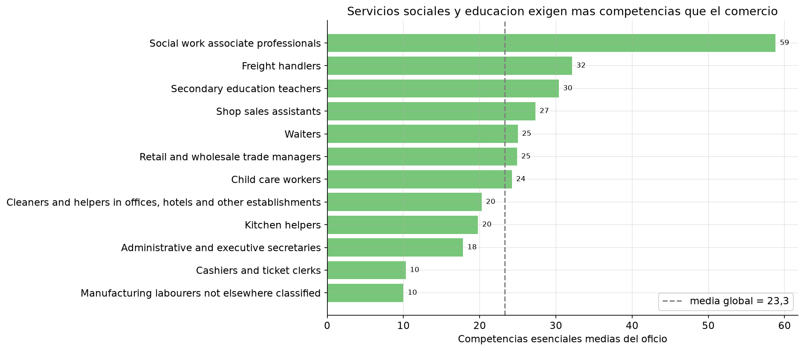

**Figura 13.** Demanda media de competencias por área. *Lectura:* servicios sociales (**58,8**), manipulación de carga (32,1) y docencia de secundaria (30,4) encabezan; cajeros (10,3) y secretariado (17,8) son los menos exigentes. La media global es **23,3** competencias.

**Vocabulario de competencias.** El dataset contiene **6.082.711** pares (experiencia, competencia) con **8.485 competencias distintas**; las **10 más frecuentes cubren solo el 5,6 %**. Es un vocabulario de **cola larga** y específico de cada puesto.

### 4.7 Propuesta de nuevas variables y segmentos (nivel Excepcional)

Se propusieron y **validaron con datos** una variable nueva, un segmento nuevo y un cruce adicional.

**(a) Nueva variable — `skills_por_trimestre` = `n_skills_essential / dur_q`** (intensidad de competencias exigidas por trimestre de permanencia).

| Grupo | Mediana `skills_por_trimestre` |
|---|---:|
| Reincide en el oficio | **5,00** |
| No reincide | 4,11 |

Correlación con `veces_ese_oficio`: **r = 0,13** (débil positiva). *Validación:* quienes repiten oficio tienden a hacerlo en cargos **más intensivos en competencias por unidad de tiempo**, aunque el efecto es débil. Se propone como variable candidata, conscientes de que no sustituye a las demás dimensiones.

**(b) Nuevo segmento — "carrera corta vs. larga"** (`dur_q ≤ 2` = corta; `dur_q ≥ 12` = larga).

| Segmento | n | Reincidencia |
|---|---:|---:|
| Carrera corta (≤ 2 trim.) | 102.683 | **35,7 %** |
| Media (3–11 trim.) | 162.831 | 30,8 % |
| Carrera larga (≥ 12 trim.) | 49.390 | **25,2 %** |

*Validación:* existe un **gradiente claro** — las experiencias cortas reinciden **más** (35,7 %) que las largas (25,2 %). *Hipótesis interpretada:* los empleos cortos se concentran en oficios donde las personas rotan y vuelven (docencia y salud), mientras que las carreras largas corresponden a un oficio estable que no requiere reincidencia. **Hipótesis a validar en la fase de secuencias:** este segmento podría ayudar a **anticipar el retorno al oficio** dentro de una trayectoria.

**(c) Cruce adicional — reincidencia por nivel educativo:** Secundaria 32,9 %, Bachelor 32,1 %, Máster 25,9 %, Doctorado 23,5 %. *Validación:* a **mayor nivel educativo, menor reincidencia**; la movilidad ocupacional es mayor en los perfiles más formados.

---

## 5. Hallazgos y recomendaciones

> Esta sección está redactada para ser entendida por una persona **sin formación técnica**. Cada hallazgo usa el formato **evidencia → recomendación**.

### Hallazgo 1 — Uno de cada tres trabajos ocurre "en terreno conocido"

**Evidencia:** el **31,5 %** de las experiencias de trabajo sucede en un oficio que la persona ya había ejercido antes. En **docencia de primaria (60,9 %)** y **enfermería (60,6 %)** este comportamiento casi se duplica (Figura 9).

**Recomendación:** tratar la repetición como una **señal de valor**, no como un dato repetido. En los planes de formación de docentes y personal de salud conviene analizar por qué la movilidad es tan baja (¿poca oferta alternativa? ¿especialización?). En el análisis técnico, registrar el retorno al oficio dentro de la secuencia de cada persona.

### Hallazgo 2 — Estar más tiempo en un empleo y tener más competencias son cosas independientes

**Evidencia:** la relación entre duración del empleo y número de competencias exigidas es **prácticamente nula (r ≈ −0,02)** (Figura 8).

**Recomendación:** no usar la duración como "resumen" de la exigencia del cargo (ni al revés). Un observatorio laboral debe **reportar ambos indicadores por separado**; combinarlos ocultaría información.

### Hallazgo 3 — Los empleos son, en general, cortos

**Evidencia:** la mitad de las experiencias dura **5 trimestres o menos**; el 75 % no pasa de 9 trimestres (Figuras 2 y 4).

**Recomendación:** diseñar los análisis y las políticas asumiendo **trayectorias cortas y fragmentadas** (varios empleos de 1–2 años), no carreras de largo plazo. Para los egresados, esto sugiere acompañar la **transición inicial**, que es donde se concentran las experiencias más breves.

### Hallazgo 4 — El "saber hacer" manda

**Evidencia:** en el **98,4 %** de los registros el cargo exige más competencias prácticas ("saber hacer") que teóricas ("saber"); y el vocabulario de competencias es muy amplio: las 10 más frecuentes cubren solo el **5,6 %** del total (Figura 12).

**Recomendación:** quienes diseñan formación deberían priorizar **competencias prácticas y específicas del puesto** sobre perfiles "genéricos". Cada oficio es un mundo aparte: no existe un "perfil promedio" que sirva para todos.

### Hallazgo 5 — Hay "ruido estructural" que debe declararse antes de modelar

**Evidencia:** algunas columnas son **redundantes** (una es determinista de otra) o quedan **constantes** tras los recortes (§4.5).

**Recomendación:** dejar **una sola** representación del oficio y **eliminar las banderas que no varían**. Esto evita que el modelo otorgue importancia a información que en realidad no distingue nada.

---

## 6. Anexos

### 6.1 Reproducibilidad

Todo el informe se regenera ejecutando el notebook (núcleo `python3`):

```bash
python -m nbconvert --to notebook --execute --inplace --ExecutePreprocessor.timeout=600 notebooks/2.1_EDA_informe.ipynb
```

El notebook resuelve la ruta del CSV buscando la carpeta `data/` hacia arriba, **no modifica** `data/01_raw/**` ni el CSV de entrada, y **persiste las 13 figuras** en `docs/explicacion/report/`.

### 6.2 Código y datos

| Recurso | Ruta |
|---|---|
| Notebook reproducible (EDA completo) | `notebooks/2.1_EDA_informe.ipynb` |
| Dataset analizado | `data/02_interim/empleos_con_competencias_limpio_sin_outliers.csv` |
| Figuras del informe | `docs/explicacion/report/01_…` a `13_…` |
| Informe EDA de referencia | `docs/INFORME_EDA.md` |
| Bitácora técnica del proyecto | `README.md`, `docs/SKILLS.md` |

### 6.3 Límites declarados de este análisis

- **Sin causalidad:** se describen asociaciones y patrones, no causa-efecto.
- **Alcance geográfico:** los datos provienen de **Flandes (Bélgica)**; no describen el mercado laboral colombiano.
- **Alcance del set:** se analizó la variante **sin cola larga**; el contraste con la variante con cola larga queda como trabajo futuro (esa versión no está en disco en la máquina de este análisis).
- **ESCO solo enriquece:** no aporta trayectorias, solo da significado e interpretación a las ocupaciones.

### 6.4 Referencias

- Dataset JobHop v2: https://huggingface.co/datasets/aida-ugent/JobHop
- Taxonomía ESCO v1.2.1: https://esco.ec.europa.eu/es/use-esco/download
- API de ESCO: https://data.europa.eu/esco/api
- *JobHop v2: A Large-Scale Career Trajectory Dataset from Unstructured Resumes* (arXiv).
