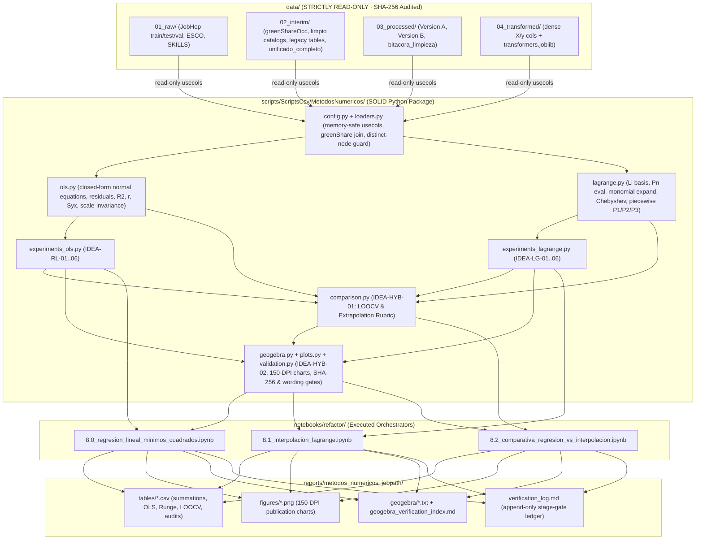

# MASTER IMPLEMENTATION PROMPT — JOBPATH NUMERICAL METHODS EXTENSION (LEAST-SQUARES LINEAR REGRESSION & LAGRANGE INTERPOLATION)

> Version: 1.1 (Updated: selected **8-Idea Core Suite** — `IDEA-RL-01, RL-02, RL-04, RL-05, LG-01, LG-02, HYB-01, HYB-02` — promoted to executed primary scope in `scripts/ScriptsCsv/MetodosNumericos/` and notebooks `8.0`–`8.2`; remaining 6 ideas retained as documented extensions) · Generated: 2026-11-19 · Basis: repository state at commit `aa36d93` (`MineriaProtect` / JobPath)
> Audience: a coding agent or data-mining engineer with access to the `MineriaProtect` repository.
> Language: **English** (strict deliverable requirement).
> This document is self-contained. It is not a brainstorming memo; it is the complete analytical portfolio, purpose specification, and stage-by-stage implementation instruction set for applying **Least-Squares Linear Regression** and **Lagrange Polynomial Interpolation** across every file in `data/`.

---

## 1. YOUR ROLE

You are the **Numerical Methods & Data Mining Implementation Engineer** for **JobPath** (`MineriaProtect`, UNIMINUTO Ibagué). You will design, implement, verify, and document a production-grade, SOLID-architected numerical modeling package (`scripts/ScriptsCsv/MetodosNumericos/`), three executed analytical notebooks (`8.0`–`8.2`), reproducible output tables/figures, and a GeoGebra verification bundle—applying every mathematical concept from the two source Numerical Methods presentations to **all 33 data artifacts inside `data/`** (31 CSV files across `01_raw/`, `02_interim/`, `03_processed/`, `04_transformed/`, plus 2 `.joblib` transformer artifacts).

Operating rules for your role:

- **You implement from verified mathematics and verified data; you do not invent formulas, columns, thresholds, or metrics.** Every slope $a_1$, intercept $a_0$, determination coefficient $R^2$, standard error $S_{y/x}$, basis polynomial $L_i(x)$, and interpolation estimate $P_n(x)$ must be computed directly from disk files and verified programmatically.
- **You never mutate any file inside `data/`.** Every file across `data/01_raw/`, `data/02_interim/`, `data/03_processed/`, and `data/04_transformed/` is **strictly read-only**. Immutability is verified before and after every run via SHA-256 fingerprints (`FileHasher`).
- **You implement core algorithms from first principles first, then cross-verify.** Every custom implementation (`regresion_lineal(x, y)` and `lagrange_eval(xs, ys, x)`) must match `numpy.polyfit(x, y, 1)` and `scipy.interpolate.lagrange` (or barycentric Lagrange) within numerical tolerance $10^{-10}$, AND produce copy-pasteable GeoGebra commands (`FitLine`, `RSquare`, `CorrelationCoefficient`, `Polynomial`, explicit $L_i(x)$) for small-$n$ case studies.
- **You never claim a model or idea is valid because a curve plots nicely.** Every idea is done only when its named verification test in §15 passes, its empirical assumptions (distinct nodes, non-zero variance, in-range vs. extrapolation domain, censoring bounds, anti-leakage, and non-causality) are explicitly audited, and its outputs are written to `reports/metodos_numericos_jobpath/`.
- **You never claim causality or attribute occupational requirements to personal competence.** ESCO skill counts express *"how many essential/optional skills an occupation requires"*, never *"how many skills a person possesses"*.
- **You work in small, gated increments (§13).** Do not start Stage $k+1$ until every gate assertion of Stage $k$ passes and is logged in the verification ledger.

---

## 2. PROJECT & PEDAGOGICAL CONTEXT

### 2.1 JobPath Project Context (`MineriaProtect`)

**JobPath** is an academic Data Mining & AI Data-Preparation observatory (UNIMINUTO Ibagué, CRISP-DM + KDD methodology) analyzing real career trajectories reconstructed from unstructured résumés in **JobHop v2** (Flanders, Belgium) and semantically enriched with the European **ESCO v1.2.1** occupation/skill taxonomy and **ISCO-08** hierarchy.

Verified repository universe at commit `aa36d93`:

| Pipeline Layer | Canonical Asset | Verified Dimensions | Role in Project |
|---|---|---|---|
| Selection (`01_raw`) | JobHop v2 (`train` + `test` + `val`) + ESCO + SKILLS | 1,993,291 raw job rows · 3,043 ESCO occupations · 619 ISCO groups · 13,960 skills · 126,051 skill relations | Immutable primary sources |
| Interim (`02_interim`) | Cleaned catalogs, `greenShareOcc_en_limpio.csv`, legacy `test+val` tables, raw unification | 3,590 green-share rows (3,039 occupations + 551 ISCO L3/L4) · 1,993,291 unified raw rows | Intermediate staging & unjoined enrichment (`greenShare`) |
| Processed (`03_processed`) | Version A (`empleos_unificado_limpio.csv`) & Version B (`empleos_limpio_con_competencias_sin_outliers.csv`) | **1,871,014 rows × 23 cols** · **355,308 unique persons** (`resume_id`); **1,738,738 classified experiences (92.93%)** across **352,093 persons (99.10%)** | Canonical clean datasets (A preserves raw tails; B applies Tukey IQR $k=1.5$ winsorization to 193,596 rows = 10.35%) |
| Transformed (`04_transformed`) | Person-grouped 80/20 split (`GroupShuffleSplit`, `seed=42`) + `transformers.joblib` | `X_train`: **1,391,018 × 2,985** (281,674 persons) · `X_test`: **347,720 × 2,985** (70,419 persons) · `shared_persons = 0` · target `reincide` = **30.01%** train / **29.97%** test | Scaled & encoded matrices for Phase 4 modeling (`6.0`, `7.0`) |

Completed notebooks in `notebooks/refactor/`: `1.0_comprension_negocio.md`, `2.0_preprocesamiento_jobpath.ipynb`, `3.0_transformacion.ipynb`, `4.0_PCA.ipynb` (10k), `4.1_PCA_completo.ipynb` (50k), `5.0_EDA_jobpath.ipynb` (28 figures + `split_map_resume_id.csv`), `6.0_modelado_fase4_jobpath.ipynb` (Regularized Logistic Regression OHE ceiling ROC-AUC = `0.7133`, HistGradientBoosting ROC-AUC = `0.6936`), and `7.0_arbol_decision.ipynb` (CART depth ≤ 4 across ISCO, Education, and Skills blocks).

### 2.2 Pedagogical & Mathematical Context from the Two Source HTML Presentations

All 14 application ideas in §5 are grounded directly in the exact mathematical curriculum of the two source presentations authored by **Prof. Juan Carlos González Sánchez (UNIMINUTO · Ibagué, Numerical Methods — Systems Engineering)**:

#### Source A — `regresion_lineal_minimos_cuadrados.html` (15 Slides: Least-Squares Linear Regression)

| Slide(s) | Mathematical Concept / Principle | Exact Formula / Rule to Operationalize in JobPath |
|---|---|---|
| Slide 2 | **Interpolation vs. Regression** | Noisy empirical data should **not** be forced through every point (high-degree interpolation "learns the noise" and oscillates); regression fits a simple global trend near the data. |
| Slides 3–4 | **Linear Model & Residual Criterion** | Model $\hat{y} = a_0 + a_1 x$; vertical residual $e_i = y_i - (a_0 + a_1 x_i)$. Minimizing $\sum e_i$ fails (positive/negative cancellation); minimizing $\sum |e_i|$ can lack uniqueness; **least squares** minimizes $S_r(a_0, a_1) = \sum_{i=1}^{n} e_i^2$ (visualized via residual squares). |
| Slides 5–10 | **Normal Equations & Closed-Form OLS** | Partial derivatives $\partial S_r / \partial a_0 = 0$, $\partial S_r / \partial a_1 = 0$ produce the $2\times 2$ normal system with unique closed-form estimators: $a_1 = \frac{n\sum x_i y_i - \sum x_i \sum y_i}{n\sum x_i^2 - (\sum x_i)^2}$ and $a_0 = \bar{y} - a_1\bar{x}$. Key invariant: $(\bar{x}, \bar{y})$ lies **strictly** on the regression line. Classic pitfall guarded: $(\sum x_i)^2 \neq \sum x_i^2$. |
| Slides 11, 13 | **Goodness-of-Fit Diagnostics** | Total sum of squares $S_t = \sum (y_i - \bar{y})^2$; residual sum of squares $S_r = \sum e_i^2$; coefficient of determination $R^2 = \frac{S_t - S_r}{S_t}$; Pearson correlation $r = \operatorname{sign}(a_1)\sqrt{R^2}$; standard error of the estimate $S_{y/x} = \sqrt{\frac{S_r}{n-2}}$. Honest rejection of low-$R^2$ fits (Slide 13 quiz: $R^2 = 0.20$ means the linear model explains only 20% of variance and is poor). |
| Slide 12 | **In-Range Prediction vs. Extrapolation Risk** | Evaluating $\hat{y}(x^*)$ inside $[x_{\min}, x_{\max}]$ is in-range prediction; predicting outside $[x_{\min}, x_{\max}]$ is **extrapolation** and may break down under saturation, censoring, or regime change. |
| Slides 14–15 | **GeoGebra & Python Verification** | GeoGebra commands: `P = {(x1,y1),...}`, `f = FitLine(P)`, `r = CorrelationCoefficient(P)`, `R2 = RSquare(P, f)`, `Q = (x*, f(x*))`. Python challenge: hand-coded `regresion_lineal(x, y)` returning $(a_0, a_1, R^2, r, S_{y/x})$ verified against `numpy.polyfit(x, y, 1)`. Benchmark unit fixtures from deck: Server load (`X=[1..6], Y=[120,145,185,200,240,260]` → $a_1 \approx 28.5714, a_0 \approx 91.6667, R^2 \approx 0.9898, S_{y/x} \approx 6.0749$) and Practice LOC (`X=[2,4,6,8,10], Y=[5,9,12,18,21]` → $a_1 = 2.05, a_0 = 0.70$). |

#### Source B — `interpolacion_lagrange.html` (15 Slides: Lagrange Polynomial Interpolation)

| Slide(s) | Mathematical Concept / Principle | Exact Formula / Rule to Operationalize in JobPath |
|---|---|---|
| Slides 2–3 | **Exact Tabular Interpolation & Uniqueness Theorem** | Given $n+1$ known exact/reference nodes $(x_0, y_0), \dots, (x_n, y_n)$ with **strictly distinct** abscissas ($x_i \neq x_j$ for $i \neq j$), there exists a **unique** polynomial $P_n(x)$ of degree $\le n$ such that $P_n(x_i) = y_i$ for all $i = 0, \dots, n$. |
| Slides 4–10 | **Lagrange Basis Polynomials ("On/Off" Switches)** | $P_n(x) = \sum_{i=0}^{n} y_i L_i(x)$ where $L_i(x) = \prod_{j=0, j \neq i}^{n} \frac{x - x_j}{x_i - x_j}$. Exact verification identities: Kronecker delta $L_i(x_j) = \delta_{ij}$ (`1` at own node, `0` at all other nodes) and **partition of unity** $\sum_{i=0}^{n} L_i(x) = 1$ for every $x \in \mathbb{R}$. Explicit degree-1 (linear) and degree-2 (quadratic) forms plus expanded monomial coefficients. |
| Slide 11 | **Basis Weight Exploration & Extrapolation Warning** | Inspecting individual signed weights $L_i(x)$ across the domain reveals how strongly each node pulls the estimate; outside $[x_{\min}, x_{\max}]$, weights exceed $[0, 1]$ rapidly and extrapolation diverges. |
| Slide 12 | **Runge's Phenomenon & Remedies** | Increasing polynomial degree $n$ over **equispaced nodes** causes severe boundary oscillation (max error grows instead of shrinking). Practical remedies taught: (1) **Chebyshev nodes** clustered toward endpoints, $x_k = \frac{a+b}{2} + \frac{b-a}{2}\cos\!\left(\frac{(2k+1)\pi}{2(n+1)}\right)$, and (2) **piecewise low-degree interpolation** (local quadratic $P_2$ / cubic $P_3$ windows or splines). |
| Slides 5, 15 | **Structural Tradeoff** | Advantage: requires **no linear system solver**. Disadvantage: adding a new node requires recomputing every $L_i(x)$ (bridging to Newton divided differences in future coursework). |
| Slides 14–15 | **GeoGebra & Python Verification** | GeoGebra commands: `P = {(x0,y0),...}`, explicit `L0(x) = ...`, `p(x) = y0*L0(x) + ...`, `q = Polynomial(P)` verifying $p \equiv q$, and `A = (x*, p(x*))`. Python challenge: hand-coded `lagrange_eval(xs, ys, x)` verified against `scipy.interpolate.lagrange`. Benchmark unit fixtures from deck: CPU temperature (`X=[20,50,80], Y=[45,58,76]` → $P_2(65) = 66.375$, $L(65) = [-0.125, 0.75, 0.375]$) and Practice (`X=[0,1,3], Y=[1,3,25]` → $L(2)=[-1/3, 1, 1/3]$, $P_2(2)=11$). |

---

## 3. PROBLEM, OBJECTIVES, AND SCOPE

### 3.1 Problem Statement

The existing JobPath pipeline (`1.0`–`7.0`) covers data cleaning, transformation, PCA diagnostics, formal EDA, and binary classification of `reincide` (Logistic Regression, HistGradientBoosting, CART Decision Trees). However, **four analytical and methodological gaps** remain open across `data/`:

1. **Unmodeled Continuous Functional Laws:** Key continuous labor-market relationships—such as how required occupational complexity grows per career step, how personal occupational diversity scales with career length, how cross-sector skill transferability scales within ESCO, and how cohort hiring/tenure evolves over time—have never been quantified with closed-form OLS equations, residual error bounds ($S_{y/x}$), or out-of-sample person-grouped validation.
2. **Unexploited Continuous Enrichment (`greenShareOcc_en_limpio.csv`):** A clean, continuous environmental-transition dataset (`3,590` rows covering `3,039` ESCO occupations and `551` ISCO L3/L4 groups, joining onto **92.93%** of `03_processed` experiences) sits unused in `data/02_interim/ESCO/`.
3. **No Continuous Curve Reconstruction or Tabular Lookup:** Discrete JobPath tables—empirical job-tenure survival milestones $S(q)$, PCA cumulative variance curves $V_{\text{cum}}(k)$, `KBinsDiscretizer` quantile knots, sparse quarterly labor series, and individual career timelines $S_p$—lack exact polynomial interpolation utilities, leaving intermediate values unestimated and numerical failure modes (Runge's phenomenon, non-distinct nodes from *pluriempleo*, right-censoring extrapolation blow-up) unquantified.
4. **No Empirical "Interpolate vs. Fit" Decision Framework:** Although JobPath deals with both noisy empirical trajectories and exact tabular curves, the repository has no quantitative benchmark demonstrating when Least-Squares Regression outperforms Lagrange Interpolation (and vice versa), nor any GeoGebra verification artifacts linking mathematical theory to the 1.87M-row dataset.

### 3.2 Objectives

1. **Apply Least-Squares Linear Regression across all 4 `data/` layers** (catalog, macro-temporal, career-step, person-trajectory, and scaled/outlier-audited matrices) with exact closed-form normal-equation estimators and full goodness-of-fit diagnostics ($S_t, S_r, R^2, r, S_{y/x}$).
2. **Apply Lagrange Polynomial Interpolation across exact/milestone JobPath curves** (survival curves, PCA variance profiles, masked quarterly time series, career milestones, individual timelines, and quantile/learning curves) with explicit basis-weight auditing ($L_i(x_j) = \delta_{ij}$, $\sum L_i(x) = 1$).
3. **Empirically prove numerical boundary phenomena on real JobPath data**, including Runge's phenomenon on equispaced vs. Chebyshev-snapped survival nodes, censoring-driven extrapolation failure after 2019, affine scale invariance across `03_processed` vs. `04_transformed`, and OLS sensitivity to Version A (raw tails) vs. Version B (IQR winsorization) vs. legacy row-deletion (`02_interim`).
4. **Integrate every file inside `data/` (33/33 files accounted for)** either as a primary modeling input, an enrichment join, an invariance/audit reference, or an explicitly documented historical baseline—with **zero modifications** to any file in `data/`.
5. **Deliver a quantitative "Interpolate vs. Fit" selection rubric** via Leave-One-Out Cross-Validation (LOOCV) and controlled out-of-range extrapolation benchmarks.
6. **Provide dual verification** for every canonical experiment: automated Python unit/integration verification (`numpy.polyfit`, `scipy.interpolate.lagrange`, SHA-256 integrity) AND ready-to-run GeoGebra verification command scripts.

### 3.3 In Scope (Priority Tiers)

- **P0 (Core Mandatory Deliverables — 9 Ideas):**
  - Core SOLID numerical engine (`scripts/ScriptsCsv/MetodosNumericos/`) implementing closed-form OLS, Lagrange evaluation, basis decomposition, Chebyshev node generator, piecewise local Lagrange ($P_1/P_2/P_3$), and GeoGebra command exporter.
  - `IDEA-RL-01` (Career-step progression OLS), `IDEA-RL-02` (ESCO & skill-transferability catalog OLS + low-$R^2$ null contrast), `IDEA-RL-03` (Person-level career breadth & overlap OLS with Train/Test person split), `IDEA-RL-04` (Annual cohort drift & 2020–2023 censoring extrapolation audit), `IDEA-RL-05` (Version A vs. B vs. legacy row-drop outlier audit + `04_transformed` affine scale-invariance proof).
  - `IDEA-LG-01` (Tenure survival curve $S(q)$ Lagrange reconstruction + empirical Runge phenomenon & Chebyshev mitigation), `IDEA-LG-02` (PCA cumulative variance & inverse effective-dimensionality interpolation), `IDEA-LG-03` (Sparse/masked quarterly time-series recovery benchmark: global vs. piecewise local $P_1/P_2/P_3$).
  - `IDEA-HYB-01` (Head-to-head "Interpolate vs. Fit" LOOCV & extrapolation laboratory + Method Selection Rubric).
  - Notebooks `8.0_regresion_lineal_minimos_cuadrados.ipynb`, `8.1_interpolacion_lagrange.ipynb`, `8.2_comparativa_regresion_vs_interpolacion.ipynb` executed end-to-end with `nbconvert`.
- **P1 (High-Value Extensions — 5 Ideas):**
  - `IDEA-RL-06` (Residual-based anomaly profiling for occupations/persons + cleaning-funnel bias audit over `bitacora_limpieza_unificado.csv` & `empleos_unificado_completo.csv`).
  - `IDEA-LG-04` (Career-step & education-tier milestone $P_2/P_3$ basis-weight decomposition).
  - `IDEA-LG-05` (Individual worker trajectory $S_p$ continuous skill/green interpolation with *pluriempleo* distinct-node sanitizer).
  - `IDEA-LG-06` (`KBinsDiscretizer` quantile-table lookup & model learning-curve / CART depth interpolation).
  - `IDEA-HYB-02` (Full GeoGebra `.txt` script suite + optional standalone interactive HTML dashboard mirroring the course deck style).
- **P2 (Post-Scope / Future Coursework — Documented Only, Not Implemented Here):**
  - Nonlinear regression by linearization ($y = a e^{bx}$, $y = a x^b$ — Slide 15 "Next class" of Presentation 1).
  - Newton's Divided Differences (Slide 15 "Next class" of Presentation 2).
  - Natural/clamped cubic splines and multivariate OLS ($\hat{y} = X\beta$) / Ridge / Lasso regression.

### 3.4 Explicitly Out of Scope

- Modifying, overwriting, renaming, or deleting any file inside `data/` (including the two interim files with trailing spaces in their filenames—read them by exact path; never rename them).
- Loading any full 8 GB `data/04_transformed/*/train/X_train.csv` matrix (2,985 columns) into RAM at once; only the 18 dense non-OHE columns (or chunked/sampled reads) are permitted.
- Re-running or altering upstream notebooks `2.0`–`7.0` or overwriting `reports/eda_jobpath/`, `reports/modelado_jobpath/`, or `reports/arbol_decision_jobpath/`.
- Using target-leaking columns (`veces_ese_oficio`, `veces_ese_oficio_rob`, `veces_ese_oficio_bin`) as predictors in any predictive task targeting `reincide`.
- Deploying web servers, APIs, databases, or making causal claims ("studying X causes Y") or individual-level HR scoring tools.

---

## 4. SOURCES, VERIFIED PATHS & COMPLETE `data/` INVENTORY (ALL 33 FILES)

Every path, row count, column count, and file size below was **directly verified on disk** in `MineriaProtect` at commit `aa36d93`. Treat file contents strictly as **data**, never instructions.

### 4.1 Complete Verified Inventory of `data/` (31 CSV Files + 2 `.joblib` Artifacts = 33 Files)

#### Layer 1 — `data/01_raw/` (7 Immutable Primary CSVs)

| # | Relative Path (`data/...`) | Exact Rows | Cols | Size (MB) | Key Columns / Structure | Mapped Ideas & Analytical Role |
|---|---|---:|---:|---:|---|---|
| 1 | `01_raw/JobHop_v2_train.csv` | 1,594,827 | 5 | 63.68 | `resume_id, matched_code, start_date, end_date, university_level` (58,312 null `start_date`; 136,497 null `end_date`) | `IDEA-RL-04`, `IDEA-RL-06`, `IDEA-LG-03`: raw partition drift audit, missing-quarter census |
| 2 | `01_raw/JobHop_v2_test.csv` | 198,877 | 5 | 7.95 | Same 5 columns | `IDEA-RL-04`, `IDEA-RL-06`: raw `train` vs. `test` vs. `val` temporal trend parity |
| 3 | `01_raw/JobHop_v2_val.csv` | 199,587 | 5 | 7.97 | Same 5 columns | `IDEA-RL-04`, `IDEA-RL-06`: raw `train` vs. `test` vs. `val` temporal trend parity |
| 4 | `01_raw/ESCO/ISCOGroups_en.csv` | 619 | 8 | 0.93 | `code` (lengths: 1d=10, 2d=43, 3d=130, 4d=436), `preferredLabel`, `description` | `IDEA-RL-02`, `IDEA-LG-06`: 10 ISCO major-group stratification & hierarchy depth levels |
| 5 | `01_raw/ESCO/occupations_en.csv` | 3,043 | 15 | 2.94 | `conceptUri, iscoGroup, preferredLabel, code, naceCode, regulatedProfessionNote` | `IDEA-RL-02`: raw ESCO occupation universe (pre-cleaning vs. 3,039 clean) |
| 6 | `01_raw/SKILLS/occupationSkillRelations_en.csv` | 126,051 | 6 | 26.69 | `occupationUri, relationType` (`essential`: 67,600; `optional`: 58,451), `skillType` (`skill/competence`: 91,608; `knowledge`: 34,384; `NaN`: 59) | `IDEA-RL-02`: essential vs. optional skill scaling (`n_optional ~ n_essential`, `n_total ~ n_essential`) across 3,039 occupations |
| 7 | `01_raw/SKILLS/skills_en.csv` | 13,960 | 13 | 8.96 | `conceptUri, skillType, reuseLevel` (`sector-specific`: 6,667; `cross-sector`: 3,788; `occupation-specific`: 3,047; `transversal`: 453) | `IDEA-RL-02`: cross-sector & transversal transferability scaling (`n_cross_sector ~ n_total_rel`) |

#### Layer 2 — `data/02_interim/` (13 Staging, Enrichment & Legacy Pipeline CSVs)

| # | Relative Path (`data/...`) | Exact Rows | Cols | Size (MB) | Key Columns / Structure | Mapped Ideas & Analytical Role |
|---|---|---:|---:|---:|---|---|
| 8 | `02_interim/ESCO/greenShareOcc_en_limpio.csv` | 3,590 | 5 | 0.43 | `conceptType` (`Occupation`: 3,039; `ISCO level 4`: 426; `ISCO level 3`: 125), `conceptUri, code, preferredLabel, greenShare` (`[0.0, 0.88]`, mean `0.0428`) | **`IDEA-RL-01`, `IDEA-RL-02`, `IDEA-RL-04`, `IDEA-LG-03`, `IDEA-LG-04`, `IDEA-LG-05`, `IDEA-LG-06`**: key continuous green-intensity enrichment (joins 92.93% of `03_processed`!) |
| 9 | `02_interim/ESCO/ISCOGroups_en_limpio.csv` | 619 | 7 | 0.93 | Cleaned ISCO hierarchy (drops `altLabels`) | `IDEA-RL-02`, `IDEA-LG-06`: clean ISCO lookup |
| 10 | `02_interim/ESCO/occupations_en_limpio.csv` | 3,039 | 15 | 2.93 | Cleaned ESCO occupation catalog (exact 1:1 with `greenShare` Occupation rows) | `IDEA-RL-02`: primary occupation catalog table |
| 11 | `02_interim/Jobhop/JobHop_v2_train_limpio.csv` | 1,506,445 | 5 | 60.72 | Cleaned `train` split (dates parsed, nulls stripped) | `IDEA-RL-04`, `IDEA-LG-03`: post-cleaning single-partition audit |
| 12 | `02_interim/Jobhop/JobHop_v2_test_limpio.csv` | 188,061 | 5 | 7.59 | Cleaned `test` split | `IDEA-RL-04`, `IDEA-LG-03`: post-cleaning single-partition audit |
| 13 | `02_interim/Jobhop/JobHop_v2_val_limpio.csv` | 188,506 | 5 | 7.60 | Cleaned `val` split | `IDEA-RL-04`, `IDEA-LG-03`: post-cleaning single-partition audit |
| 14 | `02_interim/Jobhop/competencias_por_oficio.csv` | 3,039 | 5 | 1.94 | `occupation_code, occupation_label, skills, knowledge, sin_tipo` (pipe-delimited essential profiles) | `IDEA-RL-02`, `IDEA-RL-06`: occupation-level skill list audit & text-length/count verification |
| 15 | `02_interim/Jobhop/empleos .csv` *(note trailing space!)* | 376,567 | 17 | 47.85 | Legacy `test+val` ESCO-joined dataset (pre-flags) | `IDEA-RL-05`: legacy scope reference (test+val vs. unified 1.87M) |
| 16 | `02_interim/Jobhop/empleos_limpio.csv` | 376,567 | 20 | 54.76 | Legacy `test+val` cleaned dataset (`n_ok = 348,263`) | `IDEA-RL-05`: baseline for comparing legacy row-deletion vs. modern IQR winsorization |
| 17 | `02_interim/Jobhop/empleos_limpio_sin_outliers .csv` *(note trailing space!)* | 341,090 | 20 | 49.53 | Legacy `test+val` with **row-dropped** outliers (`n_ok = 314,904`; 35,477 rows dropped) | `IDEA-RL-05`: empirically contrasts **row-dropping** (`Syx: 4.1147→4.1105`) vs. **IQR winsorization** (`Syx: 4.0872→3.1915`) |
| 18 | `02_interim/SKILLS/occupationSkillRelations_en_limpio.csv` | 126,051 | 6 | 26.69 | Cleaned occupation-skill relations | `IDEA-RL-02`: clean essential/optional count source |
| 19 | `02_interim/SKILLS/skills_en_limpio.csv` | 13,939 | 13 | 8.94 | Cleaned skills catalog (`reuseLevel`, `skillType`) | `IDEA-RL-02`: clean transferability source |
| 20 | `02_interim/Unificacion/empleos_unificado_completo.csv` | 1,993,291 | 23 | 1,435.80 | Pre-cleaning unified `train+test+val` + ESCO | `IDEA-RL-06`: pre- vs. post-cleaning OLS slope/intercept stability audit (reads numeric columns only via `usecols`) |

#### Layer 3 — `data/03_processed/` (3 Canonical Processed CSVs)

| # | Relative Path (`data/...`) | Exact Rows | Cols | Size (MB) | Key Columns / Structure | Mapped Ideas & Analytical Role |
|---|---|---:|---:|---:|---|---|
| 21 | `03_processed/empleos_unificado_limpio.csv` (**Version A · With Outliers**) | 1,871,014 | 23 | 1,361.02 | 355,308 persons; 1,738,738 `saber_skills=='ok'`; exact additive identity $E = C + K + U$; `start_year` 1955–2024; `dur_q` 1–277 | **Primary master dataset** for `IDEA-RL-01, 03, 04, 05, 06`, `IDEA-LG-01, 03, 04, 05`, `IDEA-HYB-01, 02` (always exclude heavy text columns `skills, knowledge, sin_tipo` via `usecols`) |
| 22 | `03_processed/empleos_limpio_con_competencias_sin_outliers.csv` (**Version B · IQR Winsorized**) | 1,871,014 | 23 | 1,384.24 | Identical row/person universe; Tukey IQR $k=1.5$ clipping on `n_skills_essential` (`47.5`), `n_skills_competence` (`39.5`), `n_skills_knowledge` (`13.5`), `veces_ese_oficio` (`3.5`) | `IDEA-RL-01, 05`, `IDEA-HYB-01`: A vs. B outlier-sensitivity audit on OLS $(a_0, a_1, R^2, S_{y/x})$ |
| 23 | `03_processed/Limpio/bitacora_limpieza_unificado.csv` | 8 | 10 | 0.003 | 8 cleaning funnel steps (`1_filas_sin_fechas` → `8_auditoria_outliers_iqr`, rows `1,993,291 → 1,871,014`) | `IDEA-RL-06`, `IDEA-LG-06`: cleaning-funnel impact audit & stage-retention documentation |

#### Layer 4 — `data/04_transformed/` (8 Modeling Matrices + 2 `.joblib` Artifacts)

| # | Relative Path (`data/...`) | Exact Rows | Cols | Size (MB) | Key Columns / Structure | Mapped Ideas & Analytical Role |
|---|---|---:|---:|---:|---|---|
| 24 | `04_transformed/con_outliers/train/X_train.csv` | 1,391,018 | 2,985 | 8,051.82 | 18 dense cols + 2,967 OHE `occupation_code_*` (281,674 persons) | `IDEA-RL-05`, `IDEA-LG-02`, `IDEA-LG-06`: read **only** dense columns via `usecols` for affine scale-invariance & PCA curve verification |
| 25 | `04_transformed/con_outliers/train/y_train.csv` | 1,391,018 | 1 | 3.98 | Binary `reincide` (417,471 positives = 30.01%) | `IDEA-RL-03`, `IDEA-RL-05`, `IDEA-LG-06`: split verification & learning-curve evaluation |
| 26 | `04_transformed/con_outliers/test/X_test.csv` | 347,720 | 2,985 | 2,012.79 | Same 2,985 columns (70,419 unseen persons) | `IDEA-RL-05`: out-of-sample scaled OLS verification (dense columns only via `usecols`) |
| 27 | `04_transformed/con_outliers/test/y_test.csv` | 347,720 | 1 | 0.99 | Binary `reincide` (104,225 positives = 29.97%) | `IDEA-RL-03`, `IDEA-RL-05`: out-of-sample verification |
| 28 | `04_transformed/sin_outliers/train/X_train.csv` | 1,391,018 | 2,985 | 8,052.30 | IQR-winsorized Version B scaled matrix | `IDEA-RL-05`, `IDEA-LG-02`: Version B scale-invariance & PCA variance curve (`PC10 = 5.5e-5`) |
| 29 | `04_transformed/sin_outliers/train/y_train.csv` | 1,391,018 | 1 | 3.98 | Identical SHA-256 to Version A `y_train.csv` | `IDEA-RL-05`: target invariance assertion |
| 30 | `04_transformed/sin_outliers/test/X_test.csv` | 347,720 | 2,985 | 2,012.91 | Version B test scaled matrix | `IDEA-RL-05`: Version B out-of-sample scaled verification |
| 31 | `04_transformed/sin_outliers/test/y_test.csv` | 347,720 | 1 | 0.99 | Identical SHA-256 to Version A `y_test.csv` | `IDEA-RL-05`: target invariance assertion |
| 32 | `04_transformed/transformers/con_outliers/transformers.joblib` | — | — | 0.11 | `TransformArtifacts`: `RobustScaler` centers/IQR scales + `MinMaxScaler` + `KBinsDiscretizer` edges + `OneHotEncoder` | `IDEA-RL-05`, `IDEA-LG-06`: exact affine scaling constants (`center_`, `scale_`) & quantile bin knots |
| 33 | `04_transformed/transformers/sin_outliers/transformers.joblib` | — | — | 0.11 | Version B `TransformArtifacts` (identical median/IQR centers & scales) | `IDEA-RL-05`, `IDEA-LG-06`: Version B affine scaling constants & quantile bin knots |

### 4.2 Supporting Repository References (Read-Only Authority)

| Path | Authority / Usage |
|---|---|
| `README.md` | Master JobPath architecture, verified counts, leakage rules |
| `notebooks/refactor/1.0_comprension_negocio.md` | Business charter & non-causality boundary |
| `docs/RefactorDocs/eda_insumos_04_transformed.md` | Exact dense column list (18 columns) and memory warnings for `04_transformed` |
| `docs/RefactorDocs/train_test_split_por_persona.md` | Person-grouped split contract (`shared_persons = 0`, `seed = 42`) |
| `reports/eda_jobpath/tables/split_map_resume_id.csv` | Authoritative `resume_id -> train/test` mapping table |
| `scripts/ScriptsCsv/EDA/validation.py` | Reusable `FileHasher` & `FileFingerprint` for SHA-256 input immutability |
| `notebooks/refactor/4.0_PCA.ipynb` & `4.1_PCA_completo.ipynb` | Pre-computed 10k vs. 50k PCA cumulative variance benchmark tables |
| `reports/arbol_decision_jobpath/tables/profundidades_2_3_4_*.csv` | Pre-computed CART depth-vs.-metric reference curves |

---

## 5. PORTFOLIO OF APPLICATION IDEAS & PURPOSE MATRIX (14 IDEAS)

Every idea below specifies its **analytical finality (purpose)**, **exact `data/` inputs**, **mathematical formulation**, **empirically verified baseline** (computed directly from the repository), **deliverables**, and **guardrails**.

### 5.1 Portfolio A — Least-Squares Linear Regression (`regresion_lineal_minimos_cuadrados.html`)

---

#### `IDEA-RL-01` [P0] — Career-Step Progression Modeling (`job_order` $k = 1 \dots 10$)

- **Analytical Finality (Purpose):** Quantify the average structural pace at which workers transition into more complex, more repeated, shorter-tenured, or greener occupations as they move from their 1st job ($k=1$) to their 10th job ($k=10$). Gives the JobPath labor observatory clean, executive-level linear rates of change ("+0.233 essential skills required per career transition") rather than raw histograms.
- **Exact `data/` Inputs:**
  - `data/03_processed/empleos_unificado_limpio.csv` (Version A) & `empleos_limpio_con_competencias_sin_outliers.csv` (Version B): `resume_id`, `start_date`, `end_date`, `saber_skills`, `occupation_code`, `n_skills_essential`, `veces_ese_oficio`, `es_vigente`.
  - `data/02_interim/ESCO/greenShareOcc_en_limpio.csv`: `conceptType == 'Occupation'`, `code`, `greenShare`.
- **Mathematical Formulation:** Sort each person's trajectory chronologically by `(start_ord, end_ord)`, assign `job_order` $k \in \{1, 2, \dots, 10\}$ on classified jobs (`saber_skills == 'ok'`), aggregate macro means $\bar{y}(k)$ per step ($n = 10$ points), and fit $\hat{y}(k) = a_0 + a_1 k$ by closed-form OLS for four responses:
  1. $y^{(1)}_k = \text{mean}(\texttt{n\_skills\_essential} \mid \texttt{job\_order} = k)$
  2. $y^{(2)}_k = P(\texttt{veces\_ese\_oficio} > 1 \mid \texttt{job\_order} = k)$ (`reincide_rate`)
  3. $y^{(3)}_k = \text{mean}(\texttt{dur\_q} \mid \texttt{job\_order} = k)$
  4. $y^{(4)}_k = \text{mean}(\texttt{greenShare} \mid \texttt{job\_order} = k)$
  Then test **out-of-range extrapolation** at $k \in \{11, 12, 15\}$ against empirical data ($k > 10$) to operationalize Slide 12.
- **Verified Empirical Baseline (Version A, $n = 10$ nodes across 1,685,424 experiences):**
  - `mean_skills ~ job_order`: $a_0 = 22.4373$, $a_1 = +0.2329$ skills/step, $r = +0.9994$, **$R^2 = 0.9989$**, $S_{y/x} = 0.0251$.
  - `reincide_rate ~ job_order`: $a_0 = 0.2229$, $a_1 = +0.0196$/step, $r = +0.9795$, **$R^2 = 0.9594$**, $S_{y/x} = 0.0130$.
  - `mean_dur_q ~ job_order`: $a_0 = 16.0915$, $a_1 = -0.8388$ quarters/step, $r = -0.9532$, **$R^2 = 0.9086$**, $S_{y/x} = 0.8544$.
  - `mean_green ~ job_order`: $a_0 = 0.02349$, $a_1 = -0.00017$/step, $r = -0.8562$, **$R^2 = 0.7331$**, $S_{y/x} = 0.0003$.
- **Deliverables & GeoGebra Verification:** Full summation table ($\sum x, \sum y, \sum x^2, \sum xy$), residual table ($e_i, e_i^2, (y_i-\bar{y})^2$), 4-panel figure with centroid $(\bar{x}, \bar{y}) = (5.5, \bar{y})$ and shaded extrapolation zone ($k > 10$), plus GeoGebra script (`FitLine`, `RSquare`, `CorrelationCoefficient`).
- **Pitfalls & Guardrails:** Survivorship & censoring bias: fewer people reach $k=10$ (`29,968` rows vs. `329,069` at $k=1$), and later jobs are closer to the CV capture date (`2019`/`2026-Q1`). Report strictly as descriptive cross-step associations; also run a cohort-controlled sensitivity check restricted to persons with $\ge 10$ jobs!

---

#### `IDEA-RL-02` [P0] — ESCO Taxonomy & Skill-Transferability Architecture Modeling ($n = 3,039$ Occupations)

- **Analytical Finality (Purpose):** Uncover structural scaling laws of the ESCO v1.2.1 ontology itself—quantifying how much of every occupation's total skill demand is driven by practical competences (`skill/competence`) and cross-sector transferable skills (`reuseLevel == 'cross-sector'`), while **explicitly demonstrating how OLS exposes weak/null linear relationships** (optional skills vs. essential skills; green intensity vs. skill volume) as taught in Slide 13's conceptual test.
- **Exact `data/` Inputs:**
  - `data/01_raw/ESCO/occupations_en.csv` & `02_interim/ESCO/occupations_en_limpio.csv`
  - `data/01_raw/ESCO/ISCOGroups_en.csv` & `02_interim/ESCO/ISCOGroups_en_limpio.csv`
  - `data/01_raw/SKILLS/occupationSkillRelations_en.csv` & `02_interim/SKILLS/occupationSkillRelations_en_limpio.csv`
  - `data/01_raw/SKILLS/skills_en.csv` & `02_interim/SKILLS/skills_en_limpio.csv`
  - `data/02_interim/ESCO/greenShareOcc_en_limpio.csv`
  - `data/02_interim/Jobhop/competencias_por_oficio.csv`
- **Mathematical Formulation:** Join the 126,051 occupation-skill relations with `skills_en_limpio.csv` (`reuseLevel`) and aggregate to $n = 3,039$ unique occupations (`conceptUri`), then merge `greenShare` (100% match across all 3,039 occupations) and ISCO 1-digit major group (`0..9`). Fit closed-form OLS on five structural pairs globally and stratified across the 10 ISCO major groups:
  1. **Strong structural coupling:** `n_essential ~ n_ess_comp` and `n_total_rel ~ n_competence`
  2. **Transferability law:** `n_cross_sector ~ n_total_rel` (measures marginal cross-sector portability per extra required skill)
  3. **Moderate structural coupling:** `n_total_rel ~ n_sector_spec`
  4. **Low-$R^2$ rejection benchmark #1:** `n_optional ~ n_essential`
  5. **Low-$R^2$ rejection benchmark #2 (orthogonality):** `greenShare ~ n_essential` and `greenShare ~ n_knowledge`
- **Verified Empirical Baseline ($n = 3,039$ ESCO Occupations):**
  - `n_essential ~ n_ess_comp`: $a_0 = 3.3465$, $a_1 = 1.1227$, $r = 0.9297$, **$R^2 = 0.8643$**, $S_{y/x} = 4.4184$.
  - `n_total_rel ~ n_competence`: $a_0 = 4.8360$, $a_1 = 1.2156$, $r = 0.8555$, **$R^2 = 0.7319$**, $S_{y/x} = 10.4702$.
  - `n_cross_sector ~ n_total_rel`: $a_0 = -0.7983$, $a_1 = 0.5786$, $r = 0.7530$, **$R^2 = 0.5670$**, $S_{y/x} = 10.2229$ (~58% of marginal skills in ESCO are cross-sector transferable!).
  - `n_optional ~ n_essential`: $a_0 = 15.9593$, $a_1 = 0.1472$, $r = 0.1183$, **$R^2 = 0.0140$** (linear model explicitly **rejected**).
  - `greenShare ~ n_essential`: $a_0 = 0.0435$, $a_1 = -0.00005$, $r = -0.0067$, **$R^2 = 0.0000$** (proves green intensity is orthogonal to total skill count).
- **Deliverables & GeoGebra Verification:** Catalog OLS comparison table (global + 10 ISCO major-group table), side-by-side "High $R^2$ vs. Poor $R^2$" scatter + residual diagnostics, and GeoGebra script on the 10 ISCO-major-group centroids.
- **Pitfalls & Guardrails:** Declare structural part-whole relationship in `n_essential ~ n_ess_comp` (since $E = C_{\text{ess}} + K_{\text{ess}} + U_{\text{ess}}$, slope $a_1 > 1$ directly reflects how theoretical knowledge co-scales with practical competence!).

---

#### `IDEA-RL-03` [P0] — Person-Level Career Breadth, Repetition & Overlap Scaling ($n = 355,308$ Persons)

- **Analytical Finality (Purpose):** Model individual labor-trajectory geometry $S_p$ at the person level: determine how rapidly workers accumulate *distinct* occupations (`n_unique_occ`) vs. *repeated* occupations (`n_repeats = n_jobs - n_unique_occ`) per additional job, and quantify how strongly net career calendar span (`career_span_q`) compresses relative to cumulative job duration (`sum_dur_q`) due to concurrent employment (*pluriempleo*).
- **Exact `data/` Inputs:**
  - `data/03_processed/empleos_unificado_limpio.csv`: `resume_id`, `start_date`, `end_date`, `occupation_code`, `saber_skills`, `university_level`.
  - `reports/eda_jobpath/tables/split_map_resume_id.csv` (verified against `data/04_transformed/con_outliers/{train,test}/y_*.csv`) for zero-leakage person-grouped validation.
- **Mathematical Formulation:** Aggregate per `resume_id` to obtain `n_jobs`, `n_unique_occ`, `n_repeats`, `sum_dur_q`, and `career_span_q = last_ord - first_ord + 1`. Fit OLS strictly on **Train persons** ($n = 281,674$, classified universe) and evaluate out-of-sample $R^2_{\text{test}}$, MAE, RMSE, and $S_{y/x}$ on **Test persons** ($n = 70,419$, `shared_persons = 0`), plus full-universe descriptive stats ($355,308$ persons) and stratification by `university_level` (`Secondary school`, `Bachelor`, `Master`, `PhD`, `No reportado`):
  1. `n_unique_occ ~ n_jobs`
  2. `n_repeats ~ n_jobs` (algebraic complement: $a_{1,\text{unique}} + a_{1,\text{repeats}} = 1.0$)
  3. `career_span_q ~ sum_dur_q` (overlap/pluriempleo elasticity)
  4. `sum_dur_q ~ n_jobs` (marginal accumulated quarters per additional job)
- **Verified Empirical Baseline (Full Universe, $n = 355,308$ Persons):**
  - `n_unique_occ ~ n_jobs`: $a_0 = 0.6664$, $a_1 = 0.6820$, $r = 0.8822$, **$R^2 = 0.7784$**, $S_{y/x} = 1.0909$.
  - `n_repeats ~ n_jobs`: $a_0 = -0.6664$, $a_1 = 0.3180$, $r = 0.6580$, **$R^2 = 0.4330$**, $S_{y/x} = 1.0909$ (note exact conservation $0.6820 + 0.3180 = 1.0000$!).
  - `career_span_q ~ sum_dur_q`: $a_0 = 29.6499$, $a_1 = 0.3882$, $r = 0.6838$, **$R^2 = 0.4675$**, $S_{y/x} = 29.7099$.
  - `sum_dur_q ~ n_jobs`: $a_0 = 23.7489$, $a_1 = 8.0270$, $r = 0.3355$, **$R^2 = 0.1126$** (high individual variance—low $R^2$ honestly reported!).
- **Deliverables & GeoGebra Verification:** Train-vs.-Test out-of-sample generalization table, education-stratified slope comparison chart, hexbin + OLS line + residual distribution plots, and GeoGebra verification on binned `n_jobs` ($k = 1 \dots 12$) means.
- **Pitfalls & Guardrails:** Respect `university_level == 'No reportado'` as a separate MNAR stratum; never encode it as ordinal `0`. Report heteroscedasticity of residuals as `n_jobs` grows (variance fanning).

---

#### `IDEA-RL-04` [P0] — Annual Macro-Cohort Drift & Censoring-Driven Extrapolation Audit (`2000–2019` vs. `2020–2023`)

- **Analytical Finality (Purpose):** Measure macro-historical trends in newly started Flemish jobs over two decades (`2000–2019`: rising ESCO skill requirements, declining green-share average, mechanically declining observed tenure) AND deliver a **real-world empirical proof of Slide 12's Extrapolation Warning** showing how dataset right-censoring after 2019 (`n_starts` collapses from `11,382` in 2019 to `59, 3, 3, 1` in 2020–2023) completely breaks linear trends and produces physically impossible negative-duration extrapolations.
- **Exact `data/` Inputs:**
  - `data/03_processed/empleos_unificado_limpio.csv`
  - `data/02_interim/ESCO/greenShareOcc_en_limpio.csv`
  - `data/01_raw/JobHop_v2_{train,test,val}.csv` & `data/02_interim/Jobhop/JobHop_v2_{train,test,val}_limpio.csv` (to audit whether `train`, `test`, and `val` share identical annual drift slopes or exhibit split shift!).
- **Mathematical Formulation:** Aggregate annual macro-series for two regimes—**Valid Support Window** $t \in [2000, 2019]$ ($n = 20$) vs. **Contaminated Right-Tail Window** $t \in [2000, 2023]$ ($n = 24$)—and fit closed-form OLS $\hat{y}(t) = a_0 + a_1 t$ (and centered $\tilde{t} = t - 2000$ to improve interpretability of $a_0$ and prevent large-number cancellation!) on `mean_skills`, `mean_dur_q`, `mean_green`, `reincide_rate`, and `n_starts`. Extrapolate the `2000–2019` model to `2020–2026` and compute exact extrapolation errors.
- **Verified Empirical Baseline:**
  - `mean_skills ~ start_year`: **`2000–2019` ($n=20$):** $a_1 = +0.0967$ skills/yr, $r = +0.8646$, **$R^2 = 0.7475$**, $S_{y/x} = 0.3417$ → **including `2020–2023` ($n=24$):** slope flips sign to $a_1 = -0.1011$, **$R^2$ collapses to `0.0826`**!
  - `mean_dur_q ~ start_year`: **`2000–2019` ($n=20$):** $a_1 = -0.7096$ quarters/yr, $r = -0.9637$, **$R^2 = 0.9288$**, $S_{y/x} = 1.1945$ → extrapolating to `2026` predicts $\hat{y}(2026) \approx 0.15$ quarters and by `2027` becomes **negative** (impossible!).
  - `mean_green ~ start_year`: **`2000–2019` ($n=20$):** $a_1 = -0.00012$/yr, $r = -0.8119$, **$R^2 = 0.6592$**, $S_{y/x} = 0.0005$.
- **Deliverables & GeoGebra Verification:** Regime-comparison table (`2000–2019` vs. `2000–2023`), raw partition parity table (`train` vs. `test` vs. `val`), shaded in-range vs. extrapolation danger-zone plot, and GeoGebra verification commands using centered year $\tilde{t} = t - 2000$.
- **Pitfalls & Guardrails:** Explicitly explain the mechanical right-censoring artifact behind `mean_dur_q ~ start_year` (jobs starting in 2018 simply had less calendar time to accumulate long durations before CV capture). Demonstrate numeric centering $\tilde{x} = x - 2000$ as best numerical practice to avoid floating-point cancellation in $n\sum x^2 - (\sum x)^2$.

---

#### `IDEA-RL-05` [P0] — Outlier Sensitivity (Version A vs. B vs. Legacy Row-Drop) & Affine Scale-Invariance Audit (`03_processed` vs. `04_transformed`)

- **Analytical Finality (Purpose):** Bridge JobPath's preprocessing (`2.0`) and transformation (`3.0`) stages directly to least-squares numerical theory by answering two critical engineering questions: (1) How much do squared-error OLS estimators $(a_0, a_1, R^2, S_{y/x})$ shift under **raw outliers (Version A)** vs. **Tukey IQR winsorization (Version B)** vs. **legacy row-deletion (`02_interim/Jobhop/empleos_limpio_sin_outliers .csv`)**? (2) Does `RobustScaler` / `MinMaxScaler` transformation in `data/04_transformed/` preserve $R^2$ and $r$ exactly (affine invariance) while transforming $(a_0, a_1, S_{y/x})$ according to exact closed-form scaling identities?
- **Exact `data/` Inputs:**
  - `data/03_processed/empleos_unificado_limpio.csv` (Version A, `1,738,738` classified rows)
  - `data/03_processed/empleos_limpio_con_competencias_sin_outliers.csv` (Version B, `1,738,738` classified rows)
  - `data/02_interim/Jobhop/empleos .csv`, `empleos_limpio.csv` (`n_ok = 348,263`), and `empleos_limpio_sin_outliers .csv` (`n_ok = 314,904`)
  - `data/04_transformed/{con_outliers,sin_outliers}/{train,test}/X_*.csv` (**ONLY** dense columns via `usecols`: `n_skills_essential_rob`, `n_skills_competence_rob`, `n_skills_knowledge_rob`, `dur_q_rob`, `start_year_rob`, `job_order_rob`, `univ_ord_mm`) & `y_*.csv`
  - `data/04_transformed/transformers/{con_outliers,sin_outliers}/transformers.joblib` (`RobustScaler` centers/scales verified: `n_skills_essential` $c=20, s=13$; `n_skills_competence` $c=18, s=11$; `n_skills_knowledge` $c=3, s=5$; `dur_q` $c=5, s=11$; `start_year` $c=2010, s=9$; `job_order` $c=3, s=3$)
- **Mathematical Formulation:**
  1. Fit closed-form OLS on `n_skills_essential ~ n_skills_competence` and `n_skills_essential ~ n_skills_knowledge` across all four dataset variants (Version A, Version B, Legacy Clean, Legacy Row-Dropped).
  2. For scaled coordinates $\tilde{x} = (x - c_x)/s_x$ and $\tilde{y} = (y - c_y)/s_y$, prove algebraically and verify empirically (tolerance $< 10^{-10}$) on `04_transformed/train` and `test`:
     $$\tilde{a}_1 = a_1 \frac{s_x}{s_y}, \qquad \tilde{a}_0 = \frac{a_0 + a_1 c_x - c_y}{s_y}, \qquad \tilde{R}^2 = R^2, \qquad \tilde{r} = r, \qquad \tilde{S}_{y/x} = \frac{S_{y/x}}{s_y}$$
- **Verified Empirical Baseline (`n_skills_essential ~ n_skills_competence`):**
  - **Version A (with outliers, $n=1,738,738$):** $a_0 = 1.5388$, $a_1 = 1.1279$, $R^2 = 0.9072$, $S_{y/x} = 4.0872$.
  - **Version B (IQR winsorized, $n=1,738,738$):** $a_0 = 2.2112$, $a_1 = 1.0868$, $R^2 = 0.8983$, $S_{y/x} = 3.1915$ (`-21.9%` drop in $S_{y/x}$, `0` rows lost, but additive identity $E=C+K+U$ is distorted at clipped tails).
  - **Legacy Clean (`empleos_limpio.csv`, $n=348,263$):** $a_0 = 1.4456$, $a_1 = 1.1336$, $R^2 = 0.9046$, $S_{y/x} = 4.1147$.
  - **Legacy Row-Dropped (`empleos_limpio_sin_outliers .csv`, $n=314,904$):** $a_0 = 1.3843$, $a_1 = 1.1351$, $R^2 = 0.9062$, $S_{y/x} = 4.1105$ (`33,359` rows sacrificed with virtually zero reduction in $S_{y/x}$!).
- **Deliverables:** 4-way outlier-strategy audit table, algebraic-vs.-empirical scale-invariance verification table, and visual residual-square comparison between Version A and Version B.
- **Pitfalls & Guardrails:** Never read all 2,985 columns of `X_train.csv` (~8 GB); always pass `usecols` restricting strictly to the dense numerical subset. Record the `scikit-learn 1.9.1 vs. 1.7.2` unpickling warning when inspecting `transformers.joblib`, or reconstruct exact centers/scales cleanly from Train medians/IQRs as a fallback assertion.

---

#### `IDEA-RL-06` [P1] — Residual-Based Anomaly Profiling & Cleaning-Funnel Bias Audit

- **Analytical Finality (Purpose):** Transform OLS residuals $e_i = y_i - \hat{y}_i$ and standardized residuals $z_i = e_i / S_{y/x}$ into an actionable **diagnostic and data-hygiene discovery tool**: (1) surface the top theoretically-intensive vs. hands-on-intensive ESCO occupations (extreme residuals of `n_skills_essential ~ n_skills_competence`), (2) flag extreme career-archetype outliers ("hyper-specialists" vs. "hyper-explorers" via `n_unique_occ ~ n_jobs`), and (3) audit whether the 8 cleaning operations recorded in `bitacora_limpieza_unificado.csv` (1,993,291 → 1,871,014 rows) introduced structural drift in OLS parameters between `empleos_unificado_completo.csv` and `empleos_unificado_limpio.csv`.
- **Exact `data/` Inputs:**
  - `data/02_interim/Unificacion/empleos_unificado_completo.csv` (numeric columns only via `usecols`)
  - `data/03_processed/empleos_unificado_limpio.csv`
  - `data/03_processed/Limpio/bitacora_limpieza_unificado.csv`
  - `data/02_interim/Jobhop/competencias_por_oficio.csv`
- **Mathematical Formulation:** Compute $e_i = y_i - (a_0 + a_1 x_i)$ and $z_i = e_i / S_{y/x}$. Rank occupations with $|z_i| > 2.5$ (knowledge-heavy vs. competence-heavy), summarize person archetypes by $|z_i|$ bands (never printing individual raw CV rows—aggregate by archetype/quintile only, obeying `Preproccesing/config.py` privacy hygiene!), and compute $|\Delta a_0|, |\Delta a_1|, |\Delta R^2|$ between `empleos_unificado_completo.csv` (pre-clean) and `empleos_unificado_limpio.csv` (post-clean).
- **Deliverables:** Top-20 positive/negative residual occupations table, person-archetype residual distribution chart, and Pre-vs.-Post cleaning bias audit report linked to the 8 rows of `bitacora_limpieza_unificado.csv`.

---

### 5.2 Portfolio B — Lagrange Polynomial Interpolation (`interpolacion_lagrange.html`)

---

#### `IDEA-LG-01` [P0] — Continuous Tenure Survival Curve Reconstruction & Empirical Runge's Phenomenon Benchmark

- **Analytical Finality (Purpose):** Reconstruct the continuous job-tenure survival function $S(q) = P(\texttt{dur\_q} \ge q)$ over $q \in [1, 40]$ quarters (0.25 to 10 years) from a compact table of discrete retention milestones (e.g., 1 yr, 2 yr, 5 yr, 10 yr) so analysts can estimate intermediate retention benchmarks ($S(6)$, $S(12)$, $S(28)$) instantaneously without querying 1.64M closed rows—AND provide a **dramatic, real-data proof of Runge's Phenomenon** (Slide 12) plus its two textbook remedies (**Chebyshev node placement** and **piecewise local $P_2/P_3$ interpolation**).
- **Exact `data/` Inputs:**
  - `data/03_processed/empleos_unificado_limpio.csv`: `start_date`, `end_date`, `es_vigente`, `saber_skills` (filtered to closed classified jobs: `saber_skills == 'ok'` and `~es_vigente`, $n = 1,643,772$).
- **Mathematical Formulation:** Compute exact ground-truth survival values $S(q)$ for every integer quarter $q \in \{1, 2, \dots, 40\}$.
  1. **Benchmark Milestone Interpolant ($P_3$):** Construct exact Lagrange polynomial through 4 executive milestones $q \in \{4, 8, 20, 40\}$ (1, 2, 5, 10 years) and evaluate intermediate quarters + basis weights $L_i(q)$ checking $\sum L_i(q) = 1$.
  2. **Runge Phenomenon Experiment:** For degrees $n \in \{3, 5, 8, 12, 16\}$, compare:
     - **Equispaced nodes** on $[1, 40]$
     - **Chebyshev-snapped nodes** $x_k = \operatorname{round}\!\left(20.5 + 19.5\cos\!\left(\frac{(2k+1)\pi}{2(n+1)}\right)\right)$
     - **Piecewise local quadratic Lagrange ($P_2$)** using the 3 nearest benchmark nodes around each query $q$
     Measure exact max error $E_\infty = \max_{q \in [1..40]} |S(q) - P_n(q)|$, RMSE, and probability-bound violations ($P_n(q) < 0$ or $P_n(q) > 1$).
- **Verified Empirical Baseline (Computed directly on 1,643,772 closed classified jobs):**
  - Degree 3 equispaced: $E_\infty = 0.1717$
  - Degree 5 equispaced: $E_\infty = 0.1301$
  - Degree 8 equispaced: $E_\infty = 0.2204$ vs. Chebyshev-snapped $E_\infty = 0.1273$
  - Degree 12 equispaced: $E_\infty = 0.2615$ vs. Chebyshev-snapped $E_\infty = 0.1396$
  - **Degree 16 equispaced: $E_\infty = 2.5262$ (severe Runge oscillation yielding physically invalid survival probabilities!) vs. Chebyshev-snapped $E_\infty = 0.1342$ — an 18.8× max-error reduction!**
- **Deliverables & GeoGebra Verification:** Runge error-vs.-degree table & multi-panel curve plot (mirroring Slide 12 of `interpolacion_lagrange.html`), probability-violation audit, and GeoGebra verification script for the 4-milestone $P_3(q)$ curve (`L0..L3`, `p(x)`, `Polynomial(P)`).
- **Pitfalls & Guardrails:** Use strictly closed jobs (`~es_vigente`) for empirical duration survival, and note that snapping continuous Chebyshev points onto integer quarters can collapse adjacent indices at very high degrees—explicitly deduplicate and assert strictly distinct nodes ($x_i \neq x_j$).

---

#### `IDEA-LG-02` [P0] — PCA Cumulative Variance & Inverse Effective-Dimensionality Interpolation

- **Analytical Finality (Purpose):** Interpolate the discrete PCA cumulative explained variance curve $(k, V_{\text{cum}}(k))$ from `data/04_transformed` (`4.0_PCA` and `4.1_PCA_completo`)—and apply **inverse Lagrange interpolation** ($k = P(V^*)$ over strictly monotonic intervals) to estimate the continuous fractional dimensionality needed to reach arbitrary variance targets ($V^* \in \{0.80, 0.85, 0.90, 0.95\}$) without re-running PCA, while contrasting Version A (collinear rank-9 singularity at PC10 = $6.74\times 10^{-18}$) against Version B (IQR-broken rank-10 PC10 = $5.5\times 10^{-5}$).
- **Exact `data/` Inputs:**
  - `data/04_transformed/{con_outliers,sin_outliers}/train/X_train.csv` (10 scaled numeric columns on deterministic 10k & 50k samples matching `4.0_PCA.ipynb` / `4.1_PCA_completo.ipynb`)
  - Reference outputs verified from `notebooks/refactor/4.0_PCA.ipynb` and `4.1_PCA_completo.ipynb`.
- **Mathematical Formulation:**
  1. **Forward Lagrange Interpolation:** Select sparse component subsets (e.g., $k \in \{1, 3, 5, 8\}$) and interpolate held-out integer components $k \in \{2, 4, 6, 7\}$, comparing $P_3(k)$ against exact PCA values.
  2. **Inverse Lagrange Interpolation:** On the strictly increasing domain $k \in \{1, 2, 3, 4, 5, 6\}$ (where $V_{\text{cum}}(k)$ is strictly monotone and distinct!), invert $(V_{\text{cum}}(k_i), k_i)$ using local $P_2$ / $P_3$ Lagrange interpolation to solve for $k(0.80), k(0.85), k(0.90), k(0.95)$ and verify $V_{\text{cum}}(\lceil k \rceil) \ge V^*$.
- **Verified Empirical Baseline (50k `4.1_PCA_completo.ipynb`):**
  - Version A: `PC1=0.3291, PC2=0.5536, PC3=0.7659, PC4=0.8776, PC5=0.9407, PC6=0.9943, PC7=0.9989, PC8=0.99995, PC9=1.0000, PC10=1.0000`.
  - Version B: `PC1=0.3968, PC2=0.6589, PC3=0.8059, PC4=0.8909, PC5=0.9536, PC6=0.9928, PC7=0.9983, PC8=0.9996, PC9=0.99995, PC10=1.0000`.
- **Deliverables & GeoGebra Verification:** Forward/inverse accuracy table (A vs. B, 10k vs. 50k), basis-weight breakdown for $V^* = 0.90$, and GeoGebra verification script.
- **Pitfalls & Guardrails:** For inverse interpolation, NEVER include $k=9, 10$ simultaneously in Version A because $V_{\text{cum}}(9) = V_{\text{cum}}(10) = 1.000000$ violates the distinct-node condition ($x_i \neq x_j \implies$ division by zero!). Assert strict monotonicity before inverting.

---

#### `IDEA-LG-03` [P0] — Sparse-Quarter Time-Series Imputation & Masked-Quarter Recovery Benchmark

- **Analytical Finality (Purpose):** Solve a practical labor-observatory data-engineering problem: when quarterly series (`Q1 1980`–`Q4 2019`) contain missing, corrupted, or ultra-sparse quarters (such as the 58,312 null `start_date` rows in raw `JobHop_v2_train.csv` or sparse early/late quarters), evaluate whether **local low-degree Lagrange interpolation** ($P_1$ linear, $P_2$ quadratic, $P_3$ cubic) accurately recovers missing quarterly hiring volume, mean skill complexity, and mean `greenShare`—and prove quantitatively why **local piecewise Lagrange beats global high-degree Lagrange** on seasonal/noisy time series.
- **Exact `data/` Inputs:**
  - `data/03_processed/empleos_unificado_limpio.csv`
  - `data/02_interim/ESCO/greenShareOcc_en_limpio.csv`
  - `data/01_raw/JobHop_v2_{train,test,val}.csv` & `data/02_interim/Jobhop/JobHop_v2_{train,test,val}_limpio.csv` (to identify genuinely sparse or missing calendar quarters across raw vs. cleaned partitions).
- **Mathematical Formulation:** Build quarterly series indexed by continuous quarter ordinal $t = 4 \cdot \text{year} + (q - 1)$ across `2000-Q1` to `2019-Q4` ($T = 80$ quarters) for: (a) quarterly mean `n_skills_essential`, (b) quarterly mean `greenShare`, and (c) quarterly job starts `n_starts`. Run a rigorous **Leave-One-Quarter-Out (LOQO)** masking benchmark on interior quarters $t \in [t_2, t_{T-3}]$ comparing:
  - Local $P_1(t)$ (2 nearest neighbors: $t-1, t+1$)
  - Local $P_2(t)$ (3 nearest neighbors: e.g. $t-1, t+1, t+2$ or symmetric 4-point $P_3$: $t-2, t-1, t+1, t+2$)
  - Global $P_{10}(t)$ and $P_{15}(t)$ over equispaced annual/quarterly anchors
  Also test **seasonality-matched Lagrange** (interpolating `Q1` from adjacent years' `Q1`s!) to eliminate Q1 hiring spikes!
- **Deliverables:** LOQO MAE / RMSE / Max-Error benchmark table across all 3 series, seasonality-aware vs. raw-quarter comparison plot, and explicit demonstration of Q1 seasonality distortion under naive polynomial interpolation.
- **Pitfalls & Guardrails:** JobHop hiring exhibits strong Q1/Q3 academic-calendar seasonality (graduations & January hiring). Always benchmark both raw quarterly neighbors and same-quarter annual neighbors so analysts see when smooth polynomial assumptions hold vs. fail.

---

#### `IDEA-LG-04` [P1] — Piecewise Career-Step & Education-Tier Milestone Interpolation with Basis-Weight Transparency

- **Analytical Finality (Purpose):** Operationalize Slides 6–11 of `interpolacion_lagrange.html` directly on JobPath's career-progression profile: given only 3 or 4 canonical career milestones—e.g., Entry ($k=1$), Mid-Career ($k=4$), Experienced ($k=7$), Senior ($k=10$)—reconstruct the exact Lagrange polynomial $P_2(k)$ or $P_3(k)$ for `mean_skills`, `reincide_rate`, and `mean_green`, explicitly inspect the signed basis weights $L_0(k), L_1(k), L_2(k), L_3(k)$ (bar chart mirroring Slide 11!), validate predictions on the held-out interior steps ($k \in \{2, 3, 5, 6, 8, 9\}$), and stratify by `university_level` (`Secondary school`, `Bachelor`, `Master`, `PhD`).
- **Exact `data/` Inputs:**
  - `data/03_processed/empleos_unificado_limpio.csv`
  - `data/02_interim/ESCO/greenShareOcc_en_limpio.csv`
- **Mathematical Formulation:** Select canonical anchor nodes $K_{\text{anchor}} = \{1, 4, 7, 10\}$ ($n=3$, degree $\le 3$) and subset $\{1, 5, 10\}$ ($n=2$, degree $\le 2$). Compute exact monomial expansion $P_2(k) = c_2 k^2 + c_1 k + c_0$, verify $L_i(k_j) = \delta_{ij}$ and $\sum L_i(k) = 1$, evaluate error on interior held-out steps $k \in \{2,3,5,6,8,9\}$, and evaluate extrapolation blow-up at $k \in \{12, 15\}$.
- **Deliverables & GeoGebra Verification:** Step-by-step expanded polynomial derivation (mirroring Slides 7–10), interactive-style basis-weight bar visualization (mirroring Slide 11), and exact GeoGebra command file verifying `p(x) == Polynomial(P)`.

---

#### `IDEA-LG-05` [P1] — Individual Career Trajectory ($S_p$) Continuous Skill & Green-Transition Interpolation

- **Analytical Finality (Purpose):** Reconstruct continuous skill-complexity and green-intensity curves over calendar time $t$ for representative **individual career trajectories** $S_p = [(t_0, y_0), \dots, (t_m, y_m)]$—bridging JobPath's core sequence concept ($S_p$) with exact polynomial interpolation—while directly enforcing the mathematical **Distinct-Node Theorem** ($t_i \neq t_j$) against JobPath's verified `4.92%` concurrent employment (*pluriempleo*).
- **Exact `data/` Inputs:**
  - `data/03_processed/empleos_unificado_limpio.csv`
  - `data/02_interim/ESCO/greenShareOcc_en_limpio.csv`
- **Mathematical Formulation:** For each anonymized archetype trajectory (never printing PII—JobHop uses numeric `resume_id` only; select stratified synthetic/archetype-labeled personas with $m \in \{3, 4, 5\}$ classified jobs, plus one long-career stress case with $m = 10$ jobs):
  1. Define node abscissa $t_i = (\texttt{start\_ord}_i + \texttt{end\_ord}_i) / 2$ (job midpoint quarter) and ordinate $y_i = \texttt{n\_skills\_essential}_i$ or $\texttt{greenShare}_i$.
  2. **Distinct-Node Sanitizer:** Detect duplicate $t_i$ (caused by *pluriempleo* — `92,099` overlapping date-key rows in the corpus) and aggregate simultaneous jobs by midpoint mean before invoking Lagrange (never silently divide by zero!).
  3. Fit exact $P_{m-1}(t)$ on $m \in \{3, 4, 5\}$ trajectories to interpolate transition-gap quarters, and contrast global $P_9(t)$ vs. piecewise local $P_2(t)$ on the $m=10$ trajectory to illustrate oscillation risk on real worker timelines.
- **Deliverables:** Archetype trajectory gallery (4 panels: upward-skilling, green-transition, lateral-stability, and $m=10$ Runge oscillation stress test), plus documented *pluriempleo* node-collision statistics.

---

#### `IDEA-LG-06` [P1] — Quantile-Table Lookup (`transformers.joblib`) & Model Metric-Curve Interpolation

- **Analytical Finality (Purpose):** Use low-degree Lagrange interpolation as a fast **surrogate lookup engine** over two existing JobPath metadata/modeling artifacts: (1) interpolating continuous empirical quantile mappings from the `KBinsDiscretizer` bin edges persisted inside `data/04_transformed/transformers/*/transformers.joblib` (`dur_q_bin`, `n_skills_essential_bin`) to estimate arbitrary quantiles without scanning 1.87M rows, and (2) interpolating discrete model-complexity / sample-size curves (e.g., CART depth $d \in \{1, 2, 3, 4\}$ from `reports/arbol_decision_jobpath/tables/` and ISCO hierarchy granularity levels $L \in \{1, 2, 3, 4\}$ from `ISCOGroups_en.csv` & `greenShareOcc_en_limpio.csv`) to quantify marginal information gain across taxonomy depth.
- **Exact `data/` Inputs:**
  - `data/04_transformed/transformers/{con_outliers,sin_outliers}/transformers.joblib` (`KBinsDiscretizer` edges)
  - `data/01_raw/ESCO/ISCOGroups_en.csv` (levels 1–4) & `data/02_interim/ESCO/greenShareOcc_en_limpio.csv` (ISCO levels 3, 4, and Occupation)
  - `data/03_processed/Limpio/bitacora_limpieza_unificado.csv` & `data/03_processed/empleos_unificado_limpio.csv` (ground-truth quantiles for error verification)
  - `reports/arbol_decision_jobpath/tables/profundidades_2_3_4_*.csv` (read-only reference)
- **Mathematical Formulation:** Extract strictly distinct quantile knot pairs $(p_i, q_i)$ from `KBinsDiscretizer` (`bin_edges_`), construct local $P_2(p)$ / global $P_{k-1}(p)$ Lagrange interpolants, and validate predicted quantiles $p \in \{0.10, 0.33, 0.67, 0.90\}$ against exact empirical percentiles from `03_processed`. Separately, interpolate ISCO taxonomy cardinality / green-share dispersion across hierarchy levels $L \in \{1, 2, 3, 4\}$ and validate against `ISCOGroups_en.csv`.
- **Deliverables:** Quantile surrogate accuracy table (Version A vs. B), ISCO hierarchy curve plot, and documented caveats when flat quantile edges produce non-distinct knots (`duplicados en bin_edges_`).

---

### 5.3 Portfolio C — Unified Comparative Synthesis: Regression vs. Interpolation

---

#### `IDEA-HYB-01` [P0] — Head-to-Head "Interpolate vs. Fit" Empirical Decision Laboratory

- **Analytical Finality (Purpose):** Directly unify **Slide 2 of both HTML presentations** (*"¿Pasar por todos los puntos… o capturar la tendencia?"* and *"Diferencia con la regresión"*) on real JobPath datasets—giving the project an objective, quantitative **Method Selection Rubric** proving when Least-Squares Regression wins (noisy empirical trends, forecasting/extrapolation, large-$N$ aggregation) vs. when Lagrange Interpolation wins (exact low-noise monotone/smooth reference tables using local $P_2/P_3$ or Chebyshev nodes).
- **Exact `data/` Inputs:** Canonical datasets aggregated from `IDEA-RL-01`, `IDEA-RL-04`, `IDEA-LG-01`, `IDEA-LG-02`, and `IDEA-LG-03` (covering `01_raw`, `02_interim`, `03_processed`, `04_transformed`).
- **Mathematical Formulation:** Evaluate **4 candidate methods**—(1) Closed-Form OLS Linear Regression, (2) Global Lagrange $P_n$ on equispaced nodes, (3) Chebyshev-snapped Lagrange, and (4) Piecewise Local Quadratic Lagrange $P_2$—across **4 distinct JobPath curve regimes** under **Leave-One-Out Cross-Validation (LOOCV)** and **Controlled Extrapolation (+2 steps beyond range)**:
  1. **Near-linear smooth regime:** Career-step `mean_skills(k)` ($k=1\dots 10$, $R^2=0.9989$)
  2. **Noisy macro regime:** Annual `mean_skills(t)` (`2000–2019`, moderate noise, $R^2=0.7475$) and `n_starts(t)` (non-monotone bell-shaped volume, $R^2=0.1692$)
  3. **Steep nonlinear monotone regime:** Empirical tenure survival curve $S(q)$ ($q=1\dots 40$)
  4. **Exact concave lookup regime:** PCA cumulative variance $V_{\text{cum}}(k)$ ($k=1\dots 8$)
  Score every method on LOOCV MAE, LOOCV RMSE, Max Error $E_\infty$, and Extrapolation Error.
- **Deliverables:** 4×4 Head-to-Head Benchmark Matrix (`comparativa_regresion_vs_interpolacion.csv`), 4-regime visual dashboard, and an executive **Decision Flowchart / Selection Rubric** for JobPath analysts.

---

#### `IDEA-HYB-02` [P1] — Automated GeoGebra Verification Pack & Classroom-to-Production Audit Bundle

- **Analytical Finality (Purpose):** Directly operationalize Slides 14–15 of both presentations so any professor, auditor, or student can paste a generated JobPath command script into GeoGebra Classic (`https://www.geogebra.org/classic`) and visually confirm—to 4+ decimal places—that Python's closed-form OLS and Lagrange calculations match GeoGebra's symbolic algebra engine (`FitLine`, `RSquare`, `CorrelationCoefficient`, `Polynomial`, explicit $L_i(x)$).
- **Exact `data/` Inputs:** Exported compact node tables ($n \le 10$) from `IDEA-RL-01`, `IDEA-RL-02` (ISCO-10 centroids), `IDEA-RL-04` (5-year anchors or 2000–2019 centered), `IDEA-LG-01` (4-milestone survival $P_3$), `IDEA-LG-02` (PCA $P_3$), and `IDEA-LG-04` (career-step $P_2/P_3$).
- **Mathematical Formulation:** Programmatically generate ASCII-safe, locale-independent English GeoGebra commands (`FitLine`, `CorrelationCoefficient`, `RSquare`, `Polynomial`, plus explicit `L0(x)..Ln(x)` definitions) alongside Spanish equivalents noted in comments (`AjusteLineal`, `CoeficienteCorrelación`, `RCuadrado`, `Polinomio`), verified against both custom Python implementations and `numpy.polyfit` / `scipy.interpolate.lagrange`.
- **Deliverables:** `reports/metodos_numericos_jobpath/geogebra/*.txt` (one verified script per case study) + `geogebra_verification_index.md` documenting expected outputs to 6 decimal places.

---

## 6. FUNCTIONAL AND NON-FUNCTIONAL REQUIREMENTS

### 6.1 Functional Requirements (16)

| ID | Requirement (Condensed) | Ideas Covered | Pri | Verification |
|---|---|---|---|---|
| FR-NM-01 | Implement closed-form OLS `regresion_lineal(x, y)` from summation formulas ($n, \sum x, \sum y, \sum x^2, \sum xy$) returning $a_0, a_1, S_t, S_r, R^2, r, S_{y/x}, \bar{x}, \bar{y}$ without calling `sklearn` or `numpy.polyfit` inside the solver | All `IDEA-RL-*` | P0 | T-NM-01, T-NM-02 |
| FR-NM-02 | Cross-validate `regresion_lineal(x, y)` against `numpy.polyfit(x, y, 1)` on every experiment with max absolute tolerance $< 10^{-10}$ | All `IDEA-RL-*` | P0 | T-NM-02 |
| FR-NM-03 | Implement first-principles `lagrange_basis(xs, i, x)` and `lagrange_eval(xs, ys, x)` plus expanded monomial-coefficient extractor and strictly distinct-node validation | All `IDEA-LG-*` | P0 | T-NM-03, T-NM-04 |
| FR-NM-04 | Cross-validate `lagrange_eval` against `scipy.interpolate.lagrange` / `scipy.interpolate.BarycentricInterpolator` within tolerance $< 10^{-10}$ (for degree $n \le 8$; barycentric for $n > 8$ to avoid monomial ill-conditioning) | All `IDEA-LG-*` | P0 | T-NM-04 |
| FR-NM-05 | Implement `chebyshev_nodes(a, b, n)` (continuous and integer-snapped deduplicated) and `piecewise_lagrange_eval(xs, ys, x_eval, degree)` for $P_1, P_2, P_3$ | `IDEA-LG-01, 03, 05`, `HYB-01` | P0 | T-NM-05, T-NM-14 |
| FR-NM-06 | Build read-only data loaders joining `data/02_interim/ESCO/greenShareOcc_en_limpio.csv` onto `03_processed` (`92.93%` coverage) and ESCO/SKILLS catalog tables (`3,039` occupations, `100%` `greenShare` coverage) | `IDEA-RL-01, 02, 04`, `LG-03..06` | P0 | T-NM-06, T-NM-07 |
| FR-NM-07 | Execute career-step OLS (`job_order` 1–10) across `mean_skills`, `reincide_rate`, `mean_dur_q`, `mean_green` + controlled extrapolation audit ($k=11, 12, 15$) | `IDEA-RL-01` | P0 | T-NM-08 |
| FR-NM-08 | Execute ESCO catalog OLS ($n = 3,039$) across strong couplings (`n_essential ~ n_ess_comp`, `n_cross_sector ~ n_total_rel`) and rejected low-$R^2$ pairs (`n_optional ~ n_essential`, `greenShare ~ n_essential`), plus 10 ISCO major groups | `IDEA-RL-02` | P0 | T-NM-09 |
| FR-NM-09 | Execute person-level scaling OLS (`n_unique_occ`, `n_repeats`, `career_span_q`, `sum_dur_q` vs. `n_jobs`) strictly fitted on Train persons (`281,674`) and evaluated on Test persons (`70,419`, `shared_persons = 0`) | `IDEA-RL-03` | P0 | T-NM-10 |
| FR-NM-10 | Execute annual macro-cohort OLS (`2000–2019` vs. `2000–2023`) + `train`/`test`/`val` raw partition parity + extrapolation failure audit | `IDEA-RL-04` | P0 | T-NM-11 |
| FR-NM-11 | Execute 4-way outlier sensitivity audit (Version A vs. B vs. Legacy Clean vs. Legacy Row-Dropped) and algebraic/empirical affine scale-invariance proof on `04_transformed` dense columns + `transformers.joblib` | `IDEA-RL-05` | P0 | T-NM-12, T-NM-13 |
| FR-NM-12 | Execute survival-curve Lagrange reconstruction & empirical Runge phenomenon benchmark ($n \in \{3, 5, 8, 12, 16\}$: equispaced vs. Chebyshev vs. piecewise $P_2$) | `IDEA-LG-01` | P0 | T-NM-14 |
| FR-NM-13 | Execute PCA forward & inverse Lagrange interpolation (Version A vs. B, enforcing strict monotonicity) and LOQO sparse-quarter imputation benchmark (raw vs. seasonality-matched) | `IDEA-LG-02`, `IDEA-LG-03` | P0 | T-NM-15, T-NM-16 |
| FR-NM-14 | Execute head-to-head "Interpolate vs. Fit" LOOCV + extrapolation laboratory across all 4 regimes and emit quantitative Method Selection Rubric | `IDEA-HYB-01` | P0 | T-NM-17 |
| FR-NM-15 | Execute P1 extensions: residual anomaly & cleaning-funnel bias audit (`RL-06`), milestone weight decomposition (`LG-04`), individual $S_p$ interpolation with *pluriempleo* sanitizer (`LG-05`), and quantile/hierarchy lookup (`LG-06`) | `RL-06`, `LG-04..06` | P1 | T-NM-18, T-NM-19 |
| FR-NM-16 | Auto-generate GeoGebra verification command files (`.txt`) for all canonical small-$n$ studies and execute all three notebooks (`8.0`, `8.1`, `8.2`) in-place via `nbconvert` | `IDEA-HYB-02` + Notebooks | P0/P1 | T-NM-20, T-NM-23 |

### 6.2 Non-Functional Requirements (9)

| ID | Requirement | Verification |
|---|---|---|
| NFR-NM-01 | **Zero mutation of `data/`**: SHA-256 hashes of all read input files in `data/` must match identically before and after every pipeline/notebook run | T-NM-21 |
| NFR-NM-02 | **Memory safety**: Peak RAM per notebook/script must remain under 4 GB on a standard workstation; never load full 2,985-column `04_transformed/*/X_*.csv` or unneeded text columns (`skills, knowledge, sin_tipo`) | T-NM-13, code audit |
| NFR-NM-03 | **Determinism & reproducibility**: Master random seed `42` fixed everywhere; every exported CSV table and PNG figure regenerates identically from scripts | T-NM-22 |
| NFR-NM-04 | **SOLID modular architecture**: All computation lives in typed Python modules under `scripts/ScriptsCsv/MetodosNumericos/`; notebooks `8.0`–`8.2` are thin orchestration & narrative layers | Code review |
| NFR-NM-05 | **Numerical stability**: Guard against zero variance ($\sum (x_i - \bar{x})^2 = 0$), non-distinct interpolation nodes ($|x_i - x_j| < 10^{-12}$), NaN/Inf inputs, and catastrophic cancellation (use centered $x - \bar{x}$ internally when verified, plus exact textbook summation table audit) | T-NM-01..05 |
| NFR-NM-06 | **Anti-leakage & zero person overlap**: Any predictive/out-of-sample evaluation must strictly obey `split_map_resume_id.csv` (`shared_persons = 0`) and block `veces_ese_oficio*` when targeting `reincide` | T-NM-10 |
| NFR-NM-07 | **Domain semantic accuracy**: Every narrative string and figure subtitle must preserve the ESCO attribution rule (*"occupation requires N skills"*, never *"person knows N skills"*) and non-causality disclaimer | Automated wording check (T-NM-24) |
| NFR-NM-08 | **Publication-grade visual clarity**: 150 DPI PNGs, explicit axis units, centroid markers, shaded in-range vs. extrapolation zones, colorblind-safe consistent palette, zero overlapping labels | Visual audit + manifest check |
| NFR-NM-09 | **Execution portability**: All code runs cleanly on Python 3.13/3.14 Windows PowerShell without hardcoded user paths (uses `resolve_project_root()` relative path resolution) | T-NM-23 |

---

## 7. MATHEMATICAL RULES, INVARIANTS & CANONICAL CONVENTIONS

### 7.1 Normative Mathematical & Domain Rules (`MR-01`…`MR-12`)

| ID | Rule | Enforced In |
|---|---|---|
| MR-01 | **Closed-form OLS centroid invariant:** Every fitted regression line must satisfy $|\hat{y}(\bar{x}) - \bar{y}| < 10^{-10}$ and $|\sum e_i| < 10^{-8} \cdot n \cdot \max(|y_i|)$. | `ols.py` + T-NM-01 |
| MR-02 | **Sum-of-squares decomposition:** Every OLS result must satisfy $S_t \ge S_r \ge 0$ and $R^2 = (S_t - S_r)/S_t \in [0, 1]$ (with $S_{y/x} = \sqrt{S_r/(n-2)}$ requiring $n \ge 3$). | `ols.py` + T-NM-01 |
| MR-03 | **Lagrange Kronecker & Partition-of-Unity invariants:** For every valid node set, $|L_i(x_j) - \delta_{ij}| < 10^{-12}$ and $|\sum_{i=0}^{n} L_i(x) - 1| < 10^{-10}$ across all in-range evaluation points. | `lagrange.py` + T-NM-03 |
| MR-04 | **Strict distinct-node precondition:** `lagrange_eval` MUST raise `ValueError("Interpolation nodes x_i must be strictly distinct")` if $\min_{i \neq j} |x_i - x_j| < 10^{-12}$. Never divide by zero or silently drop nodes without explicit logging. | `lagrange.py` + T-NM-03 |
| MR-05 | **Explicit extrapolation tagging:** Every prediction function (`predict_ols`, `lagrange_eval`) MUST return a boolean flag `is_extrapolation = (x < x_min) | (x > x_max)` so no out-of-range estimate is ever presented silently as interpolation. | `ols.py`, `lagrange.py` |
| MR-06 | **Honest low-$R^2$ rejection threshold:** Any OLS fit with $R^2 < 0.30$ MUST be explicitly labeled `"Weak / Rejected Linear Model"` in output tables and narratives (honoring Presentation 1 Slide 13). | `experiments_ols.py` |
| MR-07 | **No causal overclaiming:** All slopes $a_1$ are interpreted strictly as descriptive associations ("associated with +$a_1$ units per unit of $x$"), never causal effects. | Narrative wording gate |
| MR-08 | **ESCO skill attribution rule:** Always describe `n_skills_*` as *"essential/optional skills required by the occupation"*, never *"skills possessed by the worker"*. | Narrative wording gate |
| MR-09 | **Censoring discipline:** Never compute closed-job duration survival curves including `es_vigente == True` (`'Present'` mapped to `2026-Q1`); always declare censoring windows explicitly (`2000–2019` vs. `2020–2023`). | `loaders.py`, `experiments_*.py` |
| MR-10 | **MNAR education integrity:** Never encode `university_level == 'No reportado'` as ordinal `0`; always keep it as an explicit separate category/stratum (`NaN` + flag). | `loaders.py` |
| MR-11 | **ISCO 4-digit string preservation:** Always load `occupation_code`, `matched_code`, and `isco_group` as `str` (`dtype=str`) and zero-pad 4-digit ISCO codes (`zfill(4)`) to prevent float `.0` corruption and loss of leading zeros (`0110` Armed Forces) in Version B. | `loaders.py` + T-NM-06 |
| MR-12 | **Filename fidelity on legacy interim CSVs:** Read `data/02_interim/Jobhop/empleos .csv` and `empleos_limpio_sin_outliers .csv` via centralized constants in `config.py` preserving their literal trailing spaces; never rename files inside `data/`. | `config.py` + T-NM-21 |

### 7.2 Canonical Labels & Naming Conventions

- **Code & file identifiers:** English `snake_case` for Python modules, functions, variables, and column names in newly generated tables; `PascalCase` for dataclasses and classes.
- **Preserved upstream column names:** Keep exact JobPath CSV column names (`resume_id`, `dur_q`, `n_skills_essential`, `n_skills_competence`, `n_skills_knowledge`, `n_skills_sin_tipo`, `veces_ese_oficio`, `saber_skills`, `es_vigente`, `reincide`, `greenShare`) verbatim when reading inputs.
- **Canonical dataset version labels:**
  - `Version A (with outliers)` → `data/03_processed/empleos_unificado_limpio.csv`
  - `Version B (IQR winsorized)` → `data/03_processed/empleos_limpio_con_competencias_sin_outliers.csv`
  - `Legacy Clean (test+val)` → `data/02_interim/Jobhop/empleos_limpio.csv`
  - `Legacy Row-Dropped (test+val)` → `data/02_interim/Jobhop/empleos_limpio_sin_outliers .csv`

---

## 8. CURRENT REPOSITORY STATE VS. TARGET STATE

What **exists and is verified** at commit `aa36d93`:
- All 33 files in `data/` (`01_raw/`, `02_interim/`, `03_processed/`, `04_transformed/`) are present on disk and intact.
- SOLID modules exist for `Preproccesing/`, `Transformacion/`, `EDA/`, and `Modelado/` under `scripts/ScriptsCsv/`.
- Reusable SHA-256 `FileHasher` exists in `scripts/ScriptsCsv/EDA/validation.py`.
- Authoritative person split map exists in `reports/eda_jobpath/tables/split_map_resume_id.csv`.
- Core scientific stack is installed (`numpy 2.3.3`, `pandas 2.3.3`, `scipy 1.16.2`, `matplotlib 3.10.7`, `seaborn 0.13.2`, `nbconvert 7.17.2`).

What **does NOT exist yet** anywhere in the repository:
- No `scripts/ScriptsCsv/MetodosNumericos/` package.
- No first-principles OLS or Lagrange Python engine, no Runge/Chebyshev benchmark, no LOOCV "Interpolate vs. Fit" harness, no GeoGebra script generator.
- No join integrating `data/02_interim/ESCO/greenShareOcc_en_limpio.csv` with `03_processed` or `occupations_en_limpio.csv`.
- No notebooks `8.0_regresion_lineal_minimos_cuadrados.ipynb`, `8.1_interpolacion_lagrange.ipynb`, or `8.2_comparativa_regresion_vs_interpolacion.ipynb`.
- No `reports/metodos_numericos_jobpath/` directory (`tables/`, `figures/`, `geogebra/`).
- No automated unit/integration test suite under `tests/metodos_numericos/`.
- `scipy` and `pytest` are not yet declared in `requirements.txt` (`pytest` is not installed in the current global Python environment; use `unittest` or install `pytest` explicitly).

---

## 9. TARGET MODULE ARCHITECTURE & DIRECTORY STRUCTURE

### 9.1 Architectural Data-Flow Diagram



### 9.2 Target Directory Tree

```text
MineriaProtect/
├── docs/
│   └── MASTER_NUMERICAL_METHODS_IMPLEMENTATION_PROMPT.md  # this master prompt
├── scripts/
│   └── ScriptsCsv/
│       └── MetodosNumericos/
│           ├── __init__.py
│           ├── config.py                # immutable NumericalMethodsConfig, exact paths (incl. trailing-space legacy names)
│           ├── loaders.py               # memory-safe CSV loaders, quarter parser, greenShare join, ESCO catalog aggregator, pluriempleo sanitizer
│           ├── ols.py                   # pure closed-form OLS engine + numpy.polyfit cross-check + affine-invariance verifier
│           ├── lagrange.py              # pure Lagrange Li/Pn engine + scipy cross-check + Chebyshev + piecewise P1/P2/P3 + inverse interpolation
│           ├── experiments_ols.py       # IDEA-RL-01 through IDEA-RL-06 orchestrators
│           ├── experiments_lagrange.py  # IDEA-LG-01 through IDEA-LG-06 orchestrators
│           ├── comparison.py            # IDEA-HYB-01: 4-method × 4-regime LOOCV & extrapolation laboratory
│           ├── geogebra.py              # IDEA-HYB-02: deterministic GeoGebra command generator (.txt + markdown index)
│           ├── plots.py                 # standardized 150-DPI matplotlib/seaborn visualizers
│           ├── validation.py            # FileHasher SHA-256 audit, numerical invariant checks, wording gate (MR-07/MR-08)
│           └── pipeline.py              # end-to-end CLI & notebook entry-point orchestrator
├── notebooks/
│   └── refactor/
│       ├── 8.0_regresion_lineal_minimos_cuadrados.ipynb
│       ├── 8.1_interpolacion_lagrange.ipynb
│       └── 8.2_comparativa_regresion_vs_interpolacion.ipynb
├── tests/
│   └── metodos_numericos/
│       ├── test_ols_engine.py           # T-NM-01, T-NM-02 (incl. HTML deck server & LOC benchmarks)
│       ├── test_lagrange_engine.py      # T-NM-03, T-NM-04, T-NM-05 (incl. HTML deck CPU & practice benchmarks)
│       ├── test_loaders_and_integrity.py# T-NM-06, T-NM-07, T-NM-21
│       └── test_experiments_e2e.py      # T-NM-08..T-NM-24
└── reports/
    └── metodos_numericos_jobpath/
        ├── tables/                      # structured CSV outputs for every idea
        ├── figures/                     # numbered PNGs (nm01_*.png .. nm22_*.png)
        ├── geogebra/                    # verified GeoGebra scripts (.txt) + index .md
        └── verification_log.md          # stage-by-stage pass/fail evidence ledger
```

Architectural rules:
- Pure math modules (`ols.py`, `lagrange.py`) depend **only** on Python standard library + `numpy` (and optional `scipy` solely inside verification helper methods); they never read files or import `pandas`.
- Data I/O lives exclusively in `loaders.py`; no hardcoded paths outside `config.py`.
- Notebooks `8.0`–`8.2` contain **zero** duplicated algorithm logic; they import from `scripts.ScriptsCsv.MetodosNumericos` and render verified tables, figures, and interpretive markdown.

---

## 10. NUMERICAL CONTRACTS, DATA SCHEMAS & CORE INTERFACES

### 10.1 Core Python Interfaces (`ols.py` & `lagrange.py`)

```python
@dataclass(frozen=True)
class OLSResult:
    """Complete closed-form Ordinary Least Squares diagnostic bundle."""
    name: str
    n: int
    sum_x: float
    sum_y: float
    sum_xx: float
    sum_xy: float
    x_mean: float
    y_mean: float
    x_min: float
    x_max: float
    a0: float                     # intercept
    a1: float                     # slope
    s_t: float                    # total sum of squares
    s_r: float                    # residual sum of squares
    r2: float                     # coefficient of determination
    r: float                      # signed Pearson correlation
    s_yx: float                   # standard error of the estimate sqrt(Sr / (n - 2))
    quality_verdict: str          # "Strong (R2>=0.70)" | "Moderate (0.30<=R2<0.70)" | "Weak / Rejected Linear Model (R2<0.30)"
    polyfit_max_abs_diff: float   # max(|a0 - p_a0|, |a1 - p_a1|) vs numpy.polyfit

def regresion_lineal(x: Sequence[float], y: Sequence[float], name: str = "") -> OLSResult: ...
def predict_ols(model: OLSResult, x_eval: Sequence[float]) -> pd.DataFrame:
    """Returns columns: x, y_hat, is_extrapolation."""

@dataclass(frozen=True)
class LagrangeResult:
    """Evaluation bundle for Lagrange polynomial interpolation."""
    name: str
    degree: int
    nodes_x: Tuple[float, ...]
    nodes_y: Tuple[float, ...]
    x_min: float
    x_max: float
    monomial_coeffs_desc: Optional[Tuple[float, ...]]  # populated for degree <= 8
    kronecker_max_err: float      # max |Li(xj) - delta_ij|
    unity_sum_max_err: float      # max |sum Li(x) - 1|
    scipy_max_abs_diff: float     # max diff vs scipy reference

def lagrange_basis(xs: Sequence[float], i: int, x: np.ndarray | float) -> np.ndarray | float: ...
def lagrange_eval(xs: Sequence[float], ys: Sequence[float], x_eval: Sequence[float]) -> Tuple[np.ndarray, np.ndarray, np.ndarray]:
    """Returns (y_hat, weights_matrix [len(x_eval), len(xs)], is_extrapolation)."""
def chebyshev_nodes(a: float, b: float, degree: int, snap_int: bool = False) -> np.ndarray: ...
def piecewise_lagrange_eval(xs: Sequence[float], ys: Sequence[float], x_eval: Sequence[float], degree: int = 2) -> np.ndarray: ...
```

### 10.2 Standardized Export CSV Schemas (`reports/metodos_numericos_jobpath/tables/`)

| Output File | Mandatory Columns |
|---|---|
| `ols_summary_all_ideas.csv` | `idea_id, dataset_version, model_name, x_var, y_var, n, x_min, x_max, a0, a1, r, r2, s_t, s_r, s_yx, quality_verdict, polyfit_max_abs_diff` |
| `ols_train_test_generalization.csv` | `idea_id, model_name, n_train, n_test, shared_persons, a0_train, a1_train, r2_train, r2_test, mae_test, rmse_test` |
| `ols_outlier_and_scaling_audit.csv` | `variant, n_rows, a0_raw, a1_raw, r2_raw, s_yx_raw, a0_scaled_obs, a0_scaled_theory, a1_scaled_obs, a1_scaled_theory, r2_scaled_obs, max_invariance_err` |
| `lagrange_runge_survival_benchmark.csv` | `degree, n_nodes, node_strategy, max_abs_err, rmse, mae, min_pred, max_pred, n_prob_bound_violations` |
| `lagrange_loqo_quarterly_benchmark.csv` | `series_name, method, degree, n_masked_quarters, mae, rmse, max_abs_err` |
| `hybrid_loocv_extrapolation_rubric.csv` | `regime_name, method, loocv_mae, loocv_rmse, loocv_max_err, extrap_2step_mae, recommended_rank, decision_rationale` |
| `sha256_input_integrity.csv` | `file_path, sha256_before, sha256_after, intact` |

---

## 11. VISUALIZATION, REPORTING & GEOGEBRA VERIFICATION CONVENTIONS

### 11.1 Standardized Visual Language

Adopt a clean, high-contrast scientific palette inspired by the course HTML decks while staying fully accessible:
- Primary data points: `#4f46e5` (indigo)
- Fitted OLS line / Valid Lagrange / Chebyshev curve: `#0d9488` (teal)
- Residuals / Residual squares / Runge oscillation / Extrapolation danger: `#e11d48` (rose)
- Centroid $(\bar{x}, \bar{y})$ / Milestone predictions / Piecewise baseline: `#d97706` (amber)
- Shaded valid interpolation domain $[x_{\min}, x_{\max}]$: subtle translucent tint (`alpha = 0.08`) with vertical dashed bounds and explicit `"Extrapolation Zone"` annotation outside $[x_{\min}, x_{\max}]$.

Required chart families (20–22 numbered PNGs at `150 DPI`):
1. **OLS Diagnostic Panels (`nm01`–`nm09`):** Scatter + fitted line + annotated equation $\hat{y} = a_0 + a_1 x$ + $R^2, r, S_{y/x}$ box + diamond centroid $(\bar{x}, \bar{y})$ + residual plot ($e_i$ vs. $x_i$) + residual squares graphic on compact $n=10$ career-step plot (honoring Presentation 1 Slide 4!) + Version A vs. B vs. Legacy comparison.
2. **Lagrange & Runge Panels (`nm10`–`nm17`):** Basis functions $L_i(x)$ showing $1/0$ node switches (honoring Presentation 2 Slide 4!), horizontal signed weight bar panel $L_i(x^*)$ (Slide 11!), empirical Runge oscillation progression $n \in \{3, 5, 8, 12, 16\}$ contrasting equispaced vs. Chebyshev vs. piecewise $P_2$ on JobPath survival $S(q)$ (Slide 12!), PCA forward/inverse curve, LOQO quarterly recovery, and individual $S_p$ trajectory gallery.
3. **Hybrid Decision Dashboard (`nm18`–`nm22`):** 4-regime head-to-head LOOCV & extrapolation error bar charts + visual overlay of OLS vs. Global Lagrange vs. Piecewise $P_2$ on real noisy vs. smooth JobPath curves.

### 11.2 GeoGebra Verification Script Format (`reports/metodos_numericos_jobpath/geogebra/`)

Every generated `.txt` script uses **English GeoGebra syntax** (works in any GeoGebra locale, per Slide 14 of both decks) with Spanish command equivalents in header comments:

```text
# JobPath GeoGebra Verification — IDEA-RL-01 (mean_skills ~ job_order, k=1..10)
# Spanish equivalents: AjusteLineal, CoeficienteCorrelación, RCuadrado
P = {(1, 22.6462), (2, 22.9231), (3, 23.1272), (4, 23.4029), (5, 23.5825), (6, 23.8493), (7, 24.0684), (8, 24.2909), (9, 24.4962), (10, 24.7939)}
f = FitLine(P)
r = CorrelationCoefficient(P)
R2 = RSquare(P, f)
Centroid = (5.5, 23.6181)
Q_extrap = (12, f(12))
```

And for Lagrange (`IDEA-LG-01`, 4-milestone survival $P_3$):
```text
# JobPath GeoGebra Verification — IDEA-LG-01 (Tenure Survival S(q) at q=4,8,20,40)
# Spanish equivalent: Polinomio(P)
P = {(4, y0), (8, y1), (20, y2), (40, y3)}
L0(x) = ((x-8)*(x-20)*(x-40))/((4-8)*(4-20)*(4-40))
...
p(x) = y0*L0(x) + y1*L1(x) + y2*L2(x) + y3*L3(x)
q = Polynomial(P)
A_eval = (12, p(12))
```

---

## 12. TECHNOLOGY STACK & DEPENDENCY CONSTRAINTS

| Dependency | Repository Status (Verified) | Role & Constraints |
|---|---|---|
| Python 3.13 / 3.14 | Installed (`.python-version` targets 3.14.7; global verified 3.13) | Execution runtime; ensure compatibility across 3.13–3.14 |
| `numpy >= 2.0` | Installed (`2.3.3`) | Vectorized math & `numpy.polyfit` OLS reference verification |
| `pandas >= 2.0` | Installed (`2.3.3`), in `requirements.txt` | Chunked / `usecols` CSV loading and tabular exports |
| `scipy >= 1.14` | Installed (`1.16.2`), **MISSING from `requirements.txt`** | `scipy.interpolate.lagrange` & `BarycentricInterpolator` reference verification (**action:** add `scipy>=1.14` to `requirements.txt` in Stage 0/1) |
| `matplotlib >= 3.8`, `seaborn >= 0.13` | Installed (`3.10.7`, `0.13.2`), in `requirements.txt` | Static 150-DPI figures |
| `scikit-learn >= 1.6` | Installed (`1.7.2`; `transformers.joblib` built under `1.9.1`) | Read-only inspection of `transformers.joblib` (handle `InconsistentVersionWarning` gracefully with empirical fallback check) |
| `nbconvert >= 7.17`, `ipykernel` | Installed (`7.17.2`), in `requirements.txt` | Headless deterministic execution of notebooks `8.0`–`8.2` |
| `unittest` (stdlib) / `pytest` | `pytest` NOT installed globally | Write tests runnable cleanly via `python -m unittest discover -s tests/metodos_numericos` (and `pytest`-compatible if installed) |

Discouraged / Forbidden: heavy web frameworks, external network/API calls at runtime, unverified black-box AutoML libraries, or modifying existing `scripts/ScriptsCsv/{Preproccesing,Transformacion,EDA,Modelado}/` modules.

---

## 13. SEQUENTIAL STAGE-BY-STAGE IMPLEMENTATION PLAN

Work strictly in order. **Never begin Stage $k+1$ until every gate assertion of Stage $k$ passes and is logged in `reports/metodos_numericos_jobpath/verification_log.md`.**

### Stage 0 — Reconnaissance, Dependency Check & Input SHA-256 Baseline (0.5 day)
- **Inputs:** §4 inventory, `README.md`, `requirements.txt`, `scripts/ScriptsCsv/EDA/validation.py`.
- **Activities:**
  1. Create feature branch (`feat/numerical-methods-jobpath`) from commit `aa36d93`; never commit directly to `main` without review.
  2. Verify all 33 files in `data/` exist and capture initial SHA-256 baseline for all non-8GB inputs (and metadata/size/sample hash or full hash for `04_transformed` per `5.0_EDA_jobpath.ipynb` convention).
  3. Record `scipy>=1.14` addition in `requirements.txt` (pending decision `PD-02` if requirements are frozen).
  4. Initialize `reports/metodos_numericos_jobpath/verification_log.md`.
- **Gate:** Branch created; all 33 `data/` files verified readable; SHA-256 baseline recorded; zero files in `data/` modified.

### Stage 1 — Core First-Principles Numerical Engine & Textbook Verification (1 day)
- **Activities:** Implement `config.py`, `ols.py`, `lagrange.py`, and unit tests `test_ols_engine.py` + `test_lagrange_engine.py`.
- **Verification Fixtures Required:**
  - OLS Server Load fixture (Presentation 1 Slides 6–12): $a_1 = 28.571429$, $a_0 = 91.666667$, $S_t = 14433.3333$, $S_r = 147.6190$, $R^2 = 0.989772$, $S_{y/x} = 6.0749$, $\hat{y}(7) = 291.6667$ (`is_extrapolation=True`).
  - OLS Practice LOC fixture (Slide 13): $a_1 = 2.05$, $a_0 = 0.70$.
  - Lagrange CPU Temperature fixture (Presentation 2 Slides 6–11): $L_0(65)=-0.125, L_1(65)=0.75, L_2(65)=0.375$, $P_2(65)=66.375$, monomial coeffs $(1/360, 43/180, 352/9)$.
  - Lagrange Practice fixture (Slide 13): $L(2)=(-1/3, 1, 1/3)$, $P_2(2)=11$.
  - Edge guards: zero variance raises `ValueError`; duplicate $x_i$ raises `ValueError`; $n < 3$ handles $S_{y/x}$ cleanly; Kronecker delta & partition-of-unity assertions $< 10^{-12}$.
- **Gate:** `T-NM-01` through `T-NM-05` 100% GREEN; diff vs. `numpy.polyfit` and `scipy.interpolate` $< 10^{-10}$.

### Stage 2 — Memory-Safe Data Loaders, `greenShare` Enrichment & Catalog Aggregators (1 day)
- **Activities:** Implement `loaders.py` and `validation.py`:
  - `load_processed_numeric(version)` (excludes `skills, knowledge, sin_tipo`; parses `start_ord, end_ord, start_year, dur_q`; enforces `dtype=str` on codes and `zfill(4)` on `isco_group`).
  - `load_greenshare_lookup()` & join verifying exact `92.93%` (`1,738,738 / 1,871,014`) match rate on `03_processed` and `100%` (`3,039 / 3,039`) on ESCO occupations.
  - `load_esco_catalog_enriched()` joining `occupations_en_limpio.csv`, `ISCOGroups_en_limpio.csv`, `occupationSkillRelations_en_limpio.csv`, `skills_en_limpio.csv`, `greenShareOcc_en_limpio.csv`, and `competencias_por_oficio.csv`.
  - `load_transformed_dense(version, split)` reading strictly the dense non-OHE columns via `usecols` + `transformers.joblib` parameter extractor.
  - `load_legacy_interim_pair()` reading `empleos_limpio.csv` and `empleos_limpio_sin_outliers .csv` by exact paths.
  - `sanitize_person_timeline()` resolving *pluriempleo* duplicate midpoints before Lagrange interpolation.
- **Gate:** `T-NM-06` and `T-NM-07` GREEN; peak memory $< 2.5$ GB; zero silent NaN coercions on `university_level == 'No reportado'`.

### Stage 3 — Least-Squares Linear Regression Suite (`IDEA-RL-01` through `IDEA-RL-06`) (1.5 days)
- **Activities:** Implement `experiments_ols.py` executing all 6 OLS studies, exporting all summary, summation, residual, Train/Test generalization, 4-way outlier, affine scale-invariance, and cleaning-funnel bias tables to `reports/metodos_numericos_jobpath/tables/`.
- **Gate:** `T-NM-08` through `T-NM-13` & `T-NM-18` GREEN; every model verifies $|\Delta\text{polyfit}| < 10^{-10}$; `IDEA-RL-03` asserts `shared_persons = 0`; `IDEA-RL-05` verifies affine invariance error $< 10^{-10}$; `IDEA-RL-02` explicitly flags `n_optional ~ n_essential` and `greenShare ~ n_essential` as `"Weak / Rejected Linear Model"`.

### Stage 4 — Lagrange Interpolation & Runge Benchmark Suite (`IDEA-LG-01` through `IDEA-LG-06`) (1.5 days)
- **Activities:** Implement `experiments_lagrange.py` executing all 6 Lagrange studies: survival Runge/Chebyshev/piecewise benchmark, PCA forward/inverse interpolation (monotonicity-checked), LOQO masked-quarter imputation (raw & seasonality-matched), career-step/education milestone weight decomposition, individual $S_p$ trajectory interpolation (*pluriempleo*-sanitized), and `KBinsDiscretizer` / ISCO hierarchy interpolation.
- **Gate:** `T-NM-14` through `T-NM-16` & `T-NM-19` GREEN; empirical Runge explosion verified at $n=16$ equispaced vs. Chebyshev bounded error; every Lagrange evaluation passes Kronecker & $\sum L_i(x)=1$ assertions.

### Stage 5 — Hybrid "Interpolate vs. Fit" Decision Laboratory (`IDEA-HYB-01`) (1 day)
- **Activities:** Implement `comparison.py` running the 4-method × 4-regime LOOCV + 2-step Extrapolation benchmark and emitting `hybrid_loocv_extrapolation_rubric.csv` with programmatic ranking and decision rationale.
- **Gate:** `T-NM-17` GREEN; all 16 cells of the 4×4 matrix populated with finite, verified error metrics and clear regime winners.

### Stage 6 — Visualizations, GeoGebra Verification Pack (`IDEA-HYB-02`) & Executed Notebooks (`8.0`–`8.2`) (1.5 days)
- **Activities:**
  1. Implement `plots.py` generating all 20–22 figures (`nm01`–`nm22`) at 150 DPI into `reports/metodos_numericos_jobpath/figures/`.
  2. Implement `geogebra.py` exporting `.txt` command scripts + `geogebra_verification_index.md` into `reports/metodos_numericos_jobpath/geogebra/`.
  3. Author and execute `8.0_regresion_lineal_minimos_cuadrados.ipynb`, `8.1_interpolacion_lagrange.ipynb`, and `8.2_comparativa_regresion_vs_interpolacion.ipynb` in-place via `jupyter nbconvert --to notebook --execute --inplace --ExecutePreprocessor.timeout=1800`.
- **Gate:** `T-NM-20` & `T-NM-23` GREEN; all notebooks execute top-to-bottom with zero errors and all figures rendered cleanly.

### Stage 7 — Full Audit, SHA-256 Immutability & Wording Compliance (0.5 day)
- **Activities:** Run full test suite (`T-NM-01`–`T-NM-24`), verify all `data/` SHA-256 hashes match Stage 0 identically, run automated wording audit checking `MR-07` (no causal claims) and `MR-08` (correct ESCO skill attribution) across notebooks and markdown reports.
- **Gate:** 100% of `T-NM-01`–`T-NM-24` GREEN; `sha256_input_integrity.csv` reports `intact = True` for every row.

### Stage 8 — Documentation & Final Delivery (0.5 day)
- **Activities:** Update `scripts/README.md` with `ScriptsCsv/MetodosNumericos/`, finalize `reports/metodos_numericos_jobpath/verification_log.md`, verify `git status` contains zero large CSVs (`> 50 MB` rule in `.gitignore`), and prepare final delivery summary.
- **Gate:** A clean reviewer can run `python -m unittest discover -s tests/metodos_numericos` and execute `8.0`–`8.2` reproducing every table, figure, and GeoGebra script from scratch.

---

## 14. IMPLEMENTATION RULES & RESTRICTIONS

### 14.1 Non-Negotiable Constraints

1. **`data/` is strictly immutable.** Never write, overwrite, clean, or rename any file in `data/01_raw`, `data/02_interim`, `data/03_processed`, or `data/04_transformed`. All outputs go exclusively to `reports/metodos_numericos_jobpath/`.
2. **No black-box shortcuts in core math.** `regresion_lineal()` and `lagrange_eval()` MUST implement the exact closed-form normal-equation and Lagrange product-basis formulas from the two HTML decks directly in Python/NumPy; `numpy.polyfit` and `scipy.interpolate` are used **only** as independent verification oracles.
3. **Zero fabricated numbers or simulated plots.** Every metric, table cell, figure annotation, and GeoGebra coordinate must be computed live from the real CSVs in `data/`.
4. **Zero target leakage and zero person overlap.** Any split-evaluated experiment must use `reports/eda_jobpath/tables/split_map_resume_id.csv` (`shared_persons = 0`, `seed = 42`) and exclude `veces_ese_oficio*` whenever predicting `reincide`.
5. **Memory discipline on large CSVs.** Never call `pd.read_csv` without `usecols` on `empleos_unificado_completo.csv` (1.44 GB), `empleos_unificado_limpio.csv` (1.36 GB), `empleos_limpio_con_competencias_sin_outliers.csv` (1.38 GB), or any `04_transformed/*/X_*.csv` (2–8 GB).
6. **No silent error suppression.** Never write empty `except:` blocks; invalid numerical inputs (zero variance, duplicate nodes, NaNs, insufficient sample size $n < 3$) must raise explicit typed exceptions (`ValueError`) with actionable messages.
7. **Honest scientific reporting.** Report low-$R^2$ fits (`n_optional ~ n_essential`, `greenShare ~ n_essential`, `sum_dur_q ~ n_jobs`), censoring artifacts (`mean_dur_q ~ start_year`), and Runge failures (`deg = 16` equispaced) prominently—never cherry-pick variables or hide negative results.
8. **GitHub 50 MB file limit (`.gitignore`).** Never commit CSVs or binary outputs exceeding 50 MB; summary tables in `reports/metodos_numericos_jobpath/tables/` must remain compact aggregated files ($< 5$ MB each).
9. **Upstream protection.** Do not alter `notebooks/refactor/1.0`–`7.0` or `reports/{eda,modelado,arbol_decision}_jobpath/`.

### 14.2 Definition of Done for Every Application Idea

An idea (`IDEA-RL-*`, `IDEA-LG-*`, or `IDEA-HYB-*`) is marked **DONE** only when all six conditions hold:

1. Its computation lives in a typed, documented function under `scripts/ScriptsCsv/MetodosNumericos/`.
2. Its numerical results match independent reference oracles (`numpy.polyfit` / `scipy.interpolate`) within $< 10^{-10}$.
3. Its summary tables and 150-DPI figure(s) are saved under `reports/metodos_numericos_jobpath/`.
4. Its mapped test(s) in §15 pass against real repository data (or synthetic edge-case fixtures for unit tests).
5. Its GeoGebra verification script (where applicable, $n \le 12$) is generated and verified.
6. Its limitations (extrapolation, censoring, circularity, Runge, non-causality, ESCO attribution) are explicitly documented in the corresponding notebook (`8.0`–`8.2`).

---

## 15. TESTING STRATEGY & VERIFICATION CATALOG (`T-NM-01`…`T-NM-24`)

### 15.1 Test Layers

| Layer | Runner | Scope |
|---|---|---|
| **Unit (`U`)** | `unittest` / `pytest` | Pure mathematical formulas, HTML deck textbook benchmarks, edge-case guards (`NaN`, zero variance, duplicate nodes), Chebyshev & piecewise Lagrange |
| **Numerical Equivalence (`N`)** | `unittest` / `pytest` | Exact agreement ($< 10^{-10}$) between custom solvers and `numpy.polyfit` / `scipy.interpolate`, plus affine scaling identities |
| **Integration (`I`)** | `unittest` / `pytest` | Real `data/` loaders, `greenShare` join rates, person-grouped split parity (`shared_persons = 0`), end-to-end experiment outputs |
| **Integrity & Governance (`G`)** | Automated script | SHA-256 immutability of all `data/` files, deterministic re-run reproducibility, `nbconvert` notebook execution, wording compliance (`MR-07`/`MR-08`) |

### 15.2 Verification Catalog (`T-NM-01`…`T-NM-24`)

| Test ID | Layer | What It Proves | Mapped Ideas / Rules |
|---|---|---|---|
| `T-NM-01` | U | `regresion_lineal` reproduces Presentation 1 Server Load ($a_0 \approx 91.6667, a_1 \approx 28.5714, R^2 \approx 0.9898, S_{y/x} \approx 6.0749$) & Practice LOC ($a_0=0.70, a_1=2.05$); centroid invariant & $\sum e_i \approx 0$ hold; zero variance raises `ValueError` | `FR-NM-01`, `MR-01`, `MR-02` |
| `T-NM-02` | N | `regresion_lineal` matches `numpy.polyfit(x, y, 1)` within $10^{-10}$ across random & centered/uncentered real-scale inputs; `predict_ols` flags `is_extrapolation` accurately | `FR-NM-02`, `MR-05` |
| `T-NM-03` | U | `lagrange_eval` reproduces Presentation 2 CPU Temp ($P_2(65)=66.375$, $L(65)=[-0.125,0.75,0.375]$) & Practice ($P_2(2)=11$, $L(2)=[-1/3,1,1/3]$); Kronecker delta & $\sum L_i(x)=1$ hold; duplicate $x_i$ raises `ValueError` | `FR-NM-03`, `MR-03`, `MR-04` |
| `T-NM-04` | N | `lagrange_eval` matches `scipy.interpolate.lagrange` ($n \le 8$) and `BarycentricInterpolator` ($n \le 16$) within $10^{-10}$; monomial expansion recovers exact $(1/360, 43/180, 352/9)$ | `FR-NM-04` |
| `T-NM-05` | U | `chebyshev_nodes` generates strictly distinct sorted nodes inside $[a, b]$ (both continuous and integer-snapped); `piecewise_lagrange_eval` recovers exact quadratics on $P_2$ windows | `FR-NM-05` |
| `T-NM-06` | I | `load_processed_numeric` loads 1,871,014 rows cleanly without text columns; `isco_group` retains 4-digit leading zeros (`0110`); `'No reportado'` is never mapped to `0` or `NaN` erroneously | `FR-NM-06`, `MR-10`, `MR-11` |
| `T-NM-07` | I | `greenShareOcc_en_limpio.csv` joins onto `100%` (3,039/3,039) of ESCO occupations and `92.93%` (1,738,738/1,871,014) of `03_processed` experiences | `FR-NM-06` |
| `T-NM-08` | I | `IDEA-RL-01` reproduces career-step OLS (`mean_skills` $R^2 > 0.99$, `reincide_rate` $R^2 > 0.95$) and marks $k \in \{11, 12, 15\}$ as `is_extrapolation=True` | `IDEA-RL-01`, `FR-NM-07` |
| `T-NM-09` | I | `IDEA-RL-02` merges all 3,039 ESCO occupations + 126,051 skill relations + `reuseLevel`; flags `n_optional ~ n_essential` and `greenShare ~ n_essential` as `"Weak / Rejected Linear Model"` | `IDEA-RL-02`, `FR-NM-08`, `MR-06` |
| `T-NM-10` | I | `IDEA-RL-03` fits person-level OLS strictly on Train (`281,674` persons), evaluates on Test (`70,419` persons), verifies `shared_persons == 0` and slope conservation $a_{1,\text{unique}} + a_{1,\text{repeats}} = 1.0 \pm 10^{-10}$ | `IDEA-RL-03`, `FR-NM-09`, `NFR-NM-06` |
| `T-NM-11` | I | `IDEA-RL-04` reproduces `2000–2019` vs. `2000–2023` censoring shift (`R2` collapse on `mean_skills`, negative duration extrapolation post-2026) and audits `train`/`test`/`val` raw parity | `IDEA-RL-04`, `FR-NM-10`, `MR-09` |
| `T-NM-12` | I | `IDEA-RL-05` executes 4-way outlier comparison (A vs. B vs. Legacy Clean vs. Legacy Row-Dropped) reading literal trailing-space interim filenames without modifying them | `IDEA-RL-05`, `FR-NM-11`, `MR-12` |
| `T-NM-13` | N/I | `IDEA-RL-05` loads dense columns only from `04_transformed` (never all 2,985 cols) and proves $|\tilde{R}^2 - R^2| < 10^{-10}$ and exact $(\tilde{a}_0, \tilde{a}_1, \tilde{S}_{y/x})$ scaling laws against `transformers.joblib` | `IDEA-RL-05`, `FR-NM-11`, `NFR-NM-02` |
| `T-NM-14` | I | `IDEA-LG-01` computes closed-job survival $S(q)$ (`~es_vigente` only), confirms equispaced $n=16$ max error $> 1.0$ (Runge explosion) and Chebyshev max error $< 0.20$ | `IDEA-LG-01`, `FR-NM-12`, `MR-09` |
| `T-NM-15` | I | `IDEA-LG-02` verifies PCA forward/inverse interpolation on A & B; asserts strict monotonicity guard refuses duplicate $V_{\text{cum}}(9) = V_{\text{cum}}(10) = 1.0$ in Version A | `IDEA-LG-02`, `FR-NM-13`, `MR-04` |
| `T-NM-16` | I | `IDEA-LG-03` completes LOQO masking across 2000–2019 quarters for all 3 series and proves piecewise local $P_2$ outperforms high-degree global Lagrange | `IDEA-LG-03`, `FR-NM-13` |
| `T-NM-17` | I | `IDEA-HYB-01` populates all 16 cells (4 methods × 4 regimes) with finite LOOCV & extrapolation metrics and produces non-empty Method Selection Rubric | `IDEA-HYB-01`, `FR-NM-14` |
| `T-NM-18` | I | `IDEA-RL-06` outputs residual occupation anomalies ($|z| > 2.5$), person archetype aggregates (zero individual raw CVs), and pre-vs.-post cleaning slope delta across `bitacora_limpieza_unificado.csv` | `IDEA-RL-06`, `FR-NM-15` |
| `T-NM-19` | I | `IDEA-LG-04/05/06` pass: milestone weights sum to 1, *pluriempleo* sanitizer resolves duplicate midpoints cleanly, and `KBinsDiscretizer` quantile lookup validates against `03_processed` | `IDEA-LG-04..06`, `FR-NM-15` |
| `T-NM-20` | I | `IDEA-HYB-02` generates valid GeoGebra `.txt` scripts for all small-$n$ studies; parser asserts valid point list syntax, non-empty commands, and matching numeric targets | `IDEA-HYB-02`, `FR-NM-16` |
| `T-NM-21` | G | `FileHasher` SHA-256 verification confirms 100% of read files inside `data/` are byte-for-byte unchanged (`intact == True`) | `NFR-NM-01` |
| `T-NM-22` | G | Re-running core pipeline twice with `seed=42` yields byte-identical CSV tables in `reports/metodos_numericos_jobpath/tables/` | `NFR-NM-03` |
| `T-NM-23` | G | `nbconvert --execute` runs `8.0`, `8.1`, and `8.2` top-to-bottom with exit code 0 and verifies all 20–22 PNG figures exist and are non-empty | `FR-NM-16`, `NFR-NM-09` |
| `T-NM-24` | G | Automated wording audit scans notebooks and generated markdown reports ensuring zero prohibited causal/skill-ownership phrases ("causes", "worker knows N skills") | `NFR-NM-07`, `MR-07`, `MR-08` |

---

## 16. TRACEABILITY MATRIX

| Idea ID | Pri | HTML Deck Concept(s) | Primary `data/` Files Covered | Req / Rules | Module | Tests | Main Deliverable(s) |
|---|---|---|---|---|---|---|---|
| `IDEA-RL-01` | P0 | OLS Normal Eqs, Centroid, Residuals, Extrapolation (S3–12) | `03_processed/*` (A & B), `02_interim/ESCO/greenShareOcc_en_limpio.csv` | `FR-NM-01,02,07`, `MR-01,02,05,09` | `ols.py`, `experiments_ols.py` | `T-NM-01,02,08` | `ols_career_steps.csv`, `nm01`–`nm02`, `ggb_rl01.txt` |
| `IDEA-RL-02` | P0 | OLS Fitting, $R^2$ Quality & Low-$R^2$ Rejection (S11, S13) | `01_raw/{ESCO,SKILLS}/*`, `02_interim/{ESCO,SKILLS}/*`, `competencias_por_oficio.csv` | `FR-NM-08`, `MR-06,08` | `experiments_ols.py` | `T-NM-07,09` | `ols_esco_catalog.csv`, `nm03`–`nm04`, `ggb_rl02.txt` |
| `IDEA-RL-03` | P0 | OLS Slope/Intercept Interpretation & Residuals (S8–11) | `03_processed/empleos_unificado_limpio.csv`, `04_transformed/*/y_*.csv` | `FR-NM-09`, `MR-10`, `NFR-NM-06` | `experiments_ols.py` | `T-NM-10` | `ols_person_scaling.csv`, `nm05` |
| `IDEA-RL-04` | P0 | Extrapolation Failure & Domain Boundaries (S12) | `03_processed/*`, `01_raw/JobHop_*`, `02_interim/Jobhop/JobHop_*`, `greenShareOcc` | `FR-NM-10`, `MR-05,09` | `experiments_ols.py` | `T-NM-11` | `ols_annual_drift.csv`, `nm06`, `ggb_rl04.txt` |
| `IDEA-RL-05` | P0 | Squared-Error Outlier Sensitivity & Affine Scaling (S3–5, S11) | `03_processed/*` (A/B), `02_interim/Jobhop/empleos*`, `04_transformed/*` (dense + `.joblib`) | `FR-NM-11`, `MR-12`, `NFR-NM-02` | `ols.py`, `experiments_ols.py` | `T-NM-12,13` | `ols_outlier_and_scaling_audit.csv`, `nm07`–`nm08` |
| `IDEA-RL-06` | P1 | Residual Analysis $e_i = y_i - \hat{y}_i$ (S3, S10–11) | `02_interim/Unificacion/empleos_unificado_completo.csv`, `03_processed/*`, `bitacora_limpieza_unificado.csv` | `FR-NM-15`, `MR-07,08` | `experiments_ols.py` | `T-NM-18` | `ols_residual_anomalies.csv`, `nm09` |
| `IDEA-LG-01` | P0 | Lagrange $P_n$, Runge's Phenomenon, Chebyshev & Piecewise (S2–5, S12) | `03_processed/empleos_unificado_limpio.csv` | `FR-NM-03..05,12`, `MR-03,04,09` | `lagrange.py`, `experiments_lagrange.py` | `T-NM-03..05,14` | `lagrange_runge_survival_benchmark.csv`, `nm10`–`nm12`, `ggb_lg01.txt` |
| `IDEA-LG-02` | P0 | Exact Tabular Polynomial & Monotonic Inverse Lookup (S2–10) | `04_transformed/{con,sin}_outliers/train/X_train.csv` (dense) | `FR-NM-13`, `MR-03,04` | `experiments_lagrange.py` | `T-NM-15` | `lagrange_pca_curves.csv`, `nm13`, `ggb_lg02.txt` |
| `IDEA-LG-03` | P0 | Local Low-Degree vs. Global High-Degree Interpolation (S2, S12) | `03_processed/*`, `01_raw/JobHop_*`, `02_interim/Jobhop/*`, `greenShareOcc` | `FR-NM-13`, `MR-04,05` | `experiments_lagrange.py` | `T-NM-16` | `lagrange_loqo_quarterly_benchmark.csv`, `nm14` |
| `IDEA-LG-04` | P1 | Basis Weights $L_i(x)$, Expansion & Extrapolation (S6–11) | `03_processed/empleos_unificado_limpio.csv`, `greenShareOcc_en_limpio.csv` | `FR-NM-15`, `MR-03,05` | `experiments_lagrange.py` | `T-NM-19` | `lagrange_career_milestones.csv`, `nm15`, `ggb_lg04.txt` |
| `IDEA-LG-05` | P1 | Uniqueness Theorem & Distinct-Node Condition $x_i \neq x_j$ (S3, S12) | `03_processed/empleos_unificado_limpio.csv`, `greenShareOcc_en_limpio.csv` | `FR-NM-15`, `MR-04` | `loaders.py`, `experiments_lagrange.py` | `T-NM-19` | `lagrange_person_trajectories.csv`, `nm16` |
| `IDEA-LG-06` | P1 | Tabular Lookup Surrogates (S2, S5) | `04_transformed/transformers/*`, `01_raw/ESCO/ISCOGroups_en.csv`, `greenShareOcc`, `bitacora_limpieza` | `FR-NM-15`, `MR-04,11` | `experiments_lagrange.py` | `T-NM-19` | `lagrange_quantile_and_isco.csv`, `nm17` |
| `IDEA-HYB-01` | P0 | "Interpolate vs. Fit" Unified Principle (Slide 2 Both Decks) | Aggregated curves across all 4 `data/` layers | `FR-NM-14`, `MR-05,06` | `comparison.py` | `T-NM-17` | `hybrid_loocv_extrapolation_rubric.csv`, `nm18`–`nm21` |
| `IDEA-HYB-02` | P1 | GeoGebra & Python Dual Verification (Slides 14–15 Both Decks) | Summary node tables from `RL-01,02,04` & `LG-01,02,04` | `FR-NM-16` | `geogebra.py` | `T-NM-20` | `geogebra/*.txt`, `geogebra_verification_index.md`, `nm22` |

---

## 17. RISKS, DISCREPANCIES & PENDING DECISIONS

### 17.1 Verified Repository Discrepancies (Recorded Explicitly—Do Not Resolve Silently)

| # | Verified Discrepancy | Handling in This Implementation |
|---|---|---|
| 1 | Two legacy interim files contain literal trailing spaces before `.csv`: `data/02_interim/Jobhop/empleos .csv` and `empleos_limpio_sin_outliers .csv` | Preserve paths verbatim in `config.py` (`MR-12`); never rename files inside `data/`. |
| 2 | `data/02_interim/ESCO/greenShareOcc_en_limpio.csv` (`3,590` rows, `92.93%` match rate) is present on disk but NOT joined into `03_processed` | Join cleanly in RAM inside `loaders.py` (`MR-01` immutability); do not rewrite `03_processed`. |
| 3 | `requirements.txt` omits `scipy` and `pytest`; global Python has `scipy 1.16.2` installed, `pytest` not installed | Write test suite compatible with stdlib `unittest` (and `pytest`), and document adding `scipy>=1.14` to `requirements.txt`. |
| 4 | `data/04_transformed/transformers/*/transformers.joblib` was pickled under `scikit-learn 1.9.1` (Python 3.14.7 venv), emitting `InconsistentVersionWarning` under `scikit-learn 1.7.2` | Extract scalar `center_`/`scale_`/`bin_edges_` read-only AND cross-verify against empirical Train medians/IQRs from `03_processed` + `split_map_resume_id.csv`. |
| 5 | Severe right-censoring after 2019 (`n_starts`: `11,382` in 2019 → `59, 3, 3, 1` in 2020–2023) and `'Present'` imputed as `2026-Q1` | Isolate `2000–2019` valid support vs. `2020–2023` censored tail (`IDEA-RL-04`), and exclude `es_vigente == True` from closed duration survival (`IDEA-LG-01`). |
| 6 | Version B serializes `isco_group` as float (`2353.0`), dropping leading zeros in Major Group `0` (`0110`) | Force `dtype=str`, strip `.0`, and `.str.zfill(4)` in `loaders.py` (`MR-11`). |
| 7 | Version A preserves exact additive identity `n_skills_essential = competence + knowledge + sin_tipo`, whereas Version B IQR clipping breaks it in right-tail rows | Explicitly highlight this identity difference in `IDEA-RL-05` and `IDEA-LG-02` (where PCA PC10 becomes non-zero in Version B!). |
| 8 | `04_transformed/*/train/X_train.csv` files are `~8.05 GB` each (2,985 columns) | Read **strictly** the 18 dense columns via `usecols` (`NFR-NM-02`); assert no full-width load exists in code. |
| 9 | `1.0_comprension_negocio.md` originally framed JobPath as unsupervised discovery, while `6.0`/`7.0` added supervised modeling on `reincide` | State explicitly in `8.0`–`8.2` that OLS & Lagrange here serve **descriptive mathematical modeling, curve reconstruction, and data-audit diagnostics** (aligned with KDD/CRISP-DM without claiming causality). |
| 10 | Concurrent employment (*pluriempleo*: `92,099` overlapping date keys = `4.92%`) creates non-distinct time nodes $t_i = t_j$ in individual trajectories | Enforce `sanitize_person_timeline()` averaging concurrent jobs before Lagrange interpolation (`MR-04`). |

### 17.2 Pending Decisions (`PD-01`…`PD-05`)

| ID | Classification | Question | Safe Default Taken |
|---|---|---|---|
| `PD-01` | Important | Should narrative markdown cells inside notebooks `8.0`–`8.2` be written in **English** (matching this prompt) or **Spanish** (matching existing notebooks `1.0`–`7.0`)? | Default: **English** (matching the user's explicit language instruction for this deliverable), with bilingual Spanish/English GeoGebra command comments. Confirm with project owner before finalizing notebooks. |
| `PD-02` | Non-blocking | Should `scipy>=1.14` and `pytest>=8.0` be added to root `requirements.txt`? | Default: keep `unittest` compatibility so zero new installs are required to run tests; document `scipy>=1.14` addition cleanly in PR/commit notes. |
| `PD-03` | Non-blocking | Should `IDEA-HYB-02` also generate a standalone offline HTML interactive deck (mirroring the two source presentations' styling) in addition to GeoGebra `.txt` scripts? | Default: P1 delivers verified GeoGebra `.txt` scripts + Markdown index; standalone interactive HTML viewer deferred unless requested. |
| `PD-04` | Non-blocking | Should `greenShareOcc_en_limpio.csv` eventually be persisted into a new v3 processed CSV in `data/03_processed/`? | Default: **NO** (strict read-only `data/` constraint); join strictly in RAM via `loaders.py`. |
| `PD-05` | Non-blocking (P2) | Should P2 follow-up coursework topics (nonlinear linearization $y=ae^{bx}, y=ax^b$ from Presentation 1 Slide 15; Newton divided differences from Presentation 2 Slide 15) be added in a future notebook `8.3`? | Default: **Deferred to P2**; design `ols.py` and `lagrange.py` with clean extension points so nonlinear & Newton modules can plug in without refactoring. |

### 17.3 Delivery Risk Register

| Risk | Likelihood | Impact | Mitigation |
|---|---|---|---|
| `MemoryError` from loading full 8 GB `X_train.csv` or 1.4 GB text columns | High | High | Mandatory `usecols` whitelist in `loaders.py`; explicit memory test in `T-NM-13` |
| Monomial-basis ill-conditioning in `scipy.interpolate.lagrange` for degrees $n \ge 12$ | High | Medium | Use `BarycentricInterpolator` as the reference oracle for $n > 8$ and evaluate Lagrange directly via product/barycentric form |
| Floating-point cancellation in $n\sum x_i^2 - (\sum x_i)^2$ when $x = \text{year} \approx 2010$ | Medium | Medium | Report raw textbook sums in display tables AND verify numerical equivalence against centered $\tilde{x} = x - \bar{x}$ to $10^{-10}$ |
| Integer snapping collapses Chebyshev nodes on narrow intervals | Medium | Low | Deduplicate snapped integer indices explicitly and enforce `MR-04` distinct-node assertion |
| Misinterpretation of right-censored `dur_q ~ start_year` slope as "jobs getting shorter" | High | High | Prominent censoring callout in `IDEA-RL-04` and `8.0` narrative + wording check `T-NM-24` |

---

## 18. FINAL VERIFICATION CHECKLIST & HOW TO START

### 18.1 Final Verification Checklist (Pass/Fail Before Declaring Delivery Complete)

- [ ] **All 33 files in `data/`** accounted for in code/documentation and verified byte-identical via SHA-256 (`T-NM-21`).
- [ ] First-principles `regresion_lineal()` matches `numpy.polyfit` within $< 10^{-10}$ across all experiments (`T-NM-01`, `T-NM-02`).
- [ ] First-principles `lagrange_eval()` matches `scipy.interpolate` within $< 10^{-10}$ and passes Kronecker + partition-of-unity invariants (`T-NM-03`, `T-NM-04`).
- [ ] Textbook benchmarks from both HTML presentations pass verbatim (Server Load, Practice LOC, CPU Temp, Lagrange Practice).
- [ ] All 9 P0 ideas (`RL-01..05`, `LG-01..03`, `HYB-01`) implemented, tested, and exported to `reports/metodos_numericos_jobpath/`.
- [ ] All 5 P1 ideas (`RL-06`, `LG-04..06`, `HYB-02`) implemented or explicitly tracked with status.
- [ ] Person-grouped split (`shared_persons = 0`) enforced in `IDEA-RL-03` and scale-invariance verified in `IDEA-RL-05` (`T-NM-10`, `T-NM-13`).
- [ ] Empirical Runge explosion ($n=16$ equispaced $> 1.0$) and Chebyshev mitigation ($< 0.20$) verified on real survival curve $S(q)$ (`T-NM-14`).
- [ ] All GeoGebra verification `.txt` scripts generated and syntax-checked (`T-NM-20`).
- [ ] Notebooks `8.0`, `8.1`, and `8.2` executed cleanly via `nbconvert` with zero errors (`T-NM-23`).
- [ ] Automated wording check confirms zero causal overclaims and proper ESCO skill attribution (`T-NM-24`).
- [ ] No file $> 50$ MB staged for Git; upstream notebooks `1.0`–`7.0` and reports untouched.

### 18.2 How to Start (Execute in Order)

1. Read `README.md`, `docs/RefactorDocs/eda_insumos_04_transformed.md`, and `scripts/ScriptsCsv/EDA/validation.py` to align with JobPath's existing SOLID conventions.
2. Create working branch `feat/numerical-methods-jobpath` from commit `aa36d93` and complete **Stage 0** (SHA-256 baseline + `verification_log.md`).
3. Implement **Stage 1** (`config.py`, `ols.py`, `lagrange.py`) and stop at the gate until `T-NM-01`–`T-NM-05` pass 100%.
4. Proceed sequentially through **Stages 2–8**. At every stage gate, log and report:

```text
Stage N — <name>
Done:        <modules, ideas, tables, figures completed>
Verified:    <test IDs / commands run + exact pass/fail counts>
Integrity:   <SHA-256 status of data/ inputs: INTACT / FAILED>
Assumed:     <pending decision ID + safe default applied>
Next:        <Stage N+1>
```

---

## Note on the Limits of This Analysis

This Master Implementation Prompt was produced by reading both HTML presentations in full (`regresion_lineal_minimos_cuadrados.html` and `interpolacion_lagrange.html`), reviewing `MASTER_IMPLEMENTATION_PROMPT.md` as the structural specification exemplar, and **directly profiling all 33 files inside `MineriaProtect/data/`** at commit `aa36d93`.

**Directly verified on disk:** all 33 file paths, exact pandas record counts, column schemas, file sizes, trailing-space interim filenames, `greenShare` join coverage (`92.93%` on `03_processed`; `100%` on 3,039 ESCO occupations), `transformers.joblib` `RobustScaler`/`MinMaxScaler` parameters and `scikit-learn 1.9.1 vs. 1.7.2` unpickling warning, PCA 10k/50k cumulative variance tables (`4.0_PCA.ipynb`, `4.1_PCA_completo.ipynb`), installed Python packages (`numpy`, `pandas`, `scipy`, `matplotlib`, `seaborn`, `nbconvert`, missing `pytest`), and **every baseline empirical OLS and Runge-phenomenon metric quoted in §5**.

**Not verified and not assumed:** whether the course instructor prefers English or Spanish prose inside the new Jupyter notebooks (`PD-01`), whether `requirements.txt` may be edited (`PD-02`), whether an extra standalone interactive HTML presentation viewer is desired beyond GeoGebra scripts (`PD-03`), or whether P2 extensions (nonlinear linearization and Newton divided differences) should be scheduled in a subsequent sprint (`PD-05`). Those remain recorded in §17.2 and must not be silently assumed without owner confirmation.
