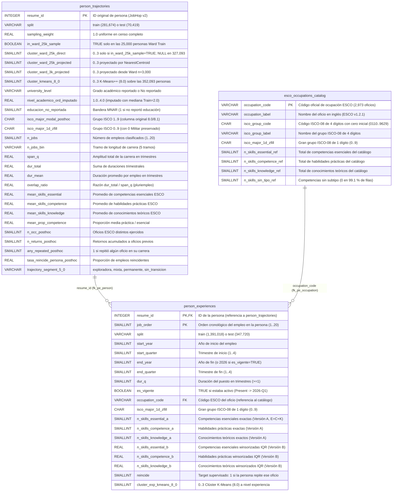

# NEON_SCHEMA.md · Esquema de Base de Datos, Diccionario en Lenguaje Claro y Auditoría de Seguridad en Neon (`JobPath` · Fase 2)

> **Proyecto en Neon:** `JobPath` (`id: steep-poetry-63912763`, PostgreSQL `18`, región `aws-us-east-1`, rama raíz `production` `id: br-round-water-bboiqzaf`, base de datos `neondb`).  
> **Plan y Facturación:** `free_v3` (`$0/mes`, límite `1,024 MiB` = `1 GiB` de almacenamiento lógico por proyecto y `6 horas` / `1 GB` de historial WAL contabilizado por separado; imposible generar cobros por excedentes).  
> **Script Reproducible de Carga y Verificación:** [src/sampling/build_and_verify_census.py](file:///c:/Users/User/Documents/JobPath/MineriaProtect/src/sampling/build_and_verify_census.py) (`SEED = 42`, lectura desde `DATA_DIR` en `.env.local`).

---

## 1. Tabla Ejecutiva de Verificación (`PASS / FAIL`) y Cifras Exactas (`RESULTS FOCUS`)

### 1.1 Resumen de Controles de Calidad y Seguridad Ejecutados en Neon (`steep-poetry-63912763`)

| # | Control de Verificación (Fase 2) | Valor Esperado / Criterio | Valor Exacto Medido en Neon PostgreSQL 18 | Estado |
|---:|---|---|---|---|
| `1` | **Plan Gratuito y Garantía de Cero Cobros** | `subscription_type = free_v3` (`$0/mes`, sin *overages*) y `0` ramas hijas | `free_v3` (`branch_logical_size_limit = 1,024 MiB`, `1` rama raíz `production`, `0` ramas hijas) | **`PASS`** |
| `2` | **Paridad Exacta de Conteo de Filas (`21` tablas)** | `100 %` coincidencia entre cada tabla SQL y su CSV fuente | **`21 / 21` tablas coinciden al `100 %`** (`2,094,127` filas totales: `1,738,738` experiencias + `352,093` personas + `2,973` oficios ESCO + `323` filas en `18` tablas `agg_*`) | **`PASS`** |
| `3` | **Integridad Referencial (`FOREIGN KEY` y Huérfanos)** | `2` llaves foráneas validadas en `pg_constraint` y `0` registros huérfanos | `fk_pe_person (validated=TRUE)` y `fk_pe_occupation (validated=TRUE)`; **`0` experiencias huérfanas sin persona** y **`0` experiencias huérfanas sin código ESCO** | **`PASS`** |
| `4` | **Separación `Train` / `Test` sin Fuga por Persona** | `281,674` personas en `Train`, `70,419` en `Test`, `0` compartidas | `train_persons = 281,674` (`79.9999 %`), `test_persons = 70,419` (`20.0001 %`), **`shared_persons = 0`** | **`PASS`** |
| `5` | **Restricción Explícita de Clústeres Directos Ward (`25k`)** | `cluster_ward_25k_direct IS NOT NULL` solo en las `25,000` personas con `in_ward_25k_sample = TRUE` (`NULL` en las `327,093` restantes) | `ward_sample_true = 25,000`, `ward_direct_non_null = 25,000`, **`invalid_ward_outside_sample = 0`** | **`PASS`** |
| `6` | **Huella Total con Índices (`pg_total_relation_size`)** | `< 600 MiB` (puerta Go/No-Go) y `< 1,024 MiB` (`1 GiB` límite Neon Free) | **`268.60 MiB` (`281,649,152 bytes`) en las `21` tablas + `6` índices**; **`276.68 MiB` (`290,119,680 bytes`) `pg_database_size('neondb')` = `27.02 %` del límite de `1 GiB`** (`747.32 MiB` libres) | **`PASS`** |
| `7` | **Número Mínimo de Índices B-tree** | Solo los índices requeridos por las consultas del dashboard | **`6` índices B-tree en total** (`3` llaves primarias + `3` índices secundarios de filtrado; `71.97 MiB` en total) | **`PASS`** |
| `8` | **Rol de Solo Lectura (`jobpath_readonly`) — Privilegios** | No superusuario (`rolsuper=FALSE`), no miembro de `neon_superuser`, sin permiso `CREATE` en `public`, con `SELECT` en las `21` tablas | `current_user = 'jobpath_readonly'`, `rolsuper = FALSE`, `is_neon_superuser = FALSE`, `can_create_in_public = FALSE`, `all_21_tables_readable = TRUE` | **`PASS`** |
| `9` | **Rol de Solo Lectura (`jobpath_readonly`) — Bloqueo de Escritura** | `INSERT`, `UPDATE`, `DELETE`, `CREATE TABLE` y `DROP TABLE` rechazados por el motor | **`5 / 5` pruebas negativas bloqueadas con `psycopg.errors.InsufficientPrivilege`** | **`PASS`** |
| `10` | **Latencia de Consultas del Dashboard (Frío y Caliente)** | Arranque en frío `<= 2,500 ms`; agregadas `<= 15 ms` motor; explorador `<= 25 ms` motor | Frío = **`1,616.69 ms`**; agregadas (`Q1`–`Q4`) = **`0.029 ms` a `0.049 ms`** motor (`77–88 ms` RTT); explorador indexado (`Q5`–`Q7`) = **`0.119 ms` a `0.357 ms`** motor (`79–85 ms` RTT) | **`PASS`** |

---

### 1.2 Inventario Físico Exacto de las `21` Tablas en Neon (`VACUUM ANALYZE` Ejecutado)

| # | Nombre de la Tabla (`public`) | Categoría | Filas Exactas | Tamaño Tabla (`pg_table_size`) | Tamaño Índices (`pg_indexes_size`) | Tamaño Total (`pg_total_relation_size`) | Total (`MiB`) | Índices B-tree |
|---:|---|---|---:|---:|---:|---:|---:|---:|
| `1` | **`person_experiences`** | Censo Nivel Experiencia | `1,738,738` | `148,422,656 B` (`141.55 MiB`) | `51,724,288 B` (`49.33 MiB`) | **`200,146,944 B`** | **`190.875 MiB`** | `2` (`person_experiences_pkey`, `idx_pe_occ_split`) |
| `2` | **`person_trajectories`** | Censo Nivel Persona | `352,093` | `56,401,920 B` (`53.79 MiB`) | `23,748,608 B` (`22.65 MiB`) | **`80,150,528 B`** | **`76.438 MiB`** | `3` (`person_trajectories_pkey`, `idx_pt_split_km_isco_edu`, `idx_pt_ward25k`) |
| `3` | **`esco_occupations_catalog`** | Catálogo Maestro ESCO | `2,973` | `385,024 B` (`0.367 MiB`) | `98,304 B` (`0.094 MiB`) | **`483,328 B`** | **`0.461 MiB`** | `1` (`esco_occupations_catalog_pkey`) |
| `4` | `agg_top_occupation_transitions` | Agregada Poblacional (EDA) | `100` | `57,344 B` | `0 B` | `57,344 B` | `0.055 MiB` | `0` |
| `5` | `agg_inclusion_exclusion_funnel` | Agregada Poblacional (Embudo) | `10` | `49,152 B` | `0 B` | `49,152 B` | `0.047 MiB` | `0` |
| `6` | `agg_cleaning_and_iqr_audit` | Agregada Poblacional (`2.0`) | `8` | `49,152 B` | `0 B` | `49,152 B` | `0.047 MiB` | `0` |
| `7` | `agg_pca_variance_and_loadings` | Agregada Poblacional (`4.0`/`4.1`) | `15` | `49,152 B` | `0 B` | `49,152 B` | `0.047 MiB` | `0` |
| `8` | `agg_eda_distributions_and_segments` | Agregada Poblacional (`5.0`) | `4` | `49,152 B` | `0 B` | `49,152 B` | `0.047 MiB` | `0` |
| `9` | `agg_supervised_models_benchmark` | Agregada Modelos (`6.0`–`7.2`) | `15` | `49,152 B` | `0 B` | `49,152 B` | `0.047 MiB` | `0` |
| `10` | `agg_decision_trees_comparison` | Agregada Árboles (`7.0`) | `15` | `49,152 B` | `0 B` | `49,152 B` | `0.047 MiB` | `0` |
| `11` | `agg_naive_bayes_isco_rates` | Agregada Naive Bayes (`7.1`) | `10` | `49,152 B` | `0 B` | `49,152 B` | `0.047 MiB` | `0` |
| `12` | `agg_knn_neighbor_purity` | Agregada KNN (`7.2`) | `11` | `49,152 B` | `0 B` | `49,152 B` | `0.047 MiB` | `0` |
| `13` | `agg_clustering_executive_comparison` | Agregada Clustering (`8.0`/`8.1`) | `4` | `49,152 B` | `0 B` | `49,152 B` | `0.047 MiB` | `0` |
| `14` | `agg_kmeans_full_profiles` | Agregada Clustering (`8.0`) | `8` | `49,152 B` | `0 B` | `49,152 B` | `0.047 MiB` | `0` |
| `15` | `agg_ward_25k_profiles` | Agregada Clustering (`8.1`) | `4` | `49,152 B` | `0 B` | `49,152 B` | `0.047 MiB` | `0` |
| `16` | `agg_nm_rl04_annual_macro` | Métodos Numéricos (MCO Serie) | `24` | `40,960 B` | `0 B` | `40,960 B` | `0.039 MiB` | `0` |
| `17` | `agg_nm_rl04_ols_regimes` | Métodos Numéricos (MCO 15 Modelos) | `15` | `49,152 B` | `0 B` | `49,152 B` | `0.047 MiB` | `0` |
| `18` | `agg_nm_rl04_extrapolation_audit` | Métodos Numéricos (MCO Extrap.) | `18` | `49,152 B` | `0 B` | `49,152 B` | `0.047 MiB` | `0` |
| `19` | `agg_nm_lg01_survival_curve` | Métodos Numéricos (Lagrange $S(q)$) | `40` | `40,960 B` | `0 B` | `40,960 B` | `0.039 MiB` | `0` |
| `20` | `agg_nm_lg01_p3_milestones` | Métodos Numéricos (Lagrange $P_3(q)$) | `7` | `40,960 B` | `0 B` | `40,960 B` | `0.039 MiB` | `0` |
| `21` | `agg_nm_lg01_runge_benchmark` | Métodos Numéricos (Runge Grados 3–16) | `15` | `49,152 B` | `0 B` | `49,152 B` | `0.047 MiB` | `0` |
| — | **TOTAL `21` TABLAS DE USUARIO** | — | **`2,094,127`** | **`206,077,952 B` (`196.53 MiB`)** | **`75,571,200 B` (`72.07 MiB`)** | **`281,649,152 B`** | **`268.60 MiB`** | **`6` índices** |
| — | **BASE COMPLETA `pg_database_size('neondb')`** | Incluye catálogos de Postgres | — | — | — | **`290,119,680 B`** | **`276.68 MiB` (`27.02 %` de `1 GiB`)** | — |

---

## 2. Diagrama de Arquitectura Relacional y Tablas Pre-Agregadas

---

## 3. Diccionario Detallado de Columnas en Lenguaje Claro (`Plain Language`)

### 3.1 Tabla 1: `esco_occupations_catalog` (`2,973` filas · Catálogo Normalizado de Ocupaciones ESCO v1.2.1)

Almacena una sola vez los nombres de los oficios y grupos ISCO-08 para no repetir cadenas de texto de `~70 bytes` en los `1.74 millones` de experiencias laborales (ahorrando `~120 MiB` de espacio en Neon).

| Columna | Tipo SQL | Nulos | Significado en Lenguaje Sencillo |
|---|---|---|---|
| `occupation_code` | `VARCHAR(16) PRIMARY KEY` | `NOT NULL` | Código único de la ocupación en la clasificación europea ESCO (por ejemplo, `'3343.1'` para asistente administrativo o `'0110.1'` para oficial de las fuerzas armadas). |
| `occupation_label` | `VARCHAR(160)` | `NOT NULL` | Nombre descriptivo oficial del oficio en el catálogo ESCO (`preferredLabel`). |
| `isco_group_code` | `CHAR(4)` | `NOT NULL` | Código de 4 dígitos de la Clasificación Internacional Uniforme de Ocupaciones (`ISCO-08`), formateado con 4 caracteres exactos (`'0110'` a `'9629'`) para conservar el cero inicial de las ocupaciones militares. |
| `isco_group_label` | `VARCHAR(160)` | `NOT NULL` | Nombre del subgrupo ocupacional ISCO-08 de 4 dígitos al que pertenece el oficio. |
| `isco_major_1d_zfill` | `CHAR(1)` | `NOT NULL` | Primer dígito del grupo ISCO-08 (`'0'` = Ocupaciones militares, `'1'` = Directores y gerentes, `'2'` = Profesionales científicos e intelectuales, `'3'` = Técnicos, `'4'` = Apoyo administrativo, `'5'` = Servicios y vendedores, `'6'` = Agropecuarios, `'7'` = Oficiales y operarios, `'8'` = Operadores de máquinas, `'9'` = Ocupaciones elementales). |
| `n_skills_essential_ref` | `SMALLINT` | `NOT NULL` | Número total de competencias esenciales que el catálogo ESCO exige para ese oficio (`essential = competence + knowledge + sin_tipo`). |
| `n_skills_competence_ref` | `SMALLINT` | `NOT NULL` | Número de habilidades prácticas (*skills/competences*, "saber hacer") esenciales del oficio. |
| `n_skills_knowledge_ref` | `SMALLINT` | `NOT NULL` | Número de conocimientos teóricos o académicos (*knowledge*, "saber") esenciales del oficio. |
| `n_skills_sin_tipo_ref` | `SMALLINT` | `NOT NULL` | Competencias esenciales del catálogo que no tienen etiqueta de subtipo (`0` en el `99.10 %` de las experiencias). |

---

### 3.2 Tabla 2: `person_trajectories` (`352,093` filas · `1 fila = 1 persona` del Censo Clasificado)

Resume toda la trayectoria laboral de cada persona clasificada, su partición `Train`/`Test`, sus etiquetas de clúster no supervisado (`8.0` y `8.1`) y sus indicadores de movilidad.

| Columna | Tipo SQL | Nulos | Significado en Lenguaje Sencillo |
|---|---|---|---|
| `resume_id` | `INTEGER PRIMARY KEY` | `NOT NULL` | Identificador numérico original del currículum en el dataset público anonimizado JobHop v2 (sin hash, calculado en Python). |
| `split` | `VARCHAR(5)` | `NOT NULL` | Indica si toda la historia de la persona pertenece al conjunto de entrenamiento (`'train'`, `281,674` personas = `80.00 %`) o al conjunto de prueba retenido (`'test'`, `70,419` personas = `20.00 %`). Ninguna persona aparece en ambos. |
| `sampling_weight` | `REAL` | `NOT NULL` | Peso estadístico de muestreo ($w_i = N_h / n_h$). Como cargamos el `100 %` del censo clasificado (Candidato C), vale exactamente `1.0` para todas las personas. |
| `in_ward_25k_sample` | `BOOLEAN` | `NOT NULL` | `TRUE` únicamente para las **`25,000` personas de `Train` (`7.10 %` del censo)** seleccionadas en la muestra estratificada del cuaderno `8.1` para ajustar el dendrograma jerárquico de Ward; `FALSE` para las `327,093` personas restantes. |
| `cluster_ward_25k_direct` | `SMALLINT` | **`NULL` en `327,093` filas** | **Etiqueta directa del clustering jerárquico de Ward (`0..3`, cuaderno `8.1`):** tiene valor **solo en las `25,000` personas donde `in_ward_25k_sample = TRUE`** y es **`NULL` en las demás `327,093` personas**, garantizando que nunca se presente el ajuste directo de Ward como si cubriera todo el censo. |
| `cluster_ward_25k_projected` | `SMALLINT` | `NOT NULL` | Aproximación por centroide más cercano (`NearestCentroid`) que proyecta los 4 grupos de Ward `n=25,000` al resto del censo (`0..3`). |
| `cluster_ward_3k_projected` | `SMALLINT` | `NOT NULL` | Aproximación por `NearestCentroid` proyectada desde la muestra inicial de descubrimiento Ward de `3,000` personas (`0..3`, tabla `08` de `8.1`). |
| `cluster_kmeans_8_0` | `SMALLINT` | `NOT NULL` | **Segmento operativo de K-Means++ (`0..3`, cuaderno `8.0`):** ajustado sobre el `100 %` de `Train` (`281,674` personas) y evaluado en `Test` (`70,419` personas). `0` = Inserción temprana/operativos (`43.90 %`), `1` = Educación no reportada MNAR (`11.66 %`), `2` = Profesionales intensivos en conocimiento (`27.99 %`), `3` = Carreras largas/pluriempleo (`16.44 %`). |
| `university_level` | `VARCHAR(20)` | `NOT NULL` | Nivel educativo reportado en el primer empleo clasificado de la persona: `'Secondary school'` (`40.56 %`), `'Bachelor'` (`32.22 %`), `'Master'` (`14.52 %`), `'No reportado'` (`12.18 %`) o `'PhD'` (`0.52 %`). |
| `nivel_academico_ord_imputado` | `REAL` | `NOT NULL` | Nivel académico en escala numérica ordinal (`1.0` = Secundaria, `2.0` = Pregrado/Bachelor, `3.0` = Maestría, `4.0` = Doctorado). Cuando no fue reportado, toma la mediana de `Train` (`2.0`) acompañada de `educacion_no_reportada = 1` (jamás se rellena con `0`). |
| `educacion_no_reportada` | `SMALLINT` | `NOT NULL` | Bandera de ausencia informativa (`1` si la persona omitió su nivel educativo en su primer empleo clasificado, `0` si lo reportó). |
| `isco_major_modal_posthoc` | `CHAR(1)` | `NOT NULL` | Gran grupo ISCO modal (`'1'..'9'`) tal como se exportó en los cuadernos `8.0` y `8.1` (donde `ISCO 0` quedó plegado en `1/2/3`). Se conserva para reproducibilidad exacta con `8.0`/`8.1`. |
| `isco_major_1d_zfill` | `CHAR(1)` | `NOT NULL` | Gran grupo ISCO-08 modal corregido (`'0'..'9'`) que preserva el cero inicial de las `598` personas con carrera mayoritaria en `0 · Ocupaciones militares`. |
| `n_jobs` | `SMALLINT` | `NOT NULL` | Cantidad total de experiencias laborales con oficio ESCO clasificado que tiene la persona en su currículum (`1` a `20`, media `4.94`). |
| `n_jobs_bin` | `VARCHAR(16)` | `NOT NULL` | Tramo agrupado de cantidad de empleos: `'1_empleo'` (`7.52 %`), `'2_3_empleos'` (`27.82 %`), `'4_5_empleos'` (`28.93 %`), `'6_8_empleos'` (`24.66 %`) o `'9_mas_empleos'` (`11.07 %`). |
| `span_q` | `REAL` | `NOT NULL` | Amplitud total de la carrera en trimestres desde el inicio del primer empleo hasta el cierre del último ($\max(\text{end\_ord}) - \min(\text{start\_ord}) + 1$). |
| `dur_total` | `REAL` | `NOT NULL` | Suma de las duraciones (en trimestres) de todos los empleos clasificados de la persona. |
| `dur_mean` | `REAL` | `NOT NULL` | Duración promedio (en trimestres) de los empleos clasificados de la persona. |
| `overlap_ratio` | `REAL` | `NOT NULL` | Índice de simultaneidad o pluriempleo (`dur_total / span_q`): un valor `> 1.0` indica que la persona tuvo contratos superpuestos en los mismos trimestres. |
| `mean_skills_essential` | `REAL` | `NOT NULL` | Promedio de competencias esenciales ESCO exigidas a lo largo de los empleos de la persona (Versión B). |
| `mean_skills_competence` | `REAL` | `NOT NULL` | Promedio de habilidades prácticas ESCO en la carrera de la persona (Versión B). |
| `mean_skills_knowledge` | `REAL` | `NOT NULL` | Promedio de conocimientos teóricos ESCO en la carrera de la persona (Versión B). |
| `mean_prop_competence` | `REAL` | `NOT NULL` | Proporción promedio de habilidades prácticas sobre el total de competencias esenciales (`competence / essential`) en la carrera de la persona. |
| `n_occ_posthoc` | `SMALLINT` | `NOT NULL` | Número de oficios ESCO distintos que la persona desempeñó en su historia laboral (`1..20`; variable de validación *post-hoc*, excluida de `X` en clustering). |
| `n_returns_posthoc` | `SMALLINT` | `NOT NULL` | Número de veces que la persona repitió un oficio ya ejercido anteriormente (`n_jobs - n_occ_posthoc`, `0..18`). |
| `any_repeated_posthoc` | `SMALLINT` | `NOT NULL` | `1` si la persona repitió al menos una vez algún oficio ESCO en su carrera (`n_returns_posthoc >= 1`), `0` si todos sus empleos fueron en oficios diferentes. |
| `tasa_reincide_persona_posthoc` | `REAL` | `NOT NULL` | Proporción de experiencias laborales de la persona que tienen `reincide = 1` (`0.0` a `1.0`). |
| `trajectory_segment_5_0` | `VARCHAR(16)` | `NOT NULL` | Tipología descriptiva del EDA (`5.0` Celda 68): `'exploradora'` (cambia siempre de oficio), `'mixta'` (combina exploración y retornos), `'permanente'` (alta proporción de autolazos o retornos) o `'sin_transicion'` (1 solo empleo clasificado). |

---

### 3.3 Tabla 3: `person_experiences` (`1,738,738` filas · `1 fila = 1 experiencia laboral` clasificada en ESCO)

Contiene la secuencia cronológica completa de puestos de trabajo de las `352,093` personas, vinculada por llaves foráneas verificadas (`fk_pe_person` y `fk_pe_occupation`).

| Columna | Tipo SQL | Nulos | Significado en Lenguaje Sencillo |
|---|---|---|---|
| `resume_id` | `INTEGER NOT NULL` (`PK`, `FK`) | `NOT NULL` | Identificador de la persona dueña de la experiencia laboral (`FOREIGN KEY` hacia `person_trajectories.resume_id`). |
| `job_order` | `SMALLINT NOT NULL` (`PK`) | `NOT NULL` | Número de orden cronológico del puesto dentro de la historia de esa persona (`1` = primer empleo, `2` = segundo empleo, hasta `20`). Junto con `resume_id` forma la llave primaria compuesta. |
| `split` | `VARCHAR(5)` | `NOT NULL` | Partición a la que pertenece la persona (`'train'`: `1,391,018` filas; `'test'`: `347,720` filas). |
| `start_year` | `SMALLINT` | `NOT NULL` | Año calendario en que inició el empleo (por ejemplo, `2014`). |
| `start_quarter` | `SMALLINT` | `NOT NULL` | Trimestre del año en que inició el empleo (`1` a `4`). |
| `end_year` | `SMALLINT` | `NOT NULL` | Año calendario en que terminó el empleo (`2026` si el empleo seguía vigente al corte del dataset). |
| `end_quarter` | `SMALLINT` | `NOT NULL` | Trimestre del año en que terminó el empleo (`1` a `4`; `1` para empleos vigentes censurados en `2026-Q1`). |
| `dur_q` | `SMALLINT` | `NOT NULL` | Duración del puesto en trimestres ($\text{end\_ord} - \text{start\_ord} + 1$, mínimo `1` trimestre). |
| `es_vigente` | `BOOLEAN` | `NOT NULL` | `TRUE` si el puesto estaba activo al momento de captura (`end_date = 'Present'`, `94,966` filas clasificadas); `FALSE` si es un empleo ya cerrado (`1,643,772` filas usadas en los análisis de supervivencia y regresión de Métodos Numéricos). |
| `occupation_code` | `VARCHAR(16)` (`FK`) | `NOT NULL` | Código ESCO del oficio desempeñado (`FOREIGN KEY` hacia `esco_occupations_catalog.occupation_code`). |
| `isco_major_1d_zfill` | `CHAR(1)` | `NOT NULL` | Gran grupo ISCO-08 de 1 dígito (`'0'..'9'`) del puesto, con el cero inicial preservado para las `4,195` experiencias militares. |
| `n_skills_essential_a` | `SMALLINT` | `NOT NULL` | Conteo entero exacto de competencias esenciales ESCO en la **Versión A (`con_outliers`)**, donde se cumple la identidad aditiva $E = C + K$ (`max = 99`). Usado por los modelos supervisados (`6.0`–`7.2`). |
| `n_skills_competence_a` | `SMALLINT` | `NOT NULL` | Conteo entero exacto de habilidades prácticas ESCO en la **Versión A** (`max = 69`). |
| `n_skills_knowledge_a` | `SMALLINT` | `NOT NULL` | Conteo entero exacto de conocimientos teóricos ESCO en la **Versión A** (`max = 45`). |
| `n_skills_essential_b` | `REAL` | `NOT NULL` | Conteo de competencias esenciales acotado por la regla de Tukey IQR (`k = 1.5`, tope superior `47.5`) en la **Versión B (`sin_outliers`)**. |
| `n_skills_competence_b` | `REAL` | `NOT NULL` | Conteo de habilidades prácticas acotado por IQR (tope superior `39.5`) en la **Versión B**, usado en clustering (`8.0` y `8.1`). |
| `n_skills_knowledge_b` | `REAL` | `NOT NULL` | Conteo de conocimientos teóricos acotado por IQR (tope superior `13.5`) en la **Versión B**, usado en clustering (`8.0` y `8.1`). |
| `reincide` | `SMALLINT` | `NOT NULL` | **Variable objetivo supervisada (`0` o `1`):** vale `1` si la persona ejerce ese mismo `occupation_code` más de una vez en su trayectoria (`veces_ese_oficio > 1`, `30.01 %` en `Train`, `29.97 %` en `Test`), y `0` si solo lo ejerce una vez. |
| `cluster_exp_kmeans_8_0` | `SMALLINT` | `NOT NULL` | Clúster K-Means++ (`0..3`, cuaderno `8.0`) asignado a la experiencia individual en la vista secundaria `V_EXPERIENCE`. |

---

### 3.4 Las `18` Tablas Resumen Pre-Agregadas (`agg_*`, `323` filas totales, `0.83 MiB` en disco)

Todas las cifras titulares, gráficas poblacionales, comparativas de modelos supervisados, retratos robot de clustering y simuladores de Métodos Numéricos del dashboard leen directamente de estas 18 tablas pre-agregadas en `< 0.05 ms` de ejecución en motor, sin escanear `person_experiences`:

| # | Tabla Agregada (`public`) | Filas | Columnas y Significado en Lenguaje Claro |
|---:|---|---:|---|
| `4` | `agg_inclusion_exclusion_funnel` | `10` | `stage_order, stage_code, stage_label_es, status_in_neon, experiences_count, persons_count, pct_clean_experiences, pct_clean_persons, reason_es` — Embudo completo desde las `1,993,291` filas crudas (`355,315` personas) hasta las `1,738,738` experiencias (`352,093` personas) incluidas en Neon, detallando qué se excluyó (`122,277` en limpieza + `132,276` sin oficio hoja ESCO), el split `80/20` (`Train`/`Test`) y la submuestra directa Ward (`25,000` personas `Train`). |
| `5` | `agg_cleaning_and_iqr_audit` | `8` | `etapa, descripcion, filas_entrada, filas_salida, filas_eliminadas, pct_eliminado, personas_entrada, personas_salida, Justificacion_metodo, regla_aplicada` — Bitácora oficial de las 8 etapas de limpieza (`limpiar_unificado.py`). |
| `6` | `agg_pca_variance_and_loadings` | `15` | `notebook, version, pc, var_exp_pct, cum_var_pct, k_for_80pct, k_for_90pct` — Varianza explicada individual y acumulada (`PC1`–`PC5`) en `4.0_PCA` (`10k`) y `4.1_PCA_completo` (`50k`) para Versiones A (`4` comps $\ge 80 \%$) y B (`3` comps $\ge 80 \%$). |
| `7` | `agg_eda_distributions_and_segments` | `4` | `trajectory_segment_5_0, persons_count, mean_n_jobs, mean_n_occ, mean_n_returns, mean_span_q, any_repeated_rate_pct, pct_persons` — Resumen poblacional de los 4 segmentos tipológicos del EDA (`exploradora`, `mixta`, `permanente`, `sin_transicion`). |
| `8` | `agg_top_occupation_transitions` | `100` | `from_occupation_code, to_occupation_code, transition_count, rank_order, from_occupation_label, to_occupation_label, is_self_loop, pct_of_all_transitions` — Las `100` transiciones consecutivas más frecuentes entre las `1,386,645` transiciones del censo clasificado. |
| `9` | `agg_supervised_models_benchmark` | `15` | Tabla maestra `13g_comparacion_unificada_version_a.csv` (`7.2_knn.ipynb`): métricas en `Test` completo (`347,720` filas) con IC 95 % bootstrap por persona (`PR-AUC`, `ROC-AUC`, `F1`, `Precision`, `Recall`, `BalAcc`, `Accuracy`, `Brier`, tiempos de `fit` y `predict`) para `Baseline Prior`, `Logística Regularizada (6.0)`, `HistGradientBoosting (6.0)`, `Árboles CART 1–3 (7.0)`, `NB-G / NB-B / NB-H (7.1)` y `KNN-D / KNN-G / KNN-W (7.2)`. |
| `10` | `agg_decision_trees_comparison` | `15` | Tabla `07_comparacion_tres_arboles_referencias_y_versiones.csv` (`7.0_arbol_decision.ipynb`): comparación de los 3 árboles CART (`ISCO`, `Educación`, `Competencias ESCO`) en Versiones A y B y puntos de operación (`None`, `balanced`, umbral OOF $\tau^*$) frente a las 3 referencias obligatorias. |
| `11` | `agg_naive_bayes_isco_rates` | `10` | Tabla `10_o1_tasas_reincidencia_isco_1d.csv` (`7.1_naive_bayes.ipynb`): volumen y tasa observada de `reincide` en `Train` y `Test` para cada uno de los `10` grandes grupos ISCO-08 (`0` Militar `7.61 %` a `5` Servicios/Ventas `33.87 %`). |
| `12` | `agg_knn_neighbor_purity` | `11` | Tabla `03_geometria_contraste_y_pureza_vecinos.csv` (`7.2_knn.ipynb`): pureza ocupacional e ISCO de los `k = 51` vecinos más cercanos en función del peso del bloque ocupacional $w \in [0, 8]$. |
| `13` | `agg_clustering_executive_comparison` | `4` | Tabla `13_matriz_ejecutiva_comparativa_8_0_vs_8_1.csv` (`8.1_clustering_jerarquico.ipynb`): matriz ejecutiva cara a cara de los 4 clústeres entre K-Means `8.0` (`100 %` Train), Ward `8.1` ($n=3,000$) y Ward Optimizado `8.1` ($n=25,000$), incluyendo tamaños, tasas post-hoc de `reincide` (`Lift`) y explicación conductual. |
| `14` | `agg_kmeans_full_profiles` | `8` | Tabla `06_perfiles_completos_y_validacion_posthoc_reincide.csv` (`8.0_kmeans_clustering.ipynb`): medias en unidades originales (`Retrato Robot`), tamaños en `Train`/`Test`/`Total`, grupo ISCO dominante y acción recomendada del Observatorio Laboral para los 4 clústeres de Personas (`352,093`) y los 4 de Experiencias (`1,738,738`). |
| `15` | `agg_ward_25k_profiles` | `4` | Tabla `12_perfiles_ward_n25000_escala_original.csv` (`8.1_clustering_jerarquico.ipynb`): medias en escala original tanto en la muestra directa de descubrimiento (`n = 25,000` `Train`) como en la proyección total (`352,093` personas) para los 4 clústeres de Ward. |
| `16` | `agg_nm_rl04_annual_macro` | `24` | Tabla `rl04_annual_macro_series.csv` (**Caso 1 Métodos Numéricos · MCO**): serie anual `2000..2023` con `n_starts`, `n_closed_starts`, `mean_skills`, `mean_knowledge`, `mean_dur_q` (solo empleos cerrados `~es_vigente`), `mean_dur_q_incl_active`, `mean_green`, `reincide_rate` y `year_centered`. |
| `17` | `agg_nm_rl04_ols_regimes` | `15` | Tabla `rl04_ols_regime_comparison.csv` (**Caso 1 MCO**): parámetros exactos ($a_0, a_1, S_t, S_r, R^2, r, S_{y/x}$, error vs. `polyfit` y veredicto) de los 15 modelos MCO comparando soporte válido `2000–2019` ($n=20$), serie con cola censurada `2000–2023` ($n=24$) y soporte centrado $t - 2000$. |
| `18` | `agg_nm_rl04_extrapolation_audit` | `18` | Tabla `rl04_extrapolation_failure_audit.csv` (**Caso 1 MCO**): predicciones extrapoladas `2020..2027` que demuestran la predicción físicamente imposible de duraciones negativas desde `2021` (`-0.2029` trim) hasta **`2027` (`-4.9585` trimestres)**. |
| `19` | `agg_nm_lg01_survival_curve` | `40` | Tabla `lg01_survival_curve_S_q.csv` (**Caso 2 Métodos Numéricos · Lagrange**): curva empírica exacta de permanencia $S(q) = P(\text{dur\_q} \ge q)$ para $q = 1..40$ trimestres (`0.25` a `10` años) calculada sobre los `1,643,772` empleos cerrados clasificados (`~es_vigente`). |
| `20` | `agg_nm_lg01_p3_milestones` | `7` | Tabla `lg01_milestone_P3_weights_and_eval.csv` (**Caso 2 Lagrange**): pesos base $L_0(q)..L_3(q)$, suma de partición de la unidad ($\sum L_i = 1$), predicción del polinomio cúbico $P_3(q)$ sobre los 4 hitos $q \in \{4, 8, 20, 40\}$ y error absoluto en $q \in \{2, 6, 12, 16, 28, 36, 48\}$. |
| `21` | `agg_nm_lg01_runge_benchmark` | `15` | Tabla `lg01_runge_phenomenon_benchmark.csv` (**Caso 2 Lagrange**): comparación en grados `3, 5, 8, 12, 16` entre Lagrange Global Equiespaciado ($E_\infty = 2.5262$ en grado 16, mínimo `-2.4827`), Chebyshev-Lobatto (`15` nodos deduplicados, $E_\infty = 0.1301$, `19.4x` menos error y `0` violaciones de `[0, 1]`) y Lagrange Local Cuadrático por Tramos $P_2$. |

---

## 4. Inventario de los `6` Índices B-tree y Justificación de Consultas

Siguiendo la regla de crear **únicamente los índices que las consultas reales del dashboard necesitan**, la base de datos mantiene exactamente **`6` índices B-tree** (`75,571,200 bytes` = `72.07 MiB` en total):

| # | Tabla | Nombre del Índice | Definición SQL (`pg_indexes`) | Consulta del Dashboard que Acelera |
|---:|---|---|---|---|
| `1` | `esco_occupations_catalog` | `esco_occupations_catalog_pkey` | `UNIQUE USING btree (occupation_code)` | `JOIN` instantáneo (`Nested Loop`, `0.064–0.143 ms`) para traducir `occupation_code` a nombres de oficio y grupo ISCO al inspeccionar una trayectoria. |
| `2` | `person_trajectories` | `person_trajectories_pkey` | `UNIQUE USING btree (resume_id)` | Búsqueda puntual de una persona por `resume_id` y validación de la llave foránea `fk_pe_person`. |
| `3` | `person_trajectories` | `idx_pt_split_km_isco_edu` | `USING btree (split, cluster_kmeans_8_0, isco_major_1d_zfill, university_level)` | Filtro interactivo del explorador de trayectorias por partición (`train`/`test`), clúster K-Means (`0..3`), sector ISCO (`0..9`) y nivel educativo (`0.357 ms` con `LIMIT 50`). |
| `4` | `person_trajectories` | `idx_pt_ward25k` | `USING btree (in_ward_25k_sample, cluster_ward_25k_direct) WHERE (in_ward_25k_sample = true)` | Índice parcial ultraligero (indexa solo las `25,000` filas de la muestra Ward) para filtrar directamente los clústeres jerárquicos de Ward (`0.119 ms` con `LIMIT 50`). |
| `5` | `person_experiences` | `person_experiences_pkey` | `UNIQUE USING btree (resume_id, job_order)` | Recuperación ordenada cronológicamente (`1..20`) de todos los empleos de una persona dado su `resume_id` (`0.064–0.143 ms`). |
| `6` | `person_experiences` | `idx_pe_occ_split` | `USING btree (occupation_code, split)` | Búsqueda de experiencias por código de ocupación ESCO y partición `train`/`test`, además de respaldar la llave foránea `fk_pe_occupation`. |

---

## 5. Arquitectura de Seguridad: Rol de Solo Lectura `jobpath_readonly` y `.env.local`

1. **Separación estricta entre administración offline y lectura del Dashboard:**
   - **`neondb_owner` (Propietario / Admin):** Se utiliza **exclusivamente** en el script local offline `src/sampling/build_and_verify_census.py` para `CREATE TABLE`, `COPY` y `VACUUM ANALYZE`. **Prohibido su uso en el dashboard de Vercel.**
   - **`jobpath_readonly` (Rol del Dashboard — Mínimo Privilegio):**
     - Creado en la rama `production` (`br-round-water-bboiqzaf`) con acceso estrictamente de solo lectura (`CONNECT` en `neondb`, `USAGE` en `schema public`, `SELECT ON ALL TABLES IN SCHEMA public` y `ALTER DEFAULT PRIVILEGES IN SCHEMA public GRANT SELECT ON TABLES`).
     - Verificado en `pg_roles`: `rolsuper = FALSE`, `pg_has_role('jobpath_readonly', 'neon_superuser', 'MEMBER') = FALSE`, `has_schema_privilege('jobpath_readonly', 'public', 'CREATE') = FALSE`.
     - Las 5 pruebas negativas de escritura ejecutadas conectándose como `jobpath_readonly` (`INSERT`, `UPDATE`, `DELETE`, `CREATE TABLE`, `DROP TABLE`) fueron rechazadas al `100 %` con `psycopg.errors.InsufficientPrivilege`.
2. **Almacenamiento seguro de credenciales en `.env.local` (Gitignored):**
   - Las variables `DATA_DIR`, `DATABASE_URL` (admin offline), `DATABASE_URL_DIRECT`, **`DATABASE_URL_READONLY`** (pooler para Vercel) y `DATABASE_URL_READONLY_DIRECT` residen únicamente en `c:\Users\User\Documents\JobPath\MineriaProtect\.env.local`.
   - Verificado mediante `git check-ignore -v .env.local .venv` que `.env.local` y `.venv/` están bloqueados por `.gitignore` (líneas 65 y 68) y no aparecen en `git status`.
