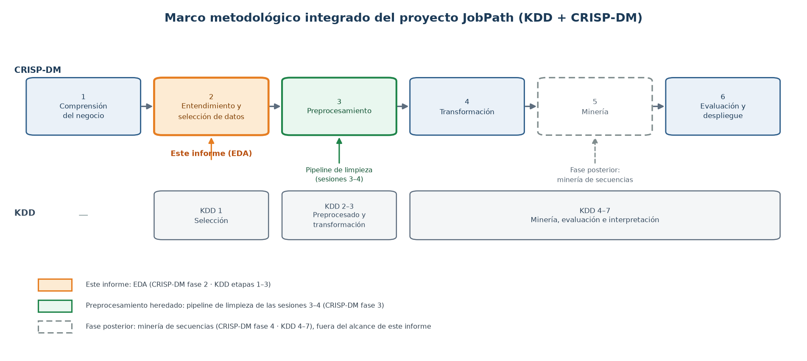
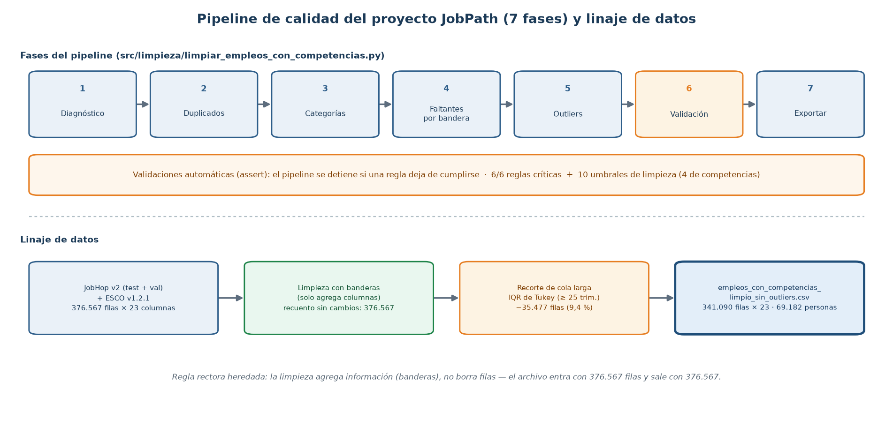
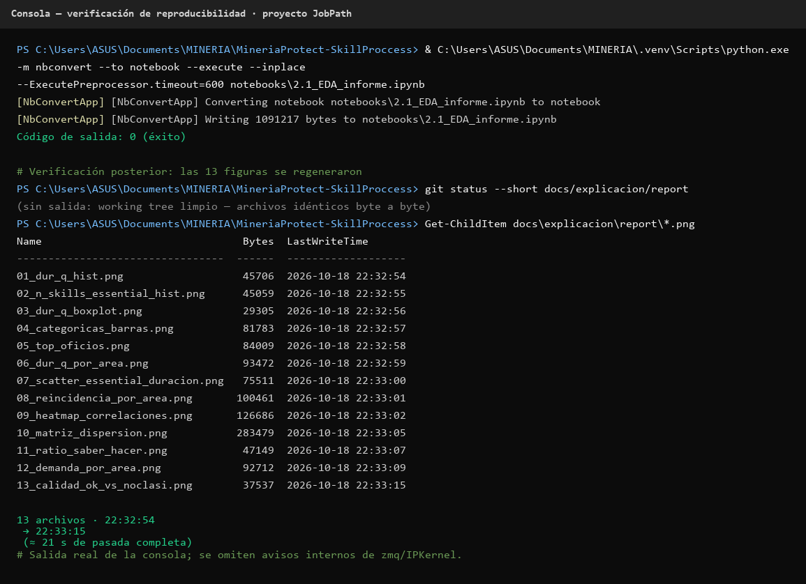

**Corporación Universitaria Minuto de Dios**  
*Educación de calidad al alcance de todos*  
*Vigilada MinEducación*

# Informe de Laboratorio: Análisis Exploratorio de Datos del Proyecto JobPath

## Patrones de Transición Ocupacional en Trayectorias Laborales

Johan Steven López Ordoñez

Juan Sebastián Rueda Ortiz

Jairo Esteban Salgado Tinoco

Facultad de Ingeniería de Sistemas

Corporación Universitaria Minuto de Dios

Vicerrectoría Regional Centro Sur, Sede Ibagué, Tolima

Minería de Datos · 2026-2 · Unidad 1

Docente: Esteban Ernesto Morales Castro

18 de octubre de 2026

---

## Resumen

El presente informe corresponde al análisis exploratorio de datos (EDA) del proyecto JobPath, desarrollado en la asignatura de Minería de Datos dentro del marco metodológico integrado KDD y CRISP-DM: el análisis se ubica en la fase de entendimiento de los datos (CRISP-DM fase 2 y KDD etapas 1 a 3), retoma decisiones de calidad del preprocesamiento de las sesiones 3 y 4 (CRISP-DM fase 3) y entrega los insumos de la fase posterior de transformación y minería de secuencias. El análisis se realizó sobre el archivo empleos_con_competencias_limpio_sin_outliers.csv, con 341.090 registros y 23 variables, correspondientes a 69.182 personas y 323.742 periodos de empleo del mercado laboral de Flandes (Bélgica). El informe sigue la estructura de seis secciones: contexto; calidad de datos; análisis univariado; análisis bivariado y multivariado; hallazgos y recomendaciones; y anexos con el notebook reproducible. Entre los resultados principales: el 92,3 % de las experiencias tiene oficio clasificado con la taxonomía ESCO; la mediana de duración por empleo es de 5 trimestres; el 31,5 % de las experiencias reincide en un oficio ya ejercido por la misma persona; y las competencias exigidas por el cargo son independientes de su duración (r = −0,021). Se documentan seis hallazgos en formato evidencia-acción orientados a la fase de minería de secuencias. El análisis es descriptivo: describe patrones del conjunto de datos y no sirve para evaluar o decidir sobre personas concretas.

**Palabras clave:** análisis exploratorio de datos; minería de datos; trayectorias laborales; competencias ESCO; transición ocupacional; reproducibilidad.

---

## Tabla de Contenido

- [Resumen](#resumen)
- [1. Contexto](#1-contexto)
  - [1.1 Identificación de la Entrega](#11-identificación-de-la-entrega)
  - [1.2 Pregunta de Negocio](#12-pregunta-de-negocio)
  - [1.3 Pregunta Técnica y Objetivo Analítico](#13-pregunta-técnica-y-objetivo-analítico)
  - [1.4 Criterios de Éxito Definidos en el Acta](#14-criterios-de-éxito-definidos-en-el-acta)
  - [1.5 Fuentes y Alcance de los Datos](#15-fuentes-y-alcance-de-los-datos)
  - [1.6 Nota de Alcance (Lectura Obligatoria)](#16-nota-de-alcance-lectura-obligatoria)
- [2. Calidad de Datos](#2-calidad-de-datos)
  - [2.1 Nulos y Vacíos Encontrados](#21-nulos-y-vacíos-encontrados)
  - [2.2 La Regla Vacío ≠ 0, Verificada](#22-la-regla-vacío--0-verificada)
  - [2.3 Duplicados y Pluriempleo](#23-duplicados-y-pluriempleo)
  - [2.4 Valores Extremos (Outliers)](#24-valores-extremos-outliers)
  - [2.5 Censura: Empleos Aún Vigentes](#25-censura-empleos-aún-vigentes)
  - [2.6 Decisiones Heredadas](#26-decisiones-heredadas)
  - [2.7 Figura de Calidad (Evidencia de la Sección 2)](#27-figura-de-calidad-evidencia-de-la-sección-2)
  - [2.8 Validaciones Automáticas](#28-validaciones-automáticas)
- [3. Análisis Univariado](#3-análisis-univariado)
  - [3.1 Tabla Descriptiva de las Variables Numéricas](#31-tabla-descriptiva-de-las-variables-numéricas)
  - [3.2 Duración de los Empleos (dur_q)](#32-duración-de-los-empleos-dur_q)
  - [3.3 Competencias que Exige el Oficio (n_skills_essential)](#33-competencias-que-exige-el-oficio-n_skills_essential)
  - [3.4 Variables Categóricas](#34-variables-categóricas)
  - [3.5 Oficios Más Frecuentes y Trayectorias por Persona](#35-oficios-más-frecuentes-y-trayectorias-por-persona)
  - [3.6 Duración por Área Ocupacional](#36-duración-por-área-ocupacional)
- [4. Análisis Bivariado y Multivariado](#4-análisis-bivariado-y-multivariado)
  - [4.1 Duración Frente a Competencias Exigidas](#41-duración-frente-a-competencias-exigidas)
  - [4.2 Reincidencia por Área Ocupacional](#42-reincidencia-por-área-ocupacional)
  - [4.3 Matriz de Correlaciones (Heatmap)](#43-matriz-de-correlaciones-heatmap)
  - [4.4 Matriz de Dispersión](#44-matriz-de-dispersión)
  - [4.5 Auditoría de Redundancia (Qué Dice lo Mismo Dos Veces)](#45-auditoría-de-redundancia-qué-dice-lo-mismo-dos-veces)
  - [4.6 Reparto Entre Saber y Saber Hacer](#46-reparto-entre-saber-y-saber-hacer)
  - [4.7 Demanda Media de Competencias por Área](#47-demanda-media-de-competencias-por-área)
  - [4.8 Cruce de Nivel Educativo por Oficio](#48-cruce-de-nivel-educativo-por-oficio)
- [5. Hallazgos y Recomendaciones](#5-hallazgos-y-recomendaciones)
  - [5.1 H1. La Cobertura del Oficio Clasificado Gobierna el Universo Analizable](#51-h1-la-cobertura-del-oficio-clasificado-gobierna-el-universo-analizable)
  - [5.2 H2. La Trayectoria Típica Es Corta y la Cola Larga Ya Fue Recortada](#52-h2-la-trayectoria-típica-es-corta-y-la-cola-larga-ya-fue-recortada)
  - [5.3 H3. La Reincidencia Ocupa un Tercio del Archivo](#53-h3-la-reincidencia-ocupa-un-tercio-del-archivo)
  - [5.4 H4. Duración y Exigencia del Cargo Son Dimensiones Ortogonales](#54-h4-duración-y-exigencia-del-cargo-son-dimensiones-ortogonales)
  - [5.5 H5. Domina el Saber Hacer y el Vocabulario de Competencias Es de Cola Larga](#55-h5-domina-el-saber-hacer-y-el-vocabulario-de-competencias-es-de-cola-larga)
  - [5.6 H6. Hay Redundancia Estructural que Conviene Declarar Antes de Modelar](#56-h6-hay-redundancia-estructural-que-conviene-declarar-antes-de-modelar)
- [6. Anexos](#6-anexos)
  - [6.1 Reproducibilidad](#61-reproducibilidad)
  - [6.2 Recursos del Proyecto](#62-recursos-del-proyecto)
- [Referencias](#referencias)

## Lista de Figuras

- Figura 1. Marco metodológico integrado (KDD + CRISP-DM) y ubicación de este informe.
- Figura 2. Pipeline de calidad de siete fases y linaje de datos.
- Figura 3. Cobertura del oficio clasificado frente a las experiencias sin oficio.
- Figura 4. Duración de los empleos.
- Figura 5. Boxplot de la duración con cerco de Tukey.
- Figura 6. Distribución de las competencias esenciales que exige el oficio.
- Figura 7. Tres categóricas clave: cobertura del oficio, estado de emparejado y nivel educativo.
- Figura 8. Dispersión entre demanda de competencias y duración.
- Figura 9. La duración mediana varía casi 3 veces entre áreas ocupacionales.
- Figura 10. Reincidencia por área ocupacional.
- Figura 11. Matriz de correlaciones.
- Figura 12. Matriz de dispersión.
- Figura 13. Ratio de competencias de ejecución sobre el total.
- Figura 14. Demanda media de competencias por área.
- Figura 15. Composición del nivel educativo por grupo ocupacional.
- Figura 16. Evidencia de la ejecución reproducible del notebook.

## Lista de Tablas

- Tabla 1. Ficha de Identificación de la Entrega.
- Tabla 2. Pregunta Técnica, Objetivo Analítico y Alcance del Proyecto.
- Tabla 3. Fuentes de Datos, Rol en el Proyecto y Decisión de Alcance.
- Tabla 4. Limitaciones Declaradas del Análisis.
- Tabla 5. Recuento de Vacíos por Columna, Causa y Decisión.
- Tabla 6. Duplicados y Pluriempleo: Verificación y Decisión.
- Tabla 7. Regla de Tukey Aplicada a la Duración y Valores Verificados.
- Tabla 8. Decisiones Heredadas de las Sesiones 3 y 4.
- Tabla 9. Medidas Descriptivas de las Seis Variables Numéricas.
- Tabla 10. Oficios más exigentes en competencias esenciales (≥ 200 experiencias).
- Tabla 11. Diez oficios más frecuentes del archivo.
- Tabla 12. Duración y reincidencia por grupo ocupacional ISCO-08.
- Tabla 13. Correlaciones de Pearson entre variables clave.
- Tabla 14. Auditoría de redundancia entre variables.
- Tabla 15. Composición porcentual del nivel educativo por grupo ocupacional.
- Tabla 16. Hallazgo H1: evidencia, significado y acción.
- Tabla 17. Hallazgo H2: evidencia, significado y acción.
- Tabla 18. Hallazgo H3: evidencia, significado y acción.
- Tabla 19. Hallazgo H4: evidencia, significado y acción.
- Tabla 20. Hallazgo H5: evidencia, significado y acción.
- Tabla 21. Hallazgo H6: evidencia, significado y acción.

---

## 1. Contexto

Esta sección fija el encuadre del análisis: quiénes lo presentan, qué problema de negocio lo origina, qué se quiere responder y sobre qué datos se trabaja. Todo lo que sigue en el informe responde a esta pregunta inicial.

El presente informe corresponde a la fase de entendimiento de los datos del marco metodológico integrado del proyecto JobPath (CRISP-DM fase 2 y KDD etapas 1 a 3, conforme al mapeo del acta de constitución analítica). Las decisiones de calidad que se reportan en la sección 2 fueron heredadas del preprocesamiento de las sesiones 3 y 4 (CRISP-DM fase 3), y los hallazgos de la sección 5 están redactados para alimentar la fase posterior de transformación y minería de secuencias (CRISP-DM fase 4; KDD etapas 4 a 7).



**Figura 1.** Marco metodológico integrado del proyecto JobPath (KDD + CRISP-DM) y ubicación de este informe.

*Fuente.* Elaboración propia a partir del acta de constitución analítica (`notebooks/1.0_comprension_negocio.md`), proyecto JobPath.

*Qué se ve:* dos carriles paralelos. El superior reproduce las seis fases de CRISP-DM y el inferior las etapas de KDD, cada bloque alineado bajo la fase CRISP-DM con la que el acta lo empareja. Los bloques resaltados marcan las tres piezas que toca este informe: la fase 2 (entendimiento y selección de datos), donde se sitúa el EDA; la fase 3 (preprocesamiento), que corresponde al pipeline de limpieza de las sesiones 3 y 4 y cuyas decisiones de calidad se heredan; y la minería de secuencias, que queda fuera del alcance.

*Qué significa:* el informe no es un análisis suelto: cada sección declara a qué fase pertenece y qué hereda de las anteriores. La sección 2 reporta el estado real del archivo dentro de la fase 2 y atribuye a la fase 3 las reglas de limpieza, y la sección 5 entrega los hallazgos en el formato que consume la minería de secuencias.

### 1.1 Identificación de la Entrega

**Tabla 1**  
Ficha de Identificación de la Entrega

| Campo | Valor |
|---|---|
| Entregable | Informe de laboratorio (EDA) + notebook reproducible |
| Proyecto | JobPath — observatorio laboral de formaciones educativas |
| Tipo de análisis | Exploratorio y descriptivo (no supervisado, sin modelo predictivo) |
| Rama de trabajo | Skill-Process |
| Fecha de redacción | 18 de octubre de 2026 |

*Fuente.* Elaboración propia a partir de la documentación del proyecto JobPath.

### 1.2 Pregunta de Negocio

El escenario de aplicación es un observatorio laboral de formaciones educativas: conectar lo que una persona estudia con lo que efectivamente llega a trabajar. A quien le importa este análisis son la institución educativa (pertinencia de sus carreras), los egresados (decisión vocacional) y los tomadores de decisión públicos (política de formación).

¿Qué patrones aparecen en la trayectoria laboral de una persona a lo largo de su vida, y qué relación tiene esa trayectoria con lo que estudió?

En lenguaje sin tecnicismos: el producto es un análisis de trayectorias laborales que descubre patrones; no es un sistema de predicción ni una aplicación. El acta de constitución analítica (notebooks/1.0_comprension_negocio.md) dejó explícito que queda fuera de alcance cualquier uso de esta información para decisiones individuales sobre personas.

### 1.3 Pregunta Técnica y Objetivo Analítico

**Tabla 2**  
Pregunta Técnica, Objetivo Analítico y Alcance del Proyecto

| Elemento | Contenido |
|---|---|
| Pregunta técnica | Dado un historial de empleos (desde, hasta, ocupación) por persona, ¿qué secuencias y transiciones ocupacionales son frecuentes y estables? |
| Objetivo analítico | Descubrir y caracterizar patrones de transición ocupacional en trayectorias post-formación. |
| Tarea de minería | Descubrimiento (no supervisada). No existe columna objetivo que predecir: se busca estructura. Quedan descartadas clasificación, regresión y predicción. |
| Finalidad última | Caracterizar patrones y consolidar un informe reproducible sobre la relación formación-empleo. |

*Fuente.* Elaboración propia a partir de la documentación del proyecto JobPath.

### 1.4 Criterios de Éxito Definidos en el Acta

Como el análisis no es predictivo, no hay porcentaje de exactitud. El éxito se mide con tres criterios, de peso igual: (1) patrones identificables y repetidos, no anécdotas sueltas; (2) datos limpios, trazables y reproducibles —cada número se regenera con los scripts, nada escrito a mano—; (3) resultados interpretables en lenguaje de negocio, es decir, que alguien no técnico entienda qué se encontró. El presente informe cumple el criterio (3) al entregar hallazgos en formato evidencia-acción (sección 5).

### 1.5 Fuentes y Alcance de los Datos

**Tabla 3**  
Fuentes de Datos, Rol en el Proyecto y Decisión de Alcance

| Fuente | Rol | Decisión |
|---|---|---|
| JobHop v2 (Hugging Face) | Principal: trayectorias laborales reconstruidas de hojas de vida no estructuradas | Se usa la unión test + val (376.567 experiencias, 71.061 personas); la partición train se excluye por tamaño sin aporte nuevo |
| ESCO v1.2.1 (Comisión Europea) | Enriquecimiento: da significado al código de ocupación y aporta las competencias esenciales | Se usa; 92,3 % de las filas quedan con oficio clasificado |
| OLE (Observatorio Laboral de Colombia) | Fuente pública adicional: trayectorias ocupacionales | Descartada: no publica trayectorias con fechas a nivel de persona (sin fechas no hay secuencia) |

*Nota.* Las fuentes listadas se presentan con formato APA en la sección [Referencias](#referencias) (Comisión Europea, s.f.; JobHop, s.f.).

*Fuente.* Elaboración propia a partir de la documentación del proyecto JobPath.

Datos analizados: `data/02_interim/empleos_con_competencias_limpio_sin_outliers.csv` — 341.090 filas × 23 columnas, 69.182 personas. Grano: una fila = un empleo (experiencia laboral), no una persona. País y mercado: Flandes, Bélgica. Periodo de los empleos: inicio 1967–2021 y fin 1970–2024, con los empleos vigentes censurados en Q1 2026.

### 1.6 Nota de Alcance (Lectura Obligatoria)

**Tabla 4**  
Limitaciones Declaradas del Análisis

| Limitación | Qué significa y por qué se declara |
|---|---|
| Sin causalidad | Se describen asociaciones y composiciones; no se demuestra que una característica cause una trayectoria. |
| Sin variable objetivo | Es un análisis no supervisado: no hay columna a predecir. Por eso la sección 4 hace cruces contra las variables clave en lugar de contra un «objetivo». |
| Grano por empleo | Quien tuvo 5 empleos en el mismo oficio pesa 5 veces. Las cifras son por experiencia, no por persona. |
| Mercado geográfico | Los datos son de Bélgica: se traslada el método, no las cifras. No describen el mercado laboral colombiano. |

*Fuente.* Elaboración propia a partir de la documentación del proyecto JobPath.

---

## 2. Calidad de Datos

La calidad se diagnosticó en las sesiones 3 y 4 mediante un pipeline de 7 fases con validaciones automáticas (scripts/pipeline/limpieza/limpiar_empleos_con_competencias.py): diagnóstico → duplicados → categorías → faltantes por bandera → outliers → validación → exportar. En este EDA se re-mide el estado real del archivo que se analiza y se explicita cada decisión. Regla rectora heredada: la limpieza de este proyecto agrega información, no la borra (el archivo entra con 376.567 filas y sale con 376.567; lo único que hace es añadir columnas de bandera).



**Figura 2.** Pipeline de calidad del proyecto JobPath (7 fases) y linaje de datos.

*Fuente.* Elaboración propia a partir del pipeline `scripts/pipeline/limpieza/limpiar_empleos_con_competencias.py` (proyecto JobPath).

*Qué se ve:* en la fila superior, las siete fases del pipeline en orden (diagnóstico, duplicados, categorías, faltantes por bandera, outliers, validación y exportar) y, debajo, el banner de validaciones automáticas: 6/6 reglas críticas y 10 umbrales de limpieza. Abajo aparece el linaje: la entrada de 376.567 filas y 23 columnas (JobHop v2 test + val integrado con ESCO), el recuento sin cambios tras la limpieza (que solo añade columnas de bandera) y la variante sin cola larga de 341.090 filas (−35.477 por la regla IQR de Tukey).

*Qué significa:* el archivo que analiza este informe no es el crudo, sino la variante de 341.090 filas, y su origen es trazable fase por fase. La limpieza no elimina registros, solo agrega banderas, y el único recorte es la cola larga de la duración (sección 2.4). Cualquier cifra del informe se puede volver a derivar siguiendo esa cadena.

### 2.1 Nulos y Vacíos Encontrados

No hay nulos aleatorios «sucios»: todos los vacíos son estructurales y están gobernados por banderas. Recuento sobre las 341.090 filas analizadas:

**Tabla 5**  
Recuento de Vacíos por Columna, Causa y Decisión

| Columna(s) | Filas vacías | Por qué falta | Decisión tomada |
|---|---|---|---|
| `university_level` | 37.868 (11,1 %) | El CV no reporta el nivel educativo | Se conserva vacío. Se muestra como «No reportado» solo en copia de trabajo (convención del proyecto); el CSV nunca se modifica ni se imputa |
| `occupation_code`, `occupation_label` | 26.186 (7,7 %) | Sin coincidencia utilizable en ESCO: 23.886 `unknown` + 2.300 `rescatado` | Bandera de calidad (`es_unknown_ocupacion`, `es_rescatado`). No se inventa código |
| `isco_group`, `isco_group_label`, `isco_level` | 23.886 (7,0 %) | Ocupación no identificada | Se excluyen de los cruces ocupacionales y se declara la exclusión |
| `n_skills_essential`, `n_skills_competence`, `n_skills_knowledge`, `n_skills_sin_tipo`, `veces_ese_oficio` | 26.186 (7,7 %) | No hay oficio al que atribuir competencias (`saber_skills` = `no_clasificado`) | Regla vacío ≠ 0: quedan vacíos, nunca 0. Un 0 afirmaría que el cargo no exige ninguna competencia, lo cual es falso |
| `end_date` (→ `dur_q`) | 18.956 (5,6 %) | Empleo vigente al capturar el CV (sin fecha de fin) | Censura por la derecha: bandera `es_vigente`. No se inventa fecha de fin |
| `skills`, `knowledge`, `sin_tipo` | 26.188 / 59.153 / 338.144 | No hay competencias de esa categoría para el oficio | Se conservan vacíos (bucket `sin_tipo` prácticamente inexistente: casi todas las relaciones traen tipo declarado) |

*Fuente.* Elaboración propia a partir del archivo empleos_con_competencias_limpio_sin_outliers.csv (proyecto JobPath).

### 2.2 La Regla Vacío ≠ 0, Verificada

Se comprobó automáticamente en los datos reales: (1) el contador de competencias está vacío exactamente cuando `saber_skills` ≠ `ok` → cumple; (2) contadores iguales a 0 en filas clasificadas → 0 casos (para `n_skills_essential`); (3) la suma de los tres buckets (`competence` + `knowledge` + `sin_tipo`) reproduce el total `essential` en las 314.904 filas clasificadas → cumple. Además, `n_skills_essential` es determinista del oficio: tiene un único valor por `occupation_code` en los 2.826 oficios observados.

### 2.3 Duplicados y Pluriempleo

**Tabla 6**  
Duplicados y Pluriempleo: Verificación y Decisión

| Qué se midió | Resultado | Decisión tomada |
|---|---|---|
| Filas duplicadas exactas | 0 | Nada que borrar: la limpieza de duplicados ya se hizo al integrar las fuentes |
| Duplicados por llave natural (persona, inicio, fin) | 323.742 periodos distintos → 17.348 filas de más | Se conservan: son pluriempleo o una transición dentro del mismo trimestre. Son información, no basura |
| Regla de «transición» para secuencias | Deuda D2 (abierta) | Se definirá al construir el dataset de secuencias S_p; por eso no se tocaron esas filas |

*Fuente.* Elaboración propia a partir del archivo empleos_con_competencias_limpio_sin_outliers.csv (proyecto JobPath).

### 2.4 Valores Extremos (Outliers)

La regla estadística de Tukey (IQR) se aplicó a la duración de los empleos. La decisión fue doble y documentada: no se borra nada y se conserva una variante aparte para poder comparar.

**Tabla 7**  
Regla de Tukey Aplicada a la Duración y Valores Verificados

| Concepto | Valor verificado |
|---|---|
| Regla aplicada | IQR de Tukey sobre `dur_q` (duración trimestral inclusiva: end − start + 1) |
| Límite superior del set completo | 24,5 trimestres (≈ 6 años) |
| Filas fuera de ese límite | 35.477 (9,4 % del set completo) — ninguna se borró |
| Máximo del set completo | 160 trimestres = 40 años de la persona más estable del archivo |
| Variante creada | empleos_con_competencias_limpio_sin_outliers.csv: 341.090 filas (−35.477). Personas afectadas por completo: 1.879 de 71.061 (−2,6 %) |
| Estado del set analizado aquí | Q1 = 2 · mediana = 5 · Q3 = 9 · IQR = 7 · cerco = 19,5 → 12.086 filas (3,5 %) lo superan · máximo = 24 |

*Nota.* IQR = rango intercuartílico.

*Fuente.* Elaboración propia a partir del archivo empleos_con_competencias_limpio_sin_outliers.csv (proyecto JobPath).

### 2.5 Censura: Empleos Aún Vigentes

18.956 empleos (5,6 %) llegan con `end_date` = «Present»: estaban vigentes al momento de capturar la hoja de vida. Se marcan con la bandera `es_vigente` y NO se les inventa fecha de fin, porque hacerlo fabricaría duraciones que nadie vivió. Consecuencia analítica: las experiencias más recientes tienden a parecer más cortas por esa censura (se verifica en la sección 4 con una correlación negativa entre año de inicio y duración).

### 2.6 Decisiones Heredadas

**Tabla 8**  
Decisiones Heredadas de las Sesiones 3 y 4

| Problema detectado | Decisión tomada | Por qué esa decisión |
|---|---|---|
| Datos faltantes | Banderas en lugar de imputación | La ausencia es informativa (MAR/MNAR): rellenar con «el más común» fabricaría formación para miles de personas |
| Literales «None» y celdas vacías | Re-categorización a «No reportado» | Evita que un vacío se lea como un valor legítimo |
| Valores extremos de duración | Se conservan + se crea una variante sin cola | «No se decide destruyendo: se decide teniendo las dos versiones» |
| Filas repetidas (pluriempleo) | Se conservan todas | Son cargos simultáneos reales; borrarlas elimina el hecho de que existen |
| Códigos ESCO/ISCO | Lectura con `dtype=str` (texto) | Los ceros a la izquierda son parte del código: 0043 no es 43 y, si se lee como número, 2.855 cruces fallan sin avisar |
| Escala de las variables | RobustScaler para fechas y duración; MinMax para educación | Colas reales censuradas y rango acotado. StandardScaler se mostró y se descartó |
| Muchas columnas | PCA medido y descartado | Las numéricas son ~3 dimensiones lineales (`dur_q` = end − start + 1): no compensa comprimir |
| Banderas `es_unknown_ocupacion` y `es_rescatado` | Quedan fuera de la matriz X | Tras el recorte del universo son constantes: una constante colapsa a 0 en la distancia y engaña la importancia de variables |

*Nota.* PCA = análisis de componentes principales; X = matriz de variables del modelo futuro.

*Fuente.* Elaboración propia a partir de la documentación del proyecto JobPath.

### 2.7 Figura de Calidad (Evidencia de la Sección 2)

El 7,7 % de las experiencias no tiene oficio al que atribuir competencias.


**Figura 3.** Cobertura del oficio clasificado frente a las experiencias sin oficio (314.904 `ok` = 92,3 % · 26.186 `no_clasificado` = 7,7 %).

*Fuente.* Elaboración propia a partir del notebook 2.1_EDA_informe.ipynb y del archivo empleos_con_competencias_limpio_sin_outliers.csv (proyecto JobPath).

*Qué se ve:* dos barras. La mayor corresponde a las experiencias con oficio identificado; la menor, a las que no lo tienen.

*Qué significa:* apenas 1 de cada 13 empleos carece de oficio atribuible, y esa pérdida no es silenciosa: está contada, marcada con banderas y declarada. Este porcentaje gobierna cuánto del universo puede entrar después al análisis de transiciones (sección 5, hallazgo H1).

### 2.8 Validaciones Automáticas

El pipeline se detiene (assert) si una regla deja de cumplirse. Sobre el archivo integrado la validación es 6/6: duplicados · duplicados por llave natural · nulos sin bandera · nulos de ocupación sin bandera · fechas futuras · start > end. Además, la fase de limpieza valida 10 umbrales fijos, cuatro de ellos de competencias (contador vacío exactamente cuando `saber_skills` ≠ `ok`; nunca 0; buckets que suman el total; `veces_ese_oficio` ≥ 1). En este EDA las cifras se re-midieron de forma independiente sobre el CSV y coinciden con las documentadas.

---

## 3. Análisis Univariado

Las seis figuras de esta sección (figuras 2 a 7) describen cada variable por separado antes de cruzarla: forma de la distribución, centro y dispersión. Como todas las numéricas resultaron asimétricas positivas (media mayor que la mediana), el centro se reporta con la mediana. El grano no cambia: un registro = un empleo (sección 1.6). Todas las cifras se regeneran con el notebook de la sección 6; ninguna está escrita a mano.

### 3.1 Tabla Descriptiva de las Variables Numéricas

**Tabla 9**  
Medidas Descriptivas de las Seis Variables Numéricas

| Variable | n | Media | Mediana | Moda | Desv. estándar | Q1 | Q3 | IQR | Máx. | Asimetría | Curtis. |
|---|---:|---:|---:|---:|---:|---:|---:|---:|---:|---:|---:|
| `dur_q` (trimestres) | 322.134 | 6,27 | 5 | 2 | 5,13 | 2 | 9 | 7 | 24 | 1,41 | 1,24 |
| `n_skills_essential` | 314.904 | 23,31 | 20 | 20 | 13,42 | 15 | 28 | 13 | 99 | 2,24 | 6,87 |
| `n_skills_competence` | 314.904 | 19,32 | 18 | 20 | 11,25 | 12 | 23 | 11 | 69 | 1,92 | 4,74 |
| `n_skills_knowledge` | 314.904 | 3,98 | 3 | 1 | 4,37 | 1 | 6 | 5 | 45 | 3,84 | 23,55 |
| `n_skills_sin_tipo` | 314.904 | 0,01 | 0 | 0 | 0,11 | 0 | 0 | 0 | 2 | 11,53 | 147,56 |
| `veces_ese_oficio` | 314.904 | 1,59 | 1 | 1 | 1,17 | 1 | 2 | 1 | 19 | 3,33 | 17,19 |

*Nota.* n = número de observaciones válidas; Q1 y Q3 = cuartiles 1 y 3; IQR = rango intercuartílico; asim. = asimetría; curt. = curtosis.

*Fuente.* Elaboración propia a partir del archivo empleos_con_competencias_limpio_sin_outliers.csv (proyecto JobPath).

Las seis variables son asimétricas positivas: una minoría de experiencias muy largas o de oficios muy exigentes estira la cola derecha, por eso la mediana describe mejor el caso típico que la media.

Dos casos extremos: `n_skills_knowledge` (curtosis 23,5) y `n_skills_sin_tipo` (curtosis 147,6) tienen colas tan pesadas que no admiten resumen con una media; el bucket «sin tipo» es casi inexistente (mediana 0 y máximo 2), lo que confirma que las relaciones ESCO casi siempre declaran el tipo de competencia.

### 3.2 Duración de los Empleos (dur_q)

La duración se calcula como fin menos inicio más uno, en trimestres, sobre 322.134 empleos con fecha de fin válida: los 18.956 empleos todavía vigentes quedan censurados (sección 2.5). La media es 6,27 y la mediana 5; el cuartil 1 es 2 y el cuartil 3 es 9.

La mitad de las experiencias dura 5 trimestres o menos.


**Figura 4.** Duración de los empleos (mediana 5 trimestres · media 6,27 · n = 322.134).

*Fuente.* Elaboración propia a partir del notebook 2.1_EDA_informe.ipynb y del archivo empleos_con_competencias_limpio_sin_outliers.csv (proyecto JobPath).

*Qué se ve:* un histograma de 24 barras, una por trimestre, con las marcas de mediana (verde) y media (naranja). La masa se concentra entre 2 y 9 trimestres y la cola se alarga hasta 24.

*Qué significa:* la trayectoria típica en este archivo es de unos 15 meses por empleo (mediana 5 trimestres). La media no describe ese caso típico porque unas pocas experiencias de cuatro o cinco años la tiran hacia arriba. De ahí que las secuencias que se construyan después sean cortas (hallazgo H2).


**Figura 5.** Boxplot de la duración: 12.086 experiencias (3,5 %) superan el cerco de Tukey de 19,5 trimestres.

*Fuente.* Elaboración propia a partir del notebook 2.1_EDA_informe.ipynb y del archivo empleos_con_competencias_limpio_sin_outliers.csv (proyecto JobPath).

*Qué se ve:* una caja horizontal que va de Q1 = 2 a Q3 = 9, con la mediana en 5 y los puntos de la derecha por encima del cerco Tukey (Q3 + 1,5 × IQR = 19,5).

*Qué significa:* el 50 % central del archivo cabe en siete trimestres. Las 12.086 experiencias fuera del cerco se conservaron y no se borraron (sección 2.4): explican por qué la media supera a la mediana y por qué la variante sin cola larga recorta solo el extremo sin tocar el grueso de los datos.

### 3.3 Competencias que Exige el Oficio (n_skills_essential)

Los contadores de competencias miden el puesto, no a la persona: describen cuántas competencias exige el oficio ESCO asociado, nunca cuántas cosas sabe quien trabaja allí. `n_skills_essential` suma las demás: mediana 20, media 23,31 y rango de 4 a 99 competencias. El reparto interno es de saber hacer (mediana 18) frente a saber (mediana 3).


**Figura 6.** Competencias esenciales que exige el oficio (mediana 20 · media 23,31 · máximo 99).

*Fuente.* Elaboración propia a partir del notebook 2.1_EDA_informe.ipynb y del archivo empleos_con_competencias_limpio_sin_outliers.csv (proyecto JobPath).

*Qué se ve:* un histograma con la distribución del número de competencias esenciales; la marca de mediana cae en 20 y la cola derecha llega hasta 99.

*Qué significa:* la mediana marca el cargo típico: 20 competencias esenciales. La cola derecha no es ruido: son oficios realmente más exigentes, que la tabla siguiente identifica por nombre.

**Tabla 10**  
Oficios Más Exigentes en Competencias Esenciales (≥ 200 Experiencias)

| Oficio más exigente | Competencias esenciales medias | Experiencias |
|---|---:|---:|
| Psicólogo clínico | 99,0 | 232 |
| Enfermero/a de atención general | 92,0 | 1.498 |
| Fisioterapeuta | 90,0 | 467 |
| Cuidador/a de guardería | 73,0 | 1.332 |
| Terapeuta del habla y el lenguaje | 73,0 | 397 |
| Trabajador/a social de juventud | 72,0 | 693 |
| Enfermero/a especialista | 70,0 | 310 |
| Educador/a en trabajo social | 69,0 | 219 |
| Cuidador/a en residencia infantil | 67,0 | 731 |
| Cuidador/a en residencia de jóvenes | 64,0 | 1.727 |

*Fuente.* Elaboración propia a partir del archivo del proyecto y de la taxonomía ESCO v1.2.1 (Comisión Europea, s.f.).

La tabla solo incluye oficios con al menos 200 experiencias, para no construir un ranking a partir de un caso o dos; los nombres fueron traducidos de la etiqueta ESCO en inglés. El perfil es claro: los oficios más exigentes son del área de salud y cuidado de personas.

### 3.4 Variables Categóricas

Cuatro columnas concentran la identidad del registro: `university_level` (4 valores distintos, además de 37.868 sin dato), `emparejado` (ok / unknown / rescatado), `isco_group` (424 grupos ocupacionales) y `occupation_label` (2.826 oficios). El reparto del nivel educativo global es: secundaria 132.489 (38,8 %), pregrado 118.999 (34,9 %), maestría 50.273 (14,7 %), sin dato 37.868 (11,1 %) y doctorado 1.461 (0,4 %).


*Fuente.* Elaboración propia a partir del notebook 2.1_EDA_informe.ipynb y del archivo empleos_con_competencias_limpio_sin_outliers.csv (proyecto JobPath).

*Qué se ve:* tres paneles de barras horizontales. En el primero, `saber_skills` separa 314.904 registros clasificados de 26.186 no clasificados; el segundo muestra los tres estados de emparejado; el tercero, el nivel educativo registrado.

*Qué significa:* la cobertura del oficio clasificado es alta (92,3 %) y el reparto de emparejado explica de dónde viene esa pérdida: 23.886 unknown y 2.300 rescatados. En nivel educativo predomina la formación secundaria y pregrado, que suman juntos 73,7 % de los registros.

### 3.5 Oficios Más Frecuentes y Trayectorias por Persona

Los oficios se nombran con ESCO (2.826 etiquetas) y se agrupan con ISCO-08 (424 grupos). El más frecuente es asistente administrativo, con 15.384 experiencias (4,9 % de las 314.904 clasificadas); el décimo, preparador de pedidos, con 3.488 (1,1 %). La lista es de cola larga: ni siquiera el primer puesto alcanza el 5 % del archivo.


**Figura 8.** Los 15 oficios más frecuentes concentran el trabajo de oficina y comercio.

*Fuente.* Elaboración propia a partir del notebook 2.1_EDA_informe.ipynb y del archivo empleos_con_competencias_limpio_sin_outliers.csv (proyecto JobPath).

*Qué se ve:* barras horizontales con los 15 oficios más frecuentes; encabezan la lista asistente administrativo, auxiliar de ventas y dependiente de tienda.

*Qué significa:* el archivo describe sobre todo empleos de oficina, comercio, almacenes y servicios básicos. Conviene leerlo al interpretar cualquier patrón general: lo que aquí aparece como «trayectoria típica» es la trayectoria del trabajador administrativo y del comercio minorista.

**Tabla 11**  
Diez Oficios Más Frecuentes del Archivo

| Oficio (traducción) | Original en inglés | Experiencias | % |
|---|---|---:|---:|
| Asistente administrativo | administrative assistant | 15.384 | 4,9 |
| Auxiliar de ventas | sales assistant | 9.432 | 3,0 |
| Dependiente de tienda | shop assistant | 9.005 | 2,9 |
| Operario de almacén | warehouse worker | 6.650 | 2,1 |
| Cajero | cashier | 5.667 | 1,8 |
| Auxiliar de cocina | kitchen assistant | 5.440 | 1,7 |
| Mesero | waiter/waitress | 4.879 | 1,5 |
| Limpiador de edificios | building cleaner | 4.490 | 1,4 |
| Operario de fábrica | factory hand | 4.231 | 1,3 |
| Preparador de pedidos | warehouse order picker | 3.488 | 1,1 |

*Nota.* % = porcentaje sobre las 314.904 experiencias con oficio clasificado.

*Fuente.* Elaboración propia a partir del archivo del proyecto y de la taxonomía ESCO v1.2.1 (Comisión Europea, s.f.).

`veces_ese_oficio` cuenta cuántas veces esa misma persona ejerció ese oficio: mediana 1, moda 1 y máximo 19. En 99.190 de las 314.904 experiencias (31,5 %) la persona vuelve a un oficio que ya había ejercido. Por persona: mediana de 4 empleos, media de 4,93 y máximo 20; el 9,1 % (6.318 personas) tiene un solo empleo y el 35,5 % (24.544) tiene seis o más.

### 3.6 Duración por Área Ocupacional

La mediana por área apenas se mueve: es de 5 trimestres en siete de las ocho áreas más grandes y de 3 en docencia. Lo que cambia es la dispersión: el cuartil superior llega a 9 trimestres en ventas y secretaría y a 5 en trabajo social y docencia. En el extremo opuesto, los gerentes de comercio (mediana 9) triplican la mediana de la docencia (3): ese salto es el que declara el título de la figura 7. La última columna anticipa el hallazgo H3: docencia reincide al 58,7 % y secretaría al 47,8 %, frente al 31,5 % global. El universo de la tabla es el mismo de las figuras: solo las 314.904 experiencias con oficio clasificado.


**Figura 9.** La duración mediana varía casi 3 veces entre áreas ocupacionales.

*Fuente.* Elaboración propia a partir del notebook 2.1_EDA_informe.ipynb y del archivo empleos_con_competencias_limpio_sin_outliers.csv (proyecto JobPath).

*Qué se ve:* doce boxplots horizontales (los 12 grupos ISCO con más empleos) ordenados de menor a mayor mediana. Las cajas de oficina y comercio son anchas; las de docencia y cuidado, más compactas.

*Qué significa:* no existe una duración única para «el empleo»: depende del área ocupacional. Las áreas de oficina y comercio tienen una cola larga de permanencias largas; la docencia concentra permanencias cortas. Cualquier umbral de soporte que se use después debe fijarse por área, no con un número global.

**Tabla 12**  
Duración y Reincidencia por Grupo Ocupacional ISCO-08

| Grupo ocupacional (ISCO-08) | n empleos | Mediana | Q3 | % reincide |
|---|---:|---:|---:|---:|
| Vendedores de tienda | 27.918 | 5 | 9 | 38,3 |
| Secretarios administrativos y ejecutivos | 22.275 | 5 | 9 | 47,8 |
| Manipuladores de carga | 12.826 | 5 | 7 | 38,3 |
| Profesores de secundaria | 8.399 | 3 | 5 | 58,7 |
| Meseros | 7.069 | 5 | 9 | 34,3 |
| Personal de limpieza | 6.185 | 5 | 6 | 38,4 |
| Cuidadores de niños | 6.106 | 5 | 7 | 38,8 |
| Profesionales asociados en trabajo social | 5.803 | 5 | 5 | 34,1 |

*Nota.* Q3 = cuartil 3. «% reincide» = experiencias de ese grupo en las que la persona vuelve a un oficio ya ejercido.

*Fuente.* Elaboración propia a partir del archivo del proyecto, con la clasificación ISCO-08 (Organización Internacional del Trabajo, s.f.).

---

## 4. Análisis Bivariado y Multivariado

La evaluación pide correlaciones, cruces y un heatmap. Como el análisis es no supervisado no existe una variable objetivo que predecir (sección 1.6): los cruces se hacen contra las dos variables clave del proyecto, el nivel educativo (`university_level`) y el área ocupacional (`isco_group_label`), y contra las fechas, que son la dimensión temporal de las secuencias. Las siete figuras de esta sección van de la 8 a la 14 (renumeradas a 8–14 tras añadir 1–2)?

### 4.1 Duración Frente a Competencias Exigidas

La correlación de Pearson entre `n_skills_essential` y `dur_q` es r = −0,021 (n = 314.904; la figura muestra una muestra de 6.000 puntos con su recta de tendencia).


**Figura 10.** La demanda de competencias es casi ortogonal a la duración (r = −0,02).

*Fuente.* Elaboración propia a partir del notebook 2.1_EDA_informe.ipynb y del archivo empleos_con_competencias_limpio_sin_outliers.csv (proyecto JobPath).

*Qué se ve:* una nube de 6.000 puntos sin forma de línea, con la recta de tendencia prácticamente horizontal y la leyenda del coeficiente.

*Qué significa:* un cargo que exige 60 competencias no dura más ni menos que uno que exige 10. Las dos dimensiones no se sustituyen entre sí: por eso se conservan ambas al caracterizar transiciones (hallazgo H4) y por eso el PCA medido en la sección 2.6 no aporta compresión.

### 4.2 Reincidencia por Área Ocupacional

El 31,5 % de las experiencias (99.190 de 314.904) ocurre en un oficio que la misma persona ya había ejercido. La línea vertical de la figura marca ese promedio global para comparar cada área contra él.


**Figura 11.** Docencia y enfermería reinciden en el mismo oficio casi el doble del promedio.

*Fuente.* Elaboración propia a partir del notebook 2.1_EDA_informe.ipynb y del archivo empleos_con_competencias_limpio_sin_outliers.csv (proyecto JobPath).

*Qué se ve:* barras horizontales con el porcentaje de experiencias que repiten oficio en cada una de las 12 áreas más grandes, contra la línea del 31,5 % global.

*Qué significa:* volver al oficio anterior es normal en muchas áreas y no es un error de captura: docencia llega al 58,7 % y secretaría al 47,8 %, mientras trabajo social queda en 34,1 %. Si estas filas se deduplicaran, se borraría justamente el fenómeno más interesante de la mitad del archivo (hallazgo H3).

### 4.3 Matriz de Correlaciones (Heatmap)

El heatmap resume las correlaciones de Pearson de las ocho variables numéricas. Las relaciones que sostienen el informe son estas:

**Tabla 13**  
Correlaciones de Pearson Entre Variables Clave

| Par de variables | r (Pearson) | Lectura |
|---|---:|---|
| inicio – fin | 0,99 | Son la misma línea de tiempo: el inicio predice casi todo el fin |
| duración – inicio | −0,32 | Lo más reciente dura menos: es el efecto de la censura (sección 2.5) |
| competencias de ejecución – saber | 0,348 | Son un reparto del total, no dos ideas independientes |
| competencias esenciales – duración | −0,021 | Ortogonales: ninguna resume a la otra (hallazgo H4) |

*Nota.* r = coeficiente de correlación de Pearson; n = 314.904 experiencias clasificadas.

*Fuente.* Elaboración propia a partir del archivo empleos_con_competencias_limpio_sin_outliers.csv (proyecto JobPath).


*Fuente.* Elaboración propia a partir del notebook 2.1_EDA_informe.ipynb y del archivo empleos_con_competencias_limpio_sin_outliers.csv (proyecto JobPath).

*Qué se ve:* un mapa de calor de 8 × 8 con el valor numérico impreso en cada celda; las dos fechas forman un bloque oscuro y los contadores de competencias quedan por debajo de 0,3 en casi todo.

*Qué significa:* las fechas describen cuándo pasó el empleo y los contadores describen qué exige el puesto: son dos bloques distintos. El único valor fuera del bloque de fechas es el reparto entre saber y saber hacer, tratado en la auditoría de la sección 4.5.

### 4.4 Matriz de Dispersión


*Fuente.* Elaboración propia a partir del notebook 2.1_EDA_informe.ipynb y del archivo empleos_con_competencias_limpio_sin_outliers.csv (proyecto JobPath).

*Qué se ve:* cuatro variables en cruz (duración, competencias esenciales, saber y reincidencia) con sus histogramas en la diagonal y nubes de puntos en el resto.

*Qué significa:* la matriz confirma visualmente el heatmap: no hay ninguna pareja con relación lineal fuerte. Es la evidencia gráfica de que el dataset no se puede resumir en una sola dimensión y de que conviene modelar cada bloque por separado.

### 4.5 Auditoría de Redundancia (Qué Dice lo Mismo Dos Veces)

**Tabla 14**  
Auditoría de Redundancia Entre Variables

| Prueba | Resultado | Lectura |
|---|---|---|
| Valores de `n_skills_essential` por oficio | 1 valor por oficio en los 2.826 observados | El contador es determinista del oficio: es una propiedad del puesto |
| Eta cuadrado del grupo ISCO sobre `n_skills_essential` | 0,728 | El área ocupacional explica cerca del 73 % de la varianza |
| Correlación entre ejecución y saber | 0,348 | Los dos contadores son un reparto del total |
| `es_unknown_ocupacion` y `es_rescatado` dentro de las filas clasificadas | 1 valor (constantes) | No aportan información dentro del universo analizado |
| `emparejado` dentro de las filas clasificadas | solo «ok» | La variable colapsa a una sola categoría |

*Nota.* η² = eta cuadrado, proporción de la varianza de `n_skills_essential` explicada por el grupo ISCO-08.

*Fuente.* Elaboración propia a partir del archivo empleos_con_competencias_limpio_sin_outliers.csv (proyecto JobPath).

En cristiano: el número de competencias que exige un cargo depende del área ocupacional a la que pertenece (el área explica cerca del 73 % de esa variación) y varias columnas del archivo dicen lo mismo de dos maneras distintas. Dejarlas todas inflaría el número de variables y engañaría la importancia de cada una (hallazgo H6).

### 4.6 Reparto Entre Saber y Saber Hacer

El ratio de competencias de ejecución sobre el total supera 0,5 en 309.709 de las 314.904 experiencias clasificadas (98,4 %).


**Figura 12.** En el 98 % de las experiencias domina el saber hacer (ratio mayor a 0,5).

*Fuente.* Elaboración propia a partir del notebook 2.1_EDA_informe.ipynb y del archivo empleos_con_competencias_limpio_sin_outliers.csv (proyecto JobPath).

*Qué se ve:* un histograma del ratio entre competencias de ejecución y total, con la mediana marcada y casi toda la masa a la derecha de 0,5.

*Qué significa:* en casi todos los oficios la mayor parte de lo que se pide es ejecutar, no conocer. Además el vocabulario es de cola larga: 8.485 competencias distintas y las 10 más frecuentes cubren solo el 5,6 % de los 6.082.711 pares experiencia-competencia. Las más frecuentes son identificar las necesidades del cliente (40.438), usar distintos canales de comunicación (39.688) y dar seguimiento al cliente (38.377): el mercado que describe este archivo es, otra vez, de comercio y atención al cliente.

### 4.7 Demanda Media de Competencias por Área


**Figura 13.** Servicios sociales y educación exigen más competencias que el comercio.

*Fuente.* Elaboración propia a partir del notebook 2.1_EDA_informe.ipynb y del archivo empleos_con_competencias_limpio_sin_outliers.csv (proyecto JobPath).

*Qué se ve:* barras horizontales con la media de competencias esenciales de las 12 áreas más grandes y la línea de la media global (23,3).

*Qué significa:* la exigencia no se distribuye parejo: trabajo social (mediana 63) y manejadores de carga (40) están muy por encima del cargo típico, mientras cuidadores de niños (10) y secretaría (20) quedan por debajo. Un mismo título o una misma formación no implica la misma exigencia según el área.

### 4.8 Cruce de Nivel Educativo por Oficio

El cruce más informativo es área ocupacional por nivel educativo: cada barra suma 100 % y muestra de qué formación está hecha cada oficio. La tabla de respaldo conserva los valores exactos para comparar los tramos pequeños.


**Figura 16.** Los oficios de salud y educación concentran formación universitaria; el comercio y la logística, formación secundaria.

*Fuente.* Elaboración propia a partir del archivo empleos_con_competencias_limpio_sin_outliers.csv (proyecto JobPath).

*Qué se ve:* doce barras apiladas al 100 % (los 12 grupos con más empleos, ordenados por tamaño) con cinco colores, uno por nivel educativo, y el porcentaje impreso en cada tramo mayor o igual al 1 %.

*Qué significa:* el nivel educativo no es un capricho del CV: separa familias de oficios. Profesores de secundaria son 55,6 % pregrado y 37,0 % maestría; el personal de limpieza es 60,6 % solo con secundaria y los ayudantes de cocina 58,1 %. Por nivel, la mediana de competencias exigidas sube de 20 (secundaria y pregrado) a 21 (maestría) y 27 (doctorado); la mediana de duración es 5 trimestres en los cuatro niveles: en este archivo el nivel educativo no separa la permanencia.

**Tabla 15**  
Composición Porcentual del Nivel Educativo por Grupo Ocupacional

| Grupo ocupacional (ISCO-08) | n empleos | No reportado | Secundaria | Pregrado | Maestría | Doctorado |
|---|---:|---:|---:|---:|---:|---:|
| Vendedores de tienda | 27.918 | 12,21 | 49,11 | 30,27 | 8,35 | 0,06 |
| Secretarios administrativos y ejecutivos | 22.275 | 9,39 | 37,49 | 38,74 | 14,17 | 0,21 |
| Manipuladores de mercancía y carga | 12.826 | 15,30 | 57,80 | 22,03 | 4,81 | 0,05 |
| Profesores de secundaria | 8.399 | 2,11 | 4,30 | 55,57 | 36,97 | 1,06 |
| Profesionales asociados en trabajo social | 7.129 | 6,21 | 24,17 | 54,65 | 14,74 | 0,22 |
| Meseros | 7.069 | 11,49 | 44,52 | 33,84 | 10,07 | 0,08 |
| Personal de limpieza | 6.185 | 18,95 | 60,63 | 16,46 | 3,91 | 0,05 |
| Cuidadores de niños | 6.106 | 9,89 | 40,47 | 42,02 | 7,55 | 0,07 |
| Cajeros y expendedores de boletos | 5.730 | 10,26 | 49,23 | 31,73 | 8,67 | 0,10 |
| Ayudantes de cocina | 5.620 | 18,56 | 58,06 | 19,04 | 4,25 | 0,09 |
| Peones de manufactura | 4.234 | 15,52 | 60,23 | 18,54 | 5,69 | 0,02 |
| Gerentes de comercio | 3.997 | 11,81 | 33,02 | 39,70 | 15,21 | 0,25 |

*Nota.* Cada fila suma 100 %. Los valores menores al 1 % no se anotan en la figura 14 aquí se muestran completos.

*Fuente.* Elaboración propia a partir del archivo del proyecto, con la taxonomía ESCO v1.2.1 (Comisión Europea, s.f.).

---

## 5. Hallazgos y Recomendaciones

Seis hallazgos, cada uno con su evidencia numérica, su traducción a lenguaje cotidiano y la acción que sugiere para la fase siguiente del proyecto (la minería de secuencias). Todos describen patrones del conjunto: ninguno sirve para decidir sobre una persona concreta (sección 1.6).

### 5.1 H1. La Cobertura del Oficio Clasificado Gobierna el Universo Analizable

**Tabla 16**  
Hallazgo H1: Evidencia, Significado y Acción

| Campo | Contenido |
|---|---|
| Evidencia | 314.904 experiencias con oficio (92,3 %) frente a 26.186 sin oficio (7,7 %); figura 1. |
| Qué significa | 12 de cada 13 empleos pueden entrar al análisis de transiciones. El resto no se perdió por decisión analítica: la taxonomía ESCO no alcanzó a clasificarlos, y además están contados y marcados con banderas. |
| Acción sugerida | Decidir antes de construir las secuencias si esas 26.186 filas se excluyen o se tratan como un segmento propio (deuda D1). Ignorarlas sin avisar deja huecos que rompen la cadena de transición. |

*Fuente.* Elaboración propia a partir de la documentación del proyecto JobPath.

### 5.2 H2. La Trayectoria Típica Es Corta y la Cola Larga Ya Fue Recortada

**Tabla 17**  
Hallazgo H2: Evidencia, Significado y Acción

| Campo | Contenido |
|---|---|
| Evidencia | Mediana de 5 trimestres, Q3 = 9 y máximo 24 (figuras 2 y 3); el recorte de la sección 2.4 dejó fuera 35.477 filas del set completo. |
| Qué significa | La mayoría de las personas pasa unos 15 meses en un empleo. Los casos de diez años o más ya no están en este archivo, por una decisión documentada y no por azar. |
| Acción sugerida | Usar umbrales de soporte bajos en el descubrimiento de patrones secuenciales y no publicar «estabilidad laboral» como conclusión: sobre este recorte los extremos se subestiman por diseño. |

*Fuente.* Elaboración propia a partir de la documentación del proyecto JobPath.

### 5.3 H3. La Reincidencia Ocupa un Tercio del Archivo

**Tabla 18**  
Hallazgo H3: Evidencia, Significado y Acción

| Campo | Contenido |
|---|---|
| Evidencia | 31,5 % de las experiencias (99.190 de 314.904) repiten un oficio ya ejercido por esa misma persona; docencia 58,7 % y secretaría 47,8 % (figura 9). |
| Qué significa | Volver al oficio anterior es lo normal en muchas áreas, no un error de los datos ni un duplicado. |
| Acción sugerida | Modelar el retorno como señal explícita («volvió al mismo oficio») y no deduplicar esas filas: el patrón de retorno es tan informativo como el de cambio. |

*Fuente.* Elaboración propia a partir de la documentación del proyecto JobPath.

### 5.4 H4. Duración y Exigencia del Cargo Son Dimensiones Ortogonales

**Tabla 19**  
Hallazgo H4: Evidencia, Significado y Acción

| Campo | Contenido |
|---|---|
| Evidencia | r = −0,021 entre la duración y las competencias esenciales (figuras 8 y 10). |
| Qué significa | Cuánto dura un empleo no dice nada sobre cuánto exige, y viceversa. |
| Acción sugerida | Caracterizar las transiciones con las dos dimensiones; ninguna sustituye a la otra. También explica por qué el PCA medido en la sección 2.6 no aporta: son justo las dos dimensiones que no se solapan. |

*Fuente.* Elaboración propia a partir de la documentación del proyecto JobPath.

### 5.5 H5. Domina el Saber Hacer y el Vocabulario de Competencias Es de Cola Larga

**Tabla 20**  
Hallazgo H5: Evidencia, Significado y Acción

| Campo | Contenido |
|---|---|
| Evidencia | El ratio de ejecución sobre el total supera 0,5 en 309.709 de 314.904 registros (98,4 %); 8.485 competencias distintas y las 10 más frecuentes cubren solo el 5,6 % de los 6.082.711 pares (figura 12). |
| Qué significa | No existe un «perfil promedio» de competencias que resuma el mercado: cada oficio trae su propia lista, larga y variada. |
| Acción sugerida | Medir el salto de competencias entre contratos consecutivos con índices de similitud sobre las listas (por ejemplo, Jaccard) y no con conteos. El oficio, y no el perfil promedio, es la unidad de análisis. |

*Fuente.* Elaboración propia a partir de la documentación del proyecto JobPath.

### 5.6 H6. Hay Redundancia Estructural que Conviene Declarar Antes de Modelar

**Tabla 21**  
Hallazgo H6: Evidencia, Significado y Acción

| Campo | Contenido |
|---|---|
| Evidencia | `n_skills_essential` tiene un único valor por cada uno de los 2.826 oficios; ejecución y saber son un reparto del total; `es_unknown_ocupacion`, `es_rescatado` y `emparejado` quedan constantes dentro de las filas clasificadas (sección 4.5). |
| Qué significa | Varias columnas del archivo dicen lo mismo de dos maneras distintas. |
| Acción sugerida | Elegir una sola representación del oficio (número o one-hot) y dejar fuera las columnas constantes al construir la matriz X, para no inflar variables ni engañar la importancia de cada una. |

*Fuente.* Elaboración propia a partir de la documentación del proyecto JobPath.

---

## 6. Anexos

### 6.1 Reproducibilidad

Todo el informe se regenera ejecutando el notebook (núcleo `python3`) desde la raíz del repositorio:

```bash
python -m nbconvert --to notebook --execute --inplace --ExecutePreprocessor.timeout=600 notebooks/2.1_EDA_informe.ipynb
```

El notebook resuelve la ruta del CSV buscando la carpeta `data/` hacia arriba, no modifica `data/01_raw/**` ni el CSV de entrada, y persiste sus 13 figuras en `docs/explicacion/report/`. Cada cifra de las secciones 2 a 5 de este informe se regenera con esa ejecución; ninguna está escrita a mano.




*Fuente.* Ejecución real del comando documentado en esta sección sobre el entorno del proyecto (proyecto JobPath).

*Qué se ve:* la transcripción de la consola con el comando ejecutado, la conversión del notebook, la escritura del archivo y el código de salida 0; debajo, la verificación posterior: `git status` no reporta cambios en `docs/explicacion/report/` y el listado muestra las 13 figuras regeneradas en una pasada completa de 21 segundos, con su tamaño y su marca de tiempo.

*Qué significa:* las 13 figuras y todas las cifras del informe se reproducen con un solo comando; al reejecutar se obtienen archivos idénticos byte a byte, lo que confirma que el notebook no depende de estado manual. La ejecución solo deja marcas de tiempo nuevas en el notebook; si se quiere mantener el repositorio limpio, basta con descartar ese cambio con `git checkout -- notebooks/2.1_EDA_informe.ipynb`.

### 6.2 Recursos del Proyecto

| Recurso | Ruta |
|---|---|
| Notebook reproducible (EDA completo) | `notebooks/2.1_EDA_informe.ipynb` |
| Dataset analizado | `data/02_interim/empleos_con_competencias_limpio_sin_outliers.csv` |
| Figuras del notebook (13) | `docs/explicacion/report/01_…` a `13_…` |
| Informe EDA complementario | `docs/INFORME_EDA.md` |
| Acta de constitución analítica (marco KDD/CRISP-DM) | `notebooks/1.0_comprension_negocio.md` |
| Pipeline de limpieza con validaciones | `scripts/pipeline/limpieza/limpiar_empleos_con_competencias.py` |

---

## Referencias

Comisión Europea. (s.f.). *ESCO — European Skills, Competences, Qualifications and Occupations* (versión 1.2.1). https://esco.ec.europa.eu/es/use-esco/download

JobHop. (s.f.). *JobHop v2: A large-scale career trajectory dataset from unstructured resumes* [Conjunto de datos]. Hugging Face. https://huggingface.co/datasets/aida-ugent/JobHop

Organización Internacional del Trabajo. (s.f.). *Clasificación Internacional Uniforme de Ocupaciones CICO-08 (ISCO-08)*.


