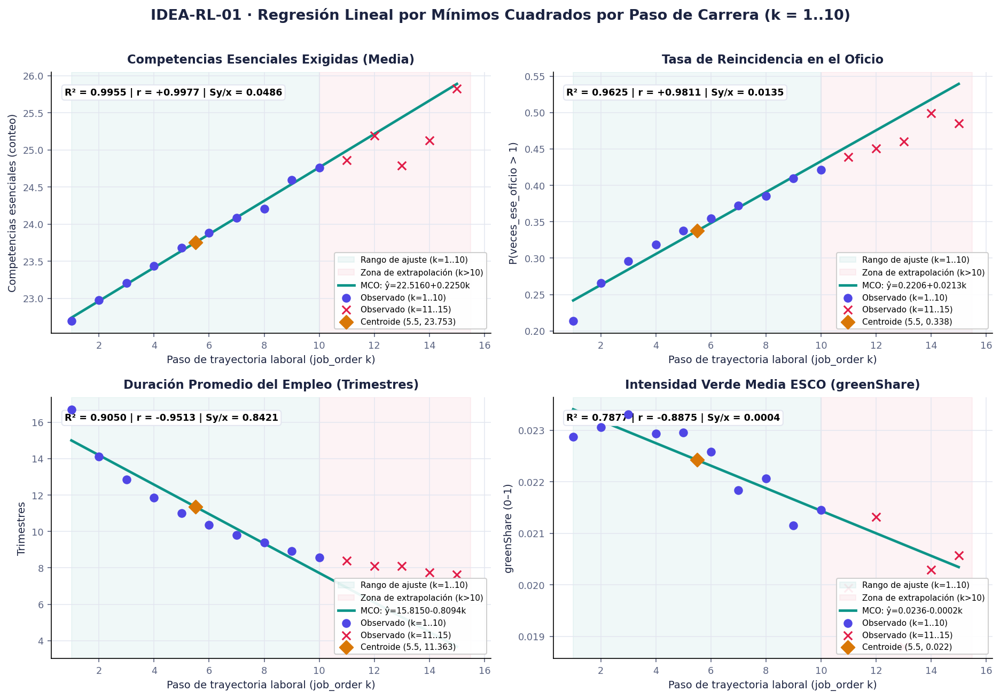
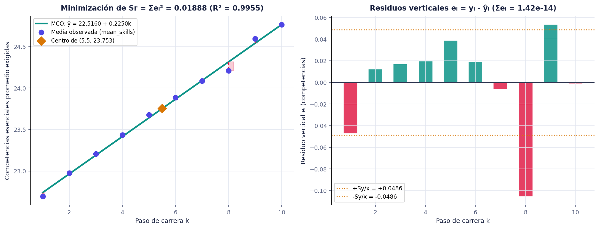

# IDEA-RL-01 — Progresión por Paso de Carrera (job_order k = 1..10)

> **Temática:** Regresión Lineal (MCO) · **Prioridad:** P0 · **Presentación base:** `regresion_lineal_minimos_cuadrados.html` (Diapositivas 3–12 (Ecuaciones Normales, Centroide, Residuos, R², Extrapolación))

---

## 1. Propósito y Finalidad Analítica

Cuantificar la tasa lineal de cambio con la que las personas transitan hacia oficios ESCO más complejos, más repetidos, de menor duración promedio o con distinta intensidad verde a medida que avanzan desde su 1.er empleo (k = 1) hasta su 10.º empleo (k = 10), sintetizando 1,738,738 experiencias clasificadas en pendientes interpretables para el observatorio laboral.

## 2. Archivos de `data/` Utilizados (Solo Lectura)

- `data/03_processed/empleos_unificado_limpio.csv` (Versión A · 1,871,014 filas; filtrado a 1,738,738 experiencias clasificadas `saber_skills == 'ok'`)
- `data/02_interim/ESCO/greenShareOcc_en_limpio.csv` (unido en RAM por `occupation_code`, cubriendo el 92.93 % del universo)

## 3. Formulación Matemática Aplicada

$$\hat{y}(k) = a_0 + a_1 k, \qquad a_1 = \frac{n\sum k_i y_i - \sum k_i \sum y_i}{n\sum k_i^2 - (\sum k_i)^2}, \qquad a_0 = \bar{y} - a_1 \bar{k}$$

$$S_t = \sum (y_i - \bar{y})^2, \qquad S_r = \sum (y_i - \hat{y}_i)^2, \qquad R^2 = \frac{S_t - S_r}{S_t}, \qquad S_{y/x} = \sqrt{\frac{S_r}{n-2}}$$

## 4. Cómo se Hizo (Metodología Paso a Paso)

1. Se cargó `empleos_unificado_limpio.csv` con `usecols` seguro en memoria (excluyendo columnas de texto largo `skills`, `knowledge`, `sin_tipo`) y se cruzó `greenShare` en RAM sin modificar archivos en disco.
2. Se ordenó cronológicamente la trayectoria de cada persona (`resume_id`) por `(start_ord, end_ord)` asignando el paso secuencial `job_order = 1, 2, ..., 15`.
3. Se agregaron las medias por paso de carrera `k = 1..10` (`n = 10` nodos) para cuatro variables: `mean_skills`, `reincide_rate`, `mean_dur_q` y `mean_green`.
4. Se ejecutó un control de sensibilidad restringido a personas con `>= 10` empleos clasificados para verificar el efecto de sesgo de supervivencia.
5. Se ajustó el modelo lineal por ecuaciones normales cerradas (`regresion_lineal`), generando la tabla completa de sumas (`Σx, Σy, Σx², Σxy`), cuadrados de residuos (`Sr`), centroide `(x̄, ȳ)` y validación frente a `numpy.polyfit(x, y, 1)` (`< 1e-10`).
6. Se auditó la extrapolación fuera de rango en `k = 11, 12, 15` (`is_extrapolation = True`) contrastando las predicciones frente a las medias reales observadas.

**Módulos de Python que lo implementan:**

- `scripts/ScriptsCsv/MetodosNumericos/loaders.py` (`load_processed_numeric`, `load_greenshare_lookup`)
- `scripts/ScriptsCsv/MetodosNumericos/ols.py` (`regresion_lineal`, `build_summation_and_residual_table`, `predict_ols`)
- `scripts/ScriptsCsv/MetodosNumericos/experiments_ols.py` (`run_rl01_career_steps`)

## 5. Resultados Empíricos Verificados

### Tabla: `rl01_ols_summary.csv`

| idea_id | y_var | n | a0 | a1 | r | r2 | s_yx | quality_verdict | polyfit_max_abs_diff |
| --- | --- | --- | --- | --- | --- | --- | --- | --- | --- |
| IDEA-RL-01 | mean_skills | 10 | 22.5160 | 0.2250 | 0.9977 | 0.9955 | 0.0486 | Ajuste Lineal Fuerte (R² ≥ 0.70) | 3.553e-15 |
| IDEA-RL-01 (cohort >=10) | mean_skills | 10 | 22.9122 | 0.2026 | 0.9762 | 0.9529 | 0.1446 | Ajuste Lineal Fuerte (R² ≥ 0.70) | 3.553e-15 |
| IDEA-RL-01 | reincide_rate | 10 | 0.2206 | 0.0213 | 0.9811 | 0.9625 | 0.0135 | Ajuste Lineal Fuerte (R² ≥ 0.70) | 5.551e-17 |
| IDEA-RL-01 (cohort >=10) | reincide_rate | 10 | 0.3806 | 0.0072 | 0.6690 | 0.4475 | 0.0258 | Ajuste Lineal Moderado (0.30 ≤ R² < 0.70) | 4.337e-18 |
| IDEA-RL-01 | mean_dur_q | 10 | 15.8150 | -0.8094 | -0.9513 | 0.9050 | 0.8421 | Ajuste Lineal Fuerte (R² ≥ 0.70) | 3.331e-16 |
| IDEA-RL-01 (cohort >=10) | mean_dur_q | 10 | 13.7106 | -0.5815 | -0.9401 | 0.8838 | 0.6771 | Ajuste Lineal Fuerte (R² ≥ 0.70) | 3.553e-15 |
| IDEA-RL-01 | mean_green | 10 | 0.0236 | -0.0002 | -0.8875 | 0.7877 | 0.0004 | Ajuste Lineal Fuerte (R² ≥ 0.70) | 3.469e-18 |
| IDEA-RL-01 (cohort >=10) | mean_green | 10 | 0.0192 | 0.0002 | 0.8550 | 0.7310 | 0.0004 | Ajuste Lineal Fuerte (R² ≥ 0.70) | 3.469e-18 |

### Tabla: `rl01_summation_and_residuals_skills.csv`

| i | x_i | y_i | x_i_sq | x_i_y_i | y_hat_i | e_i | e_i_sq | y_minus_ybar_sq |
| --- | --- | --- | --- | --- | --- | --- | --- | --- |
| 1 | 1 | 22.6939 | 1 | 22.6939 | 22.7410 | -0.0471 | 0.0022 | 1.1226 |
| 2 | 2 | 22.9780 | 4 | 45.9560 | 22.9660 | 0.0120 | 0.0001 | 0.6012 |
| 3 | 3 | 23.2077 | 9 | 69.6231 | 23.1910 | 0.0167 | 0.0003 | 0.2978 |
| 4 | 4 | 23.4354 | 16 | 93.7416 | 23.4159 | 0.0195 | 0.0004 | 0.1011 |
| 5 | 5 | 23.6797 | 25 | 118.3983 | 23.6409 | 0.0388 | 0.0015 | 0.0054 |
| 6 | 6 | 23.8848 | 36 | 143.3086 | 23.8659 | 0.0189 | 0.0004 | 0.0173 |
| 7 | 7 | 24.0849 | 49 | 168.5940 | 24.0908 | -0.0060 | 3.577e-05 | 0.1099 |
| 8 | 8 | 24.2104 | 64 | 193.6835 | 24.3158 | -0.1054 | 0.0111 | 0.2089 |
| 9 | 9 | 24.5942 | 81 | 221.3482 | 24.5408 | 0.0535 | 0.0029 | 0.7071 |
| 10 | 10 | 24.7649 | 100 | 247.6490 | 24.7658 | -0.0009 | 7.335e-07 | 1.0232 |

### Tabla: `rl01_career_step_profile.csv`

| job_order | n_rows | mean_skills | mean_dur_q | median_dur_q | mean_green | reincide_rate |
| --- | --- | --- | --- | --- | --- | --- |
| 1 | 352,093 | 22.6939 | 16.7160 | 9 | 0.0229 | 0.2134 |
| 2 | 325,612 | 22.9780 | 14.1091 | 5 | 0.0231 | 0.2660 |
| 3 | 282,150 | 23.2077 | 12.8505 | 5 | 0.0233 | 0.2957 |
| 4 | 227,663 | 23.4354 | 11.8624 | 5 | 0.0229 | 0.3184 |
| 5 | 173,414 | 23.6797 | 11.0181 | 5 | 0.0230 | 0.3381 |
| 6 | 125,814 | 23.8848 | 10.3584 | 5 | 0.0226 | 0.3546 |
| 7 | 87,520 | 24.0849 | 9.8104 | 5 | 0.0218 | 0.3723 |
| 8 | 59,147 | 24.2104 | 9.4003 | 5 | 0.0221 | 0.3855 |
| 9 | 38,987 | 24.5942 | 8.9230 | 5 | 0.0211 | 0.4098 |
| 10 | 25,321 | 24.7649 | 8.5849 | 4 | 0.0215 | 0.4215 |
| 11 | 16,044 | 24.8647 | 8.3933 | 4 | 0.0199 | 0.4392 |
| 12 | 10,159 | 25.1926 | 8.1052 | 3 | 0.0213 | 0.4509 |
| 13 | 6,261 | 24.7935 | 8.0997 | 3 | 0.0188 | 0.4605 |
| 14 | 3,850 | 25.1317 | 7.7616 | 3 | 0.0203 | 0.4990 |
| 15 | 2,241 | 25.8282 | 7.6256 | 2 | 0.0206 | 0.4855 |

### Tabla: `rl01_extrapolation_audit.csv`

| y_var | job_order_k | is_extrapolation | y_pred_ols | y_observed | abs_error | observed_n_rows |
| --- | --- | --- | --- | --- | --- | --- |
| mean_skills | 11 | Sí | 24.9907 | 24.8647 | 0.1260 | 16,044 |
| mean_skills | 12 | Sí | 25.2157 | 25.1926 | 0.0231 | 10,159 |
| mean_skills | 15 | Sí | 25.8906 | 25.8282 | 0.0624 | 2,241 |
| reincide_rate | 11 | Sí | 0.4544 | 0.4392 | 0.0153 | 16,044 |
| reincide_rate | 12 | Sí | 0.4757 | 0.4509 | 0.0247 | 10,159 |
| reincide_rate | 15 | Sí | 0.5394 | 0.4855 | 0.0539 | 2,241 |
| mean_dur_q | 11 | Sí | 6.9116 | 8.3933 | 1.4816 | 16,044 |
| mean_dur_q | 12 | Sí | 6.1023 | 8.1052 | 2.0030 | 10,159 |
| mean_dur_q | 15 | Sí | 3.6741 | 7.6256 | 3.9515 | 2,241 |
| mean_green | 11 | Sí | 0.0212 | 0.0199 | 0.0013 | 16,044 |
| mean_green | 12 | Sí | 0.0210 | 0.0213 | 0.0003 | 10,159 |
| mean_green | 15 | Sí | 0.0203 | 0.0206 | 0.0002 | 2,241 |

## 6. Gráficos Generados (150 DPI)

### `nm01_rl01_career_steps_panel.png`



*Panel 4× de regresión MCO por paso de carrera k=1..10 con centroides y zona sombreada de extrapolación (k>10).*

### `nm02_rl01_residual_squares_and_extrapolation.png`



*Representación geométrica de cuadrados de residuos (minimización de Sr) y residuos verticales e_i para mean_skills ~ job_order.*

## 7. Comandos de Verificación en GeoGebra

### `ggb_rl01_career_steps_skills.txt`

```text
# JobPath GeoGebra Verification — IDEA-RL-01 (mean_skills ~ job_order, k=1..10)
# Paste each command sequentially into GeoGebra Classic Algebra Input (https://www.geogebra.org/classic)
# Spanish equivalents: AjusteLineal(P), CoeficienteCorrelación(P), RCuadrado(P, f)
# Expected Python OLS: a0 = 22.516043, a1 = 0.224971, r = 0.997746, R2 = 0.995498
P = {(1, 22.693871), (2, 22.977992), (3, 23.207698), (4, 23.435402), (5, 23.679668), (6, 23.884766), (7, 24.084861), (8, 24.210442), (9, 24.594249), (10, 24.764899)}
f = FitLine(P)
r = CorrelationCoefficient(P)
R2 = RSquare(P, f)
Centroid = (5.500000, 23.753385)
Q_pred = (12, f(12))
# Expected Q_pred y-coordinate: 25.215697
```

## 8. Limitaciones, Advertencias y Salvaguardas de Dominio

- Asociación descriptiva, nunca causalidad (MR-07): las pendientes describen tendencias entre pasos, no implican que cambiar de empleo cause mayor adquisición de habilidades.
- Regla de atribución ESCO (MR-08): `mean_skills` mide cuántas competencias esenciales exige el oficio ocupado, no cuántas domina la persona.
- Sesgo de supervivencia y censura: llegan menos personas a `k = 10` (`25,321` registros frente a `352,093` en `k = 1`); por eso se reporta también la cohorte controlada de personas con `>= 10` empleos.

---

**Reproducibilidad:** Ejecuta `python -m scripts.ScriptsCsv.MetodosNumericos.pipeline` desde la raíz de `MineriaProtect` para recalcular todo desde `data/`, `python -m scripts.ScriptsCsv.MetodosNumericos.deliverable_packager` para actualizar esta carpeta, y `python -m unittest discover -s tests/metodos_numericos -v` para correr las 15 pruebas.
