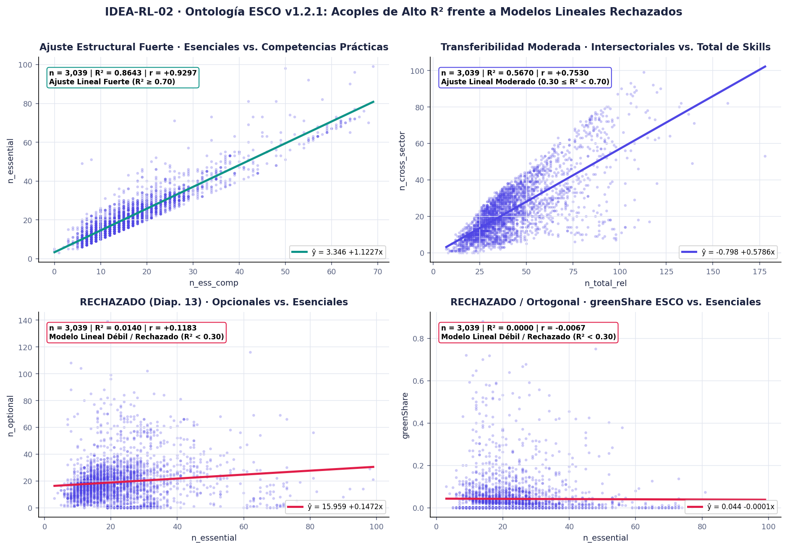
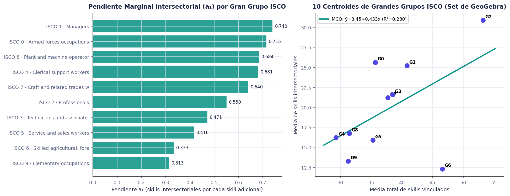

# IDEA-RL-02 — Ontología ESCO y Transferibilidad de Competencias (n = 3,039 oficios)

> **Temática:** Regresión Lineal (MCO) · **Prioridad:** P0 · **Presentación base:** `regresion_lineal_minimos_cuadrados.html` (Diapositivas 11 y 13 (Calidad del Ajuste R² y Rechazo Honesto de Modelos Pobres))

---

## 1. Propósito y Finalidad Analítica

Modelar las leyes estructurales internas de la taxonomía europea ESCO v1.2.1 —midiendo qué fracción de cada competencia adicional de un oficio es transferible entre sectores (`cross-sector`) a través de los 3,039 oficios y 10 grandes grupos ISCO-08— mientras se operacionaliza la Diapositiva 13: rechazar honestamente modelos lineales con R² cercano a cero.

## 2. Archivos de `data/` Utilizados (Solo Lectura)

- `data/02_interim/ESCO/occupations_en_limpio.csv` (3,039 oficios ESCO limpios)
- `data/02_interim/ESCO/ISCOGroups_en_limpio.csv` (619 grupos ISCO-08 y 10 grandes grupos de 1 dígito)
- `data/02_interim/SKILLS/occupationSkillRelations_en_limpio.csv` (126,051 relaciones: 67,600 esenciales + 58,451 opcionales)
- `data/02_interim/SKILLS/skills_en_limpio.csv` (13,939 competencias con `reuseLevel`: sector-specific, cross-sector, occupation-specific, transversal)
- `data/02_interim/ESCO/greenShareOcc_en_limpio.csv` (cruce exacto del 100 % en los 3,039 oficios)

## 3. Formulación Matemática Aplicada

$$\widehat{\texttt{n\_cross\_sector}} = a_0 + a_1 \cdot \texttt{n\_total\_rel}, \qquad \text{Rechazar modelo lineal si } R^2 < 0.30 \text{ (MR-06)}$$

## 4. Cómo se Hizo (Metodología Paso a Paso)

1. Se cruzaron las 126,051 relaciones oficio-competencia con `skills_en_limpio.csv` (`reuseLevel`) usando indicadores binarios vectorizados (`essential`, `optional`, `competence`, `knowledge`, `cross-sector`, `sector-specific`, `transversal`).
2. Se agregaron los conteos a nivel de los `n = 3,039` oficios únicos (`conceptUri`) y se incorporó `greenShare` (3,039/3,039 = 100 % de cobertura) más el gran grupo ISCO-08 de 1 dígito.
3. Se ajustó MCO en 7 pares estructurales contrastando acoples fuertes (`n_essential ~ n_ess_comp`), transferibilidad moderada (`n_cross_sector ~ n_total_rel`) e hipótesis nulas/ortogonales rechazadas (`n_optional ~ n_essential`, `greenShare ~ n_essential`).
4. Se estratificó la ley de transferibilidad `n_cross_sector ~ n_total_rel` por separado en los 10 grandes grupos ISCO-08 y se exportaron sus 10 centroides para verificación en GeoGebra.

**Módulos de Python que lo implementan:**

- `scripts/ScriptsCsv/MetodosNumericos/loaders.py` (`load_esco_catalog_enriched`)
- `scripts/ScriptsCsv/MetodosNumericos/ols.py` (`regresion_lineal`, `classify_r2_quality`)
- `scripts/ScriptsCsv/MetodosNumericos/experiments_ols.py` (`run_rl02_esco_catalog`)

## 5. Resultados Empíricos Verificados

### Tabla: `rl02_esco_catalog_ols.csv`

| idea_id | x_var | y_var | n | a0 | a1 | r | r2 | s_yx | quality_verdict |
| --- | --- | --- | --- | --- | --- | --- | --- | --- | --- |
| IDEA-RL-02 | n_ess_comp | n_essential | 3,039 | 3.3465 | 1.1227 | 0.9297 | 0.8643 | 4.4184 | Ajuste Lineal Fuerte (R² ≥ 0.70) |
| IDEA-RL-02 | n_competence | n_total_rel | 3,039 | 4.8359 | 1.2156 | 0.8555 | 0.7319 | 10.4702 | Ajuste Lineal Fuerte (R² ≥ 0.70) |
| IDEA-RL-02 | n_total_rel | n_cross_sector | 3,039 | -0.7983 | 0.5786 | 0.7530 | 0.5670 | 10.2229 | Ajuste Lineal Moderado (0.30 ≤ R² < 0.70) |
| IDEA-RL-02 | n_sector_spec | n_total_rel | 3,039 | 24.5534 | 0.9925 | 0.6379 | 0.4069 | 15.5728 | Ajuste Lineal Moderado (0.30 ≤ R² < 0.70) |
| IDEA-RL-02 | n_essential | n_optional | 3,039 | 15.9592 | 0.1472 | 0.1183 | 0.0140 | 14.8176 | Modelo Lineal Débil / Rechazado (R² < 0.30) |
| IDEA-RL-02 | n_essential | greenShare | 3,039 | 0.0435 | -5.206e-05 | -0.0067 | 4.474e-05 | 0.0933 | Modelo Lineal Débil / Rechazado (R² < 0.30) |
| IDEA-RL-02 | n_knowledge | greenShare | 3,039 | 0.0360 | 0.0006 | 0.0657 | 0.0043 | 0.0931 | Modelo Lineal Débil / Rechazado (R² < 0.30) |
| IDEA-RL-02 (ISCO-10 centroids) | mean_total_rel | mean_cross_sector | 10 | 3.4481 | 0.4330 | 0.5292 | 0.2800 | 5.4310 | Modelo Lineal Débil / Rechazado (R² < 0.30) |

### Tabla: `rl02_isco_major_group_slopes.csv`

| isco_major | isco_major_label | n_occupations | mean_total_rel | mean_cross_sector | a1_cross_sector_slope | r2 |
| --- | --- | --- | --- | --- | --- | --- |
| 0 | Armed forces occupations | 21 | 35.6667 | 25.6190 | 0.7150 | 0.9220 |
| 1 | Managers | 350 | 40.8229 | 25.2171 | 0.7403 | 0.7541 |
| 2 | Professionals | 868 | 53.1763 | 30.8952 | 0.5504 | 0.5011 |
| 3 | Technicians and associate professionals | 646 | 38.4737 | 21.5619 | 0.4714 | 0.4421 |
| 4 | Clerical support workers | 89 | 29.2809 | 16.2135 | 0.6813 | 0.5219 |
| 5 | Service and sales workers | 204 | 35.2843 | 15.8824 | 0.4164 | 0.2687 |
| 6 | Skilled agricultural, forestry and fishery workers | 44 | 46.5909 | 12.2955 | 0.3330 | 0.6050 |
| 7 | Craft and related trades workers | 394 | 37.7234 | 21.2005 | 0.6396 | 0.6164 |
| 8 | Plant and machine operators and assemblers | 347 | 31.4380 | 16.7406 | 0.6839 | 0.6134 |
| 9 | Elementary occupations | 76 | 31.2763 | 13.2763 | 0.3131 | 0.3618 |

## 6. Gráficos Generados (150 DPI)

### `nm03_rl02_esco_high_vs_low_r2.png`



*Contraste lado a lado entre acoples estructurales de alto R² y modelos lineales rechazados en los 3,039 oficios ESCO.*

### `nm04_rl02_isco_major_group_slopes.png`



*Pendiente marginal intersectorial a₁ en los 10 grandes grupos ISCO-08 y ajuste de sus 10 centroides para GeoGebra.*

## 7. Comandos de Verificación en GeoGebra

### `ggb_rl02_isco10_transferability.txt`

```text
# JobPath GeoGebra Verification — IDEA-RL-02 (ISCO-10 Centroids: mean_cross_sector ~ mean_total_rel)
# Paste each command sequentially into GeoGebra Classic Algebra Input (https://www.geogebra.org/classic)
# Spanish equivalents: AjusteLineal(P), CoeficienteCorrelación(P), RCuadrado(P, f)
# Expected Python OLS: a0 = 3.448113, a1 = 0.432990, r = 0.529160, R2 = 0.280010
P = {(35.666667, 25.619048), (40.822857, 25.217143), (53.176267, 30.895161), (38.473684, 21.561920), (29.280899, 16.213483), (35.284314, 15.882353), (46.590909, 12.295455), (37.723350, 21.200508), (31.438040, 16.740634), (31.276316, 13.276316)}
f = FitLine(P)
r = CorrelationCoefficient(P)
R2 = RSquare(P, f)
Centroid = (37.973330, 19.890202)
Q_pred = (45, f(45))
# Expected Q_pred y-coordinate: 22.932683
```

## 8. Limitaciones, Advertencias y Salvaguardas de Dominio

- Acople parte-todo en `n_essential ~ n_ess_comp`: las competencias prácticas son componente del total esencial ($E = C + K + U$); la pendiente $a_1 = 1.1227 > 1$ refleja cuánto conocimiento teórico acompaña a cada competencia práctica adicional.
- Ortogonalidad verde (`greenShare ~ n_essential`, $R^2 = 0.0000$): demuestra empíricamente que los oficios verdes no equivalen simplemente a oficios con más competencias totales.

---

**Reproducibilidad:** Ejecuta `python -m scripts.ScriptsCsv.MetodosNumericos.pipeline` desde la raíz de `MineriaProtect` para recalcular todo desde `data/`, `python -m scripts.ScriptsCsv.MetodosNumericos.deliverable_packager` para actualizar esta carpeta, y `python -m unittest discover -s tests/metodos_numericos -v` para correr las 15 pruebas.
