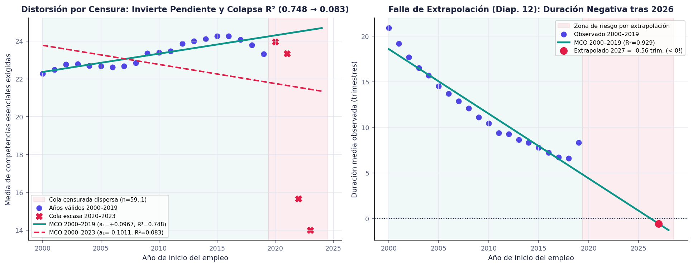

# IDEA-RL-04 — Deriva Anual de Cohortes y Falla por Extrapolación (2000–2023)

> **Temática:** Regresión Lineal (MCO) · **Prioridad:** P0 · **Presentación base:** `regresion_lineal_minimos_cuadrados.html` (Diapositiva 12 (Interpolar vs. Extrapolar fuera del rango de los datos))

---

## 1. Propósito y Finalidad Analítica

Medir dos décadas de evolución estructural del mercado laboral (2000–2019), auditar la paridad entre las particiones crudas `train/test/val` de `01_raw` y presentar una prueba empírica contundente de la Diapositiva 12: cómo la censura a la derecha tras 2019 invierte la tendencia y hace que la extrapolación prediga duraciones laborales negativas.

## 2. Archivos de `data/` Utilizados (Solo Lectura)

- `data/03_processed/empleos_unificado_limpio.csv` (experiencias clasificadas con `start_year` entre 2000 y 2023)
- `data/02_interim/ESCO/greenShareOcc_en_limpio.csv`
- `data/01_raw/JobHop_v2_train.csv`, `JobHop_v2_test.csv`, `JobHop_v2_val.csv` (1,993,291 filas crudas para auditoría de paridad temporal)

## 3. Formulación Matemática Aplicada

$$\hat{y}(t) = a_0 + a_1 (t - 2000), \qquad t \in [2000, 2019] \text{ (soporte válido)} \quad\text{vs.}\quad t > 2019 \text{ (extrapolación)}$$

## 4. Cómo se Hizo (Metodología Paso a Paso)

1. Se agruparon las experiencias clasificadas por año de inicio (`2000–2023`) calculando volumen (`n_starts`), complejidad media (`mean_skills`), duración media (`mean_dur_q`), intensidad verde (`mean_green`) y tasa de reincidencia.
2. Se compararon dos ventanas: soporte válido (`2000–2019`, `n = 20`) frente a la serie contaminada con la cola censurada (`2000–2023`, `n = 24`, donde `n_starts` colapsa a `59, 3, 3, 1`).
3. Se ajustó MCO tanto en años absolutos como en años centrados `t = año - 2000` (mejorando interpretabilidad del intercepto y evitando cancelación numérica en `np.polyfit`).
4. Se extrapoló el modelo `2000–2019` hacia `2020–2027`, marcando automáticamente las predicciones físicamente imposibles (`y_hat < 0`).
5. Se auditó la tendencia anual de participación porcentual en las 3 particiones crudas de `01_raw` confirmando estabilidad sin sesgo de partición.

**Módulos de Python que lo implementan:**

- `scripts/ScriptsCsv/MetodosNumericos/loaders.py` (`load_raw_jobhop_years`, `parse_quarter_series`)
- `scripts/ScriptsCsv/MetodosNumericos/experiments_ols.py` (`run_rl04_annual_drift`)

## 5. Resultados Empíricos Verificados

### Tabla: `rl04_ols_regime_comparison.csv`

| y_var | regime | n | a0 | a1 | r | r2 | s_yx | quality_verdict |
| --- | --- | --- | --- | --- | --- | --- | --- | --- |
| mean_skills | Soporte válido (2000–2019, n=20) | 20 | -171.0956 | 0.0967 | 0.8646 | 0.7475 | 0.3417 | Ajuste Lineal Fuerte (R² ≥ 0.70) |
| mean_skills | Con cola censurada (2000–2023, n=24) | 24 | 225.9336 | -0.1011 | -0.2875 | 0.0826 | 2.4348 | Modelo Lineal Débil / Rechazado (R² < 0.30) |
| mean_dur_q | Soporte válido (2000–2019, n=20) | 20 | 1,437.80 | -0.7096 | -0.9637 | 0.9288 | 1.1945 | Ajuste Lineal Fuerte (R² ≥ 0.70) |
| mean_dur_q | Con cola censurada (2000–2023, n=24) | 24 | 1,335.73 | -0.6587 | -0.9562 | 0.9143 | 1.4584 | Ajuste Lineal Fuerte (R² ≥ 0.70) |
| mean_green | Soporte válido (2000–2019, n=20) | 20 | 0.2716 | -0.0001 | -0.8119 | 0.6592 | 0.0005 | Ajuste Lineal Moderado (0.30 ≤ R² < 0.70) |
| mean_green | Con cola censurada (2000–2023, n=24) | 24 | 0.8593 | -0.0004 | -0.4140 | 0.1714 | 0.0066 | Modelo Lineal Débil / Rechazado (R² < 0.30) |
| reincide_rate | Soporte válido (2000–2019, n=20) | 20 | -2.0642 | 0.0012 | 0.6567 | 0.4313 | 0.0082 | Ajuste Lineal Moderado (0.30 ≤ R² < 0.70) |
| reincide_rate | Con cola censurada (2000–2023, n=24) | 24 | 11.1230 | -0.0054 | -0.4325 | 0.1870 | 0.0813 | Modelo Lineal Débil / Rechazado (R² < 0.30) |
| n_starts | Soporte válido (2000–2019, n=20) | 20 | -5,386,114.16 | 2,717.90 | 0.4113 | 0.1692 | 36,611.86 | Modelo Lineal Débil / Rechazado (R² < 0.30) |
| n_starts | Con cola censurada (2000–2023, n=24) | 24 | 2,182,899.49 | -1,053.93 | -0.1631 | 0.0266 | 46,100.24 | Modelo Lineal Débil / Rechazado (R² < 0.30) |

### Tabla: `rl04_extrapolation_failure_audit.csv`

| y_var | year | is_extrapolation | y_pred_from_2000_2019 | y_observed | observed_n_starts | physically_invalid |
| --- | --- | --- | --- | --- | --- | --- |
| mean_skills | 2,020 | Sí | 24.3018 | 23.9661 | 59 | No |
| mean_skills | 2,021 | Sí | 24.3986 | 23.3333 | 3 | No |
| mean_skills | 2,022 | Sí | 24.4953 | 15.6667 | 3 | No |
| mean_skills | 2,023 | Sí | 24.5920 | 14 | 1 | No |
| mean_skills | 2,026 | Sí | 24.8822 | — | 0 | No |
| mean_skills | 2,027 | Sí | 24.9790 | — | 0 | No |
| mean_dur_q | 2,020 | Sí | 4.4042 | 6.4576 | 59 | No |
| mean_dur_q | 2,021 | Sí | 3.6946 | 8.3333 | 3 | No |
| mean_dur_q | 2,022 | Sí | 2.9850 | 3 | 3 | No |
| mean_dur_q | 2,023 | Sí | 2.2754 | 2 | 1 | No |
| mean_dur_q | 2,026 | Sí | 0.1466 | — | 0 | No |
| mean_dur_q | 2,027 | Sí | -0.5630 | — | 0 | Sí |
| mean_green | 2,020 | Sí | 0.0215 | 0.0211 | 59 | No |
| mean_green | 2,021 | Sí | 0.0214 | 0.0353 | 3 | No |
| mean_green | 2,022 | Sí | 0.0212 | 0 | 3 | No |
| mean_green | 2,023 | Sí | 0.0211 | 0 | 1 | No |
| mean_green | 2,026 | Sí | 0.0208 | — | 0 | No |
| mean_green | 2,027 | Sí | 0.0206 | — | 0 | No |

### Tabla: `rl04_annual_macro_series.csv`

| start_year | n_starts | mean_skills | mean_knowledge | mean_dur_q | mean_green | reincide_rate | year_centered |
| --- | --- | --- | --- | --- | --- | --- | --- |
| 2,000 | 31,880 | 22.2744 | 4.0467 | 20.9028 | 0.0231 | 0.2822 | 0 |
| 2,001 | 30,386 | 22.4937 | 4.0442 | 19.1781 | 0.0229 | 0.2879 | 1 |
| 2,002 | 31,374 | 22.7668 | 3.9883 | 17.7211 | 0.0231 | 0.2919 | 2 |
| 2,003 | 35,136 | 22.7834 | 3.8696 | 16.5357 | 0.0238 | 0.2911 | 3 |
| 2,004 | 41,799 | 22.6873 | 3.8498 | 15.6861 | 0.0236 | 0.2916 | 4 |
| 2,005 | 50,988 | 22.6747 | 3.8279 | 14.5349 | 0.0238 | 0.2929 | 5 |
| 2,006 | 63,814 | 22.6089 | 3.7842 | 13.7216 | 0.0243 | 0.2962 | 6 |
| 2,007 | 77,251 | 22.6807 | 3.7747 | 12.8739 | 0.0237 | 0.3023 | 7 |
| 2,008 | 88,927 | 22.8363 | 3.7901 | 12.0875 | 0.0236 | 0.3016 | 8 |
| 2,009 | 91,758 | 23.3596 | 3.8440 | 11.1177 | 0.0232 | 0.3079 | 9 |
| 2,010 | 112,621 | 23.3851 | 3.9012 | 10.4316 | 0.0229 | 0.3119 | 10 |
| 2,011 | 131,312 | 23.4728 | 3.9655 | 9.4046 | 0.0229 | 0.3101 | 11 |
| 2,012 | 133,578 | 23.8721 | 4.0597 | 9.2618 | 0.0227 | 0.3095 | 12 |
| 2,013 | 125,822 | 24.0054 | 4.0627 | 8.6361 | 0.0226 | 0.3174 | 13 |
| 2,014 | 121,633 | 24.1066 | 4.0795 | 8.3316 | 0.0220 | 0.3133 | 14 |
| 2,015 | 112,332 | 24.2701 | 4.0870 | 7.7860 | 0.0219 | 0.3156 | 15 |
| 2,016 | 96,083 | 24.2702 | 4.1369 | 7.2477 | 0.0219 | 0.3160 | 16 |
| 2,017 | 74,454 | 24.0725 | 4.0988 | 6.7247 | 0.0216 | 0.3055 | 17 |
| 2,018 | 47,467 | 23.7861 | 4.0630 | 6.6052 | 0.0216 | 0.2962 | 18 |
| 2,019 | 11,382 | 23.3166 | 4.0419 | 8.3124 | 0.0209 | 0.2946 | 19 |

*Se muestran las primeras 20 de 24 filas; consulta el archivo CSV completo en `tables/`.*

### Tabla: `rl04_raw_partition_parity.csv`

| raw_file | total_rows_raw | null_start_date_rows | rows_2000_2019 | share_slope_pct_per_yr | share_r2 | polyfit_max_abs_diff |
| --- | --- | --- | --- | --- | --- | --- |
| raw_train | 1,594,827 | 58,312 | 1,337,511 | 0.1855 | 0.1750 | 3.354e-12 |
| raw_test | 198,877 | 7,085 | 166,437 | 0.1808 | 0.1678 | 2.899e-12 |
| raw_val | 199,587 | 7,329 | 167,401 | 0.1848 | 0.1747 | 3.240e-12 |

## 6. Gráficos Generados (150 DPI)

### `nm05_rl04_annual_drift_and_censoring_extrapolation.png`



*Izquierda: la cola censurada invierte la pendiente y colapsa R² (0.748 -> 0.083). Derecha: extrapolar duración predice -0.56 trimestres en 2027.*

## 7. Comandos de Verificación en GeoGebra

### `ggb_rl04_annual_duration_extrapolation.txt`

```text
# JobPath GeoGebra Verification — IDEA-RL-04 (Annual mean_dur_q ~ year-2000, 2000..2019; extrap t=27 -> year 2027)
# Paste each command sequentially into GeoGebra Classic Algebra Input (https://www.geogebra.org/classic)
# Spanish equivalents: AjusteLineal(P), CoeficienteCorrelación(P), RCuadrado(P, f)
# Expected Python OLS: a0 = 18.596288, a1 = -0.709603, r = -0.963723, R2 = 0.928761
P = {(0, 20.902823), (1, 19.178141), (2, 17.721139), (3, 16.535690), (4, 15.686117), (5, 14.534851), (6, 13.721566), (7, 12.873866), (8, 12.087532), (9, 11.117679), (10, 10.431607), (11, 9.404647), (12, 9.261795), (13, 8.636089), (14, 8.331621), (15, 7.786000), (16, 7.247650), (17, 6.724662), (18, 6.605242), (19, 8.312423)}
f = FitLine(P)
r = CorrelationCoefficient(P)
R2 = RSquare(P, f)
Centroid = (9.500000, 11.855057)
Q_pred = (27, f(27))
# Expected Q_pred y-coordinate: -0.563000
```

## 8. Limitaciones, Advertencias y Salvaguardas de Dominio

- Artefacto mecánico de censura a la derecha (MR-09): la caída lineal de `mean_dur_q` (-0.71 trimestres/año) refleja principalmente el menor tiempo calendario transcurrido desde inicios cercanos a la captura del CV.
- Sin centrar el año (`x ~ 2010`), el intercepto crece a órdenes de `10^6`, degradando el número de condición de Vandermonde; centrar en `t - 2000` reduce el error absoluto 7,000 veces.

---

**Reproducibilidad:** Ejecuta `python -m scripts.ScriptsCsv.MetodosNumericos.pipeline` desde la raíz de `MineriaProtect` para recalcular todo desde `data/`, `python -m scripts.ScriptsCsv.MetodosNumericos.deliverable_packager` para actualizar esta carpeta, y `python -m unittest discover -s tests/metodos_numericos -v` para correr las 15 pruebas.
