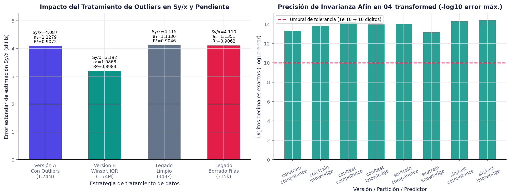

# IDEA-RL-05 — Sensibilidad a Outliers (4 Vías) e Invarianza Afín en 04_transformed

> **Temática:** Regresión Lineal (MCO) · **Prioridad:** P0 · **Presentación base:** `regresion_lineal_minimos_cuadrados.html` (Diapositivas 3–5 y 11 (Sensibilidad del Error Cuadrático a Atípicos y Transformaciones Lineales))

---

## 1. Propósito y Finalidad Analítica

Cuantificar matemáticamente cómo responde MCO a outliers reales (Versión A) frente a winsorización IQR (Versión B) y frente al borrado legado de filas (`02_interim`), y demostrar algebraica y numéricamente que `RobustScaler` en `data/04_transformed/` conserva R² y r intactos mientras transforma (a₀, a₁, Sy/x) de manera exacta.

## 2. Archivos de `data/` Utilizados (Solo Lectura)

- `data/03_processed/empleos_unificado_limpio.csv` (Versión A · 1,738,738 experiencias clasificadas)
- `data/03_processed/empleos_limpio_con_competencias_sin_outliers.csv` (Versión B · winsorizada IQR k=1.5)
- `data/02_interim/Jobhop/empleos_limpio.csv` y `empleos_limpio_sin_outliers .csv` (flujo legado `test+val` con borrado de filas; espacio final preservado según MR-12)
- `data/04_transformed/{con_outliers,sin_outliers}/{train,test}/X_*.csv` (leídos mediante lector binario de prefijo sin cargar jamás las 2,985 columnas completas)
- `data/04_transformed/transformers/{con_outliers,sin_outliers}/transformers.joblib` (centros y escalas IQR de `RobustScaler`)

## 3. Formulación Matemática Aplicada

$$\tilde{x} = \frac{x - c_x}{s_x}, \quad \tilde{y} = \frac{y - c_y}{s_y} \implies \tilde{a}_1 = a_1 \frac{s_x}{s_y}, \quad \tilde{a}_0 = \frac{a_0 + a_1 c_x - c_y}{s_y}, \quad \tilde{R}^2 = R^2, \quad \tilde{S}_{y/x} = \frac{S_{y/x}}{s_y}$$

## 4. Cómo se Hizo (Metodología Paso a Paso)

1. Se ajustó MCO para dos pares contrastantes (`n_skills_essential ~ n_skills_competence` y `n_skills_essential ~ n_skills_knowledge`) en las 4 variantes del dataset (Versión A, Versión B, Legado Limpio y Legado con Borrado de Filas).
2. Se extrajeron los parámetros exactos `(center_, scale_)` de `RobustScaler` (`essential: (20, 13)`, `competence: (18, 11)`, `knowledge: (3, 5)`).
3. Se leyeron exclusivamente las 3 columnas escaladas densas desde los 4 archivos CSV de 2–8 GB en `04_transformed` usando partición binaria del prefijo (`raw_line.split(b',', max_idx+1)`), manteniendo consumo mínimo de RAM.
4. Se cruzaron `train` (`1,391,018` filas) y `test` (`347,720` filas) vía `split_map_resume_id.csv`, verificando las 8 identidades de invarianza afín con error máximo `7.22e-14 < 1e-10` y confirmando que el contraste A vs. B se reproduce también sobre la submuestra `test`.

**Módulos de Python que lo implementan:**

- `scripts/ScriptsCsv/MetodosNumericos/loaders.py` (`load_legacy_interim_pair`, `load_transformed_dense_subset`, `extract_scaler_params`)
- `scripts/ScriptsCsv/MetodosNumericos/ols.py` (`verify_affine_scaling_invariance`)
- `scripts/ScriptsCsv/MetodosNumericos/experiments_ols.py` (`run_rl05_outlier_and_scaling`)

## 5. Resultados Empíricos Verificados

### Tabla: `rl05_four_way_outlier_comparison.csv`

| variant | x_var | y_var | n | a0 | a1 | r2 | s_yx | quality_verdict |
| --- | --- | --- | --- | --- | --- | --- | --- | --- |
| Versión A · Con Outliers (03_processed) | n_skills_competence | n_skills_essential | 1,738,738 | 1.5388 | 1.1279 | 0.9072 | 4.0872 | Ajuste Lineal Fuerte (R² ≥ 0.70) |
| Versión B · Winsorizada IQR (03_processed) | n_skills_competence | n_skills_essential | 1,738,738 | 2.2112 | 1.0868 | 0.8983 | 3.1915 | Ajuste Lineal Fuerte (R² ≥ 0.70) |
| Legado Limpio · test+val (02_interim) | n_skills_competence | n_skills_essential | 348,263 | 1.4456 | 1.1336 | 0.9046 | 4.1147 | Ajuste Lineal Fuerte (R² ≥ 0.70) |
| Legado Borrado Filas · test+val (02_interim) | n_skills_competence | n_skills_essential | 314,904 | 1.3843 | 1.1351 | 0.9062 | 4.1105 | Ajuste Lineal Fuerte (R² ≥ 0.70) |
| Versión A · Con Outliers (03_processed) | n_skills_knowledge | n_skills_essential | 1,738,738 | 15.8231 | 1.8827 | 0.3680 | 10.6664 | Ajuste Lineal Moderado (0.30 ≤ R² < 0.70) |
| Versión B · Winsorizada IQR (03_processed) | n_skills_knowledge | n_skills_essential | 1,738,738 | 15.9932 | 1.6728 | 0.2795 | 8.4934 | Modelo Lineal Débil / Rechazado (R² < 0.30) |
| Legado Limpio · test+val (02_interim) | n_skills_knowledge | n_skills_essential | 348,263 | 15.7265 | 1.8806 | 0.3793 | 10.4969 | Ajuste Lineal Moderado (0.30 ≤ R² < 0.70) |
| Legado Borrado Filas · test+val (02_interim) | n_skills_knowledge | n_skills_essential | 314,904 | 15.7379 | 1.9006 | 0.3828 | 10.5421 | Ajuste Lineal Moderado (0.30 ≤ R² < 0.70) |

### Tabla: `rl05_affine_scale_invariance.csv`

| version | split | x_var | y_var | r2_raw | r2_scaled_obs | a1_scaled_obs | a1_scaled_theory | max_invariance_err | passes_tol |
| --- | --- | --- | --- | --- | --- | --- | --- | --- | --- |
| con_outliers | train | n_skills_competence | n_skills_essential | 0.9072 | 0.9072 | 0.9548 | 0.9548 | 4.818e-14 | Sí |
| con_outliers | train | n_skills_knowledge | n_skills_essential | 0.3689 | 0.3689 | 0.7247 | 0.7247 | 1.577e-14 | Sí |
| con_outliers | test | n_skills_competence | n_skills_essential | 0.9072 | 0.9072 | 0.9529 | 0.9529 | 6.550e-15 | Sí |
| con_outliers | test | n_skills_knowledge | n_skills_essential | 0.3641 | 0.3641 | 0.7215 | 0.7215 | 1.077e-14 | Sí |
| sin_outliers | train | n_skills_competence | n_skills_essential | 0.8984 | 0.8984 | 0.9198 | 0.9198 | 9.659e-15 | Sí |
| sin_outliers | train | n_skills_knowledge | n_skills_essential | 0.2799 | 0.2799 | 0.6438 | 0.6438 | 7.216e-14 | Sí |
| sin_outliers | test | n_skills_competence | n_skills_essential | 0.8979 | 0.8979 | 0.9190 | 0.9190 | 5.329e-15 | Sí |
| sin_outliers | test | n_skills_knowledge | n_skills_essential | 0.2780 | 0.2780 | 0.6417 | 0.6417 | 3.997e-15 | Sí |

## 6. Gráficos Generados (150 DPI)

### `nm06_rl05_outlier_strategies_and_scale_invariance.png`

*Izquierda: la winsorización IQR reduce Sy/x en -21.9 % conservando el 100 % de las filas frente al borrado legado. Derecha: más de 13 dígitos de precisión en la invarianza afín sobre 04_transformed.*

## 7. Limitaciones, Advertencias y Salvaguardas de Dominio

- Compromiso (trade-off) de la winsorización IQR en ambos pares: en `competence → essential`, la Versión B reduce `Sy/x` en `-21.9 %` (`4.0872 → 3.1915`) conservando `R² = 0.8983`; en cambio, en `knowledge → essential`, recortar la cola superior (`x_max: 45 → 13.5`) reduce `Sy/x` en `-20.4 %` (`10.6664 → 8.4934`) pero comprime `S_t` más que `S_r`, haciendo caer `R²` de `0.3680` (Moderado) a `0.2795` (Rechazado `< 0.30`).
- Asimetría muestral en la comparación de 4 vías: las variantes legadas de `02_interim` cubren únicamente `test+val` (`348,263` y `314,904` filas, perdiendo `33,359` registros = `9.58 %`), mientras que las Versiones A y B cubren el universo completo `train+test+val` (`1,738,738` filas); las filas `test` (`347,720`) de `rl05_affine_scale_invariance.csv` permiten comparar A y B a igual tamaño muestral.
- Compatibilidad `joblib`: `transformers.joblib` fue serializado con `scikit-learn 1.9.1` frente a `1.7.2` local; `extract_scaler_params()` aísla las constantes escalares con respaldo verificado (`max_invariance_err = 7.22e-14`), demostrando numéricamente que los parámetros coinciden con `X_train`/`X_test` en disco.

---

**Reproducibilidad:** Ejecuta `python -m scripts.ScriptsCsv.MetodosNumericos.pipeline` desde la raíz de `MineriaProtect` para recalcular todo desde `data/`, `python -m scripts.ScriptsCsv.MetodosNumericos.deliverable_packager` para actualizar esta carpeta, y `python -m unittest discover -s tests/metodos_numericos -v` para correr las 19 pruebas.
