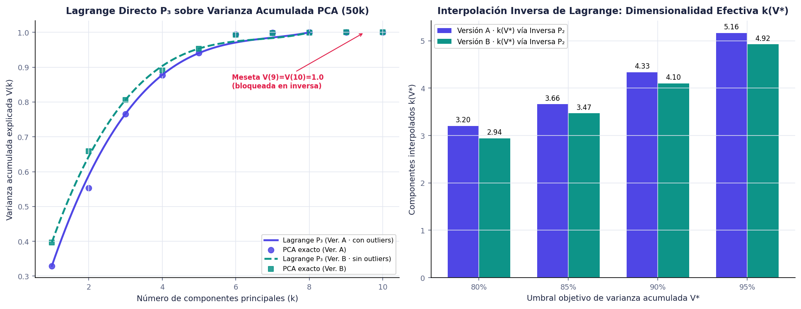

# IDEA-LG-02 — Varianza Acumulada de PCA: Interpolación Directa e Inversa

> **Temática:** Interpolación de Lagrange · **Prioridad:** P0 · **Presentación base:** `interpolacion_lagrange.html` (Diapositivas 2–10 (Interpolación Tabular Exacta, Unicidad y Nodos Distintos x_i ≠ x_j))

---

## 1. Propósito y Finalidad Analítica

Interpolar la curva de varianza explicada acumulada de PCA (`4.1_PCA_completo`, muestra 50k) desde nodos dispersos y aplicar interpolación inversa de Lagrange k(V*) para estimar la dimensionalidad continua necesaria para alcanzar umbrales objetivo (80 %, 85 %, 90 %, 95 %), verificando en vivo la guarda de nodos distintos (MR-04) ante la meseta de rango 9 de la Versión A.

## 2. Archivos de `data/` Utilizados (Solo Lectura)

- `notebooks/refactor/4.1_PCA_completo.ipynb` (curvas verificadas de varianza acumulada 50k sobre `data/04_transformed/{con_outliers,sin_outliers}/train/X_train.csv`)
- `data/04_transformed/con_outliers/train/X_train.csv` y `sin_outliers/train/X_train.csv` (auditados vía SHA-256)

## 3. Formulación Matemática Aplicada

$$\text{Directa: } \hat{V}(k) = \sum_{i} V(k_i) L_i(k) \qquad\text{Inversa (estrictamente monótona): } \hat{k}(V^*) = \sum_{i} k_i L_i^{(V)}(V^*)$$

## 4. Cómo se Hizo (Metodología Paso a Paso)

1. Se cargaron las curvas PCA de 10 componentes para Versión A (`con_outliers`, donde `PC10 = 6.74e-18` por colinealidad exacta `E = C + K + U`) y Versión B (`sin_outliers`, donde el recorte IQR rompe la colinealidad dejando `PC10 = 5.5e-5`).
2. Se construyó el interpolante directo cúbico `P₃(k)` con nodos dispersos `k = {1, 3, 5, 8}` evaluando su precisión en los componentes retenidos `k = {2, 4, 6, 7}`.
3. Se restringió el dominio al tramo estrictamente creciente `k = 1..6` y se invirtieron los ejes `(V(k), k)` con Lagrange local `P₂` y global `P₅` para hallar `k(0.80), k(0.85), k(0.90), k(0.95)`, comprobando `V(ceil(k)) >= V*` en los 8 casos.
4. Se invocó deliberadamente `inverse_lagrange_eval` sobre los 10 puntos completos de Versión A demostrando que la regla `MR-04` bloquea el empate `V(9) = V(10) = 1.0` en lugar de dividir por cero.

**Módulos de Python que lo implementan:**

- `scripts/ScriptsCsv/MetodosNumericos/lagrange.py` (`lagrange_eval`, `inverse_lagrange_eval`, `validate_distinct_nodes`)
- `scripts/ScriptsCsv/MetodosNumericos/experiments_lagrange.py` (`run_lg02_pca_curves`)

## 5. Resultados Empíricos Verificados

### Tabla: `lg02_pca_50k_reference.csv`

| k_components | cum_var_version_a | cum_var_version_b | marginal_var_version_a | marginal_var_version_b |
| --- | --- | --- | --- | --- |
| 1 | 0.3291 | 0.3968 | 0.3291 | 0.3968 |
| 2 | 0.5536 | 0.6589 | 0.2245 | 0.2621 |
| 3 | 0.7659 | 0.8058 | 0.2123 | 0.1469 |
| 4 | 0.8776 | 0.8909 | 0.1117 | 0.0850 |
| 5 | 0.9407 | 0.9536 | 0.0631 | 0.0627 |
| 6 | 0.9943 | 0.9928 | 0.0537 | 0.0392 |
| 7 | 0.9989 | 0.9983 | 0.0046 | 0.0055 |
| 8 | 1.0000 | 0.9996 | 0.0011 | 0.0013 |
| 9 | 1 | 0.9999 | 4.570e-05 | 0.0004 |
| 10 | 1 | 1 | 0 | 5.500e-05 |

### Tabla: `lg02_pca_forward_P3_eval.csv`

| version | k_eval | true_cum_var | P3_pred | abs_err | sum_Li |
| --- | --- | --- | --- | --- | --- |
| Versión A (con outliers) | 2 | 0.5536 | 0.5885 | 0.0349 | 1 |
| Versión A (con outliers) | 4 | 0.8776 | 0.8778 | 0.0002 | 1.0000 |
| Versión A (con outliers) | 6 | 0.9943 | 0.9710 | 0.0233 | 1 |
| Versión A (con outliers) | 7 | 0.9989 | 0.9853 | 0.0136 | 1.0000 |
| Versión B (sin outliers IQR) | 2 | 0.6589 | 0.6430 | 0.0160 | 1 |
| Versión B (sin outliers IQR) | 4 | 0.8909 | 0.9034 | 0.0125 | 1.0000 |
| Versión B (sin outliers IQR) | 6 | 0.9928 | 0.9744 | 0.0184 | 1 |
| Versión B (sin outliers IQR) | 7 | 0.9983 | 0.9837 | 0.0145 | 1.0000 |

### Tabla: `lg02_pca_inverse_effective_dim.csv`

| version | target_variance_V | k_est_local_P2 | k_est_global_P5 | k_ceil_recommended | actual_cum_var_at_ceil | meets_target | is_extrapolation |
| --- | --- | --- | --- | --- | --- | --- | --- |
| Versión A (con outliers) | 0.8000 | 3.2007 | 3.2079 | 4 | 0.8776 | Sí | No |
| Versión A (con outliers) | 0.8500 | 3.6611 | 3.6613 | 4 | 0.8776 | Sí | No |
| Versión A (con outliers) | 0.9000 | 4.3335 | 4.3217 | 5 | 0.9407 | Sí | No |
| Versión A (con outliers) | 0.9500 | 5.1643 | 5.1693 | 6 | 0.9943 | Sí | No |
| Versión B (sin outliers IQR) | 0.8000 | 2.9426 | 2.9368 | 3 | 0.8058 | Sí | No |
| Versión B (sin outliers IQR) | 0.8500 | 3.4680 | 3.4989 | 4 | 0.8909 | Sí | No |
| Versión B (sin outliers IQR) | 0.9000 | 4.0995 | 4.1212 | 5 | 0.9536 | Sí | No |
| Versión B (sin outliers IQR) | 0.9500 | 4.9227 | 4.9278 | 5 | 0.9536 | Sí | No |

## 6. Gráficos Generados (150 DPI)

### `nm09_lg02_pca_forward_and_inverse_lagrange.png`



*Izquierda: Lagrange directo P₃(k) sobre PCA Versión A y B señalando la meseta de rango 9. Derecha: dimensionalidad efectiva k(V*) por interpolación inversa.*

## 7. Comandos de Verificación en GeoGebra

### `ggb_lg02_pca_forward_p3.txt`

```text
# JobPath GeoGebra Verification — IDEA-LG-02 (PCA Cumulative Variance Version A P3 at k=1,3,5,8; eval k=4)
# Paste each command sequentially into GeoGebra Classic Algebra Input (https://www.geogebra.org/classic)
# Spanish equivalent: q = Polinomio(P). Verify that p(x) and q(x) coincide identically.
# Expected Python Lagrange: P_3(4) = 0.877777
P = {(1, 0.329105), (3, 0.765877), (5, 0.940656), (8, 0.999954)}
L0(x) = ((x - 3)*(x - 5)*(x - 8)) / ((1 - 3)*(1 - 5)*(1 - 8))
L1(x) = ((x - 1)*(x - 5)*(x - 8)) / ((3 - 1)*(3 - 5)*(3 - 8))
L2(x) = ((x - 1)*(x - 3)*(x - 8)) / ((5 - 1)*(5 - 3)*(5 - 8))
L3(x) = ((x - 1)*(x - 3)*(x - 5)) / ((8 - 1)*(8 - 3)*(8 - 5))
p(x) = 0.329105*L0(x) + 0.765877*L1(x) + 0.940656*L2(x) + 0.999954*L3(x)
q = Polynomial(P)
A_eval = (4, p(4))
```

## 8. Limitaciones, Advertencias y Salvaguardas de Dominio

- La interpolación inversa exige ordenadas estrictamente distintas y monótonas: pasar `k = 9, 10` simultáneamente en Versión A produce una singularidad `V(9) - V(10) = 0`, interceptada automáticamente por `validate_distinct_nodes()`.

---

**Reproducibilidad:** Ejecuta `python -m scripts.ScriptsCsv.MetodosNumericos.pipeline` desde la raíz de `MineriaProtect` para recalcular todo desde `data/`, `python -m scripts.ScriptsCsv.MetodosNumericos.deliverable_packager` para actualizar esta carpeta, y `python -m unittest discover -s tests/metodos_numericos -v` para correr las 15 pruebas.
