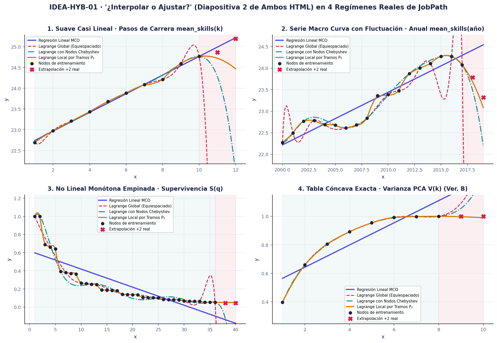
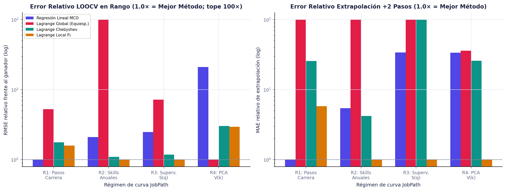

# IDEA-HYB-01 — Laboratorio Comparativo '¿Interpolar o Ajustar?' (4 Métodos × 4 Regímenes)

> **Temática:** Síntesis Híbrida (MCO vs. Lagrange) · **Prioridad:** P0 · **Presentación base:** `Ambas presentaciones HTML` (Diapositiva 2 de AMBOS HTML ('¿Pasar por todos los puntos… o capturar la tendencia?' y 'Diferencia con la regresión'))

---

## 1. Propósito y Finalidad Analítica

Unificar empíricamente ambas presentaciones sobre datos reales de JobPath: evaluar cara a cara 4 métodos numéricos en 4 regímenes de curva distintos mediante Validación Cruzada Leave-One-Out (LOOCV) y extrapolación a +2 pasos, produciendo una Rúbrica Objetiva de Selección de Método.

## 2. Archivos de `data/` Utilizados (Solo Lectura)

- Régimen 1: `rl01_career_step_profile.csv` (`mean_skills(k)`, suave casi lineal, `k=1..10`, extrap. `k=11,12`)
- Régimen 2: `rl04_annual_macro_series.csv` (`mean_skills(año)`, serie macro curva en arco con fluctuación, `2000..2017`, extrap. `2018,2019`)
- Régimen 3: `lg01_survival_curve_S_q.csv` (`S(q)`, curva monótona no lineal empinada, `q=1..36`, extrap. `q=38,40`)
- Régimen 4: `lg02_pca_50k_reference.csv` (`V(k)` Versión B, tabla cóncava exacta, `k=1..8`, extrap. `k=9,10`)

## 3. Formulación Matemática Aplicada

$$\text{LOOCV-RMSE} = \sqrt{\frac{1}{n-2}\sum_{i=2}^{n-1}\left(y_i - \hat{f}_{(-i)}(x_i)\right)^2}, \qquad \text{Extrap-MAE}_{+2} = \frac{1}{2}\sum_{m=1}^{2}\left|y_{n+m} - \hat{f}(x_{n+m})\right|$$

## 4. Cómo se Hizo (Metodología Paso a Paso)

1. Se seleccionaron 4 curvas reales de JobPath que cubren los escenarios clásicos de análisis numérico: tendencia casi lineal, serie temporal curva con fluctuación (arco `2000–2017`), decaimiento no lineal pronunciado y tabla cóncava exacta.
2. Se evaluaron en igualdad de condiciones 4 métodos: (1) Regresión Lineal MCO, (2) Lagrange Global Equiespaciado (con tope documentado de grado 12 / 13 nodos para curvas largas `n > 14`, evitando desbordamiento de grado 35), (3) Lagrange con Nodos Chebyshev-Lobatto y (4) Lagrange Local Cuadrático por Tramos `P₂`.
3. Se aplicó Validación Cruzada Leave-One-Out (LOOCV) estrictamente interior para medir MAE, RMSE y error máximo dentro de `[x_min, x_max]`, además de extrapolación controlada a +2 pasos frente a valores reales retenidos.
4. Se rankearon automáticamente las 16 combinaciones método×régimen y se generó la rúbrica ejecutiva de decisión (`hyb01_method_selection_rubric.csv`).

**Módulos de Python que lo implementan:**

- `scripts/ScriptsCsv/MetodosNumericos/comparison.py` (`run_hyb01_interpolate_vs_fit`, `_evaluate_four_methods_on_regime`)

## 5. Resultados Empíricos Verificados

### Tabla: `hyb01_method_selection_rubric.csv`

| regime_name | ols_r2 | best_in_range_method | best_loocv_rmse | best_extrapolation_method | best_extrap_mae | worst_in_range_method | worst_loocv_rmse |
| --- | --- | --- | --- | --- | --- | --- | --- |
| 1. Suave Casi Lineal · Pasos mean_skills(k) | 0.9955 | Regresión Lineal MCO | 0.0558 | Regresión Lineal MCO | 0.0745 | Lagrange Global (Equiespaciado) | 0.2937 |
| 2. Serie Macro Curva · Anual mean_skills(año) | 0.8995 | Lagrange Local por Tramos (P₂) | 0.1139 | Lagrange Local por Tramos (P₂) | 0.1711 | Lagrange Global (Equiespaciado) | 12.3239 |
| 3. No Lineal Empinada · Supervivencia S(q) | 0.6935 | Lagrange Local por Tramos (P₂) | 0.0524 | Lagrange Local por Tramos (P₂) | 0.0060 | Lagrange Global (Equiespaciado) | 0.3777 |
| 4. Tabla Cóncava Exacta · PCA V(k) (Ver. B) | 0.7964 | Lagrange Global (Equiespaciado) | 0.0036 | Lagrange Local por Tramos (P₂) | 0.0068 | Regresión Lineal MCO | 0.0765 |

### Tabla: `hyb01_loocv_and_extrapolation_matrix.csv`

| regime_name | n_train_nodes | ols_r2 | method | loocv_mae | loocv_rmse | loocv_max_err | extrap_2step_mae | loocv_rank | extrap_rank |
| --- | --- | --- | --- | --- | --- | --- | --- | --- | --- |
| 1. Suave Casi Lineal · Pasos mean_skills(k) | 10 | 0.9955 | Regresión Lineal MCO | 0.0411 | 0.0558 | 0.1278 | 0.0745 | 1 | 1 |
| 1. Suave Casi Lineal · Pasos mean_skills(k) | 10 | 0.9955 | Lagrange Local por Tramos (P₂) | 0.0627 | 0.0888 | 0.1571 | 0.4341 | 2 | 2 |
| 1. Suave Casi Lineal · Pasos mean_skills(k) | 10 | 0.9955 | Lagrange (Chebyshev-Lobatto) | 0.0654 | 0.0985 | 0.2297 | 1.9159 | 3 | 3 |
| 1. Suave Casi Lineal · Pasos mean_skills(k) | 10 | 0.9955 | Lagrange Global (Equiespaciado) | 0.2019 | 0.2937 | 0.5654 | 71.2822 | 4 | 4 |
| 2. Serie Macro Curva · Anual mean_skills(año) | 18 | 0.8995 | Lagrange Local por Tramos (P₂) | 0.0873 | 0.1139 | 0.2885 | 0.1711 | 1 | 1 |
| 2. Serie Macro Curva · Anual mean_skills(año) | 18 | 0.8995 | Lagrange (Chebyshev-Lobatto) | 0.0934 | 0.1250 | 0.2692 | 0.7216 | 2 | 2 |
| 2. Serie Macro Curva · Anual mean_skills(año) | 18 | 0.8995 | Regresión Lineal MCO | 0.2073 | 0.2396 | 0.4177 | 0.9285 | 3 | 3 |
| 2. Serie Macro Curva · Anual mean_skills(año) | 18 | 0.8995 | Lagrange Global (Equiespaciado) | 6.3936 | 12.3239 | 34.4249 | 386.3603 | 4 | 4 |
| 3. No Lineal Empinada · Supervivencia S(q) | 36 | 0.6935 | Lagrange Local por Tramos (P₂) | 0.0275 | 0.0524 | 0.1990 | 0.0060 | 1 | 1 |
| 3. No Lineal Empinada · Supervivencia S(q) | 36 | 0.6935 | Lagrange (Chebyshev-Lobatto) | 0.0433 | 0.0620 | 0.1783 | 0.6673 | 2 | 3 |
| 3. No Lineal Empinada · Supervivencia S(q) | 36 | 0.6935 | Regresión Lineal MCO | 0.1053 | 0.1301 | 0.4681 | 0.2032 | 3 | 2 |
| 3. No Lineal Empinada · Supervivencia S(q) | 36 | 0.6935 | Lagrange Global (Equiespaciado) | 0.1694 | 0.3777 | 1.6213 | 38.8875 | 4 | 4 |
| 4. Tabla Cóncava Exacta · PCA V(k) (Ver. B) | 8 | 0.7964 | Lagrange Global (Equiespaciado) | 0.0030 | 0.0036 | 0.0059 | 0.2423 | 1 | 4 |
| 4. Tabla Cóncava Exacta · PCA V(k) (Ver. B) | 8 | 0.7964 | Lagrange Local por Tramos (P₂) | 0.0091 | 0.0108 | 0.0178 | 0.0068 | 2 | 1 |
| 4. Tabla Cóncava Exacta · PCA V(k) (Ver. B) | 8 | 0.7964 | Lagrange (Chebyshev-Lobatto) | 0.0079 | 0.0111 | 0.0201 | 0.1741 | 3 | 2 |
| 4. Tabla Cóncava Exacta · PCA V(k) (Ver. B) | 8 | 0.7964 | Regresión Lineal MCO | 0.0694 | 0.0765 | 0.1067 | 0.2264 | 4 | 3 |

## 6. Gráficos Generados (150 DPI)

### `nm10_hyb01_interpolate_vs_fit_four_regimes.png`

*Superposición visual de los 4 métodos en los 4 regímenes reales de JobPath mostrando oscilación de Lagrange global frente a estabilidad de MCO y fidelidad de P₂ local.*

### `nm11_hyb01_loocv_and_extrapolation_rubric.png`

*Comparación relativa (1.0× = ganador del régimen) de RMSE en LOOCV y MAE en extrapolación +2 pasos.*

## 7. Limitaciones, Advertencias y Salvaguardas de Dominio

- Geometría real del Régimen 2 (`mean_skills` `2000–2017`, `ols_r2 = 0.8995`): presenta una curvatura suave en arco (sube hasta 2015–2016 y desciende en 2017–2019), no ruido blanco alrededor de una recta; por eso Local `P₂` (`0.1139` LOOCV; `0.1711` extrap.) y Chebyshev-Lobatto (`0.1250`) superan a MCO (`0.2396`), mientras Lagrange global equiespaciado explota `108.2×` (`12.3239` LOOCV; `386.36` extrap.).
- Transparencia del diseño del torneo: en curvas largas (`n > 14`, Regímenes 2 y 3), Lagrange Global se acota explícitamente a `13` nodos equiespaciados (grado 12) para cuantificar el Fenómeno de Runge sin desbordamiento de punto flotante; y usar nodos Chebyshev-Lobatto en el Régimen 4 (`n = 8`) produce un subconjunto propio distinto al equiespaciado, evitando empates artificiales en extrapolación (`0.1741` vs. `0.2423`).

---

**Reproducibilidad:** Ejecuta `python -m scripts.ScriptsCsv.MetodosNumericos.pipeline` desde la raíz de `MineriaProtect` para recalcular todo desde `data/`, `python -m scripts.ScriptsCsv.MetodosNumericos.deliverable_packager` para actualizar esta carpeta, y `python -m unittest discover -s tests/metodos_numericos -v` para correr las 19 pruebas.
