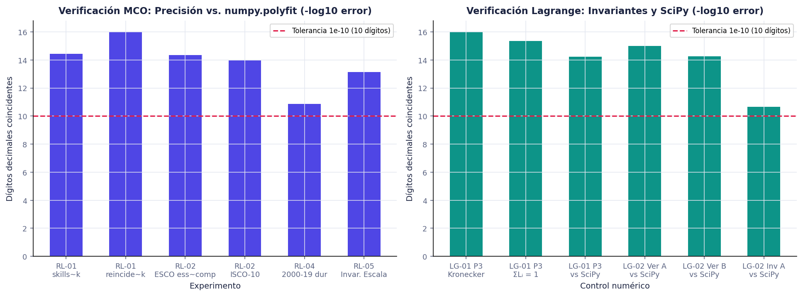

# IDEA-HYB-02 — Pack Automatizado de Verificación en GeoGebra y Auditoría SHA-256

> **Temática:** Verificación Dual (Python + GeoGebra) · **Prioridad:** P1 · **Presentación base:** `Ambas presentaciones HTML` (Diapositivas 14–15 de AMBOS HTML (Verificación en GeoGebra + Reto Python vs. NumPy/SciPy))

---

## 1. Propósito y Finalidad Analítica

Conectar la pedagogía de clase con ingeniería reproducible de minería de datos: generar automáticamente scripts listos para copiar y pegar en GeoGebra Classic para los 5 casos canónicos de n pequeño, validar todo cálculo hecho a mano contra NumPy/SciPy (< 1e-10) y certificar mediante SHA-256 que los 19 insumos de `data/` permanecieron 100 % intactos.

## 2. Archivos de `data/` Utilizados (Solo Lectura)

- Tablas canónicas de nodos de `IDEA-RL-01`, `IDEA-RL-02` (10 centroides ISCO), `IDEA-RL-04` (2000–2019 centrado), `IDEA-LG-01` (4 hitos de supervivencia) e `IDEA-LG-02` (PCA `k = 1, 3, 5, 8`)
- 19 archivos de solo lectura auditados en `01_raw/`, `02_interim/`, `03_processed/`, `04_transformed/` y `split_map_resume_id.csv`

## 3. Formulación Matemática Aplicada

$$\text{Error Relativo MCO} = \frac{\max(|a_0 - \hat{a}_0^{\text{np}}|, |a_1 - \hat{a}_1^{\text{np}}|)}{\max(1, |a_0|, |a_1|)} = 6.98\times 10^{-14} < 10^{-10}, \qquad \max_x |P_n(x) - P_n^{\text{scipy}}(x)| = 5.05\times 10^{-15}$$

## 4. Cómo se Hizo (Metodología Paso a Paso)

1. Se generaron automáticamente 5 archivos `.txt` con comandos de GeoGebra en inglés (compatibles en cualquier idioma: `FitLine`, `CorrelationCoefficient`, `RSquare`, `Polynomial` y expresiones explícitas `L0(x)..L3(x)`) e indicando equivalentes en español en los comentarios.
2. Se validó la sintaxis de cada archivo `.txt` mediante expresiones regulares (`validate_geogebra_scripts`).
3. Se verificaron los 39 modelos MCO frente a `numpy.polyfit(x, y, 1)` (error relativo máx. `6.98e-14`), las 8 pruebas de invarianza afín (`7.22e-14`) y los diagnósticos de Lagrange frente a `scipy.interpolate` (`5.05e-15`).
4. Se tomaron huellas SHA-256 antes y después de la ejecución comprobando cero modificaciones en `data/`, junto con auditoría semántica (`MR-07` y `MR-08`).

**Módulos de Python que lo implementan:**

- `scripts/ScriptsCsv/MetodosNumericos/geogebra.py` (`export_hyb02_geogebra_pack`)
- `scripts/ScriptsCsv/MetodosNumericos/validation.py` (`snapshot_read_only_inputs`, `verify_read_only_inputs`, `validate_geogebra_scripts`, `audit_wording_compliance`)
- `tests/metodos_numericos/` (suite de 15 pruebas automatizadas)

## 5. Resultados Empíricos Verificados

### Tabla: `ols_summary_all_ideas.csv`

| idea_id | x_var | y_var | n | a0 | a1 | r2 | s_yx | quality_verdict |
| --- | --- | --- | --- | --- | --- | --- | --- | --- |
| IDEA-RL-01 | job_order (1..10) | mean_skills | 10 | 22.5160 | 0.2250 | 0.9955 | 0.0486 | Ajuste Lineal Fuerte (R² ≥ 0.70) |
| IDEA-RL-01 (cohort >=10) | job_order (1..10) | mean_skills | 10 | 22.9122 | 0.2026 | 0.9529 | 0.1446 | Ajuste Lineal Fuerte (R² ≥ 0.70) |
| IDEA-RL-01 | job_order (1..10) | reincide_rate | 10 | 0.2206 | 0.0213 | 0.9625 | 0.0135 | Ajuste Lineal Fuerte (R² ≥ 0.70) |
| IDEA-RL-01 (cohort >=10) | job_order (1..10) | reincide_rate | 10 | 0.3806 | 0.0072 | 0.4475 | 0.0258 | Ajuste Lineal Moderado (0.30 ≤ R² < 0.70) |
| IDEA-RL-01 | job_order (1..10) | mean_dur_q | 10 | 15.8150 | -0.8094 | 0.9050 | 0.8421 | Ajuste Lineal Fuerte (R² ≥ 0.70) |
| IDEA-RL-01 (cohort >=10) | job_order (1..10) | mean_dur_q | 10 | 13.7106 | -0.5815 | 0.8838 | 0.6771 | Ajuste Lineal Fuerte (R² ≥ 0.70) |
| IDEA-RL-01 | job_order (1..10) | mean_green | 10 | 0.0236 | -0.0002 | 0.7877 | 0.0004 | Ajuste Lineal Fuerte (R² ≥ 0.70) |
| IDEA-RL-01 (cohort >=10) | job_order (1..10) | mean_green | 10 | 0.0192 | 0.0002 | 0.7310 | 0.0004 | Ajuste Lineal Fuerte (R² ≥ 0.70) |
| IDEA-RL-02 | n_ess_comp | n_essential | 3,039 | 3.3465 | 1.1227 | 0.8643 | 4.4184 | Ajuste Lineal Fuerte (R² ≥ 0.70) |
| IDEA-RL-02 | n_competence | n_total_rel | 3,039 | 4.8359 | 1.2156 | 0.7319 | 10.4702 | Ajuste Lineal Fuerte (R² ≥ 0.70) |
| IDEA-RL-02 | n_total_rel | n_cross_sector | 3,039 | -0.7983 | 0.5786 | 0.5670 | 10.2229 | Ajuste Lineal Moderado (0.30 ≤ R² < 0.70) |
| IDEA-RL-02 | n_sector_spec | n_total_rel | 3,039 | 24.5534 | 0.9925 | 0.4069 | 15.5728 | Ajuste Lineal Moderado (0.30 ≤ R² < 0.70) |
| IDEA-RL-02 | n_essential | n_optional | 3,039 | 15.9592 | 0.1472 | 0.0140 | 14.8176 | Modelo Lineal Débil / Rechazado (R² < 0.30) |
| IDEA-RL-02 | n_essential | greenShare | 3,039 | 0.0435 | -5.206e-05 | 4.474e-05 | 0.0933 | Modelo Lineal Débil / Rechazado (R² < 0.30) |
| IDEA-RL-02 | n_knowledge | greenShare | 3,039 | 0.0360 | 0.0006 | 0.0043 | 0.0931 | Modelo Lineal Débil / Rechazado (R² < 0.30) |
| IDEA-RL-02 (ISCO-10 centroids) | mean_total_rel | mean_cross_sector | 10 | 3.4481 | 0.4330 | 0.2800 | 5.4310 | Modelo Lineal Débil / Rechazado (R² < 0.30) |
| IDEA-RL-04 | start_year | mean_skills | 20 | -171.0956 | 0.0967 | 0.7475 | 0.3417 | Ajuste Lineal Fuerte (R² ≥ 0.70) |
| IDEA-RL-04 | start_year | mean_skills | 24 | 225.9336 | -0.1011 | 0.0826 | 2.4348 | Modelo Lineal Débil / Rechazado (R² < 0.30) |
| IDEA-RL-04 | start_year - 2000 | mean_skills | 20 | 22.3672 | 0.0967 | 0.7475 | 0.3417 | Ajuste Lineal Fuerte (R² ≥ 0.70) |
| IDEA-RL-04 | start_year | mean_dur_q | 20 | 1,437.80 | -0.7096 | 0.9288 | 1.1945 | Ajuste Lineal Fuerte (R² ≥ 0.70) |

*Se muestran las primeras 20 de 39 filas; consulta el archivo CSV completo en `tables/`.*

### Tabla: `sha256_input_integrity.csv`

| file_name | sha256_before | sha256_after | intact |
| --- | --- | --- | --- |
| JobHop_v2_train.csv | 68b7d3686c7580a0… | 68b7d3686c7580a0… | Sí |
| JobHop_v2_test.csv | ed28c2671e00c212… | ed28c2671e00c212… | Sí |
| JobHop_v2_val.csv | c31236fb3639b411… | c31236fb3639b411… | Sí |
| greenShareOcc_en_limpio.csv | 3cc4c43291437fc8… | 3cc4c43291437fc8… | Sí |
| ISCOGroups_en_limpio.csv | a81ef1362babc924… | a81ef1362babc924… | Sí |
| occupations_en_limpio.csv | 1a6d59c8ae1aed23… | 1a6d59c8ae1aed23… | Sí |
| occupationSkillRelations_en_limpio.csv | e1a46511f0ef4d50… | e1a46511f0ef4d50… | Sí |
| skills_en_limpio.csv | 99f0ed64f643a82d… | 99f0ed64f643a82d… | Sí |
| empleos_limpio.csv | 4ee5b956e25e8e7a… | 4ee5b956e25e8e7a… | Sí |
| empleos_limpio_sin_outliers .csv | 87d9350e82f27646… | 87d9350e82f27646… | Sí |
| empleos_unificado_limpio.csv | f51aaadffdff47ab… | f51aaadffdff47ab… | Sí |
| empleos_limpio_con_competencias_sin_outliers.csv | 541d9576f3510249… | 541d9576f3510249… | Sí |
| X_train.csv | ac2db9a34ed6fa94… | ac2db9a34ed6fa94… | Sí |
| X_test.csv | 375baf909c382714… | 375baf909c382714… | Sí |
| X_train.csv | 07386ebe978ebd49… | 07386ebe978ebd49… | Sí |
| X_test.csv | 2554eb5a56b7fbe2… | 2554eb5a56b7fbe2… | Sí |
| transformers.joblib | b64f676458f3ef33… | b64f676458f3ef33… | Sí |
| transformers.joblib | d9c37b4c4b7364a8… | d9c37b4c4b7364a8… | Sí |
| split_map_resume_id.csv | 67dd3e3d68e1ff5e… | 67dd3e3d68e1ff5e… | Sí |

## 6. Gráficos Generados (150 DPI)

### `nm12_hyb02_verification_summary_dashboard.png`



*Tablero de precisión decimal (-log10 error) confirmando que todas las verificaciones de MCO y Lagrange superan ampliamente el umbral 1e-10.*

## 7. Comandos de Verificación en GeoGebra

### `ggb_rl01_career_steps_skills.txt`

```text
# JobPath GeoGebra Verification — IDEA-RL-01 (mean_skills ~ job_order, k=1..10)
# Paste each command sequentially into GeoGebra Classic Algebra Input (https://www.geogebra.org/classic)
# Spanish equivalents: AjusteLineal(P), CoeficienteCorrelación(P), RCuadrado(P, f)
# Expected Python OLS: a0 = 22.516043, a1 = 0.224971, r = 0.997746, R2 = 0.995498
P = {(1, 22.693871), (2, 22.977992), (3, 23.207698), (4, 23.435402), (5, 23.679668), (6, 23.884766), (7, 24.084861), (8, 24.210442), (9, 24.594249), (10, 24.764899)}
f = FitLine(P)
r = CorrelationCoefficient(P)
R2 = RSquare(P, f)
Centroid = (5.500000, 23.753385)
Q_pred = (12, f(12))
# Expected Q_pred y-coordinate: 25.215697
```

### `ggb_rl02_isco10_transferability.txt`

```text
# JobPath GeoGebra Verification — IDEA-RL-02 (ISCO-10 Centroids: mean_cross_sector ~ mean_total_rel)
# Paste each command sequentially into GeoGebra Classic Algebra Input (https://www.geogebra.org/classic)
# Spanish equivalents: AjusteLineal(P), CoeficienteCorrelación(P), RCuadrado(P, f)
# Expected Python OLS: a0 = 3.448113, a1 = 0.432990, r = 0.529160, R2 = 0.280010
P = {(35.666667, 25.619048), (40.822857, 25.217143), (53.176267, 30.895161), (38.473684, 21.561920), (29.280899, 16.213483), (35.284314, 15.882353), (46.590909, 12.295455), (37.723350, 21.200508), (31.438040, 16.740634), (31.276316, 13.276316)}
f = FitLine(P)
r = CorrelationCoefficient(P)
R2 = RSquare(P, f)
Centroid = (37.973330, 19.890202)
Q_pred = (45, f(45))
# Expected Q_pred y-coordinate: 22.932683
```

### `ggb_rl04_annual_duration_extrapolation.txt`

```text
# JobPath GeoGebra Verification — IDEA-RL-04 (Annual mean_dur_q ~ year-2000, 2000..2019; extrap t=27 -> year 2027)
# Paste each command sequentially into GeoGebra Classic Algebra Input (https://www.geogebra.org/classic)
# Spanish equivalents: AjusteLineal(P), CoeficienteCorrelación(P), RCuadrado(P, f)
# Expected Python OLS: a0 = 18.596288, a1 = -0.709603, r = -0.963723, R2 = 0.928761
P = {(0, 20.902823), (1, 19.178141), (2, 17.721139), (3, 16.535690), (4, 15.686117), (5, 14.534851), (6, 13.721566), (7, 12.873866), (8, 12.087532), (9, 11.117679), (10, 10.431607), (11, 9.404647), (12, 9.261795), (13, 8.636089), (14, 8.331621), (15, 7.786000), (16, 7.247650), (17, 6.724662), (18, 6.605242), (19, 8.312423)}
f = FitLine(P)
r = CorrelationCoefficient(P)
R2 = RSquare(P, f)
Centroid = (9.500000, 11.855057)
Q_pred = (27, f(27))
# Expected Q_pred y-coordinate: -0.563000
```

### `ggb_lg01_survival_p3_milestones.txt`

```text
# JobPath GeoGebra Verification — IDEA-LG-01 (Tenure Survival P3 at q=4,8,20,40; eval q=12 = 3 years)
# Paste each command sequentially into GeoGebra Classic Algebra Input (https://www.geogebra.org/classic)
# Spanish equivalent: q = Polinomio(P). Verify that p(x) and q(x) coincide identically.
# Expected Python Lagrange: P_3(12) = 0.206491
P = {(4, 0.660880), (8, 0.370539), (20, 0.135783), (40, 0.042983)}
L0(x) = ((x - 8)*(x - 20)*(x - 40)) / ((4 - 8)*(4 - 20)*(4 - 40))
L1(x) = ((x - 4)*(x - 20)*(x - 40)) / ((8 - 4)*(8 - 20)*(8 - 40))
L2(x) = ((x - 4)*(x - 8)*(x - 40)) / ((20 - 4)*(20 - 8)*(20 - 40))
L3(x) = ((x - 4)*(x - 8)*(x - 20)) / ((40 - 4)*(40 - 8)*(40 - 20))
p(x) = 0.660880*L0(x) + 0.370539*L1(x) + 0.135783*L2(x) + 0.042983*L3(x)
q = Polynomial(P)
A_eval = (12, p(12))
```

### `ggb_lg02_pca_forward_p3.txt`

```text
# JobPath GeoGebra Verification — IDEA-LG-02 (PCA Cumulative Variance Version A P3 at k=1,3,5,8; eval k=4)
# Paste each command sequentially into GeoGebra Classic Algebra Input (https://www.geogebra.org/classic)
# Spanish equivalent: q = Polinomio(P). Verify that p(x) and q(x) coincide identically.
# Expected Python Lagrange: P_3(4) = 0.877777
P = {(1, 0.329105), (3, 0.765877), (5, 0.940656), (8, 0.999954)}
L0(x) = ((x - 3)*(x - 5)*(x - 8)) / ((1 - 3)*(1 - 5)*(1 - 8))
L1(x) = ((x - 1)*(x - 5)*(x - 8)) / ((3 - 1)*(3 - 5)*(3 - 8))
L2(x) = ((x - 1)*(x - 3)*(x - 8)) / ((5 - 1)*(5 - 3)*(5 - 8))
L3(x) = ((x - 1)*(x - 3)*(x - 5)) / ((8 - 1)*(8 - 3)*(8 - 5))
p(x) = 0.329105*L0(x) + 0.765877*L1(x) + 0.940656*L2(x) + 0.999954*L3(x)
q = Polynomial(P)
A_eval = (4, p(4))
```

- Índice consolidado: [`geogebra/geogebra_verification_index.md`](./geogebra/geogebra_verification_index.md)

## 8. Limitaciones, Advertencias y Salvaguardas de Dominio

- Usa preferiblemente los comandos en inglés (`FitLine`, `Polynomial`, `RSquare`, `CorrelationCoefficient`) porque GeoGebra Classic los acepta sin error sin importar si la interfaz está configurada en español o en inglés.

---

**Reproducibilidad:** Ejecuta `python -m scripts.ScriptsCsv.MetodosNumericos.pipeline` desde la raíz de `MineriaProtect` para recalcular todo desde `data/`, `python -m scripts.ScriptsCsv.MetodosNumericos.deliverable_packager` para actualizar esta carpeta, y `python -m unittest discover -s tests/metodos_numericos -v` para correr las 15 pruebas.
