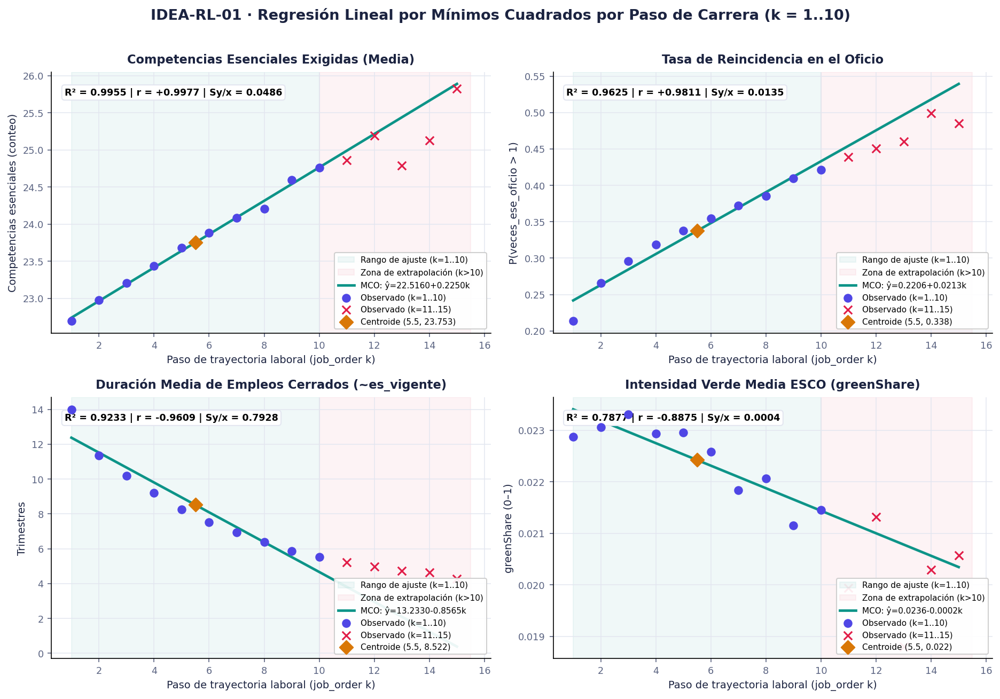
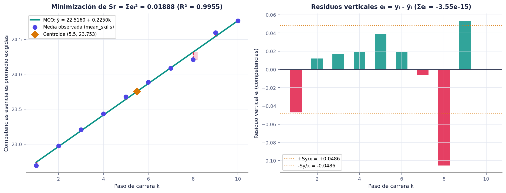

# Fuente Unificada para Estudio y NotebookLM — Caso 01 (IDEA-RL-01)

> **Carpeta origen:** [`../01_IDEA_RL_01_Pasos_Carrera_MCO/`](../01_IDEA_RL_01_Pasos_Carrera_MCO/) · **Presentación HTML:** [`presentacion_IDEA_RL_01.html`](../01_IDEA_RL_01_Pasos_Carrera_MCO/presentacion_IDEA_RL_01.html)

---

# Guía Fácil para Todos — Caso 01 (`IDEA-RL-01`): ¿Cómo cambia tu perfil laboral conforme avanzas de trabajo en trabajo?

> **Método utilizado:** Regresión Lineal por Mínimos Cuadrados Ordinarios (MCO)  
> **Nivel de lectura:** Para todo público (no necesitas saber matemáticas avanzadas)  
> **Presentación visual interactiva:** Abre [`presentacion_IDEA_RL_01.html`](../01_IDEA_RL_01_Pasos_Carrera_MCO/presentacion_IDEA_RL_01.html) en cualquier navegador.

---

## 1. Resumen en 30 segundos

Analizamos **1,738,738 experiencias laborales reales** para responder una pregunta muy simple: *cuando una persona pasa de su primer empleo al segundo, tercero y así hasta el décimo, ¿los puestos que ocupa exigen más habilidades, duran más o menos tiempo, o repiten el mismo oficio?*  
Usando **Regresión Lineal (una recta que resume la tendencia promedio)**, descubrimos una tendencia casi perfecta (**99.55 % de ajuste**): con cada nuevo empleo, el puesto exige en promedio **+0.225 habilidades esenciales adicionales** (validado también por mínimos cuadrados ponderados WLS: **+0.229**, diferencia de apenas `1.67 %`), la probabilidad de repetir oficio sube **+2.13 puntos porcentuales**, y la duración promedio de **empleos cerrados (`~es_vigente`, regla MR-09)** baja **-0.86 trimestres** por paso (`R² = 92.33 %`).

---

## 2. ¿Cuál era el problema? (Explicado fácil)

Imagina que tienes un archivo gigantesco con casi **dos millones de empleos** de más de 355,000 personas. Si miras esos datos fila por fila, es imposible ver un patrón: algunas personas cambian de trabajo cada 6 meses, otras duran 10 años, unas tienen oficios muy complejos y otras muy sencillos.

El reto era **resumir todo ese mar de datos en reglas claras y medibles** que respondan:
1. ¿A medida que alguien suma empleos (paso 1, paso 2, ..., paso 10), entra a cargos que piden más competencias?
2. ¿Se vuelve más probable que repita un oficio similar al que ya tuvo?
3. ¿Qué pasa si intentamos usar esa misma recta para predecir qué ocurrirá en el empleo número 12 o 15 (fuera del rango usado para calcular la recta)?

---

## 3. Analogía de la vida real: la regla transparente sobre puntos en una hoja

Imagina que anotas en un cuaderno la estatura promedio de niños desde los 1 hasta los 10 años y dibujas un punto por cada edad. Los puntos casi forman una línea recta, pero no están alineados con perfección milimétrica porque cada niño crece un poquito distinto.

- **¿Qué hace la Regresión Lineal por Mínimos Cuadrados (MCO)?** Coloca una **regla transparente** sobre esos puntos de forma que la suma de las distancias al cuadrado (los "errores" o saltitos verticales de cada punto hasta la regla) sea **lo más pequeña posible**.
- Así, en vez de memorizar diez números sueltos, obtienes una **receta de dos números**: dónde empiezas (*intercepto* `a₀`) y cuánto subes o bajas en cada escalón (*pendiente* `a₁`).

---

## 4. La solución explicada paso a paso

### Paso 1: Ordenar la historia laboral de cada persona
Tomamos las experiencias válidas de cada hoja de vida y las pusimos en orden cronológico: *Empleo 1, Empleo 2, Empleo 3... hasta el Empleo 10*.

### Paso 2: Calcular el promedio de cada escalón
Para cada escalón (del 1 al 10), promediamos cuatro cosas:
- **Complejidad del oficio (`mean_skills`):** cuántas habilidades esenciales pide ese cargo en el catálogo europeo ESCO.
- **Reincidencia (`reincide_rate`):** qué porcentaje de personas vuelve a un oficio que ya había tenido.
- **Duración (`mean_dur_q`):** cuántos trimestres (bloques de 3 meses) dura en promedio ese empleo.
- **Empleo verde (`mean_green`):** qué porcentaje del oficio corresponde a tareas ambientales o sostenibles.

### Paso 3: Trazar la mejor recta (MCO)
Con las ecuaciones cerradas de mínimos cuadrados obtuvimos para las **habilidades esenciales del puesto**:

> **Habilidades estimadas = 22.5160 + 0.2250 × (Número de empleo)**

¿Qué significa esto en español cotidiano?
- El punto de partida teórico (paso 0) es **22.52 habilidades**.
- Por cada empleo adicional que avanza una persona (del 1 al 2, del 2 al 3...), el cargo promedio que ocupa requiere **+0.225 habilidades esenciales más**.
- La recta pasa exactamente por el **centro de equilibrio (centroide)**: en el paso **5.5**, el promedio es **23.75 habilidades**.

### Paso 4: Leer la tabla de resultados en lenguaje humano

| Pregunta que hicimos | Cambio por cada empleo nuevo (`a₁`) | Qué tan buena es la recta (`R²`) | Traducción en palabras simples |
| :--- | :---: | :---: | :--- |
| **¿El oficio exige más habilidades?** | **+0.225 habilidades** | **99.55 %** (Excelente) | Los puntos siguen casi una línea recta perfecta hacia arriba. |
| **¿Se repite más el mismo oficio?** | **+2.13 % por paso** | **96.25 %** (Excelente) | Con el tiempo la gente se especializa y vuelve a roles similares. |
| **¿Cuánto dura cada empleo cerrado (`~es_vigente`)?** | **-0.86 trimestres** (~2.6 meses menos) | **92.33 %** (Excelente) | Al excluir empleos aún abiertos (`MR-09`), los empleos avanzados muestran una baja limpia y sostenida en duración. |
| **¿Aumentan los empleos verdes?** | **-0.02 % por paso** | **78.77 %** (Bueno) | El cambio global es diminuto —¡y ojo: al controlar por cohorte `≥ 10` empleos el signo se invierte a `+0.018 %` (Paradoja de Simpson)! |

### Paso 5: Probar la recta fuera de su zona segura (Extrapolación)
Entrenamos la recta solo con los empleos **1 al 10**, y luego probamos qué tan bien adivina los empleos **11, 12 y 15**:
- En **habilidades del oficio**, la predicción fue sorprendentemente buena: para el empleo 12 la recta predijo **25.22** y el dato real fue **25.19** (un error mínimo de apenas **0.023**).
- En cambio, en **duración de empleos cerrados**, la recta falló fuerte: para el empleo 15 predijo **0.39 trimestres**, cuando el valor real era **4.26 trimestres** (error de **3.87 trimestres**). **Lección clave:** *extrapolar fuera del rango siempre conlleva peligro si el comportamiento deja de ser recto.*

---

## 5. ¿Por qué se eligió esta solución y no otra?

- **¿Por qué Regresión Lineal y no conectar punto por punto (Interpolación)?** Porque aquí tenemos datos reales con pequeñas variaciones aleatorias ("ruido"). Si forzáramos una curva a pasar exacto por cada punto, solo copiaríamos pequeñas sacudidas del azar en lugar de capturar la tendencia real de subida (+0.225 habilidades por paso).
- **Verificación doble:** Comparamos nuestras cuentas manuales con `numpy.polyfit` y con **GeoGebra Classic**, y la diferencia fue de **3.55 × 10⁻¹⁵** (quince ceros después del punto decimal: ¡exactitud total!).

---

## 6. Cuidados importantes para no malinterpretar los resultados

1. **Tendencia no significa causa:** Que las personas en su 8.º empleo ocupen puestos más complejos no significa que *cambiar de trabajo mágicamente te haga saber más*; también puede ocurrir que quienes ascienden cambian de rol más seguido.
2. **Mide lo que pide el oficio, no a la persona:** El número `mean_skills` viene del catálogo ESCO del cargo ocupado, no de un examen aplicado al trabajador.
3. **Paradoja de Simpson y sesgo de supervivencia:** En el empleo 1 hay **352,093** personas, mientras que al empleo 10 llegan **25,321** (13.9× menos). Al repetir el cálculo **solo** con la cohorte fija de personas que tienen `≥ 10` empleos:
   - La subida de habilidades se mantiene muy fuerte (**R² = 95.29 %**, `a₁ = +0.203`).
   - En cambio, en **`mean_green`** ocurre la **Paradoja de Simpson** (la pendiente se invierte de `-0.000219` en el universo a **`+0.000183`** dentro de la cohorte fija) y en **`reincide_rate`** el ajuste cae de `96.25 %` a **`44.75 %`** (`a₁`: `+2.13 %` → `+0.72 %`), evidenciando el sesgo mecánico de calcular reincidencia sobre toda la trayectoria.
4. **Control por pesos (WLS) y censura (`MR-09`):** Verificamos con Mínimos Cuadrados Ponderados (dando más peso a pasos con más registros) que la pendiente de `mean_skills` apenas varía `1.67 %` (`+0.2287` vs. `+0.2250`), y calculamos `mean_dur_q` exclusivamente sobre empleos cerrados (`~es_vigente`) para mantener consistencia total con `IDEA-LG-01` e `IDEA-RL-04`.

---

## 7. Glosario fácil (para entender cada término sin miedo)

- **Regresión Lineal (MCO):** Método matemático que encuentra la línea recta que mejor resume la tendencia de una nube de puntos, haciendo lo más pequeña posible la suma de los errores al cuadrado.
- **Pendiente (`a₁`):** Cuánto sube (si es positiva) o baja (si es negativa) la recta cada vez que avanzas 1 paso en el eje horizontal.
- **Intercepto (`a₀`):** El valor teórico donde la recta corta el eje vertical cuando el paso vale 0.
- **Residuo (`eᵢ`):** La pequeña diferencia vertical entre el valor real observado y el valor que predijo nuestra recta.
- **Coeficiente de determinación (`R²`):** Una "nota" de 0 % a 100 % (o de 0 a 1) que dice qué tan bien explica nuestra recta el comportamiento real de los datos. Un `R² = 0.9955` equivale a un 99.55 % de ajuste.
- **Centroide (`x̄, ȳ`):** El punto promedio exacto por donde **siempre** pasa la recta de mínimos cuadrados.
- **Extrapolación:** Usar la recta para predecir valores **fuera** del rango con el que fue construida (por ejemplo, predecir el empleo 15 con una recta hecha del 1 al 10).

---

## Anexo Técnico Completo (Fórmulas, Tablas Verificadas y GeoGebra)

# IDEA-RL-01 — Progresión por Paso de Carrera (job_order k = 1..10)

> **Temática:** Regresión Lineal (MCO) · **Prioridad:** P0 · **Presentación base:** `regresion_lineal_minimos_cuadrados.html` (Diapositivas 3–12 (Ecuaciones Normales, Centroide, Residuos, R², Extrapolación))

---

## 1. Propósito y Finalidad Analítica

Cuantificar la tasa lineal de cambio con la que las personas transitan hacia oficios ESCO más complejos, más repetidos, de menor duración en empleos cerrados (~es_vigente, MR-09) o con distinta intensidad verde a medida que avanzan desde su 1.er empleo (k = 1) hasta su 10.º empleo (k = 10), sintetizando 1,738,738 experiencias clasificadas en pendientes interpretables y auditando sensibilidad por cohorte (>=10 empleos) y ponderación WLS.

## 2. Archivos de `data/` Utilizados (Solo Lectura)

- `data/03_processed/empleos_unificado_limpio.csv` (Versión A · 1,871,014 filas; filtrado a 1,738,738 experiencias clasificadas `saber_skills == 'ok'`; `mean_dur_q` calculado estrictamente sobre `1,643,772` empleos cerrados `~es_vigente` por MR-09)
- `data/02_interim/ESCO/greenShareOcc_en_limpio.csv` (unido en RAM por `occupation_code`, cubriendo el 92.93 % del universo)

## 3. Formulación Matemática Aplicada

$$\hat{y}(k) = a_0 + a_1 k, \qquad a_1 = \frac{n\sum k_i y_i - \sum k_i \sum y_i}{n\sum k_i^2 - (\sum k_i)^2}, \qquad a_0 = \bar{y} - a_1 \bar{k}$$

$$S_t = \sum (y_i - \bar{y})^2, \qquad S_r = \sum (y_i - \hat{y}_i)^2, \qquad R^2 = \frac{S_t - S_r}{S_t}, \qquad S_{y/x} = \sqrt{\frac{S_r}{n-2}}$$

## 4. Cómo se Hizo (Metodología Paso a Paso)

1. Se cargó `empleos_unificado_limpio.csv` con `usecols` seguro en memoria (excluyendo columnas de texto largo `skills`, `knowledge`, `sin_tipo`) y se cruzó `greenShare` en RAM sin modificar archivos en disco.
2. Se ordenó cronológicamente la trayectoria de cada persona (`resume_id`) por `(start_ord, end_ord)` asignando el paso secuencial `job_order = 1, 2, ..., 15`.
3. Se agregaron las medias por paso de carrera `k = 1..10` (`n = 10` nodos) para `mean_skills`, `reincide_rate` y `mean_green`, y estrictamente sobre empleos cerrados (`~es_vigente`, regla MR-09) para `mean_dur_q` y `median_dur_q`.
4. Se ejecutó un control de sensibilidad restringido a personas con `>= 10` empleos clasificados (detectando Paradoja de Simpson en `mean_green` y sesgo mecánico de trayectoria en `reincide_rate`) y una verificación por Mínimos Cuadrados Ponderados (WLS con pesos `n_rows` / `n_closed_rows`).
5. Se ajustó el modelo lineal por ecuaciones normales cerradas (`regresion_lineal`), generando la tabla completa de sumas (`Σx, Σy, Σx², Σxy`), cuadrados de residuos (`Sr`), centroide `(x̄, ȳ)` y validación frente a `numpy.polyfit(x, y, 1)` (`< 1e-10`).
6. Se auditó la extrapolación fuera de rango en `k = 11, 12, 15` (`is_extrapolation = True`) contrastando las predicciones frente a las medias reales observadas.

**Módulos de Python que lo implementan:**

- `scripts/ScriptsCsv/MetodosNumericos/loaders.py` (`load_processed_numeric`, `load_greenshare_lookup`)
- `scripts/ScriptsCsv/MetodosNumericos/ols.py` (`regresion_lineal`, `build_summation_and_residual_table`, `predict_ols`)
- `scripts/ScriptsCsv/MetodosNumericos/experiments_ols.py` (`run_rl01_career_steps`, `_wls_slope_intercept`)

## 5. Resultados Empíricos Verificados

### Tabla: `rl01_ols_summary.csv`

| idea_id | y_var | n | a0 | a1 | wls_a1 | wls_slope_rel_diff_pct | r2 | s_yx | quality_verdict | polyfit_max_abs_diff |
| --- | --- | --- | --- | --- | --- | --- | --- | --- | --- | --- |
| IDEA-RL-01 | mean_skills | 10 | 22.5160 | 0.2250 | 0.2287 | 1.6718 | 0.9955 | 0.0486 | Ajuste Lineal Fuerte (R² ≥ 0.70) | 3.553e-15 |
| IDEA-RL-01 (cohort >=10) | mean_skills | 10 | 22.9122 | 0.2026 | 0.2026 | 0 | 0.9529 | 0.1446 | Ajuste Lineal Fuerte (R² ≥ 0.70) | 3.553e-15 |
| IDEA-RL-01 | reincide_rate | 10 | 0.2206 | 0.0213 | 0.0242 | 13.8027 | 0.9625 | 0.0135 | Ajuste Lineal Fuerte (R² ≥ 0.70) | 5.551e-17 |
| IDEA-RL-01 (cohort >=10) | reincide_rate | 10 | 0.3806 | 0.0072 | 0.0072 | 1.199e-14 | 0.4475 | 0.0258 | Ajuste Lineal Moderado (0.30 ≤ R² < 0.70) | 4.337e-18 |
| IDEA-RL-01 | mean_dur_q | 10 | 13.2330 | -0.8565 | -1.0421 | 21.6718 | 0.9233 | 0.7928 | Ajuste Lineal Fuerte (R² ≥ 0.70) | 3.553e-15 |
| IDEA-RL-01 (cohort >=10) | mean_dur_q | 10 | 10.2132 | -0.5180 | -0.5195 | 0.2866 | 0.8661 | 0.6540 | Ajuste Lineal Fuerte (R² ≥ 0.70) | 1.776e-15 |
| IDEA-RL-01 | mean_green | 10 | 0.0236 | -0.0002 | -0.0002 | 29.3728 | 0.7877 | 0.0004 | Ajuste Lineal Fuerte (R² ≥ 0.70) | 3.469e-18 |
| IDEA-RL-01 (cohort >=10) | mean_green | 10 | 0.0192 | 0.0002 | 0.0002 | 1.481e-14 | 0.7310 | 0.0004 | Ajuste Lineal Fuerte (R² ≥ 0.70) | 3.469e-18 |

### Tabla: `rl01_summation_and_residuals_skills.csv`

| i | x_i | y_i | x_i_sq | x_i_y_i | y_hat_i | e_i | e_i_sq | y_minus_ybar_sq |
| --- | --- | --- | --- | --- | --- | --- | --- | --- |
| 1 | 1 | 22.6939 | 1 | 22.6939 | 22.7410 | -0.0471 | 0.0022 | 1.1226 |
| 2 | 2 | 22.9780 | 4 | 45.9560 | 22.9660 | 0.0120 | 0.0001 | 0.6012 |
| 3 | 3 | 23.2077 | 9 | 69.6231 | 23.1910 | 0.0167 | 0.0003 | 0.2978 |
| 4 | 4 | 23.4354 | 16 | 93.7416 | 23.4159 | 0.0195 | 0.0004 | 0.1011 |
| 5 | 5 | 23.6797 | 25 | 118.3983 | 23.6409 | 0.0388 | 0.0015 | 0.0054 |
| 6 | 6 | 23.8848 | 36 | 143.3086 | 23.8659 | 0.0189 | 0.0004 | 0.0173 |
| 7 | 7 | 24.0849 | 49 | 168.5940 | 24.0908 | -0.0060 | 3.577e-05 | 0.1099 |
| 8 | 8 | 24.2104 | 64 | 193.6835 | 24.3158 | -0.1054 | 0.0111 | 0.2089 |
| 9 | 9 | 24.5942 | 81 | 221.3482 | 24.5408 | 0.0535 | 0.0029 | 0.7071 |
| 10 | 10 | 24.7649 | 100 | 247.6490 | 24.7658 | -0.0009 | 7.335e-07 | 1.0232 |

### Tabla: `rl01_career_step_profile.csv`

| job_order | n_rows | n_closed_rows | mean_skills | mean_dur_q | median_dur_q | mean_green | reincide_rate |
| --- | --- | --- | --- | --- | --- | --- | --- |
| 1 | 352,093 | 336,800 | 22.6939 | 14.0063 | 7 | 0.0229 | 0.2134 |
| 2 | 325,612 | 309,550 | 22.9780 | 11.3407 | 5 | 0.0231 | 0.2660 |
| 3 | 282,150 | 267,478 | 23.2077 | 10.2038 | 5 | 0.0233 | 0.2957 |
| 4 | 227,663 | 214,999 | 23.4354 | 9.1995 | 5 | 0.0229 | 0.3184 |
| 5 | 173,414 | 162,973 | 23.6797 | 8.2517 | 5 | 0.0230 | 0.3381 |
| 6 | 125,814 | 117,797 | 23.8848 | 7.5146 | 5 | 0.0226 | 0.3546 |
| 7 | 87,520 | 81,724 | 24.0849 | 6.9372 | 5 | 0.0218 | 0.3723 |
| 8 | 59,147 | 54,977 | 24.2104 | 6.3744 | 5 | 0.0221 | 0.3855 |
| 9 | 38,987 | 36,199 | 24.5942 | 5.8759 | 4 | 0.0211 | 0.4098 |
| 10 | 25,321 | 23,465 | 24.7649 | 5.5173 | 3 | 0.0215 | 0.4215 |
| 11 | 16,044 | 14,839 | 24.8647 | 5.2389 | 3 | 0.0199 | 0.4392 |
| 12 | 10,159 | 9,390 | 25.1926 | 4.9737 | 2 | 0.0213 | 0.4509 |
| 13 | 6,261 | 5,757 | 24.7935 | 4.7438 | 2 | 0.0188 | 0.4605 |
| 14 | 3,850 | 3,547 | 25.1317 | 4.6400 | 2 | 0.0203 | 0.4990 |
| 15 | 2,241 | 2,049 | 25.8282 | 4.2601 | 2 | 0.0206 | 0.4855 |

### Tabla: `rl01_extrapolation_audit.csv`

| y_var | job_order_k | is_extrapolation | y_pred_ols | y_observed | abs_error | observed_n_rows |
| --- | --- | --- | --- | --- | --- | --- |
| mean_skills | 11 | Sí | 24.9907 | 24.8647 | 0.1260 | 16,044 |
| mean_skills | 12 | Sí | 25.2157 | 25.1926 | 0.0231 | 10,159 |
| mean_skills | 15 | Sí | 25.8906 | 25.8282 | 0.0624 | 2,241 |
| reincide_rate | 11 | Sí | 0.4544 | 0.4392 | 0.0153 | 16,044 |
| reincide_rate | 12 | Sí | 0.4757 | 0.4509 | 0.0247 | 10,159 |
| reincide_rate | 15 | Sí | 0.5394 | 0.4855 | 0.0539 | 2,241 |
| mean_dur_q | 11 | Sí | 3.8113 | 5.2389 | 1.4276 | 16,044 |
| mean_dur_q | 12 | Sí | 2.9548 | 4.9737 | 2.0189 | 10,159 |
| mean_dur_q | 15 | Sí | 0.3852 | 4.2601 | 3.8749 | 2,241 |
| mean_green | 11 | Sí | 0.0212 | 0.0199 | 0.0013 | 16,044 |
| mean_green | 12 | Sí | 0.0210 | 0.0213 | 0.0003 | 10,159 |
| mean_green | 15 | Sí | 0.0203 | 0.0206 | 0.0002 | 2,241 |

## 6. Gráficos Generados (150 DPI)

### `nm01_rl01_career_steps_panel.png`



*Panel 4× de regresión MCO por paso de carrera k=1..10 (con mean_dur_q sobre empleos cerrados ~es_vigente), centroides y zona de extrapolación (k>10).*

### `nm02_rl01_residual_squares_and_extrapolation.png`



*Representación geométrica de cuadrados de residuos (minimización de Sr) y residuos verticales e_i para mean_skills ~ job_order.*

## 7. Comandos de Verificación en GeoGebra

### `ggb_rl01_career_steps_skills.txt`

```text
# JobPath GeoGebra Verification — IDEA-RL-01 (mean_skills ~ job_order, k=1..10)
# Paste each command sequentially into GeoGebra Classic Algebra Input (https://www.geogebra.org/classic)
# Spanish equivalents: AjusteLineal(P), CoeficienteCorrelación(P), RCuadrado(P, f)
# Expected Python OLS: a0 = 22.516043, a1 = 0.224971, r = 0.997746, R2 = 0.995498
P = {(1, 22.693871), (2, 22.977992), (3, 23.207698), (4, 23.435402), (5, 23.679668), (6, 23.884766), (7, 24.084861), (8, 24.210442), (9, 24.594249), (10, 24.764899)}
f = FitLine(P)
r = CorrelationCoefficient(P)
R2 = RSquare(P, f)
Centroid = (5.500000, 23.753385)
Q_pred = (12, f(12))
# Expected Q_pred y-coordinate: 25.215697
```

## 8. Limitaciones, Advertencias y Salvaguardas de Dominio

- Asociación descriptiva, nunca causalidad (MR-07): las pendientes describen tendencias entre pasos, no implican que cambiar de empleo cause mayor adquisición de habilidades.
- Regla de atribución ESCO (MR-08): `mean_skills` mide cuántas competencias esenciales exige el oficio ocupado, no cuántas domina la persona.
- Paradoja de Simpson y sesgo de composición longitudinal: al pasar del universo completo a la cohorte fija (`>= 10` empleos), la pendiente de `mean_green` invierte su signo (`-0.000219` → `+0.000183`) y en `reincide_rate` el `R²` cae de `0.9625` a `0.4475` (`a₁`: `+0.0213` → `+0.0072`) por el sesgo mecánico de evaluar `veces_ese_oficio > 1` sobre toda la carrera.
- Agregación ecológica no ponderada vs. WLS: `k = 1` concentra `352,093` filas frente a `25,321` en `k = 10` (13.9× menos). La auditoría ponderada WLS (`wls_a1 = +0.2287` vs. MCO `+0.2250`, diferencia relativa de solo `1.67 %`) confirma que la tendencia de `mean_skills` es robusta al desbalance de tamaños.
- Consistencia de censura (MR-09): `mean_dur_q` se calcula estrictamente sobre empleos cerrados (`~es_vigente`), elevando el ajuste en `k = 1..10` a `R² = 0.9233` (`S_{y/x} = 0.7928`) y evitando contaminación por empleos vigentes imputados a `2026-Q1`.

---

**Reproducibilidad:** Ejecuta `python -m scripts.ScriptsCsv.MetodosNumericos.pipeline` desde la raíz de `MineriaProtect` para recalcular todo desde `data/`, `python -m scripts.ScriptsCsv.MetodosNumericos.deliverable_packager` para actualizar esta carpeta, y `python -m unittest discover -s tests/metodos_numericos -v` para correr las 19 pruebas.
