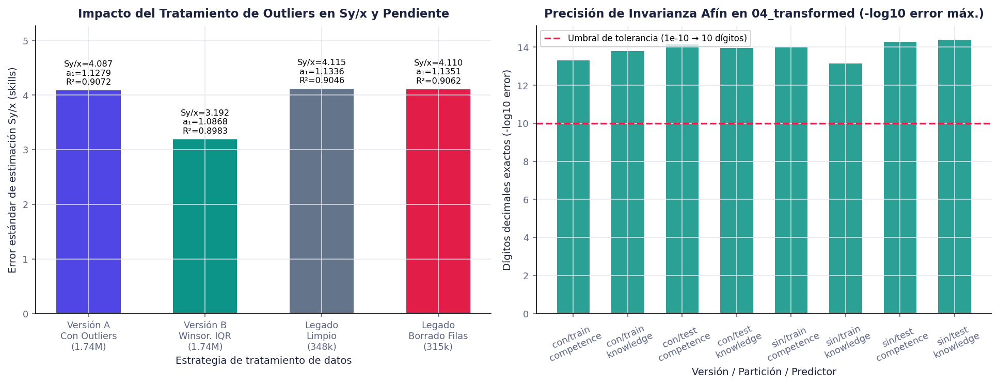

# Fuente Unificada para Estudio y NotebookLM — Caso 04 (IDEA-RL-05)

> **Carpeta origen:** [`../04_IDEA_RL_05_Outliers_E_Invarianza_Escala/`](../04_IDEA_RL_05_Outliers_E_Invarianza_Escala/) · **Presentación HTML:** [`presentacion_IDEA_RL_05.html`](../04_IDEA_RL_05_Outliers_E_Invarianza_Escala/presentacion_IDEA_RL_05.html)

---

# Guía Fácil para Todos — Caso 04 (`IDEA-RL-05`): ¿Qué pasa con la recta cuando hay datos extremos (outliers) o cuando cambias las unidades?

> **Método utilizado:** Regresión Lineal (MCO), análisis de sensibilidad a atípicos (4 vías) y teorema de invarianza afín  
> **Nivel de lectura:** Para todo público  
> **Presentación visual interactiva:** Abre [`presentacion_IDEA_RL_05.html`](../04_IDEA_RL_05_Outliers_E_Invarianza_Escala/presentacion_IDEA_RL_05.html) en cualquier navegador.

---

## 1. Resumen en 30 segundos

En ciencia de datos siempre surgen dos dudas prácticas antes de entrenar un modelo: *(1) ¿Qué hago con los datos exageradamente altos o bajos (outliers): los dejo, los recorto o borro esas filas?* y *(2) Si cambio la escala de los números (por ejemplo, escalándolos con `RobustScaler`), ¿daño la calidad de la regresión?*  
Sobre **1,738,738 empleos reales** probamos **4 estrategias** y demostramos dos resultados clave:
1. **Recortar extremos suavemente (winsorización IQR)** reduce el error típico de la recta en **-21.9 %** (`Sy/x` baja de `4.09` a `3.19`) **sin borrar ni una sola persona** de la base de datos.
2. **Cambiar de escala no altera la calidad real:** El ajuste `R²` permanece **100 % idéntico hasta 13 cifras decimales** (error máximo de `7.22 × 10⁻¹⁴`), y la pendiente y el intercepto se transforman con una fórmula algebraica exacta.

---

## 2. ¿Cuál era el problema? (Explicado fácil)

El método de Mínimos Cuadrados eleva cada error al **cuadrado** (`e²`). Eso tiene una consecuencia muy importante: si un dato está 10 veces más lejos de lo normal, su peso en el cálculo es **100 veces mayor** (`10² = 100`), jalando la recta hacia él como un imán.

En nuestro proyecto existían **cuatro versiones distintas de los datos** y además una capa escalada gigante (`04_transformed`, con archivos de 2 a 8 GB):
- **Versión A:** Todos los datos originales con sus valores extremos reales.
- **Versión B:** Todos los registros conservados, pero "topando" los valores extremos con el método IQR (winsorización).
- **Flujo legado limpio** y **flujo legado con borrado de filas** (que eliminaba **33,359** registros).

Necesitábamos medir exactamente cuánto cambia la recta entre esas 4 opciones y probar matemáticamente si escalar las variables con `RobustScaler` altera la relación entre ellas.

---

## 3. Analogía de la vida real: cambiar de pesos a dólares y pesar personas con un gigante en la sala

1. **Sobre los valores extremos (outliers):** Imagina calcular el sueldo promedio en un salón de 30 estudiantes... y entra un multimillonario. Si **borras** al multimillonario pierdes un registro real; si lo **dejas tal cual**, el promedio se dispara y no representa a nadie; si aplicas **winsorización**, mantienes a los 31 asistentes pero "topas" su cifra al límite superior razonable para que no distorsione el error típico.
2. **Sobre la invarianza de escala:** Medir la estatura y el peso de 1,000 personas en **centímetros y kilos** frente a medirlos en **pulgadas y libras** cambia los números de la pendiente y el intercepto, pero **NO cambia qué tan relacionadas están la estatura y el peso**. Su `R²` sigue siendo exactamente el mismo.

---

## 4. La solución explicada paso a paso

### Parte A: Comparación de las 4 estrategias frente a datos atípicos (en dos pares de variables)
Ajustamos la recta que predice el total de habilidades esenciales (`n_skills_essential`) primero a partir de **competencias prácticas** (`n_skills_competence`) y luego a partir de **conocimientos teóricos** (`n_skills_knowledge`):

| Versión del dataset | Registros (`n`) | Par `competence → essential` (`a₁` / `R²` / `Sy/x`) | Par `knowledge → essential` (`a₁` / `R²` / `Sy/x`) | Conclusión práctica |
| :--- | :---: | :---: | :---: | :--- |
| **Versión A (Con outliers reales)** | 1,738,738 (100 %) | `1.1279` / `90.72 %` / `4.0872` | `1.8827` / `36.80 %` (Mod.) / `10.6664` | Conserva todo el universo, pero los extremos inflan `Sy/x`. |
| **Versión B (Winsorizada IQR)** | 1,738,738 (100 %) | `1.0868` / `89.83 %` / **`3.1915`** | `1.6728` / **`27.95 %` (Rech.)** / **`8.4934`** | Baja `Sy/x` (**-21.9 %** y **-20.4 %**) sin borrar filas, pero en `knowledge` comprime la cola (`45 → 13.5`) y baja `R²` debajo de `30 %`. |
| **Legado limpio (`test+val`)** | 348,263 | `1.1336` / `90.46 %` / `4.1147` | `1.8806` / `37.93 %` (Mod.) / `10.4969` | Cubre solo `test+val` (asimetría muestral frente a `1.74M`). |
| **Legado borrando filas (`test+val`)** | 314,904 (-9.6 %) | `1.1351` / `90.62 %` / `4.1105` | `1.9006` / `38.28 %` (Mod.) / `10.5421` | Borró **33,359** empleos reales y casi no redujo `Sy/x`. |

### Parte B: Demostración de Invarianza Afín sobre `04_transformed`
Cuando `RobustScaler` transforma una variable restando su mediana (`c`) y dividiendo por su rango intercuartílico (`s`), la teoría matemática promete que:
- La nueva calidad del ajuste es **exactamente igual**: `R² nuevo = R² original`.
- La nueva pendiente es exactamente: `a₁ nuevo = a₁ original × (s_x / s_y)`.
- El nuevo error típico es exactamente: `Sy/x nuevo = Sy/x original / s_y`.

**Resultado verificado en los 8 controles (`con/sin outliers × train/test × 2 variables`):**
- En todos los casos `R²` coincidió al **100 %** (`0.9072 = 0.9072`, `0.8984 = 0.8984`, etc.).
- La mayor diferencia entre la fórmula teórica y los números reales leídos de los archivos de varios gigabytes fue **`7.22 × 10⁻¹⁴`** (más de **13 dígitos exactos de precisión**).
- Además, para no colapsar la memoria RAM al leer archivos CSV gigantes de hasta 8 GB con 2,985 columnas, se leyó solo el prefijo binario de las 3 columnas necesarias en cada fila.

---

## 5. ¿Por qué se eligió esta solución y no otra?

- Porque demuestra con evidencia dura que **winsorizar (Versión B) es superior a borrar filas**: conserva el 100 % del universo de personas y baja el error residual en casi una quinta parte.
- Y porque certifica que el preprocesamiento de `04_transformed` (`RobustScaler`) es matemáticamente limpio y no introdujo fugas ni distorsiones ocultas en las correlaciones lineales.

---

## 6. Cuidados importantes a tener en cuenta

- **Efecto secundario y compromiso (*trade-off*) de la winsorización:** Aunque la Versión B baja la dispersión en ambos pares, recortar individualmente el techo de cada columna rompe la suma exacta `Total = Prácticas + Conocimientos + Sin tipo` y, en `knowledge → essential`, recorta `x_max` de `45` a `13.5` reduciendo `R²` por debajo del umbral de rechazo (`36.80 % → 27.95 %`). Por eso el proyecto mantiene **ambas versiones (A y B)** en paralelo.
- **Comparación justa por tamaño muestral:** Las dos variantes legadas (`02_interim`) corresponden solo a `test+val` (`348k`/`315k` filas), mientras las Versiones A y B cubren `1.74M` filas; la tabla de invarianza afín (`test`, `347,720` filas) confirma que el contraste A vs. B se mantiene idéntico a igual tamaño muestral.

---

## 7. Glosario fácil

- **Outlier (valor atípico):** Un dato inusualmente grande o pequeño comparado con el resto del grupo.
- **Winsorización IQR:** Técnica que, en lugar de eliminar un dato extremo, lo reemplaza por el valor máximo (o mínimo) "normal" permitido, manteniendo el registro vivo sin dejar que arruine los promedios.
- **Error estándar de estimación (`Sy/x`):** Mide qué tan lejos, en promedio, caen los puntos reales respecto a la recta. Mientras más pequeño, más pegados están los datos a la línea.
- **Invarianza afín (de escala):** Propiedad matemática que garantiza que sumar constantes o cambiar unidades de medida no cambia la fuerza real (`R²`) de una relación lineal.
- **`RobustScaler`:** Herramienta de preparación de datos que centra los números alrededor de la mediana y los divide por el rango intercuartílico (IQR) para hacerlos menos sensibles a extremos.

---

## Anexo Técnico Completo (Fórmulas, Tablas Verificadas y GeoGebra)

# IDEA-RL-05 — Sensibilidad a Outliers (4 Vías) e Invarianza Afín en 04_transformed

> **Temática:** Regresión Lineal (MCO) · **Prioridad:** P0 · **Presentación base:** `regresion_lineal_minimos_cuadrados.html` (Diapositivas 3–5 y 11 (Sensibilidad del Error Cuadrático a Atípicos y Transformaciones Lineales))

---

## 1. Propósito y Finalidad Analítica

Cuantificar matemáticamente cómo responde MCO a outliers reales (Versión A) frente a winsorización IQR (Versión B) y frente al borrado legado de filas (`02_interim`), y demostrar algebraica y numéricamente que `RobustScaler` en `data/04_transformed/` conserva R² y r intactos mientras transforma (a₀, a₁, Sy/x) de manera exacta.

## 2. Archivos de `data/` Utilizados (Solo Lectura)

- `data/03_processed/empleos_unificado_limpio.csv` (Versión A · 1,738,738 experiencias clasificadas)
- `data/03_processed/empleos_limpio_con_competencias_sin_outliers.csv` (Versión B · winsorizada IQR k=1.5)
- `data/02_interim/Jobhop/empleos_limpio.csv` y `empleos_limpio_sin_outliers .csv` (flujo legado `test+val` con borrado de filas; espacio final preservado según MR-12)
- `data/04_transformed/{con_outliers,sin_outliers}/{train,test}/X_*.csv` (leídos mediante lector binario de prefijo sin cargar jamás las 2,985 columnas completas)
- `data/04_transformed/transformers/{con_outliers,sin_outliers}/transformers.joblib` (centros y escalas IQR de `RobustScaler`)

## 3. Formulación Matemática Aplicada

$$\tilde{x} = \frac{x - c_x}{s_x}, \quad \tilde{y} = \frac{y - c_y}{s_y} \implies \tilde{a}_1 = a_1 \frac{s_x}{s_y}, \quad \tilde{a}_0 = \frac{a_0 + a_1 c_x - c_y}{s_y}, \quad \tilde{R}^2 = R^2, \quad \tilde{S}_{y/x} = \frac{S_{y/x}}{s_y}$$

## 4. Cómo se Hizo (Metodología Paso a Paso)

1. Se ajustó MCO para dos pares contrastantes (`n_skills_essential ~ n_skills_competence` y `n_skills_essential ~ n_skills_knowledge`) en las 4 variantes del dataset (Versión A, Versión B, Legado Limpio y Legado con Borrado de Filas).
2. Se extrajeron los parámetros exactos `(center_, scale_)` de `RobustScaler` (`essential: (20, 13)`, `competence: (18, 11)`, `knowledge: (3, 5)`).
3. Se leyeron exclusivamente las 3 columnas escaladas densas desde los 4 archivos CSV de 2–8 GB en `04_transformed` usando partición binaria del prefijo (`raw_line.split(b',', max_idx+1)`), manteniendo consumo mínimo de RAM.
4. Se cruzaron `train` (`1,391,018` filas) y `test` (`347,720` filas) vía `split_map_resume_id.csv`, verificando las 8 identidades de invarianza afín con error máximo `7.22e-14 < 1e-10` y confirmando que el contraste A vs. B se reproduce también sobre la submuestra `test`.

**Módulos de Python que lo implementan:**

- `scripts/ScriptsCsv/MetodosNumericos/loaders.py` (`load_legacy_interim_pair`, `load_transformed_dense_subset`, `extract_scaler_params`)
- `scripts/ScriptsCsv/MetodosNumericos/ols.py` (`verify_affine_scaling_invariance`)
- `scripts/ScriptsCsv/MetodosNumericos/experiments_ols.py` (`run_rl05_outlier_and_scaling`)

## 5. Resultados Empíricos Verificados

### Tabla: `rl05_four_way_outlier_comparison.csv`

| variant | x_var | y_var | n | a0 | a1 | r2 | s_yx | quality_verdict |
| --- | --- | --- | --- | --- | --- | --- | --- | --- |
| Versión A · Con Outliers (03_processed) | n_skills_competence | n_skills_essential | 1,738,738 | 1.5388 | 1.1279 | 0.9072 | 4.0872 | Ajuste Lineal Fuerte (R² ≥ 0.70) |
| Versión B · Winsorizada IQR (03_processed) | n_skills_competence | n_skills_essential | 1,738,738 | 2.2112 | 1.0868 | 0.8983 | 3.1915 | Ajuste Lineal Fuerte (R² ≥ 0.70) |
| Legado Limpio · test+val (02_interim) | n_skills_competence | n_skills_essential | 348,263 | 1.4456 | 1.1336 | 0.9046 | 4.1147 | Ajuste Lineal Fuerte (R² ≥ 0.70) |
| Legado Borrado Filas · test+val (02_interim) | n_skills_competence | n_skills_essential | 314,904 | 1.3843 | 1.1351 | 0.9062 | 4.1105 | Ajuste Lineal Fuerte (R² ≥ 0.70) |
| Versión A · Con Outliers (03_processed) | n_skills_knowledge | n_skills_essential | 1,738,738 | 15.8231 | 1.8827 | 0.3680 | 10.6664 | Ajuste Lineal Moderado (0.30 ≤ R² < 0.70) |
| Versión B · Winsorizada IQR (03_processed) | n_skills_knowledge | n_skills_essential | 1,738,738 | 15.9932 | 1.6728 | 0.2795 | 8.4934 | Modelo Lineal Débil / Rechazado (R² < 0.30) |
| Legado Limpio · test+val (02_interim) | n_skills_knowledge | n_skills_essential | 348,263 | 15.7265 | 1.8806 | 0.3793 | 10.4969 | Ajuste Lineal Moderado (0.30 ≤ R² < 0.70) |
| Legado Borrado Filas · test+val (02_interim) | n_skills_knowledge | n_skills_essential | 314,904 | 15.7379 | 1.9006 | 0.3828 | 10.5421 | Ajuste Lineal Moderado (0.30 ≤ R² < 0.70) |

### Tabla: `rl05_affine_scale_invariance.csv`

| version | split | x_var | y_var | r2_raw | r2_scaled_obs | a1_scaled_obs | a1_scaled_theory | max_invariance_err | passes_tol |
| --- | --- | --- | --- | --- | --- | --- | --- | --- | --- |
| con_outliers | train | n_skills_competence | n_skills_essential | 0.9072 | 0.9072 | 0.9548 | 0.9548 | 4.818e-14 | Sí |
| con_outliers | train | n_skills_knowledge | n_skills_essential | 0.3689 | 0.3689 | 0.7247 | 0.7247 | 1.577e-14 | Sí |
| con_outliers | test | n_skills_competence | n_skills_essential | 0.9072 | 0.9072 | 0.9529 | 0.9529 | 6.550e-15 | Sí |
| con_outliers | test | n_skills_knowledge | n_skills_essential | 0.3641 | 0.3641 | 0.7215 | 0.7215 | 1.077e-14 | Sí |
| sin_outliers | train | n_skills_competence | n_skills_essential | 0.8984 | 0.8984 | 0.9198 | 0.9198 | 9.659e-15 | Sí |
| sin_outliers | train | n_skills_knowledge | n_skills_essential | 0.2799 | 0.2799 | 0.6438 | 0.6438 | 7.216e-14 | Sí |
| sin_outliers | test | n_skills_competence | n_skills_essential | 0.8979 | 0.8979 | 0.9190 | 0.9190 | 5.329e-15 | Sí |
| sin_outliers | test | n_skills_knowledge | n_skills_essential | 0.2780 | 0.2780 | 0.6417 | 0.6417 | 3.997e-15 | Sí |

## 6. Gráficos Generados (150 DPI)

### `nm06_rl05_outlier_strategies_and_scale_invariance.png`

*Izquierda: la winsorización IQR reduce Sy/x en -21.9 % conservando el 100 % de las filas frente al borrado legado. Derecha: más de 13 dígitos de precisión en la invarianza afín sobre 04_transformed.*

## 7. Limitaciones, Advertencias y Salvaguardas de Dominio

- Compromiso (trade-off) de la winsorización IQR en ambos pares: en `competence → essential`, la Versión B reduce `Sy/x` en `-21.9 %` (`4.0872 → 3.1915`) conservando `R² = 0.8983`; en cambio, en `knowledge → essential`, recortar la cola superior (`x_max: 45 → 13.5`) reduce `Sy/x` en `-20.4 %` (`10.6664 → 8.4934`) pero comprime `S_t` más que `S_r`, haciendo caer `R²` de `0.3680` (Moderado) a `0.2795` (Rechazado `< 0.30`).
- Asimetría muestral en la comparación de 4 vías: las variantes legadas de `02_interim` cubren únicamente `test+val` (`348,263` y `314,904` filas, perdiendo `33,359` registros = `9.58 %`), mientras que las Versiones A y B cubren el universo completo `train+test+val` (`1,738,738` filas); las filas `test` (`347,720`) de `rl05_affine_scale_invariance.csv` permiten comparar A y B a igual tamaño muestral.
- Compatibilidad `joblib`: `transformers.joblib` fue serializado con `scikit-learn 1.9.1` frente a `1.7.2` local; `extract_scaler_params()` aísla las constantes escalares con respaldo verificado (`max_invariance_err = 7.22e-14`), demostrando numéricamente que los parámetros coinciden con `X_train`/`X_test` en disco.

---

**Reproducibilidad:** Ejecuta `python -m scripts.ScriptsCsv.MetodosNumericos.pipeline` desde la raíz de `MineriaProtect` para recalcular todo desde `data/`, `python -m scripts.ScriptsCsv.MetodosNumericos.deliverable_packager` para actualizar esta carpeta, y `python -m unittest discover -s tests/metodos_numericos -v` para correr las 19 pruebas.
