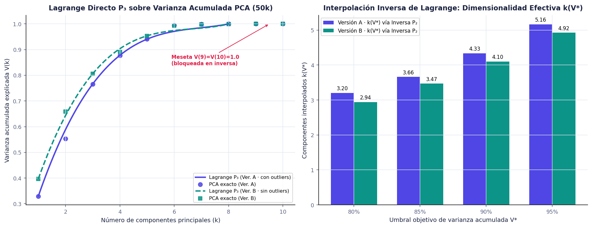

# Fuente Unificada para Estudio y NotebookLM — Caso 06 (IDEA-LG-02)

> **Carpeta origen:** [`../06_IDEA_LG_02_PCA_Lagrange_Inversa/`](../06_IDEA_LG_02_PCA_Lagrange_Inversa/) · **Presentación HTML:** [`presentacion_IDEA_LG_02.html`](../06_IDEA_LG_02_PCA_Lagrange_Inversa/presentacion_IDEA_LG_02.html)

---

# Guía Fácil para Todos — Caso 06 (`IDEA-LG-02`): ¿Cuántas variables resumidas (PCA) necesitas para conservar el 90 % de la información? (Lagrange Directa e Inversa)

> **Método utilizado:** Interpolación de Lagrange Directa `V(k)` e Interpolación Inversa `k(V*)`  
> **Nivel de lectura:** Para todo público  
> **Presentación visual interactiva:** Abre [`presentacion_IDEA_LG_02.html`](../06_IDEA_LG_02_PCA_Lagrange_Inversa/presentacion_IDEA_LG_02.html) en cualquier navegador.

---

## 1. Resumen en 30 segundos

En minería de datos se usa una técnica llamada **PCA** para resumir muchas columnas numéricas en unas pocas "super-columnas" (componentes `k = 1, 2, ..., 10`). Normalmente uno sabe cuánta información guarda cada componente, pero la pregunta real del equipo suele ser al revés: *"Si quiero conservar exactamente el **80 %, 85 %, 90 % o 95 %** de la información, ¿cuántos componentes debo elegir?"*  
Usando **Interpolación de Lagrange Directa e Inversa**, respondimos ambos sentidos con errores mínimos (`0.0002` en `k = 4`) y demostramos en vivo por qué el algoritmo bloquea automáticamente una trampa matemática oculta: cuando dos componentes tienen exactamente el mismo `100 %` acumulado (`V(9) = V(10) = 1.0`), invertir la tabla causaría una **división por cero**.

---

## 2. ¿Cuál era el problema? (Explicado fácil)

Imagina que estás empacando una maleta con 10 compartimentos ordenados por importancia (eso es la varianza acumulada de PCA):
- Con 1 componente guardas el **32.9 %** de la información (Versión A) o **39.7 %** (Versión B).
- Con 3 componentes guardas el **76.6 %** (Versión A) o **80.6 %** (Versión B).
- Con 5 componentes guardas el **94.1 %** (Versión A) o **95.4 %** (Versión B).
- Con 9 y 10 componentes en la Versión A ya tienes el **100.0 %** exacto en ambos (porque una columna era suma exacta de otras, así que el 10.º componente no aporta nada nuevo).

Teníamos tres retos concretos:
1. **Sentido directo:** Si solo conociéramos 4 filas de la tabla (`k = 1, 3, 5, 8`), ¿qué tan bien reconstruye Lagrange las filas faltantes (`k = 2, 4, 6, 7`)?
2. **Sentido inverso:** Dar la vuelta a los ejes para preguntar: *"Quiero **90 %** de varianza → ¿cuál es el número exacto `k`?"*
3. **Protección contra división por cero (`MR-04`):** Comprobar qué sucede si intentamos invertir toda la tabla incluyendo `k = 9` y `k = 10` cuando ambos valen `1.0`.

---

## 3. Analogía de la vida real: el medidor de batería al revés

Piensa en cargar la batería de tu celular:
- **Pregunta directa:** *"Llevo **40 minutos** cargando, ¿en qué porcentaje de batería voy?"* → Conoces el tiempo (`k`) y buscas el porcentaje (`V`).
- **Pregunta inversa (Lagrange inversa):** *"Necesito salir con exactamente **90 % de batería**, ¿cuántos minutos debo cargarlo?"* → Ahora el porcentaje (`V*`) entra como dato y el tiempo (`k`) es la respuesta.

¿Y cuál es la trampa del `100 %`? Una vez la batería llega al **100 %** a los 90 minutos, a los 100 minutos sigue en **100 %**. Si le preguntas al teléfono *"¿en qué minuto exacto llegué al 100 %?"*, hay dos respuestas distintas para el mismo `100 %` (90 y 100 min). En la fórmula de Lagrange eso produce un denominador `100 % - 100 % = 0`, y dividir por cero rompe cualquier cálculo. Por eso solo se invierte en el tramo donde la carga **siempre está subiendo** (`k = 1..6`).

---

## 4. La solución explicada paso a paso

### Paso 1: Interpolación directa (`P₃`) desde solo 4 nodos (sobre PCA 50k recomputado en vivo)
Recomputamos el PCA 50k directamente desde `data/03_processed` en precisión completa `float64` (sin constantes fijas copiadas a mano). Usando solo `k = {1, 3, 5, 8}` construimos el polinomio cúbico de Lagrange —cuya **forma monomial expandida** en Versión A es `P₃(k) = 0.002746·k³ - 0.057466·k² + 0.412549·k - 0.028723`— y lo probamos en los componentes ocultos `k = 2, 4, 6, 7`:
- En `k = 4` (Versión A), el valor real era **`0.8776`** y Lagrange predijo **`0.8778`** — ¡un error de apenas **0.00017 (menos de dos diezmilésimas)**!
- En todos los puntos evaluados, el error fue menor a `0.035` y los pesos base sumaron exactamente `1.0000`.

### Paso 2: Interpolación inversa `k(V*)` en el tramo estrictamente creciente (`k = 1..6`)
Intercambiamos los ejes `(x = Varianza acumulada V, y = Componentes k)` y calculamos cuántos componentes continuos se requieren para llegar a cada meta, redondeando hacia arriba (`ceil`) para elegir un número entero real de componentes:

| Meta de información (`V*`) | Versión A (Con outliers): `k` estimado → Recomendado | Varianza real lograda (A) | Versión B (Sin outliers IQR): `k` estimado → Recomendado | Varianza real lograda (B) |
| :---: | :---: | :---: | :---: | :---: |
| **80 %** (`0.80`) | `3.20` → **4 comp.** | `87.76 %` ✅ | `2.94` → **3 comp.** | `80.58 %` ✅ |
| **85 %** (`0.85`) | `3.66` → **4 comp.** | `87.76 %` ✅ | `3.47` → **4 comp.** | `89.09 %` ✅ |
| **90 %** (`0.90`) | `4.33` → **5 comp.** | `94.07 %` ✅ | `4.10` → **5 comp.** | `95.36 %` ✅ |
| **95 %** (`0.95`) | `5.16` → **6 comp.** | `99.43 %` ✅ | `4.92` → **5 comp.** | `95.36 %` ✅ |

**Hallazgo práctico:** Al limpiar outliers con IQR (Versión B), la información se compacta más rápido: necesitas **1 componente menos** para alcanzar tanto el **80 %** (3 en lugar de 4) como el **95 %** (5 en lugar de 6).

### Paso 3: Prueba de la barrera de seguridad (`MR-04`)
Probamos a propósito meter los 10 puntos de la Versión A en `inverse_lagrange_eval`. Como `V(9) = 1.0` y `V(10) = 1.0`, la función `validate_distinct_nodes()` detectó el empate inmediatamente y detuvo el cálculo con un error controlado en lugar de devolver números falsos (`NaN` o infinito).

---

## 5. ¿Por qué se eligió esta solución y no otra?

Porque la tabla de varianza acumulada de PCA es **exacta, libre de ruido aleatorio y suavemente cóncava**. Ese es precisamente el escenario soñado para la **Interpolación de Lagrange**: no queremos suavizar ruido (como en MCO), sino respetar exactamente los valores de la tabla de PCA y poder consultarla al derecho y al revés.

---

## 6. Cuidados importantes a tener en cuenta

- **Condición obligatoria para invertir:** Una tabla solo se puede interpolar al revés en una zona **estrictamente creciente (o estrictamente decreciente)** sin mesetas planas ni valores repetidos.

---

## 7. Glosario fácil

- **PCA (Análisis de Componentes Principales):** Técnica que comprime muchas variables originales en unos pocos "componentes" que conservan la mayor parte de la información.
- **Varianza explicada acumulada `V(k)`:** Porcentaje total de información original que logras conservar al quedarte con los primeros `k` componentes.
- **Interpolación inversa:** Darle la vuelta a la tabla (usar `y` como entrada y `x` como salida) para averiguar qué valor de entrada te da una meta deseada.
- **Colinealidad exacta / Meseta de rango 9:** Cuando una de tus 10 columnas se puede calcular exactamente sumando otras; entonces el 10.º componente no aporta nada (`0 %`) y la curva llega al `100 %` en el componente 9.
- **Guarda de nodos distintos (`MR-04`):** Verificación obligatoria antes de aplicar Lagrange que asegura que ningún par de puntos tenga la misma coordenada `x`, evitando divisiones por cero.

---

## Anexo Técnico Completo (Fórmulas, Tablas Verificadas y GeoGebra)

# IDEA-LG-02 — Varianza Acumulada de PCA: Interpolación Directa e Inversa

> **Temática:** Interpolación de Lagrange · **Prioridad:** P0 · **Presentación base:** `interpolacion_lagrange.html` (Diapositivas 2–10 (Interpolación Tabular Exacta, Forma Expandida, Unicidad y Nodos Distintos x_i ≠ x_j))

---

## 1. Propósito y Finalidad Analítica

Recomputar en vivo la curva de varianza explicada acumulada de PCA (muestra reproducible 50k desde `data/03_processed` en precisión completa `float64`), interpolarla en sentido directo con `P₃(k)` y en sentido inverso `k(V*)` para metas de 80 %–95 %, verificando en vivo la guarda de nodos distintos (MR-04) ante la meseta de rango 9 de la Versión A.

## 2. Archivos de `data/` Utilizados (Solo Lectura)

- `data/03_processed/empleos_unificado_limpio.csv` y `empleos_limpio_con_competencias_sin_outliers.csv` (PCA 50k recomputado en vivo en `float64` replicando `4.1_PCA_completo.ipynb`, sin constantes hardcodeadas)
- `data/04_transformed/con_outliers/train/X_train.csv` y `sin_outliers/train/X_train.csv` (auditados vía SHA-256 completo de 64 caracteres)

## 3. Formulación Matemática Aplicada

$$\text{Directa: } \hat{V}(k) = \sum_{i} V(k_i) L_i(k) \qquad\text{Inversa (estrictamente monótona): } \hat{k}(V^*) = \sum_{i} k_i L_i^{(V)}(V^*)$$

$$P_{3,\text{Ver.A}}(k) = 0.002746\,k^3 - 0.057466\,k^2 + 0.412549\,k - 0.028723$$

## 4. Cómo se Hizo (Metodología Paso a Paso)

1. Se recomputaron en vivo (`float64`, `seed = 42`, `n = 50,000`) las curvas PCA de 10 componentes directamente desde `03_processed` para Versión A (`con_outliers`, donde `PC10 = 6.74e-18` por colinealidad exacta `E = C + K + U`, produciendo `V(9) = V(10) = 1.0` en IEEE 754) y Versión B (`sin_outliers`, donde la winsorización IQR rompe la colinealidad dejando `PC10 = 5.53e-5`).
2. Se construyó el interpolante directo cúbico `P₃(k)` con nodos dispersos `k = {1, 3, 5, 8}`, exportando su forma monomial expandida (`lg_monomial_expansions.csv`) y evaluando su precisión en `k = {2, 4, 6, 7}` (error `0.00017` en `k = 4` Versión A).
3. Se restringió el dominio al tramo estrictamente creciente `k = 1..6` y se invirtieron los ejes `(V(k), k)` con Lagrange local `P₂` y global `P₅` para hallar `k(0.80), k(0.85), k(0.90), k(0.95)`, comprobando `V(ceil(k)) >= V*` en los 8 casos.
4. Se invocó deliberadamente `inverse_lagrange_eval` sobre los 10 puntos completos de Versión A demostrando que la regla `MR-04` bloquea el empate `V(9) = V(10) = 1.0` en lugar de dividir por cero.

**Módulos de Python que lo implementan:**

- `scripts/ScriptsCsv/MetodosNumericos/lagrange.py` (`lagrange_eval`, `expand_monomial_coefficients`, `inverse_lagrange_eval`, `validate_distinct_nodes`)
- `scripts/ScriptsCsv/MetodosNumericos/experiments_lagrange.py` (`_compute_live_pca_50k_curve`, `run_lg02_pca_curves`)

## 5. Resultados Empíricos Verificados

### Tabla: `lg02_pca_50k_reference.csv`

| k_components | cum_var_version_a | cum_var_version_b | marginal_var_version_a | marginal_var_version_b |
| --- | --- | --- | --- | --- |
| 1 | 0.3291 | 0.3968 | 0.3291 | 0.3968 |
| 2 | 0.5536 | 0.6589 | 0.2245 | 0.2621 |
| 3 | 0.7659 | 0.8058 | 0.2123 | 0.1469 |
| 4 | 0.8776 | 0.8909 | 0.1117 | 0.0850 |
| 5 | 0.9407 | 0.9536 | 0.0631 | 0.0627 |
| 6 | 0.9943 | 0.9928 | 0.0537 | 0.0392 |
| 7 | 0.9989 | 0.9983 | 0.0046 | 0.0055 |
| 8 | 1.0000 | 0.9996 | 0.0011 | 0.0013 |
| 9 | 1 | 0.9999 | 4.571e-05 | 0.0004 |
| 10 | 1 | 1 | 6.741e-18 | 5.534e-05 |

### Tabla: `lg02_pca_forward_P3_eval.csv`

| version | k_eval | true_cum_var | P3_pred | abs_err | sum_Li |
| --- | --- | --- | --- | --- | --- |
| Versión A (con outliers) | 2 | 0.5536 | 0.5885 | 0.0349 | 1 |
| Versión A (con outliers) | 4 | 0.8776 | 0.8778 | 0.0002 | 1.0000 |
| Versión A (con outliers) | 6 | 0.9943 | 0.9710 | 0.0233 | 1 |
| Versión A (con outliers) | 7 | 0.9989 | 0.9853 | 0.0136 | 1.0000 |
| Versión B (sin outliers IQR) | 2 | 0.6589 | 0.6430 | 0.0160 | 1 |
| Versión B (sin outliers IQR) | 4 | 0.8909 | 0.9034 | 0.0125 | 1.0000 |
| Versión B (sin outliers IQR) | 6 | 0.9928 | 0.9744 | 0.0184 | 1 |
| Versión B (sin outliers IQR) | 7 | 0.9983 | 0.9837 | 0.0145 | 1.0000 |

### Tabla: `lg02_pca_inverse_effective_dim.csv`

| version | target_variance_V | k_est_local_P2 | k_est_global_P5 | k_ceil_recommended | actual_cum_var_at_ceil | meets_target | is_extrapolation |
| --- | --- | --- | --- | --- | --- | --- | --- |
| Versión A (con outliers) | 0.8000 | 3.2007 | 3.2079 | 4 | 0.8776 | Sí | No |
| Versión A (con outliers) | 0.8500 | 3.6611 | 3.6613 | 4 | 0.8776 | Sí | No |
| Versión A (con outliers) | 0.9000 | 4.3335 | 4.3217 | 5 | 0.9407 | Sí | No |
| Versión A (con outliers) | 0.9500 | 5.1643 | 5.1693 | 6 | 0.9943 | Sí | No |
| Versión B (sin outliers IQR) | 0.8000 | 2.9426 | 2.9368 | 3 | 0.8058 | Sí | No |
| Versión B (sin outliers IQR) | 0.8500 | 3.4680 | 3.4989 | 4 | 0.8909 | Sí | No |
| Versión B (sin outliers IQR) | 0.9000 | 4.0995 | 4.1212 | 5 | 0.9536 | Sí | No |
| Versión B (sin outliers IQR) | 0.9500 | 4.9227 | 4.9278 | 5 | 0.9536 | Sí | No |

### Tabla: `lg_monomial_expansions.csv`

| idea_id | polynomial | c3 | c2 | c1 | c0 | kronecker_max_err | unity_sum_max_err | scipy_max_abs_diff |
| --- | --- | --- | --- | --- | --- | --- | --- | --- |
| IDEA-LG-01 | Survival P3(q) at q={4,8,20,40} | -7.910e-05 | 0.0058 | -0.1339 | 1.1079 | 0 | 4.441e-16 | 5.052e-15 |
| IDEA-LG-02 | PCA Forward P3(k) Version A at k={1,3,5,8} | 0.0027 | -0.0575 | 0.4125 | -0.0287 | 0 | 2.220e-16 | 5.107e-15 |
| IDEA-LG-02 | PCA Forward P3(k) Version B at k={1,3,5,8} | 0.0030 | -0.0596 | 0.4040 | 0.0494 | 0 | 2.220e-16 | 1.554e-15 |

## 6. Gráficos Generados (150 DPI)

### `nm09_lg02_pca_forward_and_inverse_lagrange.png`



*Izquierda: Lagrange directo P₃(k) sobre PCA 50k recomputado en vivo (Versión A y B) señalando la meseta de rango 9. Derecha: dimensionalidad efectiva k(V*) por interpolación inversa.*

## 7. Comandos de Verificación en GeoGebra

### `ggb_lg02_pca_forward_p3.txt`

```text
# JobPath GeoGebra Verification — IDEA-LG-02 (PCA Cumulative Variance Version A P3 at k=1,3,5,8; eval k=4)
# Paste each command sequentially into GeoGebra Classic Algebra Input (https://www.geogebra.org/classic)
# Spanish equivalent: q = Polinomio(P). Verify that p(x) and q(x) coincide identically.
# Expected Python Lagrange: P_3(4) = 0.877777
# Expanded monomial form: P_3(x) = 0.002746*x^3 - 0.057466*x^2 + 0.412549*x - 0.028723
P = {(1, 0.329105), (3, 0.765877), (5, 0.940656), (8, 0.999954)}
L0(x) = ((x - 3)*(x - 5)*(x - 8)) / ((1 - 3)*(1 - 5)*(1 - 8))
L1(x) = ((x - 1)*(x - 5)*(x - 8)) / ((3 - 1)*(3 - 5)*(3 - 8))
L2(x) = ((x - 1)*(x - 3)*(x - 8)) / ((5 - 1)*(5 - 3)*(5 - 8))
L3(x) = ((x - 1)*(x - 3)*(x - 5)) / ((8 - 1)*(8 - 3)*(8 - 5))
p(x) = 0.329105*L0(x) + 0.765877*L1(x) + 0.940656*L2(x) + 0.999954*L3(x)
q = Polynomial(P)
A_eval = (4, p(4))
```

## 8. Limitaciones, Advertencias y Salvaguardas de Dominio

- La interpolación inversa exige ordenadas estrictamente distintas y monótonas: pasar `k = 9, 10` simultáneamente en Versión A produce una singularidad `V(9) - V(10) = 0`, interceptada automáticamente por `validate_distinct_nodes()` (`MR-04`).
- Reproducibilidad completa desde disco: las curvas PCA ya no dependen de tuplas hardcodeadas; se recomputan en precisión `float64` idéntica a `4.1_PCA_completo.ipynb` directamente sobre `data/03_processed`.

---

**Reproducibilidad:** Ejecuta `python -m scripts.ScriptsCsv.MetodosNumericos.pipeline` desde la raíz de `MineriaProtect` para recalcular todo desde `data/`, `python -m scripts.ScriptsCsv.MetodosNumericos.deliverable_packager` para actualizar esta carpeta, y `python -m unittest discover -s tests/metodos_numericos -v` para correr las 19 pruebas.
