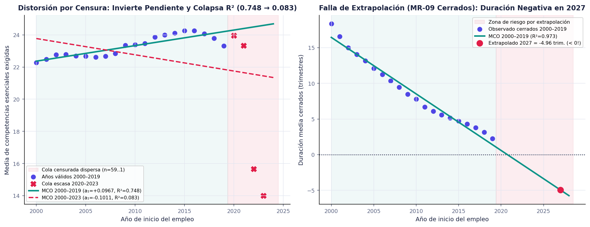

# IDEA-RL-04 — Deriva Anual de Cohortes y Falla por Extrapolación (2000–2023)

> **Temática:** Regresión Lineal (MCO) · **Prioridad:** P0 · **Presentación base:** `regresion_lineal_minimos_cuadrados.html` (Diapositiva 12 (Interpolar vs. Extrapolar fuera del rango de los datos))

---

## 1. Propósito y Finalidad Analítica

Medir dos décadas de evolución estructural del mercado laboral (2000–2019), auditar la paridad entre las particiones crudas `train/test/val` de `01_raw` y presentar una prueba empírica contundente de la Diapositiva 12: cómo la censura a la derecha tras 2019 invierte la tendencia y hace que la extrapolación de duración en empleos cerrados (~es_vigente, MR-09) prediga duraciones laborales negativas tras 2020 (-4.96 trimestres en 2027).

## 2. Archivos de `data/` Utilizados (Solo Lectura)

- `data/03_processed/empleos_unificado_limpio.csv` (experiencias clasificadas `2000–2023`; `mean_dur_q` calculado estrictamente sobre empleos cerrados `~es_vigente` según MR-09, conservando `mean_dur_q_incl_active` en el CSV como referencia auditable)
- `data/02_interim/ESCO/greenShareOcc_en_limpio.csv`
- `data/01_raw/JobHop_v2_train.csv`, `JobHop_v2_test.csv`, `JobHop_v2_val.csv` (1,993,291 filas crudas para auditoría de paridad temporal)

## 3. Formulación Matemática Aplicada

$$\hat{y}(t) = a_0 + a_1 (t - 2000), \qquad t \in [2000, 2019] \text{ (soporte válido)} \quad\text{vs.}\quad t > 2019 \text{ (extrapolación)}$$

## 4. Cómo se Hizo (Metodología Paso a Paso)

1. Se agruparon las experiencias clasificadas por año de inicio (`2000–2023`) calculando volumen (`n_starts`), volumen cerrado (`n_closed_starts`), complejidad media (`mean_skills`), duración media en empleos cerrados (`mean_dur_q`, excluyendo `es_vigente == True` para eliminar el rebote artificial de 2019), intensidad verde (`mean_green`) y tasa de reincidencia.
2. Se compararon tres regímenes (los 15 modelos completos en `rl04_ols_regime_comparison.csv`): soporte válido (`2000–2019`, `n = 20`), serie contaminada con la cola censurada (`2000–2023`, `n = 24`, donde `n_starts` colapsa a `59, 3, 3, 1`) y soporte válido centrado (`t = año - 2000`, `n = 20`).
3. Se verificó que centrar `t = año - 2000` conserva exactamente pendiente, `R²` y `Sy/x`, hace interpretable el intercepto (`16.44` trimestres en el año 2000) y reduce el error numérico frente a `numpy.polyfit` en más de 2,000×–7,000×.
4. Se extrapoló el modelo `2000–2019` hacia `2020–2027`, marcando automáticamente las predicciones físicamente imposibles (`y_hat < 0`, desde 2021 hasta `-4.96` trimestres en 2027).
5. Se auditó la tendencia anual de participación porcentual en las 3 particiones crudas de `01_raw` confirmando estabilidad sin sesgo de partición.

**Módulos de Python que lo implementan:**

- `scripts/ScriptsCsv/MetodosNumericos/loaders.py` (`load_raw_jobhop_years`, `parse_quarter_series`)
- `scripts/ScriptsCsv/MetodosNumericos/experiments_ols.py` (`run_rl04_annual_drift`)

## 5. Resultados Empíricos Verificados

### Tabla: `rl04_ols_regime_comparison.csv`

| y_var | regime | n | a0 | a1 | r | r2 | s_yx | quality_verdict | polyfit_max_abs_diff |
| --- | --- | --- | --- | --- | --- | --- | --- | --- | --- |
| mean_skills | Soporte válido (2000–2019, n=20) | 20 | -171.0956 | 0.0967 | 0.8646 | 0.7475 | 0.3417 | Ajuste Lineal Fuerte (R² ≥ 0.70) | 2.672e-12 |
| mean_skills | Con cola censurada (2000–2023, n=24) | 24 | 225.9336 | -0.1011 | -0.2875 | 0.0826 | 2.4348 | Modelo Lineal Débil / Rechazado (R² < 0.30) | 7.532e-12 |
| mean_skills | Soporte válido centrado (t−2000, n=20) | 20 | 22.3672 | 0.0967 | 0.8646 | 0.7475 | 0.3417 | Ajuste Lineal Fuerte (R² ≥ 0.70) | 7.105e-15 |
| mean_dur_q | Soporte válido (2000–2019, n=20) | 20 | 1,601.64 | -0.7926 | -0.9863 | 0.9729 | 0.8044 | Ajuste Lineal Fuerte (R² ≥ 0.70) | 1.660e-11 |
| mean_dur_q | Con cola censurada (2000–2023, n=24) | 24 | 1,390.02 | -0.6872 | -0.9723 | 0.9454 | 1.1934 | Ajuste Lineal Fuerte (R² ≥ 0.70) | 1.637e-11 |
| mean_dur_q | Soporte válido centrado (t−2000, n=20) | 20 | 16.4417 | -0.7926 | -0.9863 | 0.9729 | 0.8044 | Ajuste Lineal Fuerte (R² ≥ 0.70) | 3.553e-15 |
| mean_green | Soporte válido (2000–2019, n=20) | 20 | 0.2716 | -0.0001 | -0.8119 | 0.6592 | 0.0005 | Ajuste Lineal Moderado (0.30 ≤ R² < 0.70) | 6.273e-15 |
| mean_green | Con cola censurada (2000–2023, n=24) | 24 | 0.8593 | -0.0004 | -0.4140 | 0.1714 | 0.0066 | Modelo Lineal Débil / Rechazado (R² < 0.30) | 2.187e-14 |
| mean_green | Soporte válido centrado (t−2000, n=20) | 20 | 0.0240 | -0.0001 | -0.8119 | 0.6592 | 0.0005 | Ajuste Lineal Moderado (0.30 ≤ R² < 0.70) | 2.439e-19 |
| reincide_rate | Soporte válido (2000–2019, n=20) | 20 | -2.0642 | 0.0012 | 0.6567 | 0.4313 | 0.0082 | Ajuste Lineal Moderado (0.30 ≤ R² < 0.70) | 9.770e-15 |
| reincide_rate | Con cola censurada (2000–2023, n=24) | 24 | 11.1230 | -0.0054 | -0.4325 | 0.1870 | 0.0813 | Modelo Lineal Débil / Rechazado (R² < 0.30) | 2.913e-13 |
| reincide_rate | Soporte válido centrado (t−2000, n=20) | 20 | 0.2906 | 0.0012 | 0.6567 | 0.4313 | 0.0082 | Ajuste Lineal Moderado (0.30 ≤ R² < 0.70) | 5.551e-17 |
| n_starts | Soporte válido (2000–2019, n=20) | 20 | -5,386,114.16 | 2,717.90 | 0.4113 | 0.1692 | 36,611.86 | Modelo Lineal Débil / Rechazado (R² < 0.30) | 4.470e-08 |
| n_starts | Con cola censurada (2000–2023, n=24) | 24 | 2,182,899.49 | -1,053.93 | -0.1631 | 0.0266 | 46,100.24 | Modelo Lineal Débil / Rechazado (R² < 0.30) | 1.523e-07 |
| n_starts | Soporte válido centrado (t−2000, n=20) | 20 | 49,679.83 | 2,717.90 | 0.4113 | 0.1692 | 36,611.86 | Modelo Lineal Débil / Rechazado (R² < 0.30) | 2.183e-11 |

### Tabla: `rl04_extrapolation_failure_audit.csv`

| y_var | year | is_extrapolation | y_pred_from_2000_2019 | y_observed | observed_n_starts | physically_invalid |
| --- | --- | --- | --- | --- | --- | --- |
| mean_skills | 2020 | Sí | 24.3018 | 23.9661 | 59 | No |
| mean_skills | 2021 | Sí | 24.3986 | 23.3333 | 3 | No |
| mean_skills | 2022 | Sí | 24.4953 | 15.6667 | 3 | No |
| mean_skills | 2023 | Sí | 24.5920 | 14 | 1 | No |
| mean_skills | 2026 | Sí | 24.8822 | — | 0 | No |
| mean_skills | 2027 | Sí | 24.9790 | — | 0 | No |
| mean_dur_q | 2020 | Sí | 0.5897 | 2.3333 | 59 | No |
| mean_dur_q | 2021 | Sí | -0.2029 | 2 | 3 | Sí |
| mean_dur_q | 2022 | Sí | -0.9955 | 3 | 3 | Sí |
| mean_dur_q | 2023 | Sí | -1.7881 | 2 | 1 | Sí |
| mean_dur_q | 2026 | Sí | -4.1659 | — | 0 | Sí |
| mean_dur_q | 2027 | Sí | -4.9585 | — | 0 | Sí |
| mean_green | 2020 | Sí | 0.0215 | 0.0211 | 59 | No |
| mean_green | 2021 | Sí | 0.0214 | 0.0353 | 3 | No |
| mean_green | 2022 | Sí | 0.0212 | 0 | 3 | No |
| mean_green | 2023 | Sí | 0.0211 | 0 | 1 | No |
| mean_green | 2026 | Sí | 0.0208 | — | 0 | No |
| mean_green | 2027 | Sí | 0.0206 | — | 0 | No |

### Tabla: `rl04_annual_macro_series.csv`

| start_year | n_starts | n_closed_starts | mean_skills | mean_knowledge | mean_dur_q | mean_dur_q_incl_active | mean_green | reincide_rate | year_centered |
| --- | --- | --- | --- | --- | --- | --- | --- | --- | --- |
| 2000 | 31,880 | 30,936 | 22.2744 | 4.0467 | 18.3450 | 20.9028 | 0.0231 | 0.2822 | 0 |
| 2001 | 30,386 | 29,443 | 22.4937 | 4.0442 | 16.5669 | 19.1781 | 0.0229 | 0.2879 | 1 |
| 2002 | 31,374 | 30,332 | 22.7668 | 3.9883 | 15.0082 | 17.7211 | 0.0231 | 0.2919 | 2 |
| 2003 | 35,136 | 34,024 | 22.7834 | 3.8696 | 14.0478 | 16.5357 | 0.0238 | 0.2911 | 3 |
| 2004 | 41,799 | 40,404 | 22.6873 | 3.8498 | 13.1648 | 15.6861 | 0.0236 | 0.2916 | 4 |
| 2005 | 50,988 | 49,270 | 22.6747 | 3.8279 | 12.0892 | 14.5349 | 0.0238 | 0.2929 | 5 |
| 2006 | 63,814 | 61,550 | 22.6089 | 3.7842 | 11.2605 | 13.7216 | 0.0243 | 0.2962 | 6 |
| 2007 | 77,251 | 74,301 | 22.6807 | 3.7747 | 10.3430 | 12.8739 | 0.0237 | 0.3023 | 7 |
| 2008 | 88,927 | 85,223 | 22.8363 | 3.7901 | 9.4568 | 12.0875 | 0.0236 | 0.3016 | 8 |
| 2009 | 91,758 | 87,710 | 23.3596 | 3.8440 | 8.4646 | 11.1177 | 0.0232 | 0.3079 | 9 |
| 2010 | 112,621 | 107,365 | 23.3851 | 3.9012 | 7.7814 | 10.4316 | 0.0229 | 0.3119 | 10 |
| 2011 | 131,312 | 124,638 | 23.4728 | 3.9655 | 6.6656 | 9.4046 | 0.0229 | 0.3101 | 11 |
| 2012 | 133,578 | 125,180 | 23.8721 | 4.0597 | 6.0901 | 9.2618 | 0.0227 | 0.3095 | 12 |
| 2013 | 125,822 | 117,654 | 24.0054 | 4.0627 | 5.5907 | 8.6361 | 0.0226 | 0.3174 | 13 |
| 2014 | 121,633 | 112,744 | 24.1066 | 4.0795 | 5.1637 | 8.3316 | 0.0220 | 0.3133 | 14 |
| 2015 | 112,332 | 103,675 | 24.2701 | 4.0870 | 4.7216 | 7.7860 | 0.0219 | 0.3156 | 15 |
| 2016 | 96,083 | 88,236 | 24.2702 | 4.1369 | 4.2902 | 7.2477 | 0.0219 | 0.3160 | 16 |
| 2017 | 74,454 | 67,737 | 24.0725 | 4.0988 | 3.7769 | 6.7247 | 0.0216 | 0.3055 | 17 |
| 2018 | 47,467 | 41,845 | 23.7861 | 4.0630 | 3.1420 | 6.6052 | 0.0216 | 0.2962 | 18 |
| 2019 | 11,382 | 8,758 | 23.3166 | 4.0419 | 2.2712 | 8.3124 | 0.0209 | 0.2946 | 19 |

*Se muestran las primeras 20 de 24 filas; consulta el archivo CSV completo en `tables/`.*

### Tabla: `rl04_raw_partition_parity.csv`

| raw_file | total_rows_raw | null_start_date_rows | rows_2000_2019 | share_slope_pct_per_yr | share_r2 | polyfit_max_abs_diff |
| --- | --- | --- | --- | --- | --- | --- |
| raw_train | 1,594,827 | 58,312 | 1,337,511 | 0.1855 | 0.1750 | 3.354e-12 |
| raw_test | 198,877 | 7,085 | 166,437 | 0.1808 | 0.1678 | 2.899e-12 |
| raw_val | 199,587 | 7,329 | 167,401 | 0.1848 | 0.1747 | 3.240e-12 |

## 6. Gráficos Generados (150 DPI)

### `nm05_rl04_annual_drift_and_censoring_extrapolation.png`



*Izquierda: la cola censurada invierte la pendiente de mean_skills y colapsa R² (0.748 → 0.083). Derecha: sobre empleos cerrados (~es_vigente, R² = 0.9729), extrapolar duración predice -4.96 trimestres en 2027.*

## 7. Comandos de Verificación en GeoGebra

### `ggb_rl04_annual_duration_extrapolation.txt`

```text
# JobPath GeoGebra Verification — IDEA-RL-04 (Annual closed-job mean_dur_q ~ year-2000, 2000..2019; extrap t=27 -> year 2027)
# Paste each command sequentially into GeoGebra Classic Algebra Input (https://www.geogebra.org/classic)
# Spanish equivalents: AjusteLineal(P), CoeficienteCorrelación(P), RCuadrado(P, f)
# Expected Python OLS: a0 = 16.441713, a1 = -0.792601, r = -0.986344, R2 = 0.972874
# Strict MR-09 censoring consistency: mean_dur_q computed ONLY on closed jobs (~es_vigente); Q_pred(27) < 0 proves extrapolation failure.
P = {(0, 18.344970), (1, 16.566926), (2, 15.008176), (3, 14.047819), (4, 13.164835), (5, 12.089182), (6, 11.260520), (7, 10.342956), (8, 9.456837), (9, 8.464565), (10, 7.781372), (11, 6.665584), (12, 6.090126), (13, 5.590715), (14, 5.163663), (15, 4.721620), (16, 4.290154), (17, 3.776902), (18, 3.142024), (19, 2.271181)}
f = FitLine(P)
r = CorrelationCoefficient(P)
R2 = RSquare(P, f)
Centroid = (9.500000, 8.912006)
Q_pred = (27, f(27))
# Expected Q_pred y-coordinate: -4.958505
```

## 8. Limitaciones, Advertencias y Salvaguardas de Dominio

- Consistencia estricta de censura (MR-09): excluir `es_vigente == True` en `mean_dur_q` elimina el rebote artificial en 2019 (`8.31` con vigentes imputados a `2026-Q1` frente a `2.27` real en cerrados) y mejora `R²` de `0.9288` a `0.9729`, pero la caída lineal (`-0.7926` trimestres/año) sigue siendo un artefacto mecánico del horizonte calendario disponible.
- Sin centrar el año (`x ~ 2010`), el intercepto crece a órdenes de `10^6`, degradando el número de condición; centrar en `t - 2000` reduce el error absoluto frente a `numpy.polyfit` en más de `4,600×` en `mean_dur_q` (`1.66e-11 → 3.55e-15`) y `2,000×` en `n_starts`.

---

**Reproducibilidad:** Ejecuta `python -m scripts.ScriptsCsv.MetodosNumericos.pipeline` desde la raíz de `MineriaProtect` para recalcular todo desde `data/`, `python -m scripts.ScriptsCsv.MetodosNumericos.deliverable_packager` para actualizar esta carpeta, y `python -m unittest discover -s tests/metodos_numericos -v` para correr las 19 pruebas.
