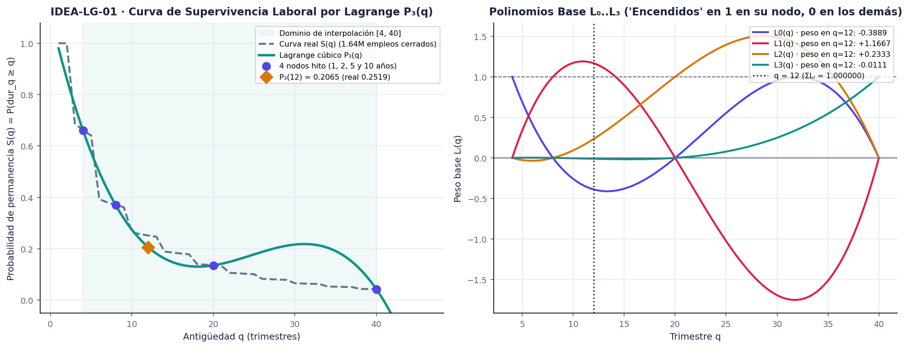

# IDEA-LG-01 — Curva de Supervivencia Laboral S(q) y Fenómeno de Runge Empírico

> **Temática:** Interpolación de Lagrange · **Prioridad:** P0 · **Presentación base:** `interpolacion_lagrange.html` (Diapositivas 2–12 (Bases L_i, Forma Expandida, Partición de la Unidad, Fenómeno de Runge, Chebyshev y Tramos))

---

## 1. Propósito y Finalidad Analítica

Reconstruir la función continua de permanencia laboral S(q) = P(dur_q >= q) a partir de una tabla compacta de 4 hitos ejecutivos (1, 2, 5 y 10 años) sin consultar 1.64M filas, obtener su forma monomial expandida exacta y demostrar con datos reales el Fenómeno de Runge junto a sus dos soluciones teóricas: nodos de Chebyshev-Lobatto (0 violaciones en todos los grados) e interpolación local cuadrática por tramos P₂.

## 2. Archivos de `data/` Utilizados (Solo Lectura)

- `data/03_processed/empleos_unificado_limpio.csv` filtrado estrictamente a experiencias cerradas clasificadas (`saber_skills == 'ok'` y `~es_vigente`, `n = 1,643,772` empleos según MR-09)

## 3. Formulación Matemática Aplicada

$$P_n(q) = \sum_{i=0}^{n} S(q_i)\,L_i(q), \qquad L_i(q) = \prod_{\substack{j=0\\ j\ne i}}^{n}\frac{q - q_j}{q_i - q_j}, \qquad \sum_{i=0}^{n} L_i(q) = 1$$

$$P_3(q) = -7.9099\times 10^{-5}\,q^3 + 0.005845\,q^2 - 0.133867\,q + 1.107889$$

$$q_k^{\text{Cheb-Lobatto}} = \operatorname{round}\!\left(\frac{a+b}{2} + \frac{b-a}{2}\cos\!\left(\frac{k\pi}{n}\right)\right), \quad k=0,1,\dots,n$$

## 4. Cómo se Hizo (Metodología Paso a Paso)

1. Se excluyeron los empleos vigentes censurados (`es_vigente == True`) y se calculó la curva exacta de permanencia `S(q) = P(dur_q >= q)` en cada trimestre `q = 1..40` (de 0.25 a 10 años).
2. Se construyó el polinomio cúbico de Lagrange `P₃(q)` pasando exactamente por los 4 hitos `q = {4, 8, 20, 40}`, exportando sus pesos base `L₀(q)..L₃(q)`, su forma monomial expandida (`lg_monomial_expansions.csv`) y verificando delta de Kronecker (`0.00e+00`), partición de la unidad (`4.44e-16`) y coincidencia con `scipy.interpolate.lagrange` (`5.05e-15`).
3. Se ejecutó el experimento del Fenómeno de Runge para grados `n en {3, 5, 8, 12, 16}` comparando: (a) Lagrange Global Equiespaciado, (b) Lagrange Global con Nodos Chebyshev-Lobatto (2.ª especie, anclados en los extremos `1` y `40`, eliminando toda extrapolación de borde en grados bajos) y (c) Lagrange Local Cuadrático por Tramos `P₂`.
4. Se midieron error máximo `E∞`, RMSE, MAE, extremos predichos y violaciones de probabilidad fuera de `[0, 1]` (confirmando `0` violaciones de Chebyshev-Lobatto en los 5 grados).

**Módulos de Python que lo implementan:**

- `scripts/ScriptsCsv/MetodosNumericos/lagrange.py` (`lagrange_basis`, `lagrange_eval`, `expand_monomial_coefficients`, `diagnose_lagrange`, `chebyshev_nodes(kind='lobatto')`, `piecewise_lagrange_eval`)
- `scripts/ScriptsCsv/MetodosNumericos/experiments_lagrange.py` (`run_lg01_survival_runge`)

## 5. Resultados Empíricos Verificados

### Tabla: `lg01_milestone_P3_weights_and_eval.csv`

| quarter_q | years | is_extrapolation | L0_q4 | L1_q8 | L2_q20 | L3_q40 | sum_Li | P3_pred | true_S_q | abs_err |
| --- | --- | --- | --- | --- | --- | --- | --- | --- | --- | --- |
| 2 | 0.5000 | Sí | 1.7812 | -0.8906 | 0.1187 | -0.0094 | 1 | 0.8629 | 1 | 0.1371 |
| 6 | 1.5000 | No | 0.4132 | 0.6198 | -0.0354 | 0.0024 | 1 | 0.4980 | 0.3929 | 0.1052 |
| 12 | 3 | No | -0.3889 | 1.1667 | 0.2333 | -0.0111 | 1 | 0.2065 | 0.2519 | 0.0455 |
| 16 | 4 | No | -0.3333 | 0.7500 | 0.6000 | -0.0167 | 1 | 0.1384 | 0.1819 | 0.0435 |
| 28 | 7 | No | 0.8333 | -1.5000 | 1.5000 | 0.1667 | 1 | 0.2058 | 0.0804 | 0.1253 |
| 36 | 9 | No | 0.7778 | -1.3333 | 0.9333 | 0.6222 | 1 | 0.1734 | 0.0520 | 0.1215 |
| 48 | 12 | Sí | -3.8889 | 6.4167 | -3.6667 | 2.1389 | 1.0000 | -0.5984 | 0.0292 | 0.6276 |

### Tabla: `lg01_runge_phenomenon_benchmark.csv`

| degree | n_nodes | node_strategy | max_abs_err | rmse | mae | min_pred | max_pred | n_prob_bound_violations |
| --- | --- | --- | --- | --- | --- | --- | --- | --- |
| 3 | 4 | Lagrange Global Equiespaciado | 0.1717 | 0.0513 | 0.0368 | 0.0430 | 1 | 0 |
| 3 | 4 | Lagrange Global (Chebyshev-Lobatto) | 0.1508 | 0.0569 | 0.0447 | 0.0429 | 1 | 0 |
| 3 | 4 | Lagrange Local Cuadrático (P₂) | 0.2121 | 0.0583 | 0.0303 | 0.0430 | 1 | 0 |
| 5 | 6 | Lagrange Global Equiespaciado | 0.1301 | 0.0373 | 0.0207 | 0.0430 | 1 | 0 |
| 5 | 6 | Lagrange Global (Chebyshev-Lobatto) | 0.1737 | 0.0484 | 0.0285 | 0.0426 | 1 | 0 |
| 5 | 6 | Lagrange Local Cuadrático (P₂) | 0.1553 | 0.0431 | 0.0235 | 0.0430 | 1 | 0 |
| 8 | 9 | Lagrange Global Equiespaciado | 0.2204 | 0.0548 | 0.0242 | 0.0430 | 1 | 0 |
| 8 | 9 | Lagrange Global (Chebyshev-Lobatto) | 0.2091 | 0.0473 | 0.0276 | 0.0327 | 1 | 0 |
| 8 | 9 | Lagrange Local Cuadrático (P₂) | 0.1641 | 0.0410 | 0.0186 | 0.0430 | 1 | 0 |
| 12 | 13 | Lagrange Global Equiespaciado | 0.2615 | 0.0650 | 0.0282 | 0.0347 | 1.2256 | 1 |
| 12 | 13 | Lagrange Global (Chebyshev-Lobatto) | 0.1476 | 0.0328 | 0.0147 | 0.0430 | 1 | 0 |
| 12 | 13 | Lagrange Local Cuadrático (P₂) | 0.1196 | 0.0317 | 0.0160 | 0.0430 | 1 | 0 |
| 16 | 17 | Lagrange Global Equiespaciado | 2.5262 | 0.5120 | 0.1511 | -2.4827 | 1 | 2 |
| 16 | 15 | Lagrange Global (Chebyshev-Lobatto) | 0.1301 | 0.0327 | 0.0153 | 0.0430 | 1 | 0 |
| 16 | 17 | Lagrange Local Cuadrático (P₂) | 0.1843 | 0.0441 | 0.0166 | 0.0430 | 1 | 0 |

### Tabla: `lg01_survival_curve_S_q.csv`

| quarter_q | years | survival_prob_S_q | n_closed_jobs |
| --- | --- | --- | --- |
| 1 | 0.2500 | 1 | 1,643,772 |
| 2 | 0.5000 | 1 | 1,643,772 |
| 3 | 0.7500 | 0.6880 | 1,643,772 |
| 4 | 1 | 0.6609 | 1,643,772 |
| 5 | 1.2500 | 0.6407 | 1,643,772 |
| 6 | 1.5000 | 0.3929 | 1,643,772 |
| 7 | 1.7500 | 0.3809 | 1,643,772 |
| 8 | 2 | 0.3705 | 1,643,772 |
| 9 | 2.2500 | 0.3623 | 1,643,772 |
| 10 | 2.5000 | 0.2636 | 1,643,772 |
| 11 | 2.7500 | 0.2577 | 1,643,772 |
| 12 | 3 | 0.2519 | 1,643,772 |
| 13 | 3.2500 | 0.2472 | 1,643,772 |
| 14 | 3.5000 | 0.1893 | 1,643,772 |
| 15 | 3.7500 | 0.1857 | 1,643,772 |
| 16 | 4 | 0.1819 | 1,643,772 |
| 17 | 4.2500 | 0.1789 | 1,643,772 |
| 18 | 4.5000 | 0.1409 | 1,643,772 |
| 19 | 4.7500 | 0.1384 | 1,643,772 |
| 20 | 5 | 0.1358 | 1,643,772 |

*Se muestran las primeras 20 de 40 filas; consulta el archivo CSV completo en `tables/`.*

### Tabla: `lg_monomial_expansions.csv`

| idea_id | polynomial | c3 | c2 | c1 | c0 | kronecker_max_err | unity_sum_max_err | scipy_max_abs_diff |
| --- | --- | --- | --- | --- | --- | --- | --- | --- |
| IDEA-LG-01 | Survival P3(q) at q={4,8,20,40} | -7.910e-05 | 0.0058 | -0.1339 | 1.1079 | 0 | 4.441e-16 | 5.052e-15 |
| IDEA-LG-02 | PCA Forward P3(k) Version A at k={1,3,5,8} | 0.0027 | -0.0575 | 0.4125 | -0.0287 | 0 | 2.220e-16 | 5.107e-15 |
| IDEA-LG-02 | PCA Forward P3(k) Version B at k={1,3,5,8} | 0.0030 | -0.0596 | 0.4040 | 0.0494 | 0 | 2.220e-16 | 1.554e-15 |

## 6. Gráficos Generados (150 DPI)

### `nm07_lg01_survival_milestones_and_weights.png`



*Izquierda: polinomio cúbico P₃(q) sobre 4 hitos frente a la curva real S(q). Derecha: polinomios base L₀..L₃ con pesos exactos en q=12.*

### `nm08_lg01_runge_phenomenon_vs_chebyshev.png`

![Prueba empírica del Fenómeno de Runge: grado 16 equiespaciado explota a E∞ = 2.5262, mientras Chebyshev-Lobatto lo acota en 0.1301 (19.4× menos error y 0 violaciones [0,1] en todos los grados) y P₂ por tramos se mantiene estable.](./figures/nm08_lg01_runge_phenomenon_vs_chebyshev.png)

*Prueba empírica del Fenómeno de Runge: grado 16 equiespaciado explota a E∞ = 2.5262, mientras Chebyshev-Lobatto lo acota en 0.1301 (19.4× menos error y 0 violaciones [0,1] en todos los grados) y P₂ por tramos se mantiene estable.*

## 7. Comandos de Verificación en GeoGebra

### `ggb_lg01_survival_p3_milestones.txt`

```text
# JobPath GeoGebra Verification — IDEA-LG-01 (Tenure Survival P3 at q=4,8,20,40; eval q=12 = 3 years)
# Paste each command sequentially into GeoGebra Classic Algebra Input (https://www.geogebra.org/classic)
# Spanish equivalent: q = Polinomio(P). Verify that p(x) and q(x) coincide identically.
# Expected Python Lagrange: P_3(12) = 0.206491
# Expanded monomial form: P_3(x) = -7.909888e-05*x^3 + 0.005845*x^2 - 0.133867*x + 1.107889
P = {(4, 0.660880), (8, 0.370539), (20, 0.135783), (40, 0.042983)}
L0(x) = ((x - 8)*(x - 20)*(x - 40)) / ((4 - 8)*(4 - 20)*(4 - 40))
L1(x) = ((x - 4)*(x - 20)*(x - 40)) / ((8 - 4)*(8 - 20)*(8 - 40))
L2(x) = ((x - 4)*(x - 8)*(x - 40)) / ((20 - 4)*(20 - 8)*(20 - 40))
L3(x) = ((x - 4)*(x - 8)*(x - 20)) / ((40 - 4)*(40 - 8)*(40 - 20))
p(x) = 0.660880*L0(x) + 0.370539*L1(x) + 0.135783*L2(x) + 0.042983*L3(x)
q = Polynomial(P)
A_eval = (12, p(12))
```

## 8. Limitaciones, Advertencias y Salvaguardas de Dominio

- No-monotonicidad del polinomio cúbico `P₃(q)`: un polinomio de Lagrange no impone restricciones de monotonía; tras caer a `0.1384` en `q = 16`, `P₃` rebota al alza hasta `0.2058` en `q = 28` (2.56× el valor real `0.0804`), demostrando por qué en tramos largos convienen interpoladores monótonos (PCHIP) o por tramos `P₂`.
- Escalones anuales (*annual heaping*) cada 4 trimestres: en `lg01_survival_curve_S_q.csv`, el redondeo anual de fechas en hojas de vida produce saltos abruptos en `q = 3, 6, 10, 14, 18...` (`S(1)=S(2)=1.0`), creando un piso irreductible de error polinomial `E∞ ≈ 0.12–0.18` incluso con Chebyshev-Lobatto y `P₂`.
- Ventaja de Chebyshev-Lobatto (2.ª especie) sobre 1.ª especie: incluir los extremos `q = 1` y `q = 40` como nodos elimina la extrapolación implícita de borde que causaba valores `> 1.0` en grados 3 y 5, logrando `0` violaciones `[0,1]` en todos los grados y reduciendo el error en grado 16 en `19.4×`.
- Deduplicación en malla entera (MR-04): al redondear nodos de Chebyshev-Lobatto en grado 16 sobre `[1, 40]`, los nodos muy agrupados en los extremos se deduplican a `15` nodos estrictamente distintos para evitar divisiones por cero.

---

**Reproducibilidad:** Ejecuta `python -m scripts.ScriptsCsv.MetodosNumericos.pipeline` desde la raíz de `MineriaProtect` para recalcular todo desde `data/`, `python -m scripts.ScriptsCsv.MetodosNumericos.deliverable_packager` para actualizar esta carpeta, y `python -m unittest discover -s tests/metodos_numericos -v` para correr las 19 pruebas.
